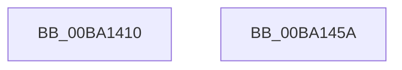

# VerifierExAllocatePoolEx

- RVA: `0x00BA1410`–`0x00BA145B` (길이 `75` bytes)
- VA: `0x0000000140BA1410`
- 실행 섹션: `PAGEVRFY`
- PDB 이름 있음: `예`; PDB Function 태그: `아니요`
- unwind 정보 RVA: `0x0006C2A4`
- 디코드: `17`개 명령, `75/75` bytes 표시
- 미해석 바이트: `0` (있으면 어셈블리에 `.byte`로 보존)

> 이 문서는 커널 이미지의 기계어와 PDB 기호를 분석해 생성했습니다. 4번과 5번은 함수 원형과 자료형을 바이너리 사용 방식에서 추정한 C 해석이며 원본 소스 복구 결과는 아닙니다.

## 1. Dependencies

- 직접 호출 지점: **1**; 고유 호출 대상: **1**
- 직접 호출자로 확인된 함수: **0**
- RIP 상대 이미지 참조: **2**

### Outgoing calls
- `0x00BA1450` → [guard_dispatch_icall](../../text/6B/guard_dispatch_icall_function_006BAAD0.md) (function, `0x006BAAD0`)

### Direct callers
- 이 함수 시작 RVA로 연결되는 직접 call은 확인되지 않았습니다. 간접 호출은 완전히 역산할 수 없습니다.

### Static image references
- `0x00BA1419` → RVA `0x00BB8A90` (`VfHandlePoolAlloc`; read)
- `0x00BA1420` → RVA `0x00FF4010` (`PAGEVRFD`; read)

## 2. Other-region calls and transfers

- 다른 실행 섹션으로 향하는 call: **1**
  - `0x00BA1450` → [guard_dispatch_icall](../../text/6B/guard_dispatch_icall_function_006BAAD0.md) (`PAGEVRFY` → `.text`)
- 별도 외부 분기/꼬리 이동을 확인하지 못했습니다.

## 3. Assembly (complete function range)

```asm
00BA1410  48 83 EC 58                     sub rsp, 0x58
00BA1414  4C 8B 4C 24 58                  mov r9, qword ptr [rsp + 0x58]
00BA1419  4C 8D 15 70 76 01 00            lea r10, [rip + 0x17670]
00BA1420  48 8B 05 E9 2B 45 00            mov rax, qword ptr [rip + 0x452be9]
00BA1427  0F BA E9 07                     bts ecx, 7
00BA142B  4C 89 54 24 40                  mov qword ptr [rsp + 0x40], r10
00BA1430  4C 89 4C 24 38                  mov qword ptr [rsp + 0x38], r9
00BA1435  45 8B C8                        mov r9d, r8d
00BA1438  83 64 24 30 00                  and dword ptr [rsp + 0x30], 0
00BA143D  4C 8B C2                        mov r8, rdx
00BA1440  48 83 64 24 28 00               and qword ptr [rsp + 0x28], 0
00BA1446  33 D2                           xor edx, edx
00BA1448  C7 44 24 20 20 00 00 00         mov dword ptr [rsp + 0x20], 0x20
00BA1450  E8 7B 96 B1 FF                  call 0x1406baad0
00BA1455  48 83 C4 58                     add rsp, 0x58
00BA1459  C3                              ret
00BA145A  CC                              int3
```

## 4. C-style interpretation (structured pseudocode)

```c
__int64 __fastcall VerifierExAllocatePoolEx(int a1, __int64 a2, int a3)
{
    __int64 result;
    __int64 v_rsp;
    unsigned __int64 v_stack_m18;
    unsigned __int64 v_stack_m20;
    unsigned int v_stack_m28;
    unsigned __int64 v_stack_m30;
    unsigned int v_stack_m38;
    unsigned __int64 v_stack_p0;

    v_rsp = (v_rsp) - (88);
    v_stack_m18 = v_rip + 95856;
    v_stack_m20 = v_stack_p0;
    a2 = 0;
    v_stack_m38 = 32;
    result = guard_dispatch_icall(a1, a2, a2, (unsigned int)(a3));
    v_rsp = (v_rsp) + (88);
    return result;
}
```

## 5. (Beta) C Style

```c
int64_t VerifierExAllocatePoolEx(int32_t Arg1, int64_t Arg2, int32_t Arg3)
{
    int64_t result;
    int64_t local_rsp;
    uint64_t v_stack_m18;
    uint64_t v_stack_m20;
    uint32_t v_stack_m28;
    uint64_t v_stack_m30;
    uint32_t v_stack_m38;
    uint64_t v_stack_p0;

    local_rsp = (local_rsp) - (88);
    v_stack_m18 = v_rip + 95856;
    v_stack_m20 = v_stack_p0;
    Arg2 = 0;
    v_stack_m38 = 32;
    result = guard_dispatch_icall(Arg1, Arg2, Arg2, (uint32_t)(Arg3));
    local_rsp = (local_rsp) + (88);
    return result;
}
```

## 6. Execution-region graph

[열기: 2D/3D 그래프와 함수 탐색 컨트롤 패널](../../../control-panel.html?section=pagevrfy&rva=0x00BA1410&view=graph)

- 2D 그래프는 위에서 아래로 흐르고, 3D 그래프는 빈 공간을 드래그해 회전합니다. Shift+드래그는 이동, 휠은 확대·축소, 함수 노드 선택은 대상 보고서 이동입니다.

### Static fallback


