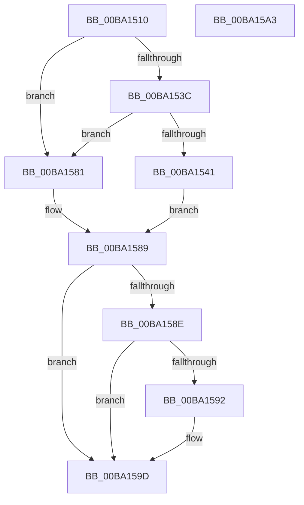

# VerifierExAllocatePoolWithQuotaTag

- RVA: `0x00BA1510`–`0x00BA15A4` (길이 `148` bytes)
- VA: `0x0000000140BA1510`
- 실행 섹션: `PAGEVRFY`
- PDB 이름 있음: `예`; PDB Function 태그: `아니요`
- unwind 정보 RVA: `0x00071A74`
- 디코드: `41`개 명령, `148/148` bytes 표시
- 미해석 바이트: `0` (있으면 어셈블리에 `.byte`로 보존)

> 이 문서는 커널 이미지의 기계어와 PDB 기호를 분석해 생성했습니다. 4번과 5번은 함수 원형과 자료형을 바이너리 사용 방식에서 추정한 C 해석이며 원본 소스 복구 결과는 아닙니다.

## 1. Dependencies

- 직접 호출 지점: **3**; 고유 호출 대상: **3**
- 직접 호출자로 확인된 함수: **0**
- RIP 상대 이미지 참조: **3**

### Outgoing calls
- `0x00BA157A` → [guard_dispatch_icall](../../text/6B/guard_dispatch_icall_function_006BAAD0.md) (function, `0x006BAAD0`)
- `0x00BA1584` → [ExAllocatePoolWithQuotaTag](../../text/49/ExAllocatePoolWithQuotaTag_function_004987E0.md) (function, `0x004987E0`)
- `0x00BA1597` → [RtlRaiseStatus](../../text/2F/RtlRaiseStatus_function_002F6A50.md) (function, `0x002F6A50`)

### Direct callers
- 이 함수 시작 RVA로 연결되는 직접 call은 확인되지 않았습니다. 간접 호출은 완전히 역산할 수 없습니다.

### Static image references
- `0x00BA1516` → RVA `0x00FF4040` (`PAGEVRFD`; read)
- `0x00BA1530` → RVA `0x00BA0FB0` (`VfExAllocPoolInternal`; read)
- `0x00BA1546` → RVA `0x00BB8A90` (`VfHandlePoolAlloc`; read)

## 2. Other-region calls and transfers

- 다른 실행 섹션으로 향하는 call: **3**
  - `0x00BA157A` → [guard_dispatch_icall](../../text/6B/guard_dispatch_icall_function_006BAAD0.md) (`PAGEVRFY` → `.text`)
  - `0x00BA1584` → [ExAllocatePoolWithQuotaTag](../../text/49/ExAllocatePoolWithQuotaTag_function_004987E0.md) (`PAGEVRFY` → `.text`)
  - `0x00BA1597` → [RtlRaiseStatus](../../text/2F/RtlRaiseStatus_function_002F6A50.md) (`PAGEVRFY` → `.text`)
- 별도 외부 분기/꼬리 이동을 확인하지 못했습니다.

## 3. Assembly (complete function range)

```asm
00BA1510  40 53                           push rbx
00BA1512  48 83 EC 50                     sub rsp, 0x50
00BA1516  48 8B 05 23 2B 45 00            mov rax, qword ptr [rip + 0x452b23]
00BA151D  44 8B D1                        mov r10d, ecx
00BA1520  41 83 E2 F7                     and r10d, 0xfffffff7
00BA1524  8B D9                           mov ebx, ecx
00BA1526  83 E3 08                        and ebx, 8
00BA1529  4C 8B DA                        mov r11, rdx
00BA152C  44 0F 44 D1                     cmove r10d, ecx
00BA1530  48 8D 0D 79 FA FF FF            lea rcx, [rip - 0x587]
00BA1537  48 3B C8                        cmp rcx, rax
00BA153A  74 45                           je 0x140ba1581
00BA153C  48 85 C0                        test rax, rax
00BA153F  74 40                           je 0x140ba1581
00BA1541  48 8B 54 24 58                  mov rdx, qword ptr [rsp + 0x58]
00BA1546  48 8D 0D 43 75 01 00            lea rcx, [rip + 0x17543]
00BA154D  48 89 4C 24 40                  mov qword ptr [rsp + 0x40], rcx
00BA1552  41 0F BA EA 07                  bts r10d, 7
00BA1557  48 89 54 24 38                  mov qword ptr [rsp + 0x38], rdx
00BA155C  45 8B C8                        mov r9d, r8d
00BA155F  83 64 24 30 00                  and dword ptr [rsp + 0x30], 0
00BA1564  4D 8B C3                        mov r8, r11
00BA1567  48 83 64 24 28 00               and qword ptr [rsp + 0x28], 0
00BA156D  33 D2                           xor edx, edx
00BA156F  41 8B CA                        mov ecx, r10d
00BA1572  C7 44 24 20 20 00 00 00         mov dword ptr [rsp + 0x20], 0x20
00BA157A  E8 51 95 B1 FF                  call 0x1406baad0
00BA157F  EB 08                           jmp 0x140ba1589
00BA1581  41 8B CA                        mov ecx, r10d
00BA1584  E8 57 72 8F FF                  call 0x1404987e0
00BA1589  48 85 C0                        test rax, rax
00BA158C  75 0F                           jne 0x140ba159d
00BA158E  85 DB                           test ebx, ebx
00BA1590  75 0B                           jne 0x140ba159d
00BA1592  B9 9A 00 00 C0                  mov ecx, 0xc000009a
00BA1597  E8 B4 54 75 FF                  call 0x1402f6a50
00BA159C  CC                              int3
00BA159D  48 83 C4 50                     add rsp, 0x50
00BA15A1  5B                              pop rbx
00BA15A2  C3                              ret
00BA15A3  CC                              int3
```

## 4. C-style interpretation (structured pseudocode)

```c
__int64 __fastcall VerifierExAllocatePoolWithQuotaTag(int a1, __int64 a2, int a3)
{
    __int64 result;
    __int64 v_r10;
    __int64 v_rbx;
    __int64 v_rsp;
    unsigned __int64 v_stack_m18;
    unsigned __int64 v_stack_m20;
    unsigned int v_stack_m28;
    unsigned __int64 v_stack_m30;
    unsigned int v_stack_m38;
    unsigned __int64 v_stack_p0;

    v_rsp = (v_rsp) - (80);
    v_r10 = (unsigned int)(((unsigned int)(a1)) & (0xFFFFFFF7ULL));
    v_rbx = (unsigned int)(((unsigned int)(a1)) & (8));
    if (condition_is_equal) { v_r10 = a1; }
    if ((v_rip - 1415) == (*(unsigned __int64 *)(v_rip + 4533027))) goto loc_00BA1581;
    if (*(unsigned __int64 *)(v_rip + 4533027) == 0) goto loc_00BA1581;
    v_stack_m18 = v_rip + 95555;
    v_stack_m20 = v_stack_p0;
    a2 = 0;
    v_stack_m38 = 32;
    result = guard_dispatch_icall((unsigned int)((unsigned int)(v_r10)), a2, a2, (unsigned int)(a3));
    goto loc_00BA1589;
loc_00BA1581:
    result = ExAllocatePoolWithQuotaTag((unsigned int)((unsigned int)(v_r10)), a2, a2, (unsigned int)(a3));
loc_00BA1589:
    if (result != 0) goto loc_00BA159D;
    if ((unsigned int)(v_rbx) == 0) {
        a1 = 0xC000009AULL;
        result = RtlRaiseStatus(a1, a2, a2, (unsigned int)(a3));
    }
    v_rsp = (v_rsp) + (80);
    return result;
}
```

## 5. (Beta) C Style

```c
int64_t VerifierExAllocatePoolWithQuotaTag(int32_t Arg1, int64_t Arg2, int32_t Arg3)
{
    int64_t result;
    int64_t local_r10;
    int64_t local_rbx;
    int64_t local_rsp;
    uint64_t v_stack_m18;
    uint64_t v_stack_m20;
    uint32_t v_stack_m28;
    uint64_t v_stack_m30;
    uint32_t v_stack_m38;
    uint64_t v_stack_p0;

    local_rsp = (local_rsp) - (80);
    local_r10 = (uint32_t)(((uint32_t)(Arg1)) & (0xFFFFFFF7ULL));
    local_rbx = (uint32_t)(((uint32_t)(Arg1)) & (8));
    if (condition_is_equal) { local_r10 = Arg1; }
    if ((v_rip - 1415) == (*(uint64_t *)(v_rip + 0x452B23))) goto loc_00BA1581;
    if (*(uint64_t *)(v_rip + 0x452B23) == 0) goto loc_00BA1581;
    v_stack_m18 = v_rip + 95555;
    v_stack_m20 = v_stack_p0;
    Arg2 = 0;
    v_stack_m38 = 32;
    result = guard_dispatch_icall((uint32_t)((uint32_t)(local_r10)), Arg2, Arg2, (uint32_t)(Arg3));
    goto loc_00BA1589;
loc_00BA1581:
    result = ExAllocatePoolWithQuotaTag((uint32_t)((uint32_t)(local_r10)), Arg2, Arg2, (uint32_t)(Arg3));
loc_00BA1589:
    if (result != 0) goto loc_00BA159D;
    if ((uint32_t)(local_rbx) == 0) {
        Arg1 = 0xC000009AULL;
        result = RtlRaiseStatus(Arg1, Arg2, Arg2, (uint32_t)(Arg3));
    }
    local_rsp = (local_rsp) + (80);
    return result;
}
```

## 6. Execution-region graph

[열기: 2D/3D 그래프와 함수 탐색 컨트롤 패널](../../../control-panel.html?section=pagevrfy&rva=0x00BA1510&view=graph)

- 2D 그래프는 위에서 아래로 흐르고, 3D 그래프는 빈 공간을 드래그해 회전합니다. Shift+드래그는 이동, 휠은 확대·축소, 함수 노드 선택은 대상 보고서 이동입니다.

### Static fallback


