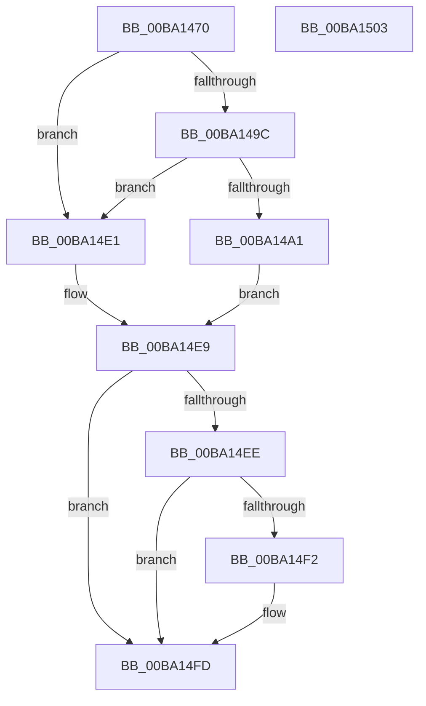

# VerifierExAllocatePoolWithQuota

- RVA: `0x00BA1470`–`0x00BA1504` (길이 `148` bytes)
- VA: `0x0000000140BA1470`
- 실행 섹션: `PAGEVRFY`
- PDB 이름 있음: `예`; PDB Function 태그: `아니요`
- unwind 정보 RVA: `0x00071A74`
- 디코드: `40`개 명령, `148/148` bytes 표시
- 미해석 바이트: `0` (있으면 어셈블리에 `.byte`로 보존)

> 이 문서는 커널 이미지의 기계어와 PDB 기호를 분석해 생성했습니다. 4번과 5번은 함수 원형과 자료형을 바이너리 사용 방식에서 추정한 C 해석이며 원본 소스 복구 결과는 아닙니다.

## 1. Dependencies

- 직접 호출 지점: **3**; 고유 호출 대상: **3**
- 직접 호출자로 확인된 함수: **0**
- RIP 상대 이미지 참조: **3**

### Outgoing calls
- `0x00BA14DA` → [guard_dispatch_icall](../../text/6B/guard_dispatch_icall_function_006BAAD0.md) (function, `0x006BAAD0`)
- `0x00BA14E4` → [ExAllocatePoolWithQuota](../../text/65/ExAllocatePoolWithQuota_function_00655E00.md) (function, `0x00655E00`)
- `0x00BA14F7` → [RtlRaiseStatus](../../text/2F/RtlRaiseStatus_function_002F6A50.md) (function, `0x002F6A50`)

### Direct callers
- 이 함수 시작 RVA로 연결되는 직접 call은 확인되지 않았습니다. 간접 호출은 완전히 역산할 수 없습니다.

### Static image references
- `0x00BA1476` → RVA `0x00FF4010` (`PAGEVRFD`; read)
- `0x00BA1490` → RVA `0x00BA0FB0` (`VfExAllocPoolInternal`; read)
- `0x00BA14A6` → RVA `0x00BB8A90` (`VfHandlePoolAlloc`; read)

## 2. Other-region calls and transfers

- 다른 실행 섹션으로 향하는 call: **3**
  - `0x00BA14DA` → [guard_dispatch_icall](../../text/6B/guard_dispatch_icall_function_006BAAD0.md) (`PAGEVRFY` → `.text`)
  - `0x00BA14E4` → [ExAllocatePoolWithQuota](../../text/65/ExAllocatePoolWithQuota_function_00655E00.md) (`PAGEVRFY` → `.text`)
  - `0x00BA14F7` → [RtlRaiseStatus](../../text/2F/RtlRaiseStatus_function_002F6A50.md) (`PAGEVRFY` → `.text`)
- 별도 외부 분기/꼬리 이동을 확인하지 못했습니다.

## 3. Assembly (complete function range)

```asm
00BA1470  40 53                           push rbx
00BA1472  48 83 EC 50                     sub rsp, 0x50
00BA1476  48 8B 05 93 2B 45 00            mov rax, qword ptr [rip + 0x452b93]
00BA147D  44 8B D1                        mov r10d, ecx
00BA1480  41 83 E2 F7                     and r10d, 0xfffffff7
00BA1484  8B D9                           mov ebx, ecx
00BA1486  83 E3 08                        and ebx, 8
00BA1489  4C 8B C2                        mov r8, rdx
00BA148C  44 0F 44 D1                     cmove r10d, ecx
00BA1490  48 8D 0D 19 FB FF FF            lea rcx, [rip - 0x4e7]
00BA1497  48 3B C8                        cmp rcx, rax
00BA149A  74 45                           je 0x140ba14e1
00BA149C  48 85 C0                        test rax, rax
00BA149F  74 40                           je 0x140ba14e1
00BA14A1  48 8B 54 24 58                  mov rdx, qword ptr [rsp + 0x58]
00BA14A6  48 8D 0D E3 75 01 00            lea rcx, [rip + 0x175e3]
00BA14AD  48 89 4C 24 40                  mov qword ptr [rsp + 0x40], rcx
00BA14B2  41 0F BA EA 07                  bts r10d, 7
00BA14B7  48 89 54 24 38                  mov qword ptr [rsp + 0x38], rdx
00BA14BC  41 B9 57 72 61 70               mov r9d, 0x70617257
00BA14C2  83 64 24 30 00                  and dword ptr [rsp + 0x30], 0
00BA14C7  33 D2                           xor edx, edx
00BA14C9  48 83 64 24 28 00               and qword ptr [rsp + 0x28], 0
00BA14CF  41 8B CA                        mov ecx, r10d
00BA14D2  C7 44 24 20 20 00 00 00         mov dword ptr [rsp + 0x20], 0x20
00BA14DA  E8 F1 95 B1 FF                  call 0x1406baad0
00BA14DF  EB 08                           jmp 0x140ba14e9
00BA14E1  41 8B CA                        mov ecx, r10d
00BA14E4  E8 17 49 AB FF                  call 0x140655e00
00BA14E9  48 85 C0                        test rax, rax
00BA14EC  75 0F                           jne 0x140ba14fd
00BA14EE  85 DB                           test ebx, ebx
00BA14F0  75 0B                           jne 0x140ba14fd
00BA14F2  B9 9A 00 00 C0                  mov ecx, 0xc000009a
00BA14F7  E8 54 55 75 FF                  call 0x1402f6a50
00BA14FC  CC                              int3
00BA14FD  48 83 C4 50                     add rsp, 0x50
00BA1501  5B                              pop rbx
00BA1502  C3                              ret
00BA1503  CC                              int3
```

## 4. C-style interpretation (structured pseudocode)

```c
__int64 __fastcall VerifierExAllocatePoolWithQuota(int a1, __int64 a2)
{
    __int64 result;
    __int64 v_r10;
    __int64 v_rbx;
    __int64 v_rsp;
    unsigned __int64 v_stack_m18;
    unsigned __int64 v_stack_m20;
    unsigned int v_stack_m28;
    unsigned __int64 v_stack_m30;
    unsigned int v_stack_m38;
    unsigned __int64 v_stack_p0;

    v_rsp = (v_rsp) - (80);
    v_r10 = (unsigned int)(((unsigned int)(a1)) & (0xFFFFFFF7ULL));
    v_rbx = (unsigned int)(((unsigned int)(a1)) & (8));
    if (condition_is_equal) { v_r10 = a1; }
    if ((v_rip - 1255) == (*(unsigned __int64 *)(v_rip + 4533139))) goto loc_00BA14E1;
    if (*(unsigned __int64 *)(v_rip + 4533139) == 0) goto loc_00BA14E1;
    v_stack_m18 = v_rip + 95715;
    v_stack_m20 = v_stack_p0;
    a2 = 0;
    v_stack_m38 = 32;
    result = guard_dispatch_icall((unsigned int)((unsigned int)(v_r10)), a2, a2, (unsigned int)(0x70617257ULL));
    goto loc_00BA14E9;
loc_00BA14E1:
    result = ExAllocatePoolWithQuota((unsigned int)((unsigned int)(v_r10)), a2, a2, (unsigned int)(0x70617257ULL));
loc_00BA14E9:
    if (result != 0) goto loc_00BA14FD;
    if ((unsigned int)(v_rbx) == 0) {
        a1 = 0xC000009AULL;
        result = RtlRaiseStatus(a1, a2, a2, (unsigned int)(0x70617257ULL));
    }
    v_rsp = (v_rsp) + (80);
    return result;
}
```

## 5. (Beta) C Style

```c
int64_t VerifierExAllocatePoolWithQuota(int32_t Arg1, int64_t Arg2)
{
    int64_t result;
    int64_t local_r10;
    int64_t local_rbx;
    int64_t local_rsp;
    uint64_t v_stack_m18;
    uint64_t v_stack_m20;
    uint32_t v_stack_m28;
    uint64_t v_stack_m30;
    uint32_t v_stack_m38;
    uint64_t v_stack_p0;

    local_rsp = (local_rsp) - (80);
    local_r10 = (uint32_t)(((uint32_t)(Arg1)) & (0xFFFFFFF7ULL));
    local_rbx = (uint32_t)(((uint32_t)(Arg1)) & (8));
    if (condition_is_equal) { local_r10 = Arg1; }
    if ((v_rip - 1255) == (*(uint64_t *)(v_rip + 0x452B93))) goto loc_00BA14E1;
    if (*(uint64_t *)(v_rip + 0x452B93) == 0) goto loc_00BA14E1;
    v_stack_m18 = v_rip + 95715;
    v_stack_m20 = v_stack_p0;
    Arg2 = 0;
    v_stack_m38 = 32;
    result = guard_dispatch_icall((uint32_t)((uint32_t)(local_r10)), Arg2, Arg2, (uint32_t)(0x70617257ULL));
    goto loc_00BA14E9;
loc_00BA14E1:
    result = ExAllocatePoolWithQuota((uint32_t)((uint32_t)(local_r10)), Arg2, Arg2, (uint32_t)(0x70617257ULL));
loc_00BA14E9:
    if (result != 0) goto loc_00BA14FD;
    if ((uint32_t)(local_rbx) == 0) {
        Arg1 = 0xC000009AULL;
        result = RtlRaiseStatus(Arg1, Arg2, Arg2, (uint32_t)(0x70617257ULL));
    }
    local_rsp = (local_rsp) + (80);
    return result;
}
```

## 6. Execution-region graph

[열기: 2D/3D 그래프와 함수 탐색 컨트롤 패널](../../../control-panel.html?section=pagevrfy&rva=0x00BA1470&view=graph)

- 2D 그래프는 위에서 아래로 흐르고, 3D 그래프는 빈 공간을 드래그해 회전합니다. Shift+드래그는 이동, 휠은 확대·축소, 함수 노드 선택은 대상 보고서 이동입니다.

### Static fallback


