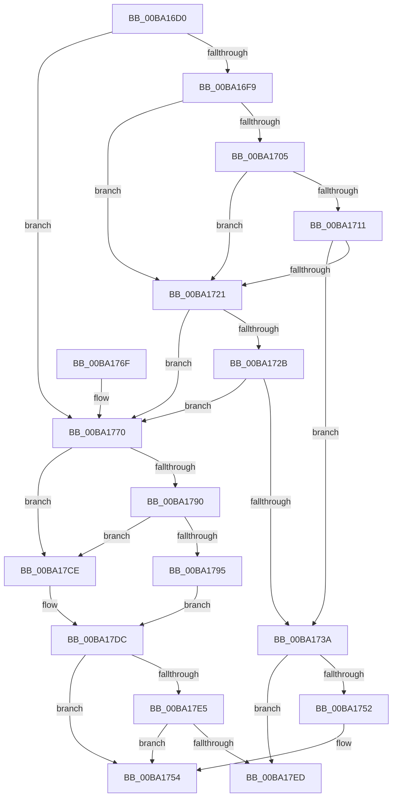

# VerifierExAllocatePoolWithTagPriority

- RVA: `0x00BA16D0`–`0x00BA17F8` (길이 `296` bytes)
- VA: `0x0000000140BA16D0`
- 실행 섹션: `PAGEVRFY`
- PDB 이름 있음: `예`; PDB Function 태그: `아니요`
- unwind 정보 RVA: `0x000D24A4`
- 디코드: `81`개 명령, `296/296` bytes 표시
- 미해석 바이트: `0` (있으면 어셈블리에 `.byte`로 보존)

> 이 문서는 커널 이미지의 기계어와 PDB 기호를 분석해 생성했습니다. 4번과 5번은 함수 원형과 자료형을 바이너리 사용 방식에서 추정한 C 해석이며 원본 소스 복구 결과는 아닙니다.

## 1. Dependencies

- 직접 호출 지점: **6**; 고유 호출 대상: **5**
- 직접 호출자로 확인된 함수: **0**
- RIP 상대 이미지 참조: **6**

### Outgoing calls
- `0x00BA1718` → [guard_dispatch_icall](../../text/6B/guard_dispatch_icall_function_006BAAD0.md) (function, `0x006BAAD0`)
- `0x00BA1731` → [VfFaultsInjectPoolAllocationFailure](VfFaultsInjectPoolAllocationFailure_function_00BA6480.md) (function, `0x00BA6480`)
- `0x00BA1744` → [ViPtLogPoolTraceWrapper](../B9/ViPtLogPoolTraceWrapper_function_00B92100.md) (function, `0x00B92100`)
- `0x00BA17C7` → [guard_dispatch_icall](../../text/6B/guard_dispatch_icall_function_006BAAD0.md) (function, `0x006BAAD0`)
- `0x00BA17D7` → [ExAllocatePoolWithTagPriority](../../text/43/ExAllocatePoolWithTagPriority_function_0043E5F0.md) (function, `0x0043E5F0`)
- `0x00BA17F2` → [RtlRaiseStatus](../../text/2F/RtlRaiseStatus_function_002F6A50.md) (function, `0x002F6A50`)

### Direct callers
- 이 함수 시작 RVA로 연결되는 직접 call은 확인되지 않았습니다. 간접 호출은 완전히 역산할 수 없습니다.

### Static image references
- `0x00BA16F9` → RVA `0x00E681A0` (`.data`; read)
- `0x00BA1705` → RVA `0x00FFDA10` (`PAGEVRFD`; read)
- `0x00BA1711` → RVA `0x00BBA860` (` ?? ::JKADOLAD::`string'`; read)
- `0x00BA1770` → RVA `0x00FF4010` (`PAGEVRFD`; read)
- `0x00BA1777` → RVA `0x00BA0FB0` (`VfExAllocPoolInternal`; read)
- `0x00BA179A` → RVA `0x00BB8A90` (`VfHandlePoolAlloc`; read)

## 2. Other-region calls and transfers

- 다른 실행 섹션으로 향하는 call: **4**
  - `0x00BA1718` → [guard_dispatch_icall](../../text/6B/guard_dispatch_icall_function_006BAAD0.md) (`PAGEVRFY` → `.text`)
  - `0x00BA17C7` → [guard_dispatch_icall](../../text/6B/guard_dispatch_icall_function_006BAAD0.md) (`PAGEVRFY` → `.text`)
  - `0x00BA17D7` → [ExAllocatePoolWithTagPriority](../../text/43/ExAllocatePoolWithTagPriority_function_0043E5F0.md) (`PAGEVRFY` → `.text`)
  - `0x00BA17F2` → [RtlRaiseStatus](../../text/2F/RtlRaiseStatus_function_002F6A50.md) (`PAGEVRFY` → `.text`)
- 별도 외부 분기/꼬리 이동을 확인하지 못했습니다.

## 3. Assembly (complete function range)

```asm
00BA16D0  48 8B C4                        mov rax, rsp
00BA16D3  48 89 58 08                     mov qword ptr [rax + 8], rbx
00BA16D7  48 89 68 10                     mov qword ptr [rax + 0x10], rbp
00BA16DB  48 89 70 18                     mov qword ptr [rax + 0x18], rsi
00BA16DF  48 89 78 20                     mov qword ptr [rax + 0x20], rdi
00BA16E3  41 56                           push r14
00BA16E5  48 83 EC 50                     sub rsp, 0x50
00BA16E9  45 8B F1                        mov r14d, r9d
00BA16EC  41 8B F8                        mov edi, r8d
00BA16EF  48 8B EA                        mov rbp, rdx
00BA16F2  8B D9                           mov ebx, ecx
00BA16F4  F6 C1 02                        test cl, 2
00BA16F7  75 77                           jne 0x140ba1770
00BA16F9  F7 05 9D 6A 2C 00 00 00 04 00   test dword ptr [rip + 0x2c6a9d], 0x40000
00BA1703  74 1C                           je 0x140ba1721
00BA1705  48 8B 05 04 C3 45 00            mov rax, qword ptr [rip + 0x45c304]
00BA170C  48 85 C0                        test rax, rax
00BA170F  74 10                           je 0x140ba1721
00BA1711  48 8D 0D 48 91 01 00            lea rcx, [rip + 0x19148]
00BA1718  E8 B3 93 B1 FF                  call 0x1406baad0
00BA171D  84 C0                           test al, al
00BA171F  75 19                           jne 0x140ba173a
00BA1721  8B 05 79 6A 2C 00               mov eax, dword ptr [rip + 0x2c6a79]
00BA1727  A8 04                           test al, 4
00BA1729  74 45                           je 0x140ba1770
00BA172B  8B CF                           mov ecx, edi
00BA172D  0F BA F1 1F                     btr ecx, 0x1f
00BA1731  E8 4A 4D 00 00                  call 0x140ba6480
00BA1736  85 C0                           test eax, eax
00BA1738  74 36                           je 0x140ba1770
00BA173A  45 33 C9                        xor r9d, r9d
00BA173D  4C 8B C5                        mov r8, rbp
00BA1740  8B D7                           mov edx, edi
00BA1742  33 C9                           xor ecx, ecx
00BA1744  E8 B7 09 FF FF                  call 0x140b92100
00BA1749  F6 C3 10                        test bl, 0x10
00BA174C  0F 85 9B 00 00 00               jne 0x140ba17ed
00BA1752  33 C0                           xor eax, eax
00BA1754  48 8B 5C 24 60                  mov rbx, qword ptr [rsp + 0x60]
00BA1759  48 8B 6C 24 68                  mov rbp, qword ptr [rsp + 0x68]
00BA175E  48 8B 74 24 70                  mov rsi, qword ptr [rsp + 0x70]
00BA1763  48 8B 7C 24 78                  mov rdi, qword ptr [rsp + 0x78]
00BA1768  48 83 C4 50                     add rsp, 0x50
00BA176C  41 5E                           pop r14
00BA176E  C3                              ret
00BA176F  CC                              int3
00BA1770  48 8B 05 99 28 45 00            mov rax, qword ptr [rip + 0x452899]
00BA1777  48 8D 15 32 F8 FF FF            lea rdx, [rip - 0x7ce]
00BA177E  8B CB                           mov ecx, ebx
00BA1780  8B F3                           mov esi, ebx
00BA1782  83 E1 EF                        and ecx, 0xffffffef
00BA1785  83 E6 10                        and esi, 0x10
00BA1788  0F 44 CB                        cmove ecx, ebx
00BA178B  48 3B D0                        cmp rdx, rax
00BA178E  74 3E                           je 0x140ba17ce
00BA1790  48 85 C0                        test rax, rax
00BA1793  74 39                           je 0x140ba17ce
00BA1795  48 8B 54 24 58                  mov rdx, qword ptr [rsp + 0x58]
00BA179A  4C 8D 05 EF 72 01 00            lea r8, [rip + 0x172ef]
00BA17A1  4C 89 44 24 40                  mov qword ptr [rsp + 0x40], r8
00BA17A6  0F BA E9 07                     bts ecx, 7
00BA17AA  48 89 54 24 38                  mov qword ptr [rsp + 0x38], rdx
00BA17AF  44 8B CF                        mov r9d, edi
00BA17B2  83 64 24 30 00                  and dword ptr [rsp + 0x30], 0
00BA17B7  4C 8B C5                        mov r8, rbp
00BA17BA  48 83 64 24 28 00               and qword ptr [rsp + 0x28], 0
00BA17C0  33 D2                           xor edx, edx
00BA17C2  44 89 74 24 20                  mov dword ptr [rsp + 0x20], r14d
00BA17C7  E8 04 93 B1 FF                  call 0x1406baad0
00BA17CC  EB 0E                           jmp 0x140ba17dc
00BA17CE  45 8B CE                        mov r9d, r14d
00BA17D1  44 8B C7                        mov r8d, edi
00BA17D4  48 8B D5                        mov rdx, rbp
00BA17D7  E8 14 CE 89 FF                  call 0x14043e5f0
00BA17DC  48 85 C0                        test rax, rax
00BA17DF  0F 85 6F FF FF FF               jne 0x140ba1754
00BA17E5  85 F6                           test esi, esi
00BA17E7  0F 84 67 FF FF FF               je 0x140ba1754
00BA17ED  B9 9A 00 00 C0                  mov ecx, 0xc000009a
00BA17F2  E8 59 52 75 FF                  call 0x1402f6a50
00BA17F7  CC                              int3
```

## 4. C-style interpretation (structured pseudocode)

```c
__int64 __fastcall VerifierExAllocatePoolWithTagPriority(int a1, __int64 a2, int a3, int a4)
{
    __int64 result;
    __int64 v_rsi;
    __int64 v_rsp;
    unsigned __int64 v_stack_p10;
    unsigned __int64 v_stack_p18;
    unsigned __int64 v_stack_p20;
    unsigned __int64 v_stack_p28;
    unsigned int v_stack_p30;
    unsigned __int64 v_stack_p38;
    unsigned __int64 v_stack_p40;
    unsigned __int64 v_stack_p58;
    unsigned __int64 v_stack_p8;

    *(unsigned __int64 *)(v_rsp + 8) = v_rbx;
    *(unsigned __int64 *)(v_rsp + 16) = v_rbp;
    *(unsigned __int64 *)(v_rsp + 24) = v_rsi;
    *(unsigned __int64 *)(v_rsp + 32) = v_rdi;
    v_rsp = (v_rsp) - (80);
    if ((((unsigned __int8)(a1)) & (2)) != 0) goto loc_00BA1770;
    if (((*(unsigned int *)(v_rip + 2910877)) & (0x40000ULL)) == 0) goto loc_00BA1721;
    if (*(unsigned __int64 *)(v_rip + 4571908) == 0) goto loc_00BA1721;
    result = guard_dispatch_icall(v_rip + 102728, a2, a3, a4);
    if ((unsigned __int8)(result) != 0) goto loc_00BA173A;
loc_00BA1721:
    if ((((unsigned __int8)((unsigned int)(*(unsigned int *)(v_rip + 2910841)))) & (4)) == 0) goto loc_00BA1770;
    result = VfFaultsInjectPoolAllocationFailure((unsigned int)((unsigned int)((unsigned int)(a3))), a2, a3, a4);
    if ((unsigned int)(result) == 0) goto loc_00BA1770;
loc_00BA173A:
    a4 = 0;
    a1 = 0;
    result = ViPtLogPoolTraceWrapper(a1, (unsigned int)((unsigned int)((unsigned int)(a3))), a2, a4);
    if ((((unsigned __int8)((unsigned int)(a1))) & (16)) != 0) goto loc_00BA17ED;
    result = 0;
loc_00BA1754:
    v_rsp = (v_rsp) + (80);
    return result;
loc_00BA1770:
    a1 = (unsigned int)(((unsigned int)((unsigned int)(v_stack_p8))) & (0xFFFFFFEFULL));
    v_rsi = (unsigned int)(((unsigned int)((unsigned int)(v_stack_p8))) & (16));
    if (condition_is_equal) { a1 = (unsigned int)(v_stack_p8); }
    if ((v_rip - 1998) == (*(unsigned __int64 *)(v_rip + 4532377))) goto loc_00BA17CE;
    if (*(unsigned __int64 *)(v_rip + 4532377) == 0) goto loc_00BA17CE;
    v_stack_p40 = v_rip + 94959;
    v_stack_p38 = v_stack_p58;
    a2 = 0;
    v_stack_p20 = (unsigned int)((unsigned int)(a4));
    result = guard_dispatch_icall(a1, a2, v_stack_p10, (unsigned int)((unsigned int)(v_stack_p20)));
    goto loc_00BA17DC;
loc_00BA17CE:
    result = ExAllocatePoolWithTagPriority(a1, v_stack_p10, (unsigned int)((unsigned int)(v_stack_p20)), (unsigned int)((unsigned int)((unsigned int)(a4))));
loc_00BA17DC:
    if (result != 0) goto loc_00BA1754;
    if ((unsigned int)(v_rsi) == 0) goto loc_00BA1754;
loc_00BA17ED:
    result = RtlRaiseStatus((unsigned int)(0xC000009AULL), v_stack_p10, (unsigned int)((unsigned int)(v_stack_p20)), (unsigned int)((unsigned int)((unsigned int)(a4))));
    return result;
}
```

## 5. (Beta) C Style

```c
int64_t VerifierExAllocatePoolWithTagPriority(int32_t Arg1, int64_t Arg2, int32_t Arg3, int32_t Arg4)
{
    int64_t result;
    int64_t local_rsi;
    int64_t local_rsp;
    uint64_t v_stack_p10;
    uint64_t v_stack_p18;
    uint64_t v_stack_p20;
    uint64_t v_stack_p28;
    uint32_t v_stack_p30;
    uint64_t v_stack_p38;
    uint64_t v_stack_p40;
    uint64_t v_stack_p58;
    uint64_t v_stack_p8;

    *(uint64_t *)(local_rsp + 0x8) = local_rbx;
    *(uint64_t *)(local_rsp + 0x10) = local_rbp;
    *(uint64_t *)(local_rsp + 0x18) = local_rsi;
    *(uint64_t *)(local_rsp + 0x20) = local_rdi;
    local_rsp = (local_rsp) - (80);
    if ((((uint8_t)(Arg1)) & (2)) != 0) goto loc_00BA1770;
    if (((*(uint32_t *)(v_rip + 0x2C6A9D)) & (0x40000ULL)) == 0) goto loc_00BA1721;
    if (*(uint64_t *)(v_rip + 0x45C304) == 0) goto loc_00BA1721;
    result = guard_dispatch_icall(v_rip + 102728, Arg2, Arg3, Arg4);
    if ((uint8_t)(result) != 0) goto loc_00BA173A;
loc_00BA1721:
    if ((((uint8_t)((uint32_t)(*(uint32_t *)(v_rip + 0x2C6A79)))) & (4)) == 0) goto loc_00BA1770;
    result = VfFaultsInjectPoolAllocationFailure((uint32_t)((uint32_t)((uint32_t)(Arg3))), Arg2, Arg3, Arg4);
    if ((uint32_t)(result) == 0) goto loc_00BA1770;
loc_00BA173A:
    Arg4 = 0;
    Arg1 = 0;
    result = ViPtLogPoolTraceWrapper(Arg1, (uint32_t)((uint32_t)((uint32_t)(Arg3))), Arg2, Arg4);
    if ((((uint8_t)((uint32_t)(Arg1))) & (16)) != 0) goto loc_00BA17ED;
    result = 0;
loc_00BA1754:
    local_rsp = (local_rsp) + (80);
    return result;
loc_00BA1770:
    Arg1 = (uint32_t)(((uint32_t)((uint32_t)(v_stack_p8))) & (0xFFFFFFEFULL));
    local_rsi = (uint32_t)(((uint32_t)((uint32_t)(v_stack_p8))) & (16));
    if (condition_is_equal) { Arg1 = (uint32_t)(v_stack_p8); }
    if ((v_rip - 1998) == (*(uint64_t *)(v_rip + 0x452899))) goto loc_00BA17CE;
    if (*(uint64_t *)(v_rip + 0x452899) == 0) goto loc_00BA17CE;
    v_stack_p40 = v_rip + 94959;
    v_stack_p38 = v_stack_p58;
    Arg2 = 0;
    v_stack_p20 = (uint32_t)((uint32_t)(Arg4));
    result = guard_dispatch_icall(Arg1, Arg2, v_stack_p10, (uint32_t)((uint32_t)(v_stack_p20)));
    goto loc_00BA17DC;
loc_00BA17CE:
    result = ExAllocatePoolWithTagPriority(Arg1, v_stack_p10, (uint32_t)((uint32_t)(v_stack_p20)), (uint32_t)((uint32_t)((uint32_t)(Arg4))));
loc_00BA17DC:
    if (result != 0) goto loc_00BA1754;
    if ((uint32_t)(local_rsi) == 0) goto loc_00BA1754;
loc_00BA17ED:
    result = RtlRaiseStatus((uint32_t)(0xC000009AULL), v_stack_p10, (uint32_t)((uint32_t)(v_stack_p20)), (uint32_t)((uint32_t)((uint32_t)(Arg4))));
    return result;
}
```

## 6. Execution-region graph

[열기: 2D/3D 그래프와 함수 탐색 컨트롤 패널](../../../control-panel.html?section=pagevrfy&rva=0x00BA16D0&view=graph)

- 2D 그래프는 위에서 아래로 흐르고, 3D 그래프는 빈 공간을 드래그해 회전합니다. Shift+드래그는 이동, 휠은 확대·축소, 함수 노드 선택은 대상 보고서 이동입니다.

### Static fallback


