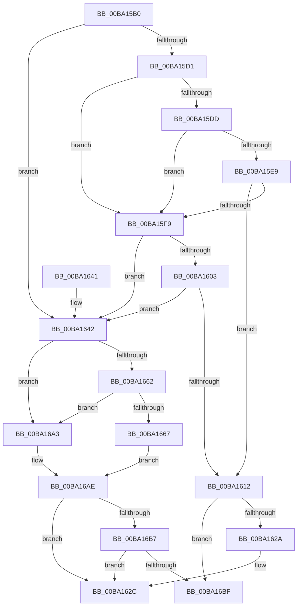

# VerifierExAllocatePoolWithTag

- RVA: `0x00BA15B0`–`0x00BA16CA` (길이 `282` bytes)
- VA: `0x0000000140BA15B0`
- 실행 섹션: `PAGEVRFY`
- PDB 이름 있음: `예`; PDB Function 태그: `아니요`
- unwind 정보 RVA: `0x000D24C0`
- 디코드: `76`개 명령, `282/282` bytes 표시
- 미해석 바이트: `0` (있으면 어셈블리에 `.byte`로 보존)

> 이 문서는 커널 이미지의 기계어와 PDB 기호를 분석해 생성했습니다. 4번과 5번은 함수 원형과 자료형을 바이너리 사용 방식에서 추정한 C 해석이며 원본 소스 복구 결과는 아닙니다.

## 1. Dependencies

- 직접 호출 지점: **6**; 고유 호출 대상: **5**
- 직접 호출자로 확인된 함수: **0**
- RIP 상대 이미지 참조: **6**

### Outgoing calls
- `0x00BA15F0` → [guard_dispatch_icall](../../text/6B/guard_dispatch_icall_function_006BAAD0.md) (function, `0x006BAAD0`)
- `0x00BA1609` → [VfFaultsInjectPoolAllocationFailure](VfFaultsInjectPoolAllocationFailure_function_00BA6480.md) (function, `0x00BA6480`)
- `0x00BA161C` → [ViPtLogPoolTraceWrapper](../B9/ViPtLogPoolTraceWrapper_function_00B92100.md) (function, `0x00B92100`)
- `0x00BA169C` → [guard_dispatch_icall](../../text/6B/guard_dispatch_icall_function_006BAAD0.md) (function, `0x006BAAD0`)
- `0x00BA16A9` → [ExAllocatePoolWithTag](../../poolcode/B8/ExAllocatePoolWithTag_function_00B82010.md) (function, `0x00B82010`)
- `0x00BA16C4` → [RtlRaiseStatus](../../text/2F/RtlRaiseStatus_function_002F6A50.md) (function, `0x002F6A50`)

### Direct callers
- 이 함수 시작 RVA로 연결되는 직접 call은 확인되지 않았습니다. 간접 호출은 완전히 역산할 수 없습니다.

### Static image references
- `0x00BA15D1` → RVA `0x00E681A0` (`.data`; read)
- `0x00BA15DD` → RVA `0x00FFDA10` (`PAGEVRFD`; read)
- `0x00BA15E9` → RVA `0x00BBA860` (` ?? ::JKADOLAD::`string'`; read)
- `0x00BA1642` → RVA `0x00FF4048` (`PAGEVRFD`; read)
- `0x00BA1649` → RVA `0x00BA0FB0` (`VfExAllocPoolInternal`; read)
- `0x00BA166C` → RVA `0x00BB8A90` (`VfHandlePoolAlloc`; read)

## 2. Other-region calls and transfers

- 다른 실행 섹션으로 향하는 call: **4**
  - `0x00BA15F0` → [guard_dispatch_icall](../../text/6B/guard_dispatch_icall_function_006BAAD0.md) (`PAGEVRFY` → `.text`)
  - `0x00BA169C` → [guard_dispatch_icall](../../text/6B/guard_dispatch_icall_function_006BAAD0.md) (`PAGEVRFY` → `.text`)
  - `0x00BA16A9` → [ExAllocatePoolWithTag](../../poolcode/B8/ExAllocatePoolWithTag_function_00B82010.md) (`PAGEVRFY` → `POOLCODE`)
  - `0x00BA16C4` → [RtlRaiseStatus](../../text/2F/RtlRaiseStatus_function_002F6A50.md) (`PAGEVRFY` → `.text`)
- 별도 외부 분기/꼬리 이동을 확인하지 못했습니다.

## 3. Assembly (complete function range)

```asm
00BA15B0  48 89 5C 24 08                  mov qword ptr [rsp + 8], rbx
00BA15B5  48 89 6C 24 10                  mov qword ptr [rsp + 0x10], rbp
00BA15BA  48 89 74 24 18                  mov qword ptr [rsp + 0x18], rsi
00BA15BF  57                              push rdi
00BA15C0  48 83 EC 50                     sub rsp, 0x50
00BA15C4  41 8B F8                        mov edi, r8d
00BA15C7  48 8B EA                        mov rbp, rdx
00BA15CA  8B D9                           mov ebx, ecx
00BA15CC  F6 C1 02                        test cl, 2
00BA15CF  75 71                           jne 0x140ba1642
00BA15D1  F7 05 C5 6B 2C 00 00 00 04 00   test dword ptr [rip + 0x2c6bc5], 0x40000
00BA15DB  74 1C                           je 0x140ba15f9
00BA15DD  48 8B 05 2C C4 45 00            mov rax, qword ptr [rip + 0x45c42c]
00BA15E4  48 85 C0                        test rax, rax
00BA15E7  74 10                           je 0x140ba15f9
00BA15E9  48 8D 0D 70 92 01 00            lea rcx, [rip + 0x19270]
00BA15F0  E8 DB 94 B1 FF                  call 0x1406baad0
00BA15F5  84 C0                           test al, al
00BA15F7  75 19                           jne 0x140ba1612
00BA15F9  8B 05 A1 6B 2C 00               mov eax, dword ptr [rip + 0x2c6ba1]
00BA15FF  A8 04                           test al, 4
00BA1601  74 3F                           je 0x140ba1642
00BA1603  8B CF                           mov ecx, edi
00BA1605  0F BA F1 1F                     btr ecx, 0x1f
00BA1609  E8 72 4E 00 00                  call 0x140ba6480
00BA160E  85 C0                           test eax, eax
00BA1610  74 30                           je 0x140ba1642
00BA1612  45 33 C9                        xor r9d, r9d
00BA1615  4C 8B C5                        mov r8, rbp
00BA1618  8B D7                           mov edx, edi
00BA161A  33 C9                           xor ecx, ecx
00BA161C  E8 DF 0A FF FF                  call 0x140b92100
00BA1621  F6 C3 10                        test bl, 0x10
00BA1624  0F 85 95 00 00 00               jne 0x140ba16bf
00BA162A  33 C0                           xor eax, eax
00BA162C  48 8B 5C 24 60                  mov rbx, qword ptr [rsp + 0x60]
00BA1631  48 8B 6C 24 68                  mov rbp, qword ptr [rsp + 0x68]
00BA1636  48 8B 74 24 70                  mov rsi, qword ptr [rsp + 0x70]
00BA163B  48 83 C4 50                     add rsp, 0x50
00BA163F  5F                              pop rdi
00BA1640  C3                              ret
00BA1641  CC                              int3
00BA1642  48 8B 05 FF 29 45 00            mov rax, qword ptr [rip + 0x4529ff]
00BA1649  48 8D 15 60 F9 FF FF            lea rdx, [rip - 0x6a0]
00BA1650  8B CB                           mov ecx, ebx
00BA1652  8B F3                           mov esi, ebx
00BA1654  83 E1 EF                        and ecx, 0xffffffef
00BA1657  83 E6 10                        and esi, 0x10
00BA165A  0F 44 CB                        cmove ecx, ebx
00BA165D  48 3B D0                        cmp rdx, rax
00BA1660  74 41                           je 0x140ba16a3
00BA1662  48 85 C0                        test rax, rax
00BA1665  74 3C                           je 0x140ba16a3
00BA1667  48 8B 54 24 58                  mov rdx, qword ptr [rsp + 0x58]
00BA166C  4C 8D 05 1D 74 01 00            lea r8, [rip + 0x1741d]
00BA1673  4C 89 44 24 40                  mov qword ptr [rsp + 0x40], r8
00BA1678  0F BA E9 07                     bts ecx, 7
00BA167C  48 89 54 24 38                  mov qword ptr [rsp + 0x38], rdx
00BA1681  44 8B CF                        mov r9d, edi
00BA1684  83 64 24 30 00                  and dword ptr [rsp + 0x30], 0
00BA1689  4C 8B C5                        mov r8, rbp
00BA168C  48 83 64 24 28 00               and qword ptr [rsp + 0x28], 0
00BA1692  33 D2                           xor edx, edx
00BA1694  C7 44 24 20 20 00 00 00         mov dword ptr [rsp + 0x20], 0x20
00BA169C  E8 2F 94 B1 FF                  call 0x1406baad0
00BA16A1  EB 0B                           jmp 0x140ba16ae
00BA16A3  44 8B C7                        mov r8d, edi
00BA16A6  48 8B D5                        mov rdx, rbp
00BA16A9  E8 62 09 FE FF                  call 0x140b82010
00BA16AE  48 85 C0                        test rax, rax
00BA16B1  0F 85 75 FF FF FF               jne 0x140ba162c
00BA16B7  85 F6                           test esi, esi
00BA16B9  0F 84 6D FF FF FF               je 0x140ba162c
00BA16BF  B9 9A 00 00 C0                  mov ecx, 0xc000009a
00BA16C4  E8 87 53 75 FF                  call 0x1402f6a50
00BA16C9  CC                              int3
```

## 4. C-style interpretation (structured pseudocode)

```c
__int64 __fastcall VerifierExAllocatePoolWithTag(int a1, __int64 a2, int a3, int a4)
{
    __int64 result;
    __int64 v_rsi;
    __int64 v_rsp;
    unsigned __int64 v_stack_p10;
    unsigned __int64 v_stack_p18;
    unsigned int v_stack_p20;
    unsigned __int64 v_stack_p28;
    unsigned int v_stack_p30;
    unsigned __int64 v_stack_p38;
    unsigned __int64 v_stack_p40;
    unsigned __int64 v_stack_p58;
    unsigned __int64 v_stack_p8;

    v_stack_p8 = v_rbx;
    v_stack_p10 = v_rbp;
    v_stack_p18 = v_rsi;
    v_rsp = (v_rsp) - (80);
    if ((((unsigned __int8)(a1)) & (2)) != 0) goto loc_00BA1642;
    if (((*(unsigned int *)(v_rip + 2911173)) & (0x40000ULL)) == 0) goto loc_00BA15F9;
    if (*(unsigned __int64 *)(v_rip + 4572204) == 0) goto loc_00BA15F9;
    result = guard_dispatch_icall(v_rip + 103024, a2, a3, a4);
    if ((unsigned __int8)(result) != 0) goto loc_00BA1612;
loc_00BA15F9:
    if ((((unsigned __int8)((unsigned int)(*(unsigned int *)(v_rip + 2911137)))) & (4)) == 0) goto loc_00BA1642;
    result = VfFaultsInjectPoolAllocationFailure((unsigned int)((unsigned int)((unsigned int)(a3))), a2, a3, a4);
    if ((unsigned int)(result) == 0) goto loc_00BA1642;
loc_00BA1612:
    a4 = 0;
    a1 = 0;
    result = ViPtLogPoolTraceWrapper(a1, (unsigned int)((unsigned int)((unsigned int)(a3))), a2, a4);
    if ((((unsigned __int8)((unsigned int)(a1))) & (16)) != 0) goto loc_00BA16BF;
    result = 0;
loc_00BA162C:
    v_rsp = (v_rsp) + (80);
    return result;
loc_00BA1642:
    a1 = (unsigned int)(((unsigned int)((unsigned int)(v_stack_p8))) & (0xFFFFFFEFULL));
    v_rsi = (unsigned int)(((unsigned int)((unsigned int)(v_stack_p8))) & (16));
    if (condition_is_equal) { a1 = (unsigned int)(v_stack_p8); }
    if ((v_rip - 1696) == (*(unsigned __int64 *)(v_rip + 4532735))) goto loc_00BA16A3;
    if (*(unsigned __int64 *)(v_rip + 4532735) == 0) goto loc_00BA16A3;
    v_stack_p40 = v_rip + 95261;
    v_stack_p38 = v_stack_p58;
    a2 = 0;
    v_stack_p20 = 32;
    result = guard_dispatch_icall(a1, a2, v_stack_p10, (unsigned int)((unsigned int)((unsigned int)(a3))));
    goto loc_00BA16AE;
loc_00BA16A3:
    result = ExAllocatePoolWithTag(a1, v_stack_p10, (unsigned int)((unsigned int)((unsigned int)(a3))), (unsigned int)((unsigned int)((unsigned int)(a3))));
loc_00BA16AE:
    if (result != 0) goto loc_00BA162C;
    if ((unsigned int)(v_rsi) == 0) goto loc_00BA162C;
loc_00BA16BF:
    result = RtlRaiseStatus((unsigned int)(0xC000009AULL), v_stack_p10, (unsigned int)((unsigned int)((unsigned int)(a3))), (unsigned int)((unsigned int)((unsigned int)(a3))));
    return result;
}
```

## 5. (Beta) C Style

```c
int64_t VerifierExAllocatePoolWithTag(int32_t Arg1, int64_t Arg2, int32_t Arg3, int32_t Arg4)
{
    int64_t result;
    int64_t local_rsi;
    int64_t local_rsp;
    uint64_t v_stack_p10;
    uint64_t v_stack_p18;
    uint32_t v_stack_p20;
    uint64_t v_stack_p28;
    uint32_t v_stack_p30;
    uint64_t v_stack_p38;
    uint64_t v_stack_p40;
    uint64_t v_stack_p58;
    uint64_t v_stack_p8;

    v_stack_p8 = local_rbx;
    v_stack_p10 = local_rbp;
    v_stack_p18 = local_rsi;
    local_rsp = (local_rsp) - (80);
    if ((((uint8_t)(Arg1)) & (2)) != 0) goto loc_00BA1642;
    if (((*(uint32_t *)(v_rip + 0x2C6BC5)) & (0x40000ULL)) == 0) goto loc_00BA15F9;
    if (*(uint64_t *)(v_rip + 0x45C42C) == 0) goto loc_00BA15F9;
    result = guard_dispatch_icall(v_rip + 103024, Arg2, Arg3, Arg4);
    if ((uint8_t)(result) != 0) goto loc_00BA1612;
loc_00BA15F9:
    if ((((uint8_t)((uint32_t)(*(uint32_t *)(v_rip + 0x2C6BA1)))) & (4)) == 0) goto loc_00BA1642;
    result = VfFaultsInjectPoolAllocationFailure((uint32_t)((uint32_t)((uint32_t)(Arg3))), Arg2, Arg3, Arg4);
    if ((uint32_t)(result) == 0) goto loc_00BA1642;
loc_00BA1612:
    Arg4 = 0;
    Arg1 = 0;
    result = ViPtLogPoolTraceWrapper(Arg1, (uint32_t)((uint32_t)((uint32_t)(Arg3))), Arg2, Arg4);
    if ((((uint8_t)((uint32_t)(Arg1))) & (16)) != 0) goto loc_00BA16BF;
    result = 0;
loc_00BA162C:
    local_rsp = (local_rsp) + (80);
    return result;
loc_00BA1642:
    Arg1 = (uint32_t)(((uint32_t)((uint32_t)(v_stack_p8))) & (0xFFFFFFEFULL));
    local_rsi = (uint32_t)(((uint32_t)((uint32_t)(v_stack_p8))) & (16));
    if (condition_is_equal) { Arg1 = (uint32_t)(v_stack_p8); }
    if ((v_rip - 1696) == (*(uint64_t *)(v_rip + 0x4529FF))) goto loc_00BA16A3;
    if (*(uint64_t *)(v_rip + 0x4529FF) == 0) goto loc_00BA16A3;
    v_stack_p40 = v_rip + 95261;
    v_stack_p38 = v_stack_p58;
    Arg2 = 0;
    v_stack_p20 = 32;
    result = guard_dispatch_icall(Arg1, Arg2, v_stack_p10, (uint32_t)((uint32_t)((uint32_t)(Arg3))));
    goto loc_00BA16AE;
loc_00BA16A3:
    result = ExAllocatePoolWithTag(Arg1, v_stack_p10, (uint32_t)((uint32_t)((uint32_t)(Arg3))), (uint32_t)((uint32_t)((uint32_t)(Arg3))));
loc_00BA16AE:
    if (result != 0) goto loc_00BA162C;
    if ((uint32_t)(local_rsi) == 0) goto loc_00BA162C;
loc_00BA16BF:
    result = RtlRaiseStatus((uint32_t)(0xC000009AULL), v_stack_p10, (uint32_t)((uint32_t)((uint32_t)(Arg3))), (uint32_t)((uint32_t)((uint32_t)(Arg3))));
    return result;
}
```

## 6. Execution-region graph

[열기: 2D/3D 그래프와 함수 탐색 컨트롤 패널](../../../control-panel.html?section=pagevrfy&rva=0x00BA15B0&view=graph)

- 2D 그래프는 위에서 아래로 흐르고, 3D 그래프는 빈 공간을 드래그해 회전합니다. Shift+드래그는 이동, 휠은 확대·축소, 함수 노드 선택은 대상 보고서 이동입니다.

### Static fallback


