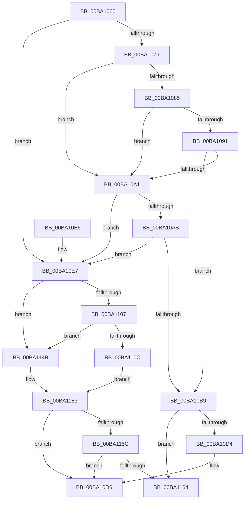

# VerifierExAllocatePool

- RVA: `0x00BA1060`–`0x00BA116F` (길이 `271` bytes)
- VA: `0x0000000140BA1060`
- 실행 섹션: `PAGEVRFY`
- PDB 이름 있음: `예`; PDB Function 태그: `아니요`
- unwind 정보 RVA: `0x000D24F4`
- 디코드: `71`개 명령, `271/271` bytes 표시
- 미해석 바이트: `0` (있으면 어셈블리에 `.byte`로 보존)

> 이 문서는 커널 이미지의 기계어와 PDB 기호를 분석해 생성했습니다. 4번과 5번은 함수 원형과 자료형을 바이너리 사용 방식에서 추정한 C 해석이며 원본 소스 복구 결과는 아닙니다.

## 1. Dependencies

- 직접 호출 지점: **6**; 고유 호출 대상: **5**
- 직접 호출자로 확인된 함수: **0**
- RIP 상대 이미지 참조: **6**

### Outgoing calls
- `0x00BA1098` → [guard_dispatch_icall](../../text/6B/guard_dispatch_icall_function_006BAAD0.md) (function, `0x006BAAD0`)
- `0x00BA10B0` → [VfFaultsInjectPoolAllocationFailure](VfFaultsInjectPoolAllocationFailure_function_00BA6480.md) (function, `0x00BA6480`)
- `0x00BA10C6` → [ViPtLogPoolTraceWrapper](../B9/ViPtLogPoolTraceWrapper_function_00B92100.md) (function, `0x00B92100`)
- `0x00BA1144` → [guard_dispatch_icall](../../text/6B/guard_dispatch_icall_function_006BAAD0.md) (function, `0x006BAAD0`)
- `0x00BA114E` → [ExAllocatePool](../../text/42/ExAllocatePool_function_0042F010.md) (function, `0x0042F010`)
- `0x00BA1169` → [RtlRaiseStatus](../../text/2F/RtlRaiseStatus_function_002F6A50.md) (function, `0x002F6A50`)

### Direct callers
- 이 함수 시작 RVA로 연결되는 직접 call은 확인되지 않았습니다. 간접 호출은 완전히 역산할 수 없습니다.

### Static image references
- `0x00BA1079` → RVA `0x00E681A0` (`.data`; read)
- `0x00BA1085` → RVA `0x00FFDA10` (`PAGEVRFD`; read)
- `0x00BA1091` → RVA `0x00BBA860` (` ?? ::JKADOLAD::`string'`; read)
- `0x00BA10E7` → RVA `0x00FF4050` (`PAGEVRFD`; read)
- `0x00BA10EE` → RVA `0x00BA0FB0` (`VfExAllocPoolInternal`; read)
- `0x00BA1111` → RVA `0x00BB8A90` (`VfHandlePoolAlloc`; read)

## 2. Other-region calls and transfers

- 다른 실행 섹션으로 향하는 call: **4**
  - `0x00BA1098` → [guard_dispatch_icall](../../text/6B/guard_dispatch_icall_function_006BAAD0.md) (`PAGEVRFY` → `.text`)
  - `0x00BA1144` → [guard_dispatch_icall](../../text/6B/guard_dispatch_icall_function_006BAAD0.md) (`PAGEVRFY` → `.text`)
  - `0x00BA114E` → [ExAllocatePool](../../text/42/ExAllocatePool_function_0042F010.md) (`PAGEVRFY` → `.text`)
  - `0x00BA1169` → [RtlRaiseStatus](../../text/2F/RtlRaiseStatus_function_002F6A50.md) (`PAGEVRFY` → `.text`)
- 별도 외부 분기/꼬리 이동을 확인하지 못했습니다.

## 3. Assembly (complete function range)

```asm
00BA1060  48 89 5C 24 08                  mov qword ptr [rsp + 8], rbx
00BA1065  48 89 74 24 10                  mov qword ptr [rsp + 0x10], rsi
00BA106A  57                              push rdi
00BA106B  48 83 EC 50                     sub rsp, 0x50
00BA106F  48 8B F2                        mov rsi, rdx
00BA1072  8B D9                           mov ebx, ecx
00BA1074  F6 C1 02                        test cl, 2
00BA1077  75 6E                           jne 0x140ba10e7
00BA1079  F7 05 1D 71 2C 00 00 00 04 00   test dword ptr [rip + 0x2c711d], 0x40000
00BA1083  74 1C                           je 0x140ba10a1
00BA1085  48 8B 05 84 C9 45 00            mov rax, qword ptr [rip + 0x45c984]
00BA108C  48 85 C0                        test rax, rax
00BA108F  74 10                           je 0x140ba10a1
00BA1091  48 8D 0D C8 97 01 00            lea rcx, [rip + 0x197c8]
00BA1098  E8 33 9A B1 FF                  call 0x1406baad0
00BA109D  84 C0                           test al, al
00BA109F  75 18                           jne 0x140ba10b9
00BA10A1  8B 05 F9 70 2C 00               mov eax, dword ptr [rip + 0x2c70f9]
00BA10A7  A8 04                           test al, 4
00BA10A9  74 3C                           je 0x140ba10e7
00BA10AB  B9 57 72 61 70                  mov ecx, 0x70617257
00BA10B0  E8 CB 53 00 00                  call 0x140ba6480
00BA10B5  85 C0                           test eax, eax
00BA10B7  74 2E                           je 0x140ba10e7
00BA10B9  45 33 C9                        xor r9d, r9d
00BA10BC  4C 8B C6                        mov r8, rsi
00BA10BF  BA 57 72 61 70                  mov edx, 0x70617257
00BA10C4  33 C9                           xor ecx, ecx
00BA10C6  E8 35 10 FF FF                  call 0x140b92100
00BA10CB  F6 C3 10                        test bl, 0x10
00BA10CE  0F 85 90 00 00 00               jne 0x140ba1164
00BA10D4  33 C0                           xor eax, eax
00BA10D6  48 8B 5C 24 60                  mov rbx, qword ptr [rsp + 0x60]
00BA10DB  48 8B 74 24 68                  mov rsi, qword ptr [rsp + 0x68]
00BA10E0  48 83 C4 50                     add rsp, 0x50
00BA10E4  5F                              pop rdi
00BA10E5  C3                              ret
00BA10E6  CC                              int3
00BA10E7  48 8B 05 62 2F 45 00            mov rax, qword ptr [rip + 0x452f62]
00BA10EE  48 8D 15 BB FE FF FF            lea rdx, [rip - 0x145]
00BA10F5  8B CB                           mov ecx, ebx
00BA10F7  8B FB                           mov edi, ebx
00BA10F9  83 E1 EF                        and ecx, 0xffffffef
00BA10FC  83 E7 10                        and edi, 0x10
00BA10FF  0F 44 CB                        cmove ecx, ebx
00BA1102  48 3B D0                        cmp rdx, rax
00BA1105  74 44                           je 0x140ba114b
00BA1107  48 85 C0                        test rax, rax
00BA110A  74 3F                           je 0x140ba114b
00BA110C  48 8B 54 24 58                  mov rdx, qword ptr [rsp + 0x58]
00BA1111  4C 8D 05 78 79 01 00            lea r8, [rip + 0x17978]
00BA1118  4C 89 44 24 40                  mov qword ptr [rsp + 0x40], r8
00BA111D  0F BA E9 07                     bts ecx, 7
00BA1121  48 89 54 24 38                  mov qword ptr [rsp + 0x38], rdx
00BA1126  41 B9 57 72 61 70               mov r9d, 0x70617257
00BA112C  83 64 24 30 00                  and dword ptr [rsp + 0x30], 0
00BA1131  4C 8B C6                        mov r8, rsi
00BA1134  48 83 64 24 28 00               and qword ptr [rsp + 0x28], 0
00BA113A  33 D2                           xor edx, edx
00BA113C  C7 44 24 20 20 00 00 00         mov dword ptr [rsp + 0x20], 0x20
00BA1144  E8 87 99 B1 FF                  call 0x1406baad0
00BA1149  EB 08                           jmp 0x140ba1153
00BA114B  48 8B D6                        mov rdx, rsi
00BA114E  E8 BD DE 88 FF                  call 0x14042f010
00BA1153  48 85 C0                        test rax, rax
00BA1156  0F 85 7A FF FF FF               jne 0x140ba10d6
00BA115C  85 FF                           test edi, edi
00BA115E  0F 84 72 FF FF FF               je 0x140ba10d6
00BA1164  B9 9A 00 00 C0                  mov ecx, 0xc000009a
00BA1169  E8 E2 58 75 FF                  call 0x1402f6a50
00BA116E  CC                              int3
```

## 4. C-style interpretation (structured pseudocode)

```c
__int64 __fastcall VerifierExAllocatePool(int a1, __int64 a2, __int64 a3, int a4)
{
    __int64 result;
    __int64 v_rdi;
    __int64 v_rsp;
    unsigned __int64 v_stack_p10;
    unsigned int v_stack_p20;
    unsigned __int64 v_stack_p28;
    unsigned int v_stack_p30;
    unsigned __int64 v_stack_p38;
    unsigned __int64 v_stack_p40;
    unsigned __int64 v_stack_p58;
    unsigned __int64 v_stack_p8;

    v_stack_p8 = v_rbx;
    v_stack_p10 = v_rsi;
    v_rsp = (v_rsp) - (80);
    if ((((unsigned __int8)(a1)) & (2)) != 0) goto loc_00BA10E7;
    if (((*(unsigned int *)(v_rip + 2912541)) & (0x40000ULL)) == 0) goto loc_00BA10A1;
    if (*(unsigned __int64 *)(v_rip + 4573572) == 0) goto loc_00BA10A1;
    result = guard_dispatch_icall(v_rip + 104392, a2, a3, a4);
    if ((unsigned __int8)(result) != 0) goto loc_00BA10B9;
loc_00BA10A1:
    if ((((unsigned __int8)((unsigned int)(*(unsigned int *)(v_rip + 2912505)))) & (4)) == 0) goto loc_00BA10E7;
    result = VfFaultsInjectPoolAllocationFailure((unsigned int)(0x70617257ULL), a2, a3, a4);
    if ((unsigned int)(result) == 0) goto loc_00BA10E7;
loc_00BA10B9:
    a4 = 0;
    a1 = 0;
    result = ViPtLogPoolTraceWrapper(a1, (unsigned int)(0x70617257ULL), a2, a4);
    if ((((unsigned __int8)((unsigned int)(a1))) & (16)) != 0) goto loc_00BA1164;
    result = 0;
loc_00BA10D6:
    v_rsp = (v_rsp) + (80);
    return result;
loc_00BA10E7:
    a1 = (unsigned int)(((unsigned int)((unsigned int)(v_stack_p8))) & (0xFFFFFFEFULL));
    v_rdi = (unsigned int)(((unsigned int)((unsigned int)(v_stack_p8))) & (16));
    if (condition_is_equal) { a1 = (unsigned int)(v_stack_p8); }
    if ((v_rip - 325) == (*(unsigned __int64 *)(v_rip + 4534114))) goto loc_00BA114B;
    if (*(unsigned __int64 *)(v_rip + 4534114) == 0) goto loc_00BA114B;
    v_stack_p40 = v_rip + 96632;
    v_stack_p38 = v_stack_p58;
    a2 = 0;
    v_stack_p20 = 32;
    result = guard_dispatch_icall(a1, a2, v_stack_p10, (unsigned int)(0x70617257ULL));
    goto loc_00BA1153;
loc_00BA114B:
    result = ExAllocatePool(a1, v_stack_p10, v_stack_p10, (unsigned int)(0x70617257ULL));
loc_00BA1153:
    if (result != 0) goto loc_00BA10D6;
    if ((unsigned int)(v_rdi) == 0) goto loc_00BA10D6;
loc_00BA1164:
    result = RtlRaiseStatus((unsigned int)(0xC000009AULL), v_stack_p10, v_stack_p10, (unsigned int)(0x70617257ULL));
    return result;
}
```

## 5. (Beta) C Style

```c
int64_t VerifierExAllocatePool(int32_t Arg1, int64_t Arg2, int64_t Arg3, int32_t Arg4)
{
    int64_t result;
    int64_t local_rdi;
    int64_t local_rsp;
    uint64_t v_stack_p10;
    uint32_t v_stack_p20;
    uint64_t v_stack_p28;
    uint32_t v_stack_p30;
    uint64_t v_stack_p38;
    uint64_t v_stack_p40;
    uint64_t v_stack_p58;
    uint64_t v_stack_p8;

    v_stack_p8 = local_rbx;
    v_stack_p10 = local_rsi;
    local_rsp = (local_rsp) - (80);
    if ((((uint8_t)(Arg1)) & (2)) != 0) goto loc_00BA10E7;
    if (((*(uint32_t *)(v_rip + 0x2C711D)) & (0x40000ULL)) == 0) goto loc_00BA10A1;
    if (*(uint64_t *)(v_rip + 0x45C984) == 0) goto loc_00BA10A1;
    result = guard_dispatch_icall(v_rip + 104392, Arg2, Arg3, Arg4);
    if ((uint8_t)(result) != 0) goto loc_00BA10B9;
loc_00BA10A1:
    if ((((uint8_t)((uint32_t)(*(uint32_t *)(v_rip + 0x2C70F9)))) & (4)) == 0) goto loc_00BA10E7;
    result = VfFaultsInjectPoolAllocationFailure((uint32_t)(0x70617257ULL), Arg2, Arg3, Arg4);
    if ((uint32_t)(result) == 0) goto loc_00BA10E7;
loc_00BA10B9:
    Arg4 = 0;
    Arg1 = 0;
    result = ViPtLogPoolTraceWrapper(Arg1, (uint32_t)(0x70617257ULL), Arg2, Arg4);
    if ((((uint8_t)((uint32_t)(Arg1))) & (16)) != 0) goto loc_00BA1164;
    result = 0;
loc_00BA10D6:
    local_rsp = (local_rsp) + (80);
    return result;
loc_00BA10E7:
    Arg1 = (uint32_t)(((uint32_t)((uint32_t)(v_stack_p8))) & (0xFFFFFFEFULL));
    local_rdi = (uint32_t)(((uint32_t)((uint32_t)(v_stack_p8))) & (16));
    if (condition_is_equal) { Arg1 = (uint32_t)(v_stack_p8); }
    if ((v_rip - 325) == (*(uint64_t *)(v_rip + 0x452F62))) goto loc_00BA114B;
    if (*(uint64_t *)(v_rip + 0x452F62) == 0) goto loc_00BA114B;
    v_stack_p40 = v_rip + 96632;
    v_stack_p38 = v_stack_p58;
    Arg2 = 0;
    v_stack_p20 = 32;
    result = guard_dispatch_icall(Arg1, Arg2, v_stack_p10, (uint32_t)(0x70617257ULL));
    goto loc_00BA1153;
loc_00BA114B:
    result = ExAllocatePool(Arg1, v_stack_p10, v_stack_p10, (uint32_t)(0x70617257ULL));
loc_00BA1153:
    if (result != 0) goto loc_00BA10D6;
    if ((uint32_t)(local_rdi) == 0) goto loc_00BA10D6;
loc_00BA1164:
    result = RtlRaiseStatus((uint32_t)(0xC000009AULL), v_stack_p10, v_stack_p10, (uint32_t)(0x70617257ULL));
    return result;
}
```

## 6. Execution-region graph

[열기: 2D/3D 그래프와 함수 탐색 컨트롤 패널](../../../control-panel.html?section=pagevrfy&rva=0x00BA1060&view=graph)

- 2D 그래프는 위에서 아래로 흐르고, 3D 그래프는 빈 공간을 드래그해 회전합니다. Shift+드래그는 이동, 휠은 확대·축소, 함수 노드 선택은 대상 보고서 이동입니다.

### Static fallback


