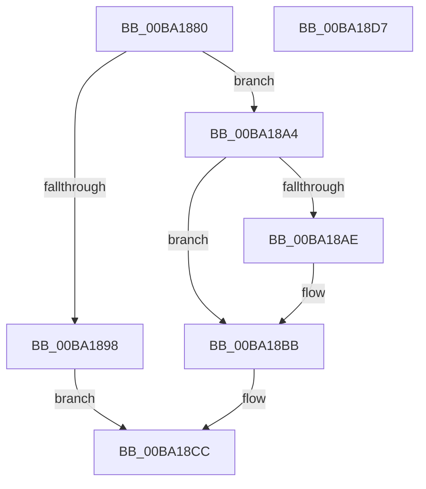

# VerifierExFreePoolWithTag

- RVA: `0x00BA1880`–`0x00BA18D8` (길이 `88` bytes)
- VA: `0x0000000140BA1880`
- 실행 섹션: `PAGEVRFY`
- PDB 이름 있음: `예`; PDB Function 태그: `아니요`
- unwind 정보 RVA: `0x0005CAAC`
- 디코드: `27`개 명령, `88/88` bytes 표시
- 미해석 바이트: `0` (있으면 어셈블리에 `.byte`로 보존)

> 이 문서는 커널 이미지의 기계어와 PDB 기호를 분석해 생성했습니다. 4번과 5번은 함수 원형과 자료형을 바이너리 사용 방식에서 추정한 C 해석이며 원본 소스 복구 결과는 아닙니다.

## 1. Dependencies

- 직접 호출 지점: **4**; 고유 호출 대상: **4**
- 직접 호출자로 확인된 함수: **0**
- RIP 상대 이미지 참조: **2**

### Outgoing calls
- `0x00BA188F` → [VfIsKernelVerificationOn](../../text/4F/VfIsKernelVerificationOn_function_004FCC90.md) (function, `0x004FCC90`)
- `0x00BA189D` → [ExFreePoolWithTag](../../poolcode/B8/ExFreePoolWithTag_function_00B82870.md) (function, `0x00B82870`)
- `0x00BA18B6` → [ExFreePoolSanityChecks](../BB/ExFreePoolSanityChecks_function_00BB44A0.md) (function, `0x00BB44A0`)
- `0x00BA18C7` → [guard_dispatch_icall](../../text/6B/guard_dispatch_icall_function_006BAAD0.md) (function, `0x006BAAD0`)

### Direct callers
- 이 함수 시작 RVA로 연결되는 직접 call은 확인되지 않았습니다. 간접 호출은 완전히 역산할 수 없습니다.

### Static image references
- `0x00BA18A4` → RVA `0x00F04A20` (`.data`; read)
- `0x00BA18BB` → RVA `0x00FFE690` (`PAGEVRFD`; read)

## 2. Other-region calls and transfers

- 다른 실행 섹션으로 향하는 call: **3**
  - `0x00BA188F` → [VfIsKernelVerificationOn](../../text/4F/VfIsKernelVerificationOn_function_004FCC90.md) (`PAGEVRFY` → `.text`)
  - `0x00BA189D` → [ExFreePoolWithTag](../../poolcode/B8/ExFreePoolWithTag_function_00B82870.md) (`PAGEVRFY` → `POOLCODE`)
  - `0x00BA18C7` → [guard_dispatch_icall](../../text/6B/guard_dispatch_icall_function_006BAAD0.md) (`PAGEVRFY` → `.text`)
- 별도 외부 분기/꼬리 이동을 확인하지 못했습니다.

## 3. Assembly (complete function range)

```asm
00BA1880  48 89 5C 24 08                  mov qword ptr [rsp + 8], rbx
00BA1885  57                              push rdi
00BA1886  48 83 EC 20                     sub rsp, 0x20
00BA188A  8B FA                           mov edi, edx
00BA188C  48 8B D9                        mov rbx, rcx
00BA188F  E8 FC B3 95 FF                  call 0x1404fcc90
00BA1894  84 C0                           test al, al
00BA1896  74 0C                           je 0x140ba18a4
00BA1898  8B D7                           mov edx, edi
00BA189A  48 8B CB                        mov rcx, rbx
00BA189D  E8 CE 0F FE FF                  call 0x140b82870
00BA18A2  EB 28                           jmp 0x140ba18cc
00BA18A4  8B 05 76 31 36 00               mov eax, dword ptr [rip + 0x363176]
00BA18AA  A8 01                           test al, 1
00BA18AC  74 0D                           je 0x140ba18bb
00BA18AE  48 8B 54 24 28                  mov rdx, qword ptr [rsp + 0x28]
00BA18B3  48 8B CB                        mov rcx, rbx
00BA18B6  E8 E5 2B 01 00                  call 0x140bb44a0
00BA18BB  48 8B 05 CE CD 45 00            mov rax, qword ptr [rip + 0x45cdce]
00BA18C2  8B D7                           mov edx, edi
00BA18C4  48 8B CB                        mov rcx, rbx
00BA18C7  E8 04 92 B1 FF                  call 0x1406baad0
00BA18CC  48 8B 5C 24 30                  mov rbx, qword ptr [rsp + 0x30]
00BA18D1  48 83 C4 20                     add rsp, 0x20
00BA18D5  5F                              pop rdi
00BA18D6  C3                              ret
00BA18D7  CC                              int3
```

## 4. C-style interpretation (structured pseudocode)

```c
__int64 __fastcall VerifierExFreePoolWithTag(__int64 a1, int a2)
{
    __int64 result;
    __int64 v_rsp;
    unsigned __int64 v_stack_p0;
    unsigned __int64 v_stack_p8;

    v_stack_p8 = v_rbx;
    v_rsp = (v_rsp) - (32);
    result = VfIsKernelVerificationOn(a1, a2, a3, a4);
    if ((unsigned __int8)(result) == 0) goto loc_00BA18A4;
    result = ExFreePoolWithTag(a1, (unsigned int)((unsigned int)((unsigned int)(a2))), a3, a4);
    goto loc_00BA18CC;
loc_00BA18A4:
    result = (unsigned int)(*(unsigned int *)(v_rip + 3551606));
    if ((((unsigned __int8)((unsigned int)(*(unsigned int *)(v_rip + 3551606)))) & (1)) != 0) {
        a2 = v_stack_p0;
        a1 = a1;
        result = ExFreePoolSanityChecks(a1, a2, a3, a4);
    }
    result = guard_dispatch_icall(a1, (unsigned int)((unsigned int)((unsigned int)(a2))), a3, a4);
loc_00BA18CC:
    v_rsp = (v_rsp) + (32);
    return result;
}
```

## 5. (Beta) C Style

```c
int64_t VerifierExFreePoolWithTag(int64_t Arg1, int32_t Arg2)
{
    int64_t result;
    int64_t local_rsp;
    uint64_t v_stack_p0;
    uint64_t v_stack_p8;

    v_stack_p8 = local_rbx;
    local_rsp = (local_rsp) - (32);
    result = VfIsKernelVerificationOn(Arg1, Arg2, a3, a4);
    if ((uint8_t)(result) == 0) goto loc_00BA18A4;
    result = ExFreePoolWithTag(Arg1, (uint32_t)((uint32_t)((uint32_t)(Arg2))), a3, a4);
    goto loc_00BA18CC;
loc_00BA18A4:
    result = (uint32_t)(*(uint32_t *)(v_rip + 0x363176));
    if ((((uint8_t)((uint32_t)(*(uint32_t *)(v_rip + 0x363176)))) & (1)) != 0) {
        Arg2 = v_stack_p0;
        Arg1 = Arg1;
        result = ExFreePoolSanityChecks(Arg1, Arg2, a3, a4);
    }
    result = guard_dispatch_icall(Arg1, (uint32_t)((uint32_t)((uint32_t)(Arg2))), a3, a4);
loc_00BA18CC:
    local_rsp = (local_rsp) + (32);
    return result;
}
```

## 6. Execution-region graph

[열기: 2D/3D 그래프와 함수 탐색 컨트롤 패널](../../../control-panel.html?section=pagevrfy&rva=0x00BA1880&view=graph)

- 2D 그래프는 위에서 아래로 흐르고, 3D 그래프는 빈 공간을 드래그해 회전합니다. Shift+드래그는 이동, 휠은 확대·축소, 함수 노드 선택은 대상 보고서 이동입니다.

### Static fallback


