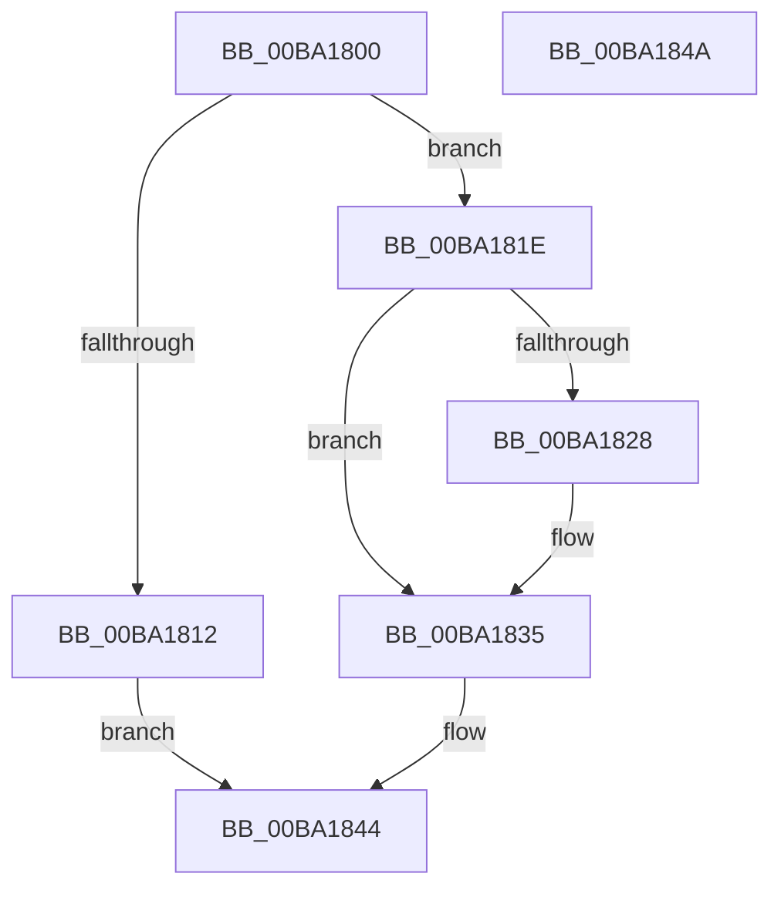

# VerifierExFreePool

- RVA: `0x00BA1800`–`0x00BA184B` (길이 `75` bytes)
- VA: `0x0000000140BA1800`
- 실행 섹션: `PAGEVRFY`
- PDB 이름 있음: `예`; PDB Function 태그: `아니요`
- unwind 정보 RVA: `0x0005CF00`
- 디코드: `23`개 명령, `75/75` bytes 표시
- 미해석 바이트: `0` (있으면 어셈블리에 `.byte`로 보존)

> 이 문서는 커널 이미지의 기계어와 PDB 기호를 분석해 생성했습니다. 4번과 5번은 함수 원형과 자료형을 바이너리 사용 방식에서 추정한 C 해석이며 원본 소스 복구 결과는 아닙니다.

## 1. Dependencies

- 직접 호출 지점: **4**; 고유 호출 대상: **4**
- 직접 호출자로 확인된 함수: **1**
- RIP 상대 이미지 참조: **2**

### Outgoing calls
- `0x00BA1809` → [VfIsKernelVerificationOn](../../text/4F/VfIsKernelVerificationOn_function_004FCC90.md) (function, `0x004FCC90`)
- `0x00BA1817` → [ExFreePoolWithTag](../../poolcode/B8/ExFreePoolWithTag_function_00B82870.md) (function, `0x00B82870`)
- `0x00BA1830` → [ExFreePoolSanityChecks](../BB/ExFreePoolSanityChecks_function_00BB44A0.md) (function, `0x00BB44A0`)
- `0x00BA183F` → [guard_dispatch_icall](../../text/6B/guard_dispatch_icall_function_006BAAD0.md) (function, `0x006BAAD0`)

### Direct callers
- [VerifierExFreePoolEx](VerifierExFreePoolEx_function_00BA1860.md) at `0x00BA1864`

### Static image references
- `0x00BA181E` → RVA `0x00F04A20` (`.data`; read)
- `0x00BA1835` → RVA `0x00FFE688` (`PAGEVRFD`; read)

## 2. Other-region calls and transfers

- 다른 실행 섹션으로 향하는 call: **3**
  - `0x00BA1809` → [VfIsKernelVerificationOn](../../text/4F/VfIsKernelVerificationOn_function_004FCC90.md) (`PAGEVRFY` → `.text`)
  - `0x00BA1817` → [ExFreePoolWithTag](../../poolcode/B8/ExFreePoolWithTag_function_00B82870.md) (`PAGEVRFY` → `POOLCODE`)
  - `0x00BA183F` → [guard_dispatch_icall](../../text/6B/guard_dispatch_icall_function_006BAAD0.md) (`PAGEVRFY` → `.text`)
- 별도 외부 분기/꼬리 이동을 확인하지 못했습니다.

## 3. Assembly (complete function range)

```asm
00BA1800  40 53                           push rbx
00BA1802  48 83 EC 20                     sub rsp, 0x20
00BA1806  48 8B D9                        mov rbx, rcx
00BA1809  E8 82 B4 95 FF                  call 0x1404fcc90
00BA180E  84 C0                           test al, al
00BA1810  74 0C                           je 0x140ba181e
00BA1812  33 D2                           xor edx, edx
00BA1814  48 8B CB                        mov rcx, rbx
00BA1817  E8 54 10 FE FF                  call 0x140b82870
00BA181C  EB 26                           jmp 0x140ba1844
00BA181E  8B 05 FC 31 36 00               mov eax, dword ptr [rip + 0x3631fc]
00BA1824  A8 01                           test al, 1
00BA1826  74 0D                           je 0x140ba1835
00BA1828  48 8B 54 24 28                  mov rdx, qword ptr [rsp + 0x28]
00BA182D  48 8B CB                        mov rcx, rbx
00BA1830  E8 6B 2C 01 00                  call 0x140bb44a0
00BA1835  48 8B 05 4C CE 45 00            mov rax, qword ptr [rip + 0x45ce4c]
00BA183C  48 8B CB                        mov rcx, rbx
00BA183F  E8 8C 92 B1 FF                  call 0x1406baad0
00BA1844  48 83 C4 20                     add rsp, 0x20
00BA1848  5B                              pop rbx
00BA1849  C3                              ret
00BA184A  CC                              int3
```

## 4. C-style interpretation (structured pseudocode)

```c
__int64 __fastcall VerifierExFreePool(__int64 a1, int a2)
{
    __int64 result;
    __int64 v_rsp;
    unsigned __int64 v_stack_p0;

    v_rsp = (v_rsp) - (32);
    result = VfIsKernelVerificationOn(a1, a2, a3, a4);
    if ((unsigned __int8)(result) == 0) goto loc_00BA181E;
    a2 = 0;
    result = ExFreePoolWithTag(a1, a2, a3, a4);
    goto loc_00BA1844;
loc_00BA181E:
    result = (unsigned int)(*(unsigned int *)(v_rip + 3551740));
    if ((((unsigned __int8)((unsigned int)(*(unsigned int *)(v_rip + 3551740)))) & (1)) != 0) {
        a2 = v_stack_p0;
        a1 = a1;
        result = ExFreePoolSanityChecks(a1, a2, a3, a4);
    }
    result = guard_dispatch_icall(a1, a2, a3, a4);
loc_00BA1844:
    v_rsp = (v_rsp) + (32);
    return result;
}
```

## 5. (Beta) C Style

```c
int64_t VerifierExFreePool(int64_t Arg1, int32_t Arg2)
{
    int64_t result;
    int64_t local_rsp;
    uint64_t v_stack_p0;

    local_rsp = (local_rsp) - (32);
    result = VfIsKernelVerificationOn(Arg1, Arg2, a3, a4);
    if ((uint8_t)(result) == 0) goto loc_00BA181E;
    Arg2 = 0;
    result = ExFreePoolWithTag(Arg1, Arg2, a3, a4);
    goto loc_00BA1844;
loc_00BA181E:
    result = (uint32_t)(*(uint32_t *)(v_rip + 0x3631FC));
    if ((((uint8_t)((uint32_t)(*(uint32_t *)(v_rip + 0x3631FC)))) & (1)) != 0) {
        Arg2 = v_stack_p0;
        Arg1 = Arg1;
        result = ExFreePoolSanityChecks(Arg1, Arg2, a3, a4);
    }
    result = guard_dispatch_icall(Arg1, Arg2, a3, a4);
loc_00BA1844:
    local_rsp = (local_rsp) + (32);
    return result;
}
```

## 6. Execution-region graph

[열기: 2D/3D 그래프와 함수 탐색 컨트롤 패널](../../../control-panel.html?section=pagevrfy&rva=0x00BA1800&view=graph)

- 2D 그래프는 위에서 아래로 흐르고, 3D 그래프는 빈 공간을 드래그해 회전합니다. Shift+드래그는 이동, 휠은 확대·축소, 함수 노드 선택은 대상 보고서 이동입니다.

### Static fallback


