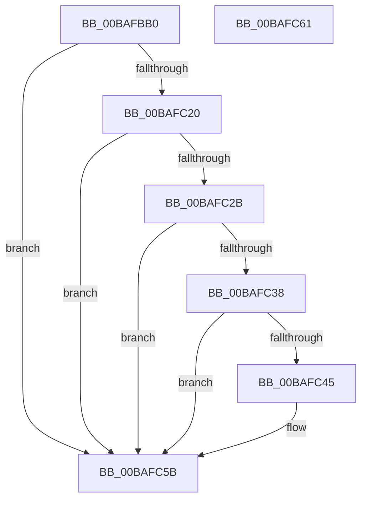

# VerifierExInitializeLookasideListEx

- RVA: `0x00BAFBB0`–`0x00BAFC62` (길이 `178` bytes)
- VA: `0x0000000140BAFBB0`
- 실행 섹션: `PAGEVRFY`
- PDB 이름 있음: `예`; PDB Function 태그: `아니요`
- unwind 정보 RVA: `0x0006E5B4`
- 디코드: `38`개 명령, `178/178` bytes 표시
- 미해석 바이트: `0` (있으면 어셈블리에 `.byte`로 보존)

> 이 문서는 커널 이미지의 기계어와 PDB 기호를 분석해 생성했습니다. 4번과 5번은 함수 원형과 자료형을 바이너리 사용 방식에서 추정한 C 해석이며 원본 소스 복구 결과는 아닙니다.

## 1. Dependencies

- 직접 호출 지점: **1**; 고유 호출 대상: **1**
- 직접 호출자로 확인된 함수: **0**
- RIP 상대 이미지 참조: **7**

### Outgoing calls
- `0x00BAFC17` → [guard_dispatch_icall](../../text/6B/guard_dispatch_icall_function_006BAAD0.md) (function, `0x006BAAD0`)

### Direct callers
- 이 함수 시작 RVA로 연결되는 직접 call은 확인되지 않았습니다. 간접 호출은 완전히 역산할 수 없습니다.

### Static image references
- `0x00BAFBB6` → RVA `0x00E681A0` (`.data`; read)
- `0x00BAFBC0` → RVA `0x00FF4128` (`PAGEVRFD`; read)
- `0x00BAFBC7` → RVA `0x00468890` (`ExInitializeLookasideListExInternal`; read)
- `0x00BAFC2B` → RVA `0x0043F0D0` (`ExAllocatePoolEx`; read)
- `0x00BAFC38` → RVA `0x00475D80` (`CmSiFreeMemory`; read)
- `0x00BAFC45` → RVA `0x00BA1410` (`VerifierExAllocatePoolEx`; read)
- `0x00BAFC50` → RVA `0x00BA1860` (`VerifierExFreePoolEx`; read)

## 2. Other-region calls and transfers

- 다른 실행 섹션으로 향하는 call: **1**
  - `0x00BAFC17` → [guard_dispatch_icall](../../text/6B/guard_dispatch_icall_function_006BAAD0.md) (`PAGEVRFY` → `.text`)
- 별도 외부 분기/꼬리 이동을 확인하지 못했습니다.

## 3. Assembly (complete function range)

```asm
00BAFBB0  40 53                           push rbx
00BAFBB2  48 83 EC 60                     sub rsp, 0x60
00BAFBB6  F6 05 E3 85 2B 00 01            test byte ptr [rip + 0x2b85e3], 1
00BAFBBD  48 8B D9                        mov rbx, rcx
00BAFBC0  48 8B 05 61 45 44 00            mov rax, qword ptr [rip + 0x444561]
00BAFBC7  48 8D 0D C2 8C 8B FF            lea rcx, [rip - 0x74733e]
00BAFBCE  48 89 4C 24 48                  mov qword ptr [rsp + 0x48], rcx
00BAFBD3  41 BA 00 00 00 00               mov r10d, 0
00BAFBD9  66 44 0F 44 94 24 A8 00 00 00   cmove r10w, word ptr [rsp + 0xa8]
00BAFBE3  8B 8C 24 A0 00 00 00            mov ecx, dword ptr [rsp + 0xa0]
00BAFBEA  C7 44 24 40 01 00 00 00         mov dword ptr [rsp + 0x40], 1
00BAFBF2  66 44 89 54 24 38               mov word ptr [rsp + 0x38], r10w
00BAFBF8  89 4C 24 30                     mov dword ptr [rsp + 0x30], ecx
00BAFBFC  48 8B 8C 24 98 00 00 00         mov rcx, qword ptr [rsp + 0x98]
00BAFC04  48 89 4C 24 28                  mov qword ptr [rsp + 0x28], rcx
00BAFC09  8B 8C 24 90 00 00 00            mov ecx, dword ptr [rsp + 0x90]
00BAFC10  89 4C 24 20                     mov dword ptr [rsp + 0x20], ecx
00BAFC14  48 8B CB                        mov rcx, rbx
00BAFC17  E8 B4 AE B0 FF                  call 0x1406baad0
00BAFC1C  85 C0                           test eax, eax
00BAFC1E  78 3B                           js 0x140bafc5b
00BAFC20  8B 0D 7A 85 2B 00               mov ecx, dword ptr [rip + 0x2b857a]
00BAFC26  F6 C1 01                        test cl, 1
00BAFC29  74 30                           je 0x140bafc5b
00BAFC2B  48 8D 0D 9E F4 88 FF            lea rcx, [rip - 0x770b62]
00BAFC32  48 39 4B 30                     cmp qword ptr [rbx + 0x30], rcx
00BAFC36  75 23                           jne 0x140bafc5b
00BAFC38  48 8D 0D 41 61 8C FF            lea rcx, [rip - 0x739ebf]
00BAFC3F  48 39 4B 38                     cmp qword ptr [rbx + 0x38], rcx
00BAFC43  75 16                           jne 0x140bafc5b
00BAFC45  48 8D 0D C4 17 FF FF            lea rcx, [rip - 0xe83c]
00BAFC4C  48 89 4B 30                     mov qword ptr [rbx + 0x30], rcx
00BAFC50  48 8D 0D 09 1C FF FF            lea rcx, [rip - 0xe3f7]
00BAFC57  48 89 4B 38                     mov qword ptr [rbx + 0x38], rcx
00BAFC5B  48 83 C4 60                     add rsp, 0x60
00BAFC5F  5B                              pop rbx
00BAFC60  C3                              ret
00BAFC61  CC                              int3
```

## 4. C-style interpretation (structured pseudocode)

```c
__int64 __fastcall VerifierExInitializeLookasideListEx(__int64 a1, __int64 a2, __int64 a3, __int64 a4, unsigned int a5, __int64 a6, unsigned int a7, unsigned __int16 a8)
{
    __int64 result;
    __int64 v_r10;
    __int64 v_rsp;
    unsigned __int64 v_stack_m20;
    unsigned int v_stack_m28;
    unsigned __int16 v_stack_m30;
    unsigned int v_stack_m38;
    unsigned __int64 v_stack_m40;
    unsigned int v_stack_m48;

    v_rsp = (v_rsp) - (96);
    v_stack_m20 = v_rip - 7631678;
    v_r10 = 0;
    if (((*(unsigned __int8 *)(v_rip + 2852323)) & (1)) == 0) { v_r10 = a8; }
    v_stack_m28 = 1;
    v_stack_m30 = (unsigned __int16)(v_r10);
    v_stack_m38 = (unsigned int)((unsigned int)(a7));
    v_stack_m40 = a6;
    v_stack_m48 = (unsigned int)((unsigned int)(a5));
    result = guard_dispatch_icall(a1, a2, a3, a4);
    if (sign_flag) goto loc_00BAFC5B;
    if ((((unsigned __int8)((unsigned int)(*(unsigned int *)(v_rip + 2852218)))) & (1)) == 0) goto loc_00BAFC5B;
    if ((*(unsigned __int64 *)(a1 + 48)) != (v_rip - 7801698)) goto loc_00BAFC5B;
    if ((*(unsigned __int64 *)(a1 + 56)) == (v_rip - 7577279)) {
        a1 = v_rip - 59452;
        *(unsigned __int64 *)(a1 + 48) = a1;
        a1 = v_rip - 58359;
        *(unsigned __int64 *)(a1 + 56) = a1;
    }
    v_rsp = (v_rsp) + (96);
    return result;
}
```

## 5. (Beta) C Style

```c
int64_t VerifierExInitializeLookasideListEx(void *Arg1, int64_t Arg2, int64_t Arg3, int64_t Arg4, uint32_t Arg5, int64_t Arg6, uint32_t Arg7, uint16_t Arg8)
{
    uint8_t *arg1 = (uint8_t *)Arg1;

    int64_t result;
    int64_t local_r10;
    int64_t local_rsp;
    uint64_t v_stack_m20;
    uint32_t v_stack_m28;
    uint16_t v_stack_m30;
    uint32_t v_stack_m38;
    uint64_t v_stack_m40;
    uint32_t v_stack_m48;

    local_rsp = (local_rsp) - (96);
    v_stack_m20 = v_rip - 7631678;
    local_r10 = 0;
    if (((*(uint8_t *)(v_rip + 0x2B85E3)) & (1)) == 0) { local_r10 = Arg8; }
    v_stack_m28 = 1;
    v_stack_m30 = (uint16_t)(local_r10);
    v_stack_m38 = (uint32_t)((uint32_t)(Arg7));
    v_stack_m40 = Arg6;
    v_stack_m48 = (uint32_t)((uint32_t)(Arg5));
    result = guard_dispatch_icall(Arg1, Arg2, Arg3, Arg4);
    if (sign_flag) goto loc_00BAFC5B;
    if ((((uint8_t)((uint32_t)(*(uint32_t *)(v_rip + 0x2B857A)))) & (1)) == 0) goto loc_00BAFC5B;
    if ((*(uint64_t *)(arg1 + 0x30)) != (v_rip - 7801698)) goto loc_00BAFC5B;
    if ((*(uint64_t *)(arg1 + 0x38)) == (v_rip - 7577279)) {
        Arg1 = v_rip - 59452;
        *(void **)(arg1 + 0x30) = Arg1;
        Arg1 = v_rip - 58359;
        *(void **)(arg1 + 0x38) = Arg1;
    }
    local_rsp = (local_rsp) + (96);
    return result;
}
```

### 관측된 메모리 오프셋

구조체 형식이 확인되지 않은 접근은 인자 기준의 오프셋으로만 기록했습니다.

| 기준 인자 | 오프셋 표현 | 폭 (bit) | 접근 |
|---|---:|---:|---|
| `Arg1` | `+ 0x30` | `64` | `R` |
| `Arg1` | `+ 0x30` | `64` | `W` |
| `Arg1` | `+ 0x38` | `64` | `R` |
| `Arg1` | `+ 0x38` | `64` | `W` |

## 6. Execution-region graph

[열기: 2D/3D 그래프와 함수 탐색 컨트롤 패널](../../../control-panel.html?section=pagevrfy&rva=0x00BAFBB0&view=graph)

- 2D 그래프는 위에서 아래로 흐르고, 3D 그래프는 빈 공간을 드래그해 회전합니다. Shift+드래그는 이동, 휠은 확대·축소, 함수 노드 선택은 대상 보고서 이동입니다.

### Static fallback


