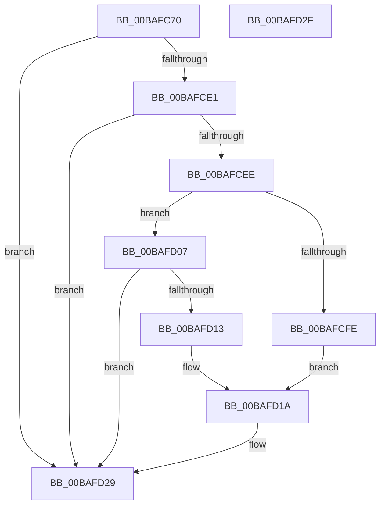

# VerifierExInitializeNPagedLookasideList

- RVA: `0x00BAFC70`–`0x00BAFD30` (길이 `192` bytes)
- VA: `0x0000000140BAFC70`
- 실행 섹션: `PAGEVRFY`
- PDB 이름 있음: `예`; PDB Function 태그: `아니요`
- unwind 정보 RVA: `0x00071A74`
- 디코드: `42`개 명령, `192/192` bytes 표시
- 미해석 바이트: `0` (있으면 어셈블리에 `.byte`로 보존)

> 이 문서는 커널 이미지의 기계어와 PDB 기호를 분석해 생성했습니다. 4번과 5번은 함수 원형과 자료형을 바이너리 사용 방식에서 추정한 C 해석이며 원본 소스 복구 결과는 아닙니다.

## 1. Dependencies

- 직접 호출 지점: **1**; 고유 호출 대상: **1**
- 직접 호출자로 확인된 함수: **0**
- RIP 상대 이미지 참조: **9**

### Outgoing calls
- `0x00BAFCD2` → [guard_dispatch_icall](../../text/6B/guard_dispatch_icall_function_006BAAD0.md) (function, `0x006BAAD0`)

### Direct callers
- 이 함수 시작 RVA로 연결되는 직접 call은 확인되지 않았습니다. 간접 호출은 완전히 역산할 수 없습니다.

### Static image references
- `0x00BAFC76` → RVA `0x00E681A0` (`.data`; read)
- `0x00BAFC80` → RVA `0x00FF4120` (`PAGEVRFD`; read)
- `0x00BAFC87` → RVA `0x00468720` (`ExInitializeNPagedLookasideListInternal`; read)
- `0x00BAFCE1` → RVA `0x00B82850` (`ExFreePool`; read)
- `0x00BAFCF2` → RVA `0x00B82010` (`ExAllocatePoolWithTag`; read)
- `0x00BAFCFE` → RVA `0x00BA15B0` (`VerifierExAllocatePoolWithTag`; read)
- `0x00BAFD07` → RVA `0x004987E0` (`ExAllocatePoolWithQuotaTag`; read)
- `0x00BAFD13` → RVA `0x00BA1510` (`VerifierExAllocatePoolWithQuotaTag`; read)
- `0x00BAFD1E` → RVA `0x00BA1800` (`VerifierExFreePool`; read)

## 2. Other-region calls and transfers

- 다른 실행 섹션으로 향하는 call: **1**
  - `0x00BAFCD2` → [guard_dispatch_icall](../../text/6B/guard_dispatch_icall_function_006BAAD0.md) (`PAGEVRFY` → `.text`)
- 별도 외부 분기/꼬리 이동을 확인하지 못했습니다.

## 3. Assembly (complete function range)

```asm
00BAFC70  40 53                           push rbx
00BAFC72  48 83 EC 50                     sub rsp, 0x50
00BAFC76  F6 05 23 85 2B 00 01            test byte ptr [rip + 0x2b8523], 1
00BAFC7D  48 8B D9                        mov rbx, rcx
00BAFC80  48 8B 05 99 44 44 00            mov rax, qword ptr [rip + 0x444499]
00BAFC87  48 8D 0D 92 8A 8B FF            lea rcx, [rip - 0x74756e]
00BAFC8E  48 89 4C 24 40                  mov qword ptr [rsp + 0x40], rcx
00BAFC93  4C 8B DA                        mov r11, rdx
00BAFC96  8B 94 24 88 00 00 00            mov edx, dword ptr [rsp + 0x88]
00BAFC9D  41 BA 00 00 00 00               mov r10d, 0
00BAFCA3  66 44 0F 44 94 24 90 00 00 00   cmove r10w, word ptr [rsp + 0x90]
00BAFCAD  48 8B 8C 24 80 00 00 00         mov rcx, qword ptr [rsp + 0x80]
00BAFCB5  C7 44 24 38 01 00 00 00         mov dword ptr [rsp + 0x38], 1
00BAFCBD  66 44 89 54 24 30               mov word ptr [rsp + 0x30], r10w
00BAFCC3  89 54 24 28                     mov dword ptr [rsp + 0x28], edx
00BAFCC7  49 8B D3                        mov rdx, r11
00BAFCCA  48 89 4C 24 20                  mov qword ptr [rsp + 0x20], rcx
00BAFCCF  48 8B CB                        mov rcx, rbx
00BAFCD2  E8 F9 AD B0 FF                  call 0x1406baad0
00BAFCD7  8B 05 C3 84 2B 00               mov eax, dword ptr [rip + 0x2b84c3]
00BAFCDD  A8 01                           test al, 1
00BAFCDF  74 48                           je 0x140bafd29
00BAFCE1  48 8D 05 68 2B FD FF            lea rax, [rip - 0x2d498]
00BAFCE8  48 39 43 38                     cmp qword ptr [rbx + 0x38], rax
00BAFCEC  75 3B                           jne 0x140bafd29
00BAFCEE  48 8B 43 30                     mov rax, qword ptr [rbx + 0x30]
00BAFCF2  48 8D 0D 17 23 FD FF            lea rcx, [rip - 0x2dce9]
00BAFCF9  48 3B C1                        cmp rax, rcx
00BAFCFC  75 09                           jne 0x140bafd07
00BAFCFE  48 8D 05 AB 18 FF FF            lea rax, [rip - 0xe755]
00BAFD05  EB 13                           jmp 0x140bafd1a
00BAFD07  48 8D 0D D2 8A 8E FF            lea rcx, [rip - 0x71752e]
00BAFD0E  48 3B C1                        cmp rax, rcx
00BAFD11  75 16                           jne 0x140bafd29
00BAFD13  48 8D 05 F6 17 FF FF            lea rax, [rip - 0xe80a]
00BAFD1A  48 89 43 30                     mov qword ptr [rbx + 0x30], rax
00BAFD1E  48 8D 05 DB 1A FF FF            lea rax, [rip - 0xe525]
00BAFD25  48 89 43 38                     mov qword ptr [rbx + 0x38], rax
00BAFD29  48 83 C4 50                     add rsp, 0x50
00BAFD2D  5B                              pop rbx
00BAFD2E  C3                              ret
00BAFD2F  CC                              int3
```

## 4. C-style interpretation (structured pseudocode)

```c
__int64 __fastcall VerifierExInitializeNPagedLookasideList(__int64 a1, __int64 a2, __int64 a3, __int64 a4, __int64 a5, unsigned int a6, unsigned __int16 a7)
{
    __int64 result;
    __int64 v_r10;
    __int64 v_rsp;
    unsigned __int64 v_stack_m18;
    unsigned int v_stack_m20;
    unsigned __int16 v_stack_m28;
    unsigned int v_stack_m30;
    unsigned __int64 v_stack_m38;

    v_rsp = (v_rsp) - (80);
    v_stack_m18 = v_rip - 7632238;
    v_r10 = 0;
    if (((*(unsigned __int8 *)(v_rip + 2852131)) & (1)) == 0) { v_r10 = a7; }
    v_stack_m20 = 1;
    v_stack_m28 = (unsigned __int16)(v_r10);
    v_stack_m30 = (unsigned int)((unsigned int)(a6));
    v_stack_m38 = a5;
    result = guard_dispatch_icall(a1, a2, a3, a4);
    if ((((unsigned __int8)((unsigned int)(*(unsigned int *)(v_rip + 2852035)))) & (1)) == 0) goto loc_00BAFD29;
    if ((*(unsigned __int64 *)(a1 + 56)) != (v_rip - 185496)) goto loc_00BAFD29;
    if ((*(unsigned __int64 *)(a1 + 48)) != (v_rip - 187625)) goto loc_00BAFD07;
    goto loc_00BAFD1A;
loc_00BAFD07:
    if ((v_rip - 59221) != (v_rip - 7435566)) goto loc_00BAFD29;
loc_00BAFD1A:
    *(unsigned __int64 *)(a1 + 48) = v_rip - 59402;
    *(unsigned __int64 *)(a1 + 56) = v_rip - 58661;
loc_00BAFD29:
    v_rsp = (v_rsp) + (80);
    return v_rip - 58661;
}
```

## 5. (Beta) C Style

```c
int64_t VerifierExInitializeNPagedLookasideList(void *Arg1, int64_t Arg2, int64_t Arg3, int64_t Arg4, int64_t Arg5, uint32_t Arg6, uint16_t Arg7)
{
    uint8_t *arg1 = (uint8_t *)Arg1;

    int64_t result;
    int64_t local_r10;
    int64_t local_rsp;
    uint64_t v_stack_m18;
    uint32_t v_stack_m20;
    uint16_t v_stack_m28;
    uint32_t v_stack_m30;
    uint64_t v_stack_m38;

    local_rsp = (local_rsp) - (80);
    v_stack_m18 = v_rip - 7632238;
    local_r10 = 0;
    if (((*(uint8_t *)(v_rip + 0x2B8523)) & (1)) == 0) { local_r10 = Arg7; }
    v_stack_m20 = 1;
    v_stack_m28 = (uint16_t)(local_r10);
    v_stack_m30 = (uint32_t)((uint32_t)(Arg6));
    v_stack_m38 = Arg5;
    result = guard_dispatch_icall(Arg1, Arg2, Arg3, Arg4);
    if ((((uint8_t)((uint32_t)(*(uint32_t *)(v_rip + 0x2B84C3)))) & (1)) == 0) goto loc_00BAFD29;
    if ((*(uint64_t *)(arg1 + 0x38)) != (v_rip - 185496)) goto loc_00BAFD29;
    if ((*(uint64_t *)(arg1 + 0x30)) != (v_rip - 187625)) goto loc_00BAFD07;
    goto loc_00BAFD1A;
loc_00BAFD07:
    if ((v_rip - 59221) != (v_rip - 7435566)) goto loc_00BAFD29;
loc_00BAFD1A:
    *(uint64_t *)(arg1 + 0x30) = v_rip - 59402;
    *(uint64_t *)(arg1 + 0x38) = v_rip - 58661;
loc_00BAFD29:
    local_rsp = (local_rsp) + (80);
    return v_rip - 58661;
}
```

### 관측된 메모리 오프셋

구조체 형식이 확인되지 않은 접근은 인자 기준의 오프셋으로만 기록했습니다.

| 기준 인자 | 오프셋 표현 | 폭 (bit) | 접근 |
|---|---:|---:|---|
| `Arg1` | `+ 0x30` | `64` | `R` |
| `Arg1` | `+ 0x30` | `64` | `W` |
| `Arg1` | `+ 0x38` | `64` | `R` |
| `Arg1` | `+ 0x38` | `64` | `W` |

## 6. Execution-region graph

[열기: 2D/3D 그래프와 함수 탐색 컨트롤 패널](../../../control-panel.html?section=pagevrfy&rva=0x00BAFC70&view=graph)

- 2D 그래프는 위에서 아래로 흐르고, 3D 그래프는 빈 공간을 드래그해 회전합니다. Shift+드래그는 이동, 휠은 확대·축소, 함수 노드 선택은 대상 보고서 이동입니다.

### Static fallback


