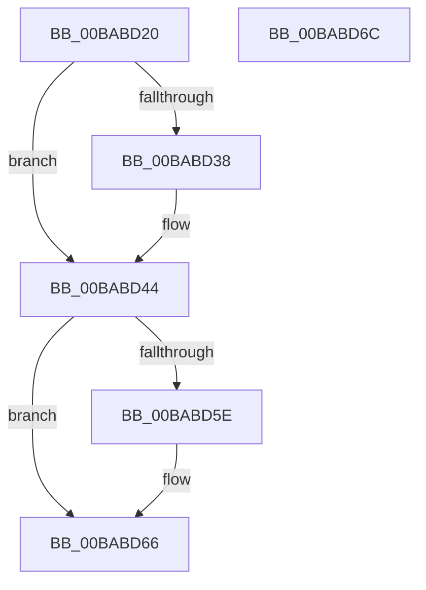

# VerifierExReleaseFastMutex

- RVA: `0x00BABD20`–`0x00BABD6D` (길이 `77` bytes)
- VA: `0x0000000140BABD20`
- 실행 섹션: `PAGEVRFY`
- PDB 이름 있음: `예`; PDB Function 태그: `아니요`
- unwind 정보 RVA: `0x0005CF00`
- 디코드: `23`개 명령, `77/77` bytes 표시
- 미해석 바이트: `0` (있으면 어셈블리에 `.byte`로 보존)

> 이 문서는 커널 이미지의 기계어와 PDB 기호를 분석해 생성했습니다. 4번과 5번은 함수 원형과 자료형을 바이너리 사용 방식에서 추정한 C 해석이며 원본 소스 복구 결과는 아닙니다.

## 1. Dependencies

- 직접 호출 지점: **3**; 고유 호출 대상: **3**
- 직접 호출자로 확인된 함수: **0**
- RIP 상대 이미지 참조: **2**

### Outgoing calls
- `0x00BABD3C` → [VfKeIrqlTransitionReserveLogEntry](../BB/VfKeIrqlTransitionReserveLogEntry_function_00BB80A8.md) (function, `0x00BB80A8`)
- `0x00BABD4E` → [guard_dispatch_icall](../../text/6B/guard_dispatch_icall_function_006BAAD0.md) (function, `0x006BAAD0`)
- `0x00BABD61` → [VfKeIrqlLogLower](../BB/VfKeIrqlLogLower_function_00BB91EC.md) (function, `0x00BB91EC`)

### Direct callers
- 이 함수 시작 RVA로 연결되는 직접 call은 확인되지 않았습니다. 간접 호출은 완전히 역산할 수 없습니다.

### Static image references
- `0x00BABD26` → RVA `0x00E681A0` (`.data`; read)
- `0x00BABD44` → RVA `0x00FFE468` (`PAGEVRFD`; read)

## 2. Other-region calls and transfers

- 다른 실행 섹션으로 향하는 call: **1**
  - `0x00BABD4E` → [guard_dispatch_icall](../../text/6B/guard_dispatch_icall_function_006BAAD0.md) (`PAGEVRFY` → `.text`)
- 별도 외부 분기/꼬리 이동을 확인하지 못했습니다.

## 3. Assembly (complete function range)

```asm
00BABD20  40 53                           push rbx
00BABD22  48 83 EC 20                     sub rsp, 0x20
00BABD26  8B 05 74 C4 2B 00               mov eax, dword ptr [rip + 0x2bc474]
00BABD2C  33 DB                           xor ebx, ebx
00BABD2E  8A 51 30                        mov dl, byte ptr [rcx + 0x30]
00BABD31  4C 8B C9                        mov r9, rcx
00BABD34  A8 02                           test al, 2
00BABD36  74 0C                           je 0x140babd44
00BABD38  44 0F 20 C1                     mov rcx, cr8
00BABD3C  E8 67 C3 00 00                  call 0x140bb80a8
00BABD41  48 8B D8                        mov rbx, rax
00BABD44  48 8B 05 1D 27 45 00            mov rax, qword ptr [rip + 0x45271d]
00BABD4B  49 8B C9                        mov rcx, r9
00BABD4E  E8 7D ED B0 FF                  call 0x1406baad0
00BABD53  8B 0D 47 C4 2B 00               mov ecx, dword ptr [rip + 0x2bc447]
00BABD59  F6 C1 02                        test cl, 2
00BABD5C  74 08                           je 0x140babd66
00BABD5E  48 8B CB                        mov rcx, rbx
00BABD61  E8 86 D4 00 00                  call 0x140bb91ec
00BABD66  48 83 C4 20                     add rsp, 0x20
00BABD6A  5B                              pop rbx
00BABD6B  C3                              ret
00BABD6C  CC                              int3
```

## 4. C-style interpretation (structured pseudocode)

```c
__int64 __fastcall VerifierExReleaseFastMutex(__int64 a1)
{
    __int64 result;
    __int64 v_rbx;
    __int64 v_rsp;

    v_rsp = (v_rsp) - (32);
    v_rbx = 0;
    result = (unsigned int)(*(unsigned int *)(v_rip + 2868340));
    if ((((unsigned __int8)((unsigned int)(*(unsigned int *)(v_rip + 2868340)))) & (2)) != 0) {
        a1 = v_cr8;
        result = VfKeIrqlTransitionReserveLogEntry(a1, *(unsigned __int8 *)(a1 + 48), a3, a1);
        v_rbx = result;
    }
    result = guard_dispatch_icall(a1, *(unsigned __int8 *)(a1 + 48), a3, a1);
    if ((((unsigned __int8)((unsigned int)(*(unsigned int *)(v_rip + 2868295)))) & (2)) != 0) {
        a1 = v_rbx;
        result = VfKeIrqlLogLower(a1, *(unsigned __int8 *)(a1 + 48), a3, a1);
    }
    v_rsp = (v_rsp) + (32);
    return result;
}
```

## 5. (Beta) C Style

```c
int64_t VerifierExReleaseFastMutex(void *Arg1)
{
    uint8_t *arg1 = (uint8_t *)Arg1;

    int64_t result;
    int64_t local_rbx;
    int64_t local_rsp;

    local_rsp = (local_rsp) - (32);
    local_rbx = 0;
    result = (uint32_t)(*(uint32_t *)(v_rip + 0x2BC474));
    if ((((uint8_t)((uint32_t)(*(uint32_t *)(v_rip + 0x2BC474)))) & (2)) != 0) {
        Arg1 = v_cr8;
        result = VfKeIrqlTransitionReserveLogEntry(Arg1, *(uint8_t *)(arg1 + 0x30), a3, Arg1);
        local_rbx = result;
    }
    result = guard_dispatch_icall(Arg1, *(uint8_t *)(arg1 + 0x30), a3, Arg1);
    if ((((uint8_t)((uint32_t)(*(uint32_t *)(v_rip + 0x2BC447)))) & (2)) != 0) {
        Arg1 = local_rbx;
        result = VfKeIrqlLogLower(Arg1, *(uint8_t *)(arg1 + 0x30), a3, Arg1);
    }
    local_rsp = (local_rsp) + (32);
    return result;
}
```

### 관측된 메모리 오프셋

구조체 형식이 확인되지 않은 접근은 인자 기준의 오프셋으로만 기록했습니다.

| 기준 인자 | 오프셋 표현 | 폭 (bit) | 접근 |
|---|---:|---:|---|
| `Arg1` | `+ 0x30` | `8` | `R` |

## 6. Execution-region graph

[열기: 2D/3D 그래프와 함수 탐색 컨트롤 패널](../../../control-panel.html?section=pagevrfy&rva=0x00BABD20&view=graph)

- 2D 그래프는 위에서 아래로 흐르고, 3D 그래프는 빈 공간을 드래그해 회전합니다. Shift+드래그는 이동, 휠은 확대·축소, 함수 노드 선택은 대상 보고서 이동입니다.

### Static fallback


