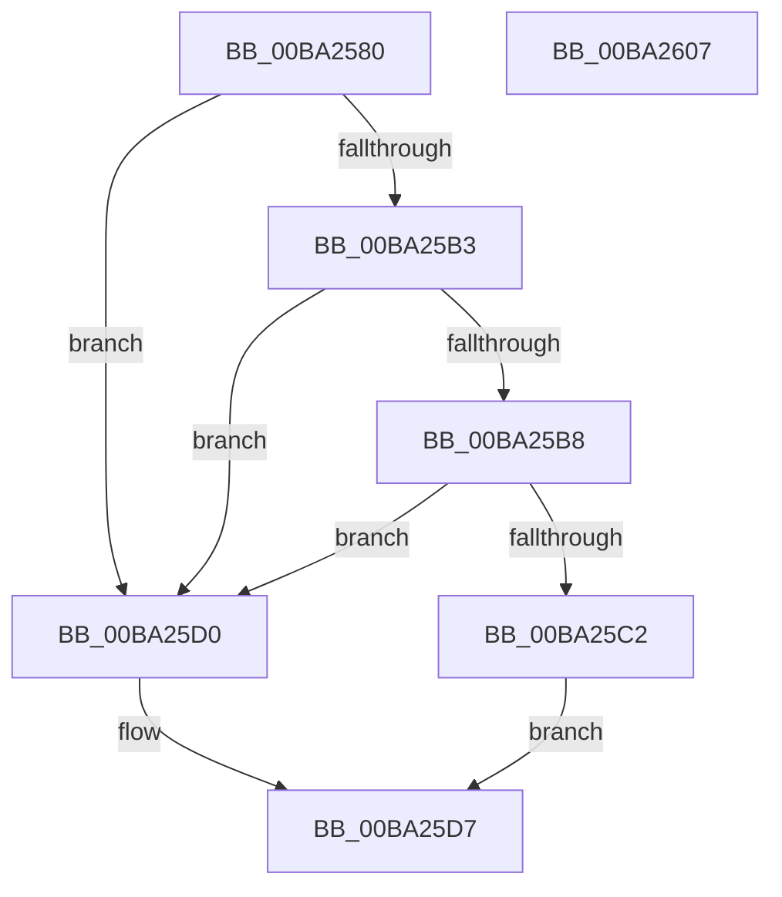

# VerifierIoAcquireRemoveLockEx

- RVA: `0x00BA2580`–`0x00BA2608` (길이 `136` bytes)
- VA: `0x0000000140BA2580`
- 실행 섹션: `PAGEVRFY`
- PDB 이름 있음: `예`; PDB Function 태그: `아니요`
- unwind 정보 RVA: `0x0005D7BC`
- 디코드: `38`개 명령, `136/136` bytes 표시
- 미해석 바이트: `0` (있으면 어셈블리에 `.byte`로 보존)

> 이 문서는 커널 이미지의 기계어와 PDB 기호를 분석해 생성했습니다. 4번과 5번은 함수 원형과 자료형을 바이너리 사용 방식에서 추정한 C 해석이며 원본 소스 복구 결과는 아닙니다.

## 1. Dependencies

- 직접 호출 지점: **2**; 고유 호출 대상: **2**
- 직접 호출자로 확인된 함수: **0**
- RIP 상대 이미지 참조: **2**

### Outgoing calls
- `0x00BA25B8` → [ViRemLockFindSurrogate](ViRemLockFindSurrogate_function_00BA2994.md) (function, `0x00BA2994`)
- `0x00BA25E7` → [guard_dispatch_icall](../../text/6B/guard_dispatch_icall_function_006BAAD0.md) (function, `0x006BAAD0`)

### Direct callers
- 이 함수 시작 RVA로 연결되는 직접 call은 확인되지 않았습니다. 간접 호출은 완전히 역산할 수 없습니다.

### Static image references
- `0x00BA2599` → RVA `0x00FFDA28` (`PAGEVRFD`; read)
- `0x00BA25D7` → RVA `0x00FFDC10` (`PAGEVRFD`; read)

## 2. Other-region calls and transfers

- 다른 실행 섹션으로 향하는 call: **1**
  - `0x00BA25E7` → [guard_dispatch_icall](../../text/6B/guard_dispatch_icall_function_006BAAD0.md) (`PAGEVRFY` → `.text`)
- 별도 외부 분기/꼬리 이동을 확인하지 못했습니다.

## 3. Assembly (complete function range)

```asm
00BA2580  48 8B C4                        mov rax, rsp
00BA2583  48 89 58 08                     mov qword ptr [rax + 8], rbx
00BA2587  48 89 68 10                     mov qword ptr [rax + 0x10], rbp
00BA258B  48 89 70 18                     mov qword ptr [rax + 0x18], rsi
00BA258F  48 89 78 20                     mov qword ptr [rax + 0x20], rdi
00BA2593  41 56                           push r14
00BA2595  48 83 EC 30                     sub rsp, 0x30
00BA2599  8B 05 89 B4 45 00               mov eax, dword ptr [rip + 0x45b489]
00BA259F  41 8B F1                        mov esi, r9d
00BA25A2  8B 5C 24 60                     mov ebx, dword ptr [rsp + 0x60]
00BA25A6  49 8B E8                        mov rbp, r8
00BA25A9  4C 8B F2                        mov r14, rdx
00BA25AC  48 8B F9                        mov rdi, rcx
00BA25AF  85 C0                           test eax, eax
00BA25B1  74 1D                           je 0x140ba25d0
00BA25B3  83 FB 78                        cmp ebx, 0x78
00BA25B6  74 18                           je 0x140ba25d0
00BA25B8  E8 D7 03 00 00                  call 0x140ba2994
00BA25BD  48 85 C0                        test rax, rax
00BA25C0  74 0E                           je 0x140ba25d0
00BA25C2  48 8D 48 10                     lea rcx, [rax + 0x10]
00BA25C6  C7 44 24 20 78 00 00 00         mov dword ptr [rsp + 0x20], 0x78
00BA25CE  EB 07                           jmp 0x140ba25d7
00BA25D0  89 5C 24 20                     mov dword ptr [rsp + 0x20], ebx
00BA25D4  48 8B CF                        mov rcx, rdi
00BA25D7  48 8B 05 32 B6 45 00            mov rax, qword ptr [rip + 0x45b632]
00BA25DE  44 8B CE                        mov r9d, esi
00BA25E1  4C 8B C5                        mov r8, rbp
00BA25E4  49 8B D6                        mov rdx, r14
00BA25E7  E8 E4 84 B1 FF                  call 0x1406baad0
00BA25EC  48 8B 5C 24 40                  mov rbx, qword ptr [rsp + 0x40]
00BA25F1  48 8B 6C 24 48                  mov rbp, qword ptr [rsp + 0x48]
00BA25F6  48 8B 74 24 50                  mov rsi, qword ptr [rsp + 0x50]
00BA25FB  48 8B 7C 24 58                  mov rdi, qword ptr [rsp + 0x58]
00BA2600  48 83 C4 30                     add rsp, 0x30
00BA2604  41 5E                           pop r14
00BA2606  C3                              ret
00BA2607  CC                              int3
```

## 4. C-style interpretation (structured pseudocode)

```c
__int64 __fastcall VerifierIoAcquireRemoveLockEx(__int64 a1, __int64 a2, __int64 a3, int a4, unsigned int a5)
{
    __int64 result;
    __int64 v_rsp;
    unsigned int v_stack_m18;
    unsigned __int64 v_stack_p10;
    unsigned __int64 v_stack_p18;
    unsigned __int64 v_stack_p20;
    unsigned __int64 v_stack_p8;

    *(unsigned __int64 *)(v_rsp + 8) = v_rbx;
    *(unsigned __int64 *)(v_rsp + 16) = v_rbp;
    *(unsigned __int64 *)(v_rsp + 24) = v_rsi;
    *(unsigned __int64 *)(v_rsp + 32) = v_rdi;
    v_rsp = (v_rsp) - (48);
    if ((unsigned int)((unsigned int)(*(unsigned int *)(v_rip + 4568201))) == 0) goto loc_00BA25D0;
    if (((unsigned int)((unsigned int)(a5))) == 120) goto loc_00BA25D0;
    result = ViRemLockFindSurrogate(a1, a2, a3, a4);
    if (result == 0) goto loc_00BA25D0;
    v_stack_m18 = 120;
    goto loc_00BA25D7;
loc_00BA25D0:
    v_stack_m18 = (unsigned int)((unsigned int)(a5));
loc_00BA25D7:
    result = guard_dispatch_icall(a1, a2, a3, (unsigned int)((unsigned int)((unsigned int)(a4))));
    v_rsp = (v_rsp) + (48);
    return result;
}
```

## 5. (Beta) C Style

```c
int64_t VerifierIoAcquireRemoveLockEx(int64_t Arg1, int64_t Arg2, int64_t Arg3, int32_t Arg4, uint32_t Arg5)
{
    int64_t result;
    int64_t local_rsp;
    uint32_t v_stack_m18;
    uint64_t v_stack_p10;
    uint64_t v_stack_p18;
    uint64_t v_stack_p20;
    uint64_t v_stack_p8;

    *(uint64_t *)(local_rsp + 0x8) = local_rbx;
    *(uint64_t *)(local_rsp + 0x10) = local_rbp;
    *(uint64_t *)(local_rsp + 0x18) = local_rsi;
    *(uint64_t *)(local_rsp + 0x20) = local_rdi;
    local_rsp = (local_rsp) - (48);
    if ((uint32_t)((uint32_t)(*(uint32_t *)(v_rip + 0x45B489))) == 0) goto loc_00BA25D0;
    if (((uint32_t)((uint32_t)(Arg5))) == 120) goto loc_00BA25D0;
    result = ViRemLockFindSurrogate(Arg1, Arg2, Arg3, Arg4);
    if (result == 0) goto loc_00BA25D0;
    v_stack_m18 = 120;
    goto loc_00BA25D7;
loc_00BA25D0:
    v_stack_m18 = (uint32_t)((uint32_t)(Arg5));
loc_00BA25D7:
    result = guard_dispatch_icall(Arg1, Arg2, Arg3, (uint32_t)((uint32_t)((uint32_t)(Arg4))));
    local_rsp = (local_rsp) + (48);
    return result;
}
```

## 6. Execution-region graph

[열기: 2D/3D 그래프와 함수 탐색 컨트롤 패널](../../../control-panel.html?section=pagevrfy&rva=0x00BA2580&view=graph)

- 2D 그래프는 위에서 아래로 흐르고, 3D 그래프는 빈 공간을 드래그해 회전합니다. Shift+드래그는 이동, 휠은 확대·축소, 함수 노드 선택은 대상 보고서 이동입니다.

### Static fallback


