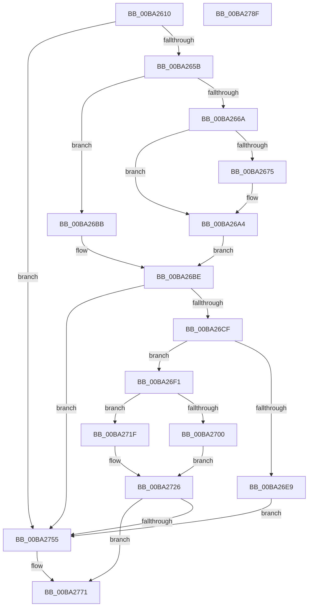

# VerifierIoInitializeRemoveLockEx

- RVA: `0x00BA2610`–`0x00BA2790` (길이 `384` bytes)
- VA: `0x0000000140BA2610`
- 실행 섹션: `PAGEVRFY`
- PDB 이름 있음: `예`; PDB Function 태그: `아니요`
- unwind 정보 RVA: `0x0008C11C`
- 디코드: `102`개 명령, `384/384` bytes 표시
- 미해석 바이트: `0` (있으면 어셈블리에 `.byte`로 보존)

> 이 문서는 커널 이미지의 기계어와 PDB 기호를 분석해 생성했습니다. 4번과 5번은 함수 원형과 자료형을 바이너리 사용 방식에서 추정한 C 해석이며 원본 소스 복구 결과는 아닙니다.

## 1. Dependencies

- 직접 호출 지점: **10**; 고유 호출 대상: **9**
- 직접 호출자로 확인된 함수: **0**
- RIP 상대 이미지 참조: **7**

### Outgoing calls
- `0x00BA265B` → [ViRemLockFindSurrogate](ViRemLockFindSurrogate_function_00BA2994.md) (function, `0x00BA2994`)
- `0x00BA269F` → [CarReportRuleViolationFromNt](../B9/CarReportRuleViolationFromNt_function_00B9D904.md) (function, `0x00B9D904`)
- `0x00BA26B4` → [ViRemLockDeleteFirstTreeNode](ViRemLockDeleteFirstTreeNode_function_00BA28F4.md) (function, `0x00BA28F4`)
- `0x00BA26DC` → [VfAvlReserveNode](../../text/3E/VfAvlReserveNode_function_003EF760.md) (function, `0x003EF760`)
- `0x00BA2715` → [guard_dispatch_icall](../../text/6B/guard_dispatch_icall_function_006BAAD0.md) (function, `0x006BAAD0`)
- `0x00BA2721` → [memset](../../text/6C/memset_function_006C6C40.md) (function, `0x006C6C40`)
- `0x00BA272D` → [VfAvlInitializeLockContext](../../text/4A/VfAvlInitializeLockContext_function_004A686C.md) (function, `0x004A686C`)
- `0x00BA2741` → [VfAvlInsertReservedTreeNode](../../text/3E/VfAvlInsertReservedTreeNode_function_003EE424.md) (function, `0x003EE424`)
- `0x00BA274B` → [VfAvlCleanupLockContext](../../text/3E/VfAvlCleanupLockContext_function_003EF56C.md) (function, `0x003EF56C`)
- `0x00BA276C` → [guard_dispatch_icall](../../text/6B/guard_dispatch_icall_function_006BAAD0.md) (function, `0x006BAAD0`)

### Direct callers
- 이 함수 시작 RVA로 연결되는 직접 call은 확인되지 않았습니다. 간접 호출은 완전히 역산할 수 없습니다.

### Static image references
- `0x00BA2647` → RVA `0x00FFDA28` (`PAGEVRFD`; read)
- `0x00BA266A` → RVA `0x00E681A0` (`.data`; read)
- `0x00BA26A4` → RVA `0x00FFDD28` (`PAGEVRFD`; read/write)
- `0x00BA26BE` → RVA `0x00F04A20` (`.data`; read)
- `0x00BA26D2` → RVA `0x00FFDCE0` (`PAGEVRFD`; read)
- `0x00BA26E9` → RVA `0x00FFDB8C` (`PAGEVRFD`; read/write)
- `0x00BA2700` → RVA `0x00FFDC08` (`PAGEVRFD`; read)

## 2. Other-region calls and transfers

- 다른 실행 섹션으로 향하는 call: **7**
  - `0x00BA26DC` → [VfAvlReserveNode](../../text/3E/VfAvlReserveNode_function_003EF760.md) (`PAGEVRFY` → `.text`)
  - `0x00BA2715` → [guard_dispatch_icall](../../text/6B/guard_dispatch_icall_function_006BAAD0.md) (`PAGEVRFY` → `.text`)
  - `0x00BA2721` → [memset](../../text/6C/memset_function_006C6C40.md) (`PAGEVRFY` → `.text`)
  - `0x00BA272D` → [VfAvlInitializeLockContext](../../text/4A/VfAvlInitializeLockContext_function_004A686C.md) (`PAGEVRFY` → `.text`)
  - `0x00BA2741` → [VfAvlInsertReservedTreeNode](../../text/3E/VfAvlInsertReservedTreeNode_function_003EE424.md) (`PAGEVRFY` → `.text`)
  - `0x00BA274B` → [VfAvlCleanupLockContext](../../text/3E/VfAvlCleanupLockContext_function_003EF56C.md) (`PAGEVRFY` → `.text`)
  - `0x00BA276C` → [guard_dispatch_icall](../../text/6B/guard_dispatch_icall_function_006BAAD0.md) (`PAGEVRFY` → `.text`)
- 별도 외부 분기/꼬리 이동을 확인하지 못했습니다.

## 3. Assembly (complete function range)

```asm
00BA2610  4C 8B DC                        mov r11, rsp
00BA2613  49 89 5B 08                     mov qword ptr [r11 + 8], rbx
00BA2617  49 89 6B 10                     mov qword ptr [r11 + 0x10], rbp
00BA261B  49 89 73 18                     mov qword ptr [r11 + 0x18], rsi
00BA261F  57                              push rdi
00BA2620  41 54                           push r12
00BA2622  41 55                           push r13
00BA2624  41 56                           push r14
00BA2626  41 57                           push r15
00BA2628  48 83 EC 60                     sub rsp, 0x60
00BA262C  8B AC 24 B0 00 00 00            mov ebp, dword ptr [rsp + 0xb0]
00BA2633  33 C0                           xor eax, eax
00BA2635  0F 57 C0                        xorps xmm0, xmm0
00BA2638  45 8B F9                        mov r15d, r9d
00BA263B  0F 11 44 24 40                  movups xmmword ptr [rsp + 0x40], xmm0
00BA2640  49 89 43 C8                     mov qword ptr [r11 - 0x38], rax
00BA2644  45 8B E0                        mov r12d, r8d
00BA2647  8B 05 DB B3 45 00               mov eax, dword ptr [rip + 0x45b3db]
00BA264D  44 8B EA                        mov r13d, edx
00BA2650  48 8B F9                        mov rdi, rcx
00BA2653  85 C0                           test eax, eax
00BA2655  0F 84 FA 00 00 00               je 0x140ba2755
00BA265B  E8 34 03 00 00                  call 0x140ba2994
00BA2660  BB 01 00 00 00                  mov ebx, 1
00BA2665  48 85 C0                        test rax, rax
00BA2668  74 51                           je 0x140ba26bb
00BA266A  8B 0D 30 5B 2C 00               mov ecx, dword ptr [rip + 0x2c5b30]
00BA2670  F6 C1 10                        test cl, 0x10
00BA2673  74 2F                           je 0x140ba26a4
00BA2675  48 8B 8C 24 88 00 00 00         mov rcx, qword ptr [rsp + 0x88]
00BA267D  4C 8D 40 10                     lea r8, [rax + 0x10]
00BA2681  48 89 4C 24 30                  mov qword ptr [rsp + 0x30], rcx
00BA2686  BA D7 00 00 00                  mov edx, 0xd7
00BA268B  C7 44 24 28 04 00 00 00         mov dword ptr [rsp + 0x28], 4
00BA2693  4C 8B CF                        mov r9, rdi
00BA2696  48 83 64 24 20 00               and qword ptr [rsp + 0x20], 0
00BA269C  8D 4A ED                        lea ecx, [rdx - 0x13]
00BA269F  E8 60 B2 FF FF                  call 0x140b9d904
00BA26A4  F0 01 1D 7D B6 45 00            lock add dword ptr [rip + 0x45b67d], ebx
00BA26AB  48 8B D5                        mov rdx, rbp
00BA26AE  48 8B CF                        mov rcx, rdi
00BA26B1  48 8B F5                        mov rsi, rbp
00BA26B4  E8 3B 02 00 00                  call 0x140ba28f4
00BA26B9  EB 03                           jmp 0x140ba26be
00BA26BB  48 8B F5                        mov rsi, rbp
00BA26BE  8B 05 5C 23 36 00               mov eax, dword ptr [rip + 0x36235c]
00BA26C4  45 33 F6                        xor r14d, r14d
00BA26C7  A8 10                           test al, 0x10
00BA26C9  0F 84 86 00 00 00               je 0x140ba2755
00BA26CF  4C 8B C6                        mov r8, rsi
00BA26D2  48 8D 0D 07 B6 45 00            lea rcx, [rip + 0x45b607]
00BA26D9  48 8B D7                        mov rdx, rdi
00BA26DC  E8 7F D0 84 FF                  call 0x1403ef760
00BA26E1  48 8B F0                        mov rsi, rax
00BA26E4  48 85 C0                        test rax, rax
00BA26E7  75 08                           jne 0x140ba26f1
00BA26E9  87 1D 9D B4 45 00               xchg dword ptr [rip + 0x45b49d], ebx
00BA26EF  EB 64                           jmp 0x140ba2755
00BA26F1  41 B8 78 00 00 00               mov r8d, 0x78
00BA26F7  48 8D 48 10                     lea rcx, [rax + 0x10]
00BA26FB  41 3B E8                        cmp ebp, r8d
00BA26FE  74 1F                           je 0x140ba271f
00BA2700  48 8B 05 01 B5 45 00            mov rax, qword ptr [rip + 0x45b501]
00BA2707  45 8B CF                        mov r9d, r15d
00BA270A  44 89 44 24 20                  mov dword ptr [rsp + 0x20], r8d
00BA270F  41 8B D5                        mov edx, r13d
00BA2712  45 8B C4                        mov r8d, r12d
00BA2715  E8 B6 83 B1 FF                  call 0x1406baad0
00BA271A  44 8B F3                        mov r14d, ebx
00BA271D  EB 07                           jmp 0x140ba2726
00BA271F  33 D2                           xor edx, edx
00BA2721  E8 1A 45 B2 FF                  call 0x1406c6c40
00BA2726  33 D2                           xor edx, edx
00BA2728  48 8D 4C 24 40                  lea rcx, [rsp + 0x40]
00BA272D  E8 3A 41 90 FF                  call 0x1404a686c
00BA2732  4C 8B C6                        mov r8, rsi
00BA2735  48 8D 54 24 40                  lea rdx, [rsp + 0x40]
00BA273A  48 8D 0D 9F B5 45 00            lea rcx, [rip + 0x45b59f]
00BA2741  E8 DE BC 84 FF                  call 0x1403ee424
00BA2746  48 8D 4C 24 40                  lea rcx, [rsp + 0x40]
00BA274B  E8 1C CE 84 FF                  call 0x1403ef56c
00BA2750  45 85 F6                        test r14d, r14d
00BA2753  75 1C                           jne 0x140ba2771
00BA2755  48 8B 05 AC B4 45 00            mov rax, qword ptr [rip + 0x45b4ac]
00BA275C  45 8B CF                        mov r9d, r15d
00BA275F  45 8B C4                        mov r8d, r12d
00BA2762  89 6C 24 20                     mov dword ptr [rsp + 0x20], ebp
00BA2766  41 8B D5                        mov edx, r13d
00BA2769  48 8B CF                        mov rcx, rdi
00BA276C  E8 5F 83 B1 FF                  call 0x1406baad0
00BA2771  4C 8D 5C 24 60                  lea r11, [rsp + 0x60]
00BA2776  49 8B 5B 30                     mov rbx, qword ptr [r11 + 0x30]
00BA277A  49 8B 6B 38                     mov rbp, qword ptr [r11 + 0x38]
00BA277E  49 8B 73 40                     mov rsi, qword ptr [r11 + 0x40]
00BA2782  49 8B E3                        mov rsp, r11
00BA2785  41 5F                           pop r15
00BA2787  41 5E                           pop r14
00BA2789  41 5D                           pop r13
00BA278B  41 5C                           pop r12
00BA278D  5F                              pop rdi
00BA278E  C3                              ret
00BA278F  CC                              int3
```

## 4. C-style interpretation (structured pseudocode)

```c
__int64 __fastcall VerifierIoInitializeRemoveLockEx(__int64 a1, int a2, int a3, int a4, unsigned int a5)
{
    __int64 result;
    __int64 v_r14;
    __int64 v_rsp;
    unsigned __int64 v_stack_m28;
    unsigned __int64 v_stack_m48;
    unsigned __int64 v_stack_m58;
    unsigned int v_stack_m60;
    unsigned __int64 v_stack_m68;
    unsigned __int64 v_stack_p0;

    *(unsigned __int64 *)(v_rsp + 8) = v_rbx;
    *(unsigned __int64 *)(v_rsp + 16) = v_rbp;
    *(unsigned __int64 *)(v_rsp + 24) = v_rsi;
    v_rsp = (v_rsp) - (96);
    result = 0;
    v_stack_m48 = v_xmm0;
    *(unsigned __int64 *)(v_rsp - 56) = 0;
    if ((unsigned int)((unsigned int)(*(unsigned int *)(v_rip + 4568027))) == 0) goto loc_00BA2755;
    result = ViRemLockFindSurrogate(a1, a2, a3, a4);
    if (result == 0) goto loc_00BA26BB;
    if ((((unsigned __int8)((unsigned int)(*(unsigned int *)(v_rip + 2906928)))) & (16)) != 0) {
        a1 = v_stack_p0;
        a3 = result + 16;
        v_stack_m58 = a1;
        a2 = 215;
        v_stack_m60 = 4;
        a4 = a1;
        a1 = a2 - 19;
        result = CarReportRuleViolationFromNt(a1, a2, a3, a4);
    }
    result = ViRemLockDeleteFirstTreeNode(a1, (unsigned int)(a5), a3, a4);
    goto loc_00BA26BE;
loc_00BA26BB:
loc_00BA26BE:
    v_r14 = 0;
    if ((((unsigned __int8)((unsigned int)(*(unsigned int *)(v_rip + 3547996)))) & (16)) == 0) goto loc_00BA2755;
    result = VfAvlReserveNode(v_rip + 4568583, a1, (unsigned int)(a5), a4);
    if (result != 0) goto loc_00BA26F1;
    goto loc_00BA2755;
loc_00BA26F1:
    if (((unsigned int)((unsigned int)(a5))) == 120) goto loc_00BA271F;
    v_stack_m68 = 120;
    result = guard_dispatch_icall(result + 16, (unsigned int)((unsigned int)((unsigned int)(a2))), (unsigned int)((unsigned int)((unsigned int)(a3))), (unsigned int)((unsigned int)((unsigned int)(a4))));
    goto loc_00BA2726;
loc_00BA271F:
    a2 = 0;
    result = memset(result + 16, a2, (unsigned int)((unsigned int)((unsigned int)(a3))), (unsigned int)((unsigned int)((unsigned int)(a4))));
loc_00BA2726:
    a2 = 0;
    result = VfAvlInitializeLockContext(v_stack_m48, a2, (unsigned int)((unsigned int)((unsigned int)(a3))), (unsigned int)((unsigned int)((unsigned int)(a4))));
    result = VfAvlInsertReservedTreeNode(v_rip + 4568479, v_stack_m48, result, (unsigned int)((unsigned int)((unsigned int)(a4))));
    result = VfAvlCleanupLockContext(v_stack_m48, v_stack_m48, result, (unsigned int)((unsigned int)((unsigned int)(a4))));
    if (1 == 0) {
        result = *(unsigned __int64 *)(v_rip + 4568236);
        a4 = (unsigned int)((unsigned int)(a4));
        a3 = (unsigned int)((unsigned int)(a3));
        v_stack_m68 = (unsigned int)((unsigned int)(a5));
        a2 = (unsigned int)((unsigned int)(a2));
        a1 = a1;
        result = guard_dispatch_icall(a1, a2, a3, a4);
    }
    return result;
}
```

## 5. (Beta) C Style

```c
int64_t VerifierIoInitializeRemoveLockEx(int64_t Arg1, int32_t Arg2, int32_t Arg3, int32_t Arg4, uint32_t Arg5)
{
    int64_t result;
    int64_t local_r14;
    int64_t local_rsp;
    uint64_t v_stack_m28;
    uint64_t v_stack_m48;
    uint64_t v_stack_m58;
    uint32_t v_stack_m60;
    uint64_t v_stack_m68;
    uint64_t v_stack_p0;

    *(uint64_t *)(local_rsp + 0x8) = local_rbx;
    *(uint64_t *)(local_rsp + 0x10) = local_rbp;
    *(uint64_t *)(local_rsp + 0x18) = local_rsi;
    local_rsp = (local_rsp) - (96);
    result = 0;
    v_stack_m48 = v_xmm0;
    *(uint64_t *)(local_rsp - 0x38) = 0;
    if ((uint32_t)((uint32_t)(*(uint32_t *)(v_rip + 0x45B3DB))) == 0) goto loc_00BA2755;
    result = ViRemLockFindSurrogate(Arg1, Arg2, Arg3, Arg4);
    if (result == 0) goto loc_00BA26BB;
    if ((((uint8_t)((uint32_t)(*(uint32_t *)(v_rip + 0x2C5B30)))) & (16)) != 0) {
        Arg1 = v_stack_p0;
        Arg3 = result + 16;
        v_stack_m58 = Arg1;
        Arg2 = 215;
        v_stack_m60 = 4;
        Arg4 = Arg1;
        Arg1 = Arg2 - 19;
        result = CarReportRuleViolationFromNt(Arg1, Arg2, Arg3, Arg4);
    }
    result = ViRemLockDeleteFirstTreeNode(Arg1, (uint32_t)(Arg5), Arg3, Arg4);
    goto loc_00BA26BE;
loc_00BA26BB:
loc_00BA26BE:
    local_r14 = 0;
    if ((((uint8_t)((uint32_t)(*(uint32_t *)(v_rip + 0x36235C)))) & (16)) == 0) goto loc_00BA2755;
    result = VfAvlReserveNode(v_rip + 4568583, Arg1, (uint32_t)(Arg5), Arg4);
    if (result != 0) goto loc_00BA26F1;
    goto loc_00BA2755;
loc_00BA26F1:
    if (((uint32_t)((uint32_t)(Arg5))) == 120) goto loc_00BA271F;
    v_stack_m68 = 120;
    result = guard_dispatch_icall(result + 16, (uint32_t)((uint32_t)((uint32_t)(Arg2))), (uint32_t)((uint32_t)((uint32_t)(Arg3))), (uint32_t)((uint32_t)((uint32_t)(Arg4))));
    goto loc_00BA2726;
loc_00BA271F:
    Arg2 = 0;
    result = memset(result + 16, Arg2, (uint32_t)((uint32_t)((uint32_t)(Arg3))), (uint32_t)((uint32_t)((uint32_t)(Arg4))));
loc_00BA2726:
    Arg2 = 0;
    result = VfAvlInitializeLockContext(v_stack_m48, Arg2, (uint32_t)((uint32_t)((uint32_t)(Arg3))), (uint32_t)((uint32_t)((uint32_t)(Arg4))));
    result = VfAvlInsertReservedTreeNode(v_rip + 4568479, v_stack_m48, result, (uint32_t)((uint32_t)((uint32_t)(Arg4))));
    result = VfAvlCleanupLockContext(v_stack_m48, v_stack_m48, result, (uint32_t)((uint32_t)((uint32_t)(Arg4))));
    if (1 == 0) {
        result = *(uint64_t *)(v_rip + 0x45B4AC);
        Arg4 = (uint32_t)((uint32_t)(Arg4));
        Arg3 = (uint32_t)((uint32_t)(Arg3));
        v_stack_m68 = (uint32_t)((uint32_t)(Arg5));
        Arg2 = (uint32_t)((uint32_t)(Arg2));
        Arg1 = Arg1;
        result = guard_dispatch_icall(Arg1, Arg2, Arg3, Arg4);
    }
    return result;
}
```

## 6. Execution-region graph

[열기: 2D/3D 그래프와 함수 탐색 컨트롤 패널](../../../control-panel.html?section=pagevrfy&rva=0x00BA2610&view=graph)

- 2D 그래프는 위에서 아래로 흐르고, 3D 그래프는 빈 공간을 드래그해 회전합니다. Shift+드래그는 이동, 휠은 확대·축소, 함수 노드 선택은 대상 보고서 이동입니다.

### Static fallback


