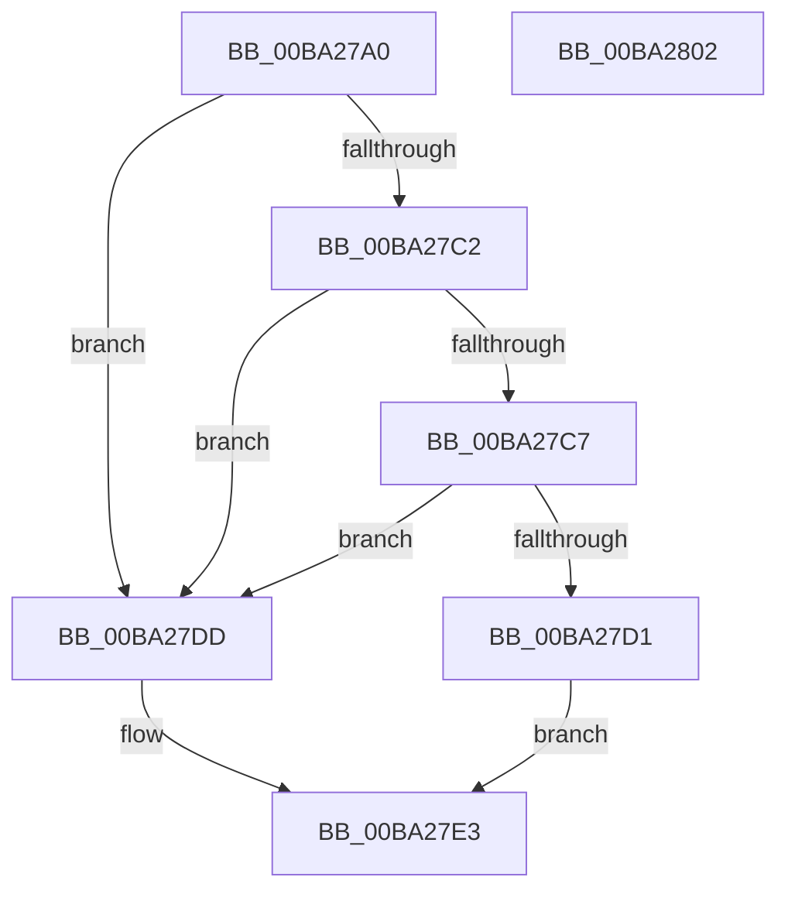

# VerifierIoReleaseRemoveLockAndWaitEx

- RVA: `0x00BA27A0`–`0x00BA2803` (길이 `99` bytes)
- VA: `0x0000000140BA27A0`
- 실행 섹션: `PAGEVRFY`
- PDB 이름 있음: `예`; PDB Function 태그: `아니요`
- unwind 정보 RVA: `0x00060BC4`
- 디코드: `29`개 명령, `99/99` bytes 표시
- 미해석 바이트: `0` (있으면 어셈블리에 `.byte`로 보존)

> 이 문서는 커널 이미지의 기계어와 PDB 기호를 분석해 생성했습니다. 4번과 5번은 함수 원형과 자료형을 바이너리 사용 방식에서 추정한 C 해석이며 원본 소스 복구 결과는 아닙니다.

## 1. Dependencies

- 직접 호출 지점: **2**; 고유 호출 대상: **2**
- 직접 호출자로 확인된 함수: **0**
- RIP 상대 이미지 참조: **2**

### Outgoing calls
- `0x00BA27C7` → [ViRemLockFindSurrogate](ViRemLockFindSurrogate_function_00BA2994.md) (function, `0x00BA2994`)
- `0x00BA27ED` → [guard_dispatch_icall](../../text/6B/guard_dispatch_icall_function_006BAAD0.md) (function, `0x006BAAD0`)

### Direct callers
- 이 함수 시작 RVA로 연결되는 직접 call은 확인되지 않았습니다. 간접 호출은 완전히 역산할 수 없습니다.

### Static image references
- `0x00BA27AF` → RVA `0x00FFDA28` (`PAGEVRFD`; read)
- `0x00BA27E3` → RVA `0x00FFDC20` (`PAGEVRFD`; read)

## 2. Other-region calls and transfers

- 다른 실행 섹션으로 향하는 call: **1**
  - `0x00BA27ED` → [guard_dispatch_icall](../../text/6B/guard_dispatch_icall_function_006BAAD0.md) (`PAGEVRFY` → `.text`)
- 별도 외부 분기/꼬리 이동을 확인하지 못했습니다.

## 3. Assembly (complete function range)

```asm
00BA27A0  48 89 5C 24 08                  mov qword ptr [rsp + 8], rbx
00BA27A5  48 89 74 24 10                  mov qword ptr [rsp + 0x10], rsi
00BA27AA  57                              push rdi
00BA27AB  48 83 EC 20                     sub rsp, 0x20
00BA27AF  8B 05 73 B2 45 00               mov eax, dword ptr [rip + 0x45b273]
00BA27B5  41 8B D8                        mov ebx, r8d
00BA27B8  48 8B F2                        mov rsi, rdx
00BA27BB  48 8B F9                        mov rdi, rcx
00BA27BE  85 C0                           test eax, eax
00BA27C0  74 1B                           je 0x140ba27dd
00BA27C2  83 FB 78                        cmp ebx, 0x78
00BA27C5  74 16                           je 0x140ba27dd
00BA27C7  E8 C8 01 00 00                  call 0x140ba2994
00BA27CC  48 85 C0                        test rax, rax
00BA27CF  74 0C                           je 0x140ba27dd
00BA27D1  48 8D 48 10                     lea rcx, [rax + 0x10]
00BA27D5  41 B8 78 00 00 00               mov r8d, 0x78
00BA27DB  EB 06                           jmp 0x140ba27e3
00BA27DD  44 8B C3                        mov r8d, ebx
00BA27E0  48 8B CF                        mov rcx, rdi
00BA27E3  48 8B 05 36 B4 45 00            mov rax, qword ptr [rip + 0x45b436]
00BA27EA  48 8B D6                        mov rdx, rsi
00BA27ED  E8 DE 82 B1 FF                  call 0x1406baad0
00BA27F2  48 8B 5C 24 30                  mov rbx, qword ptr [rsp + 0x30]
00BA27F7  48 8B 74 24 38                  mov rsi, qword ptr [rsp + 0x38]
00BA27FC  48 83 C4 20                     add rsp, 0x20
00BA2800  5F                              pop rdi
00BA2801  C3                              ret
00BA2802  CC                              int3
```

## 4. C-style interpretation (structured pseudocode)

```c
__int64 __fastcall VerifierIoReleaseRemoveLockAndWaitEx(__int64 a1, __int64 a2, int a3)
{
    __int64 result;
    __int64 v_rsp;
    unsigned __int64 v_stack_p10;
    unsigned __int64 v_stack_p8;

    v_stack_p8 = v_rbx;
    v_stack_p10 = v_rsi;
    v_rsp = (v_rsp) - (32);
    if ((unsigned int)((unsigned int)(*(unsigned int *)(v_rip + 4567667))) == 0) goto loc_00BA27DD;
    if (((unsigned int)((unsigned int)(a3))) == 120) goto loc_00BA27DD;
    result = ViRemLockFindSurrogate(a1, a2, a3, a4);
    if (result == 0) goto loc_00BA27DD;
    goto loc_00BA27E3;
loc_00BA27DD:
loc_00BA27E3:
    result = guard_dispatch_icall(a1, a2, (unsigned int)((unsigned int)((unsigned int)(a3))), a4);
    v_rsp = (v_rsp) + (32);
    return result;
}
```

## 5. (Beta) C Style

```c
int64_t VerifierIoReleaseRemoveLockAndWaitEx(int64_t Arg1, int64_t Arg2, int32_t Arg3)
{
    int64_t result;
    int64_t local_rsp;
    uint64_t v_stack_p10;
    uint64_t v_stack_p8;

    v_stack_p8 = local_rbx;
    v_stack_p10 = local_rsi;
    local_rsp = (local_rsp) - (32);
    if ((uint32_t)((uint32_t)(*(uint32_t *)(v_rip + 0x45B273))) == 0) goto loc_00BA27DD;
    if (((uint32_t)((uint32_t)(Arg3))) == 120) goto loc_00BA27DD;
    result = ViRemLockFindSurrogate(Arg1, Arg2, Arg3, a4);
    if (result == 0) goto loc_00BA27DD;
    goto loc_00BA27E3;
loc_00BA27DD:
loc_00BA27E3:
    result = guard_dispatch_icall(Arg1, Arg2, (uint32_t)((uint32_t)((uint32_t)(Arg3))), a4);
    local_rsp = (local_rsp) + (32);
    return result;
}
```

## 6. Execution-region graph

[열기: 2D/3D 그래프와 함수 탐색 컨트롤 패널](../../../control-panel.html?section=pagevrfy&rva=0x00BA27A0&view=graph)

- 2D 그래프는 위에서 아래로 흐르고, 3D 그래프는 빈 공간을 드래그해 회전합니다. Shift+드래그는 이동, 휠은 확대·축소, 함수 노드 선택은 대상 보고서 이동입니다.

### Static fallback


