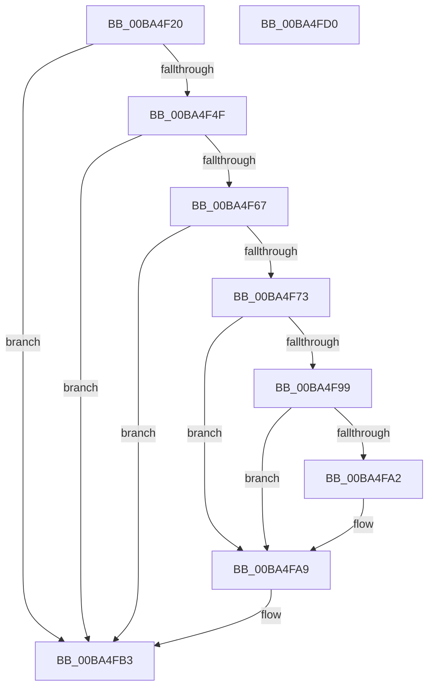

# VerifierKeAcquireInStackQueuedSpinLockAtDpcLevel

- RVA: `0x00BA4F20`–`0x00BA4FD1` (길이 `177` bytes)
- VA: `0x0000000140BA4F20`
- 실행 섹션: `PAGEVRFY`
- PDB 이름 있음: `예`; PDB Function 태그: `아니요`
- unwind 정보 RVA: `0x00065960`
- 디코드: `46`개 명령, `177/177` bytes 표시
- 미해석 바이트: `0` (있으면 어셈블리에 `.byte`로 보존)

> 이 문서는 커널 이미지의 기계어와 PDB 기호를 분석해 생성했습니다. 4번과 5번은 함수 원형과 자료형을 바이너리 사용 방식에서 추정한 C 해석이며 원본 소스 복구 결과는 아닙니다.

## 1. Dependencies

- 직접 호출 지점: **6**; 고유 호출 대상: **6**
- 직접 호출자로 확인된 함수: **0**
- RIP 상대 이미지 참조: **5**

### Outgoing calls
- `0x00BA4F5E` → [ViTargetUpdateTreeAllowed](../B9/ViTargetUpdateTreeAllowed_function_00B9BC04.md) (function, `0x00B9BC04`)
- `0x00BA4F6A` → [VfDriverIsKernelImageAddress](../BB/VfDriverIsKernelImageAddress_function_00BB7EBC.md) (function, `0x00BB7EBC`)
- `0x00BA4F7B` → [VfAvlInitializeLockContext](../../text/4A/VfAvlInitializeLockContext_function_004A686C.md) (function, `0x004A686C`)
- `0x00BA4F8F` → [VfAvlLookupTreeNode](../../text/3E/VfAvlLookupTreeNode_function_003EF1B4.md) (function, `0x003EF1B4`)
- `0x00BA4FAE` → [VfAvlCleanupLockContext](../../text/3E/VfAvlCleanupLockContext_function_003EF56C.md) (function, `0x003EF56C`)
- `0x00BA4FC0` → [guard_dispatch_icall](../../text/6B/guard_dispatch_icall_function_006BAAD0.md) (function, `0x006BAAD0`)

### Direct callers
- 이 함수 시작 RVA로 연결되는 직접 call은 확인되지 않았습니다. 간접 호출은 완전히 역산할 수 없습니다.

### Static image references
- `0x00BA4F2A` → RVA `0x00F04A28` (`.data`; read)
- `0x00BA4F38` → RVA `0x00F04A20` (`.data`; read)
- `0x00BA4F42` → RVA `0x00F04A28` (`.data`; write)
- `0x00BA4F83` → RVA `0x00F049A0` (`.data`; read)
- `0x00BA4FB3` → RVA `0x00FFE668` (`PAGEVRFD`; read)

## 2. Other-region calls and transfers

- 다른 실행 섹션으로 향하는 call: **4**
  - `0x00BA4F7B` → [VfAvlInitializeLockContext](../../text/4A/VfAvlInitializeLockContext_function_004A686C.md) (`PAGEVRFY` → `.text`)
  - `0x00BA4F8F` → [VfAvlLookupTreeNode](../../text/3E/VfAvlLookupTreeNode_function_003EF1B4.md) (`PAGEVRFY` → `.text`)
  - `0x00BA4FAE` → [VfAvlCleanupLockContext](../../text/3E/VfAvlCleanupLockContext_function_003EF56C.md) (`PAGEVRFY` → `.text`)
  - `0x00BA4FC0` → [guard_dispatch_icall](../../text/6B/guard_dispatch_icall_function_006BAAD0.md) (`PAGEVRFY` → `.text`)
- 별도 외부 분기/꼬리 이동을 확인하지 못했습니다.

## 3. Assembly (complete function range)

```asm
00BA4F20  48 89 5C 24 08                  mov qword ptr [rsp + 8], rbx
00BA4F25  57                              push rdi
00BA4F26  48 83 EC 40                     sub rsp, 0x40
00BA4F2A  8B 05 F8 FA 35 00               mov eax, dword ptr [rip + 0x35faf8]
00BA4F30  48 8B DA                        mov rbx, rdx
00BA4F33  FF C0                           inc eax
00BA4F35  48 8B F9                        mov rdi, rcx
00BA4F38  F7 05 DE FA 35 00 00 10 00 00   test dword ptr [rip + 0x35fade], 0x1000
00BA4F42  89 05 E0 FA 35 00               mov dword ptr [rip + 0x35fae0], eax
00BA4F48  4C 8B 44 24 48                  mov r8, qword ptr [rsp + 0x48]
00BA4F4D  74 64                           je 0x140ba4fb3
00BA4F4F  33 C0                           xor eax, eax
00BA4F51  0F 57 C0                        xorps xmm0, xmm0
00BA4F54  0F 11 44 24 20                  movups xmmword ptr [rsp + 0x20], xmm0
00BA4F59  48 89 44 24 30                  mov qword ptr [rsp + 0x30], rax
00BA4F5E  E8 A1 6C FF FF                  call 0x140b9bc04
00BA4F63  85 C0                           test eax, eax
00BA4F65  74 4C                           je 0x140ba4fb3
00BA4F67  49 8B C8                        mov rcx, r8
00BA4F6A  E8 4D 2F 01 00                  call 0x140bb7ebc
00BA4F6F  85 C0                           test eax, eax
00BA4F71  75 40                           jne 0x140ba4fb3
00BA4F73  8D 50 01                        lea edx, [rax + 1]
00BA4F76  48 8D 4C 24 20                  lea rcx, [rsp + 0x20]
00BA4F7B  E8 EC 18 90 FF                  call 0x1404a686c
00BA4F80  44 8B CA                        mov r9d, edx
00BA4F83  48 8D 0D 16 FA 35 00            lea rcx, [rip + 0x35fa16]
00BA4F8A  48 8D 54 24 20                  lea rdx, [rsp + 0x20]
00BA4F8F  E8 20 A2 84 FF                  call 0x1403ef1b4
00BA4F94  48 85 C0                        test rax, rax
00BA4F97  74 10                           je 0x140ba4fa9
00BA4F99  48 8B 40 40                     mov rax, qword ptr [rax + 0x40]
00BA4F9D  48 85 C0                        test rax, rax
00BA4FA0  74 07                           je 0x140ba4fa9
00BA4FA2  F0 FF 80 A4 00 00 00            lock inc dword ptr [rax + 0xa4]
00BA4FA9  48 8D 4C 24 20                  lea rcx, [rsp + 0x20]
00BA4FAE  E8 B9 A5 84 FF                  call 0x1403ef56c
00BA4FB3  48 8B 05 AE 96 45 00            mov rax, qword ptr [rip + 0x4596ae]
00BA4FBA  48 8B D3                        mov rdx, rbx
00BA4FBD  48 8B CF                        mov rcx, rdi
00BA4FC0  E8 0B 5B B1 FF                  call 0x1406baad0
00BA4FC5  48 8B 5C 24 50                  mov rbx, qword ptr [rsp + 0x50]
00BA4FCA  48 83 C4 40                     add rsp, 0x40
00BA4FCE  5F                              pop rdi
00BA4FCF  C3                              ret
00BA4FD0  CC                              int3
```

## 4. C-style interpretation (structured pseudocode)

```c
__int64 __fastcall VerifierKeAcquireInStackQueuedSpinLockAtDpcLevel(__int64 a1, __int64 a2)
{
    __int64 result;
    __int64 v_rsp;
    unsigned __int64 v_stack_m18;
    unsigned __int64 v_stack_m28;
    unsigned __int64 v_stack_p0;
    unsigned __int64 v_stack_p8;

    v_stack_p8 = v_rbx;
    v_rsp = (v_rsp) - (64);
    result = (unsigned int)(((unsigned int)(*(unsigned int *)(v_rip + 3537656))) + 1);
    *(unsigned int *)(v_rip + 3537632) = (unsigned int)(result);
    if (((*(unsigned int *)(v_rip + 3537630)) & (0x1000ULL)) == 0) goto loc_00BA4FB3;
    result = 0;
    v_stack_m28 = v_xmm0;
    v_stack_m18 = 0;
    result = ViTargetUpdateTreeAllowed(a1, a2, v_stack_p0, a4);
    if ((unsigned int)(result) == 0) goto loc_00BA4FB3;
    result = VfDriverIsKernelImageAddress(v_stack_p0, a2, v_stack_p0, a4);
    if ((unsigned int)(result) != 0) goto loc_00BA4FB3;
    result = VfAvlInitializeLockContext(v_stack_m28, result + 1, v_stack_p0, a4);
    result = VfAvlLookupTreeNode(v_rip + 3537430, v_stack_m28, v_stack_p0, (unsigned int)((unsigned int)(result + 1)));
    if (result == 0) goto loc_00BA4FA9;
    if (*(unsigned __int64 *)(result + 64) != 0) {
    }
    result = VfAvlCleanupLockContext(v_stack_m28, v_stack_m28, v_stack_p0, (unsigned int)((unsigned int)(result + 1)));
loc_00BA4FB3:
    result = guard_dispatch_icall(a1, a2, v_stack_p0, (unsigned int)((unsigned int)(result + 1)));
    v_rsp = (v_rsp) + (64);
    return result;
}
```

## 5. (Beta) C Style

```c
int64_t VerifierKeAcquireInStackQueuedSpinLockAtDpcLevel(int64_t Arg1, int64_t Arg2)
{
    int64_t result;
    int64_t local_rsp;
    uint64_t v_stack_m18;
    uint64_t v_stack_m28;
    uint64_t v_stack_p0;
    uint64_t v_stack_p8;

    v_stack_p8 = local_rbx;
    local_rsp = (local_rsp) - (64);
    result = (uint32_t)(((uint32_t)(*(uint32_t *)(v_rip + 0x35FAF8))) + 1);
    *(uint32_t *)(v_rip + 0x35FAE0) = (uint32_t)(result);
    if (((*(uint32_t *)(v_rip + 0x35FADE)) & (0x1000ULL)) == 0) goto loc_00BA4FB3;
    result = 0;
    v_stack_m28 = v_xmm0;
    v_stack_m18 = 0;
    result = ViTargetUpdateTreeAllowed(Arg1, Arg2, v_stack_p0, a4);
    if ((uint32_t)(result) == 0) goto loc_00BA4FB3;
    result = VfDriverIsKernelImageAddress(v_stack_p0, Arg2, v_stack_p0, a4);
    if ((uint32_t)(result) != 0) goto loc_00BA4FB3;
    result = VfAvlInitializeLockContext(v_stack_m28, result + 1, v_stack_p0, a4);
    result = VfAvlLookupTreeNode(v_rip + 3537430, v_stack_m28, v_stack_p0, (uint32_t)((uint32_t)(result + 1)));
    if (result == 0) goto loc_00BA4FA9;
    if (*(uint64_t *)(result + 0x40) != 0) {
    }
    result = VfAvlCleanupLockContext(v_stack_m28, v_stack_m28, v_stack_p0, (uint32_t)((uint32_t)(result + 1)));
loc_00BA4FB3:
    result = guard_dispatch_icall(Arg1, Arg2, v_stack_p0, (uint32_t)((uint32_t)(result + 1)));
    local_rsp = (local_rsp) + (64);
    return result;
}
```

## 6. Execution-region graph

[열기: 2D/3D 그래프와 함수 탐색 컨트롤 패널](../../../control-panel.html?section=pagevrfy&rva=0x00BA4F20&view=graph)

- 2D 그래프는 위에서 아래로 흐르고, 3D 그래프는 빈 공간을 드래그해 회전합니다. Shift+드래그는 이동, 휠은 확대·축소, 함수 노드 선택은 대상 보고서 이동입니다.

### Static fallback


