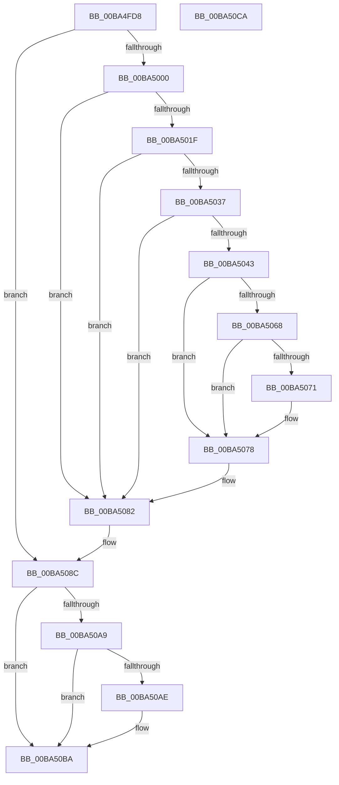

# VerifierKeAcquireInStackQueuedSpinLockCommon

- RVA: `0x00BA4FD8`–`0x00BA50CB` (길이 `243` bytes)
- VA: `0x0000000140BA4FD8`
- 실행 섹션: `PAGEVRFY`
- PDB 이름 있음: `예`; PDB Function 태그: `아니요`
- unwind 정보 RVA: `0x00086C28`
- 디코드: `63`개 명령, `243/243` bytes 표시
- 미해석 바이트: `0` (있으면 어셈블리에 `.byte`로 보존)

> 이 문서는 커널 이미지의 기계어와 PDB 기호를 분석해 생성했습니다. 4번과 5번은 함수 원형과 자료형을 바이너리 사용 방식에서 추정한 C 해석이며 원본 소스 복구 결과는 아닙니다.

## 1. Dependencies

- 직접 호출 지점: **7**; 고유 호출 대상: **7**
- 직접 호출자로 확인된 함수: **1**
- RIP 상대 이미지 참조: **6**

### Outgoing calls
- `0x00BA502E` → [ViTargetUpdateTreeAllowed](../B9/ViTargetUpdateTreeAllowed_function_00B9BC04.md) (function, `0x00B9BC04`)
- `0x00BA503A` → [VfDriverIsKernelImageAddress](../BB/VfDriverIsKernelImageAddress_function_00BB7EBC.md) (function, `0x00BB7EBC`)
- `0x00BA504A` → [VfAvlInitializeLockContext](../../text/4A/VfAvlInitializeLockContext_function_004A686C.md) (function, `0x004A686C`)
- `0x00BA505E` → [VfAvlLookupTreeNode](../../text/3E/VfAvlLookupTreeNode_function_003EF1B4.md) (function, `0x003EF1B4`)
- `0x00BA507D` → [VfAvlCleanupLockContext](../../text/3E/VfAvlCleanupLockContext_function_003EF56C.md) (function, `0x003EF56C`)
- `0x00BA5084` → [ViKeIrqlLogAndTrimMemory](../BB/ViKeIrqlLogAndTrimMemory_function_00BB7F58.md) (function, `0x00BB7F58`)
- `0x00BA5099` → [guard_dispatch_icall](../../text/6B/guard_dispatch_icall_function_006BAAD0.md) (function, `0x006BAAD0`)

### Direct callers
- [VerifierKeAcquireInStackQueuedSpinLock](VerifierKeAcquireInStackQueuedSpinLock_function_00BA4F00.md) at `0x00BA4F0C`

### Static image references
- `0x00BA4FE7` → RVA `0x00E681A0` (`.data`; read)
- `0x00BA5000` → RVA `0x00F04A28` (`.data`; read)
- `0x00BA500D` → RVA `0x00F04A20` (`.data`; read)
- `0x00BA5017` → RVA `0x00F04A28` (`.data`; write)
- `0x00BA5057` → RVA `0x00F049A0` (`.data`; read)
- `0x00BA508C` → RVA `0x00FFDC40` (`PAGEVRFD`; read)

## 2. Other-region calls and transfers

- 다른 실행 섹션으로 향하는 call: **4**
  - `0x00BA504A` → [VfAvlInitializeLockContext](../../text/4A/VfAvlInitializeLockContext_function_004A686C.md) (`PAGEVRFY` → `.text`)
  - `0x00BA505E` → [VfAvlLookupTreeNode](../../text/3E/VfAvlLookupTreeNode_function_003EF1B4.md) (`PAGEVRFY` → `.text`)
  - `0x00BA507D` → [VfAvlCleanupLockContext](../../text/3E/VfAvlCleanupLockContext_function_003EF56C.md) (`PAGEVRFY` → `.text`)
  - `0x00BA5099` → [guard_dispatch_icall](../../text/6B/guard_dispatch_icall_function_006BAAD0.md) (`PAGEVRFY` → `.text`)
- 별도 외부 분기/꼬리 이동을 확인하지 못했습니다.

## 3. Assembly (complete function range)

```asm
00BA4FD8  48 89 5C 24 08                  mov qword ptr [rsp + 8], rbx
00BA4FDD  48 89 74 24 10                  mov qword ptr [rsp + 0x10], rsi
00BA4FE2  57                              push rdi
00BA4FE3  48 83 EC 40                     sub rsp, 0x40
00BA4FE7  8B 05 B3 31 2C 00               mov eax, dword ptr [rip + 0x2c31b3]
00BA4FED  33 DB                           xor ebx, ebx
00BA4FEF  49 8B F8                        mov rdi, r8
00BA4FF2  4C 8B C2                        mov r8, rdx
00BA4FF5  48 8B F1                        mov rsi, rcx
00BA4FF8  A8 02                           test al, 2
00BA4FFA  0F 84 8C 00 00 00               je 0x140ba508c
00BA5000  8B 05 22 FA 35 00               mov eax, dword ptr [rip + 0x35fa22]
00BA5006  BB 01 00 00 00                  mov ebx, 1
00BA500B  03 C3                           add eax, ebx
00BA500D  F7 05 09 FA 35 00 00 10 00 00   test dword ptr [rip + 0x35fa09], 0x1000
00BA5017  89 05 0B FA 35 00               mov dword ptr [rip + 0x35fa0b], eax
00BA501D  74 63                           je 0x140ba5082
00BA501F  33 C0                           xor eax, eax
00BA5021  0F 57 C0                        xorps xmm0, xmm0
00BA5024  0F 11 44 24 20                  movups xmmword ptr [rsp + 0x20], xmm0
00BA5029  48 89 44 24 30                  mov qword ptr [rsp + 0x30], rax
00BA502E  E8 D1 6B FF FF                  call 0x140b9bc04
00BA5033  85 C0                           test eax, eax
00BA5035  74 4B                           je 0x140ba5082
00BA5037  49 8B C8                        mov rcx, r8
00BA503A  E8 7D 2E 01 00                  call 0x140bb7ebc
00BA503F  85 C0                           test eax, eax
00BA5041  75 3F                           jne 0x140ba5082
00BA5043  8B D3                           mov edx, ebx
00BA5045  48 8D 4C 24 20                  lea rcx, [rsp + 0x20]
00BA504A  E8 1D 18 90 FF                  call 0x1404a686c
00BA504F  44 8B CB                        mov r9d, ebx
00BA5052  48 8D 54 24 20                  lea rdx, [rsp + 0x20]
00BA5057  48 8D 0D 42 F9 35 00            lea rcx, [rip + 0x35f942]
00BA505E  E8 51 A1 84 FF                  call 0x1403ef1b4
00BA5063  48 85 C0                        test rax, rax
00BA5066  74 10                           je 0x140ba5078
00BA5068  48 8B 40 40                     mov rax, qword ptr [rax + 0x40]
00BA506C  48 85 C0                        test rax, rax
00BA506F  74 07                           je 0x140ba5078
00BA5071  F0 01 98 A4 00 00 00            lock add dword ptr [rax + 0xa4], ebx
00BA5078  48 8D 4C 24 20                  lea rcx, [rsp + 0x20]
00BA507D  E8 EA A4 84 FF                  call 0x1403ef56c
00BA5082  B1 02                           mov cl, 2
00BA5084  E8 CF 2E 01 00                  call 0x140bb7f58
00BA5089  48 8B D8                        mov rbx, rax
00BA508C  48 8B 05 AD 8B 45 00            mov rax, qword ptr [rip + 0x458bad]
00BA5093  48 8B D7                        mov rdx, rdi
00BA5096  48 8B CE                        mov rcx, rsi
00BA5099  E8 32 5A B1 FF                  call 0x1406baad0
00BA509E  8B 0D FC 30 2C 00               mov ecx, dword ptr [rip + 0x2c30fc]
00BA50A4  F6 C1 02                        test cl, 2
00BA50A7  74 11                           je 0x140ba50ba
00BA50A9  48 85 DB                        test rbx, rbx
00BA50AC  74 0C                           je 0x140ba50ba
00BA50AE  65 8B 04 25 A4 01 00 00         mov eax, dword ptr gs:[0x1a4]
00BA50B6  66 89 43 0A                     mov word ptr [rbx + 0xa], ax
00BA50BA  48 8B 5C 24 50                  mov rbx, qword ptr [rsp + 0x50]
00BA50BF  48 8B 74 24 58                  mov rsi, qword ptr [rsp + 0x58]
00BA50C4  48 83 C4 40                     add rsp, 0x40
00BA50C8  5F                              pop rdi
00BA50C9  C3                              ret
00BA50CA  CC                              int3
```

## 4. C-style interpretation (structured pseudocode)

```c
__int64 __fastcall VerifierKeAcquireInStackQueuedSpinLockCommon(__int64 a1, __int64 a2, __int64 a3)
{
    __int64 result;
    __int64 v_rbx;
    __int64 v_rsp;
    unsigned __int64 v_stack_m18;
    unsigned __int64 v_stack_m28;
    unsigned __int64 v_stack_p10;
    unsigned __int64 v_stack_p8;

    v_stack_p8 = v_rbx;
    v_stack_p10 = v_rsi;
    v_rsp = (v_rsp) - (64);
    v_rbx = 0;
    if ((((unsigned __int8)((unsigned int)(*(unsigned int *)(v_rip + 2896307)))) & (2)) == 0) goto loc_00BA508C;
    result = (unsigned int)(((unsigned int)(*(unsigned int *)(v_rip + 3537442))) + (1));
    *(unsigned int *)(v_rip + 3537419) = (unsigned int)(result);
    if (((*(unsigned int *)(v_rip + 3537417)) & (0x1000ULL)) == 0) goto loc_00BA5082;
    result = 0;
    v_stack_m28 = v_xmm0;
    v_stack_m18 = 0;
    result = ViTargetUpdateTreeAllowed(a1, a2, a2, a4);
    if ((unsigned int)(result) == 0) goto loc_00BA5082;
    result = VfDriverIsKernelImageAddress(a2, a2, a2, a4);
    if ((unsigned int)(result) != 0) goto loc_00BA5082;
    result = VfAvlInitializeLockContext(v_stack_m28, 1, a2, a4);
    result = VfAvlLookupTreeNode(v_rip + 3537218, v_stack_m28, a2, 1);
    if (result == 0) goto loc_00BA5078;
    if (*(unsigned __int64 *)(result + 64) != 0) {
    }
    result = VfAvlCleanupLockContext(v_stack_m28, v_stack_m28, a2, 1);
loc_00BA5082:
    result = ViKeIrqlLogAndTrimMemory(2, v_stack_m28, a2, 1);
loc_00BA508C:
    result = guard_dispatch_icall(a1, a3, a2, 1);
    if ((((unsigned __int8)((unsigned int)(*(unsigned int *)(v_rip + 2896124)))) & (2)) == 0) goto loc_00BA50BA;
    if (result != 0) {
        result = *(unsigned int *)(gs_base + (0 + 420));
        *(unsigned __int16 *)(result + 10) = (unsigned __int16)(result);
    }
    v_rsp = (v_rsp) + (64);
    return result;
}
```

## 5. (Beta) C Style

```c
int64_t VerifierKeAcquireInStackQueuedSpinLockCommon(int64_t Arg1, int64_t Arg2, int64_t Arg3)
{
    int64_t result;
    int64_t local_rbx;
    int64_t local_rsp;
    uint64_t v_stack_m18;
    uint64_t v_stack_m28;
    uint64_t v_stack_p10;
    uint64_t v_stack_p8;

    v_stack_p8 = local_rbx;
    v_stack_p10 = local_rsi;
    local_rsp = (local_rsp) - (64);
    local_rbx = 0;
    if ((((uint8_t)((uint32_t)(*(uint32_t *)(v_rip + 0x2C31B3)))) & (2)) == 0) goto loc_00BA508C;
    result = (uint32_t)(((uint32_t)(*(uint32_t *)(v_rip + 0x35FA22))) + (1));
    *(uint32_t *)(v_rip + 0x35FA0B) = (uint32_t)(result);
    if (((*(uint32_t *)(v_rip + 0x35FA09)) & (0x1000ULL)) == 0) goto loc_00BA5082;
    result = 0;
    v_stack_m28 = v_xmm0;
    v_stack_m18 = 0;
    result = ViTargetUpdateTreeAllowed(Arg1, Arg2, Arg2, a4);
    if ((uint32_t)(result) == 0) goto loc_00BA5082;
    result = VfDriverIsKernelImageAddress(Arg2, Arg2, Arg2, a4);
    if ((uint32_t)(result) != 0) goto loc_00BA5082;
    result = VfAvlInitializeLockContext(v_stack_m28, 1, Arg2, a4);
    result = VfAvlLookupTreeNode(v_rip + 3537218, v_stack_m28, Arg2, 1);
    if (result == 0) goto loc_00BA5078;
    if (*(uint64_t *)(result + 0x40) != 0) {
    }
    result = VfAvlCleanupLockContext(v_stack_m28, v_stack_m28, Arg2, 1);
loc_00BA5082:
    result = ViKeIrqlLogAndTrimMemory(2, v_stack_m28, Arg2, 1);
loc_00BA508C:
    result = guard_dispatch_icall(Arg1, Arg3, Arg2, 1);
    if ((((uint8_t)((uint32_t)(*(uint32_t *)(v_rip + 0x2C30FC)))) & (2)) == 0) goto loc_00BA50BA;
    if (result != 0) {
        result = *(uint32_t *)(gs_base + (0 + 0x1A4));
        *(uint16_t *)(result + 0xA) = (uint16_t)(result);
    }
    local_rsp = (local_rsp) + (64);
    return result;
}
```

## 6. Execution-region graph

[열기: 2D/3D 그래프와 함수 탐색 컨트롤 패널](../../../control-panel.html?section=pagevrfy&rva=0x00BA4FD8&view=graph)

- 2D 그래프는 위에서 아래로 흐르고, 3D 그래프는 빈 공간을 드래그해 회전합니다. Shift+드래그는 이동, 휠은 확대·축소, 함수 노드 선택은 대상 보고서 이동입니다.

### Static fallback


