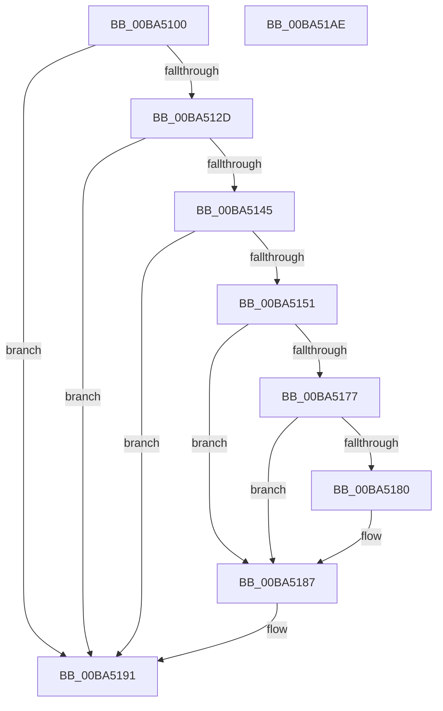

# VerifierKeAcquireInStackQueuedSpinLockForDpcCommon

- RVA: `0x00BA5100`–`0x00BA51AF` (길이 `175` bytes)
- VA: `0x0000000140BA5100`
- 실행 섹션: `PAGEVRFY`
- PDB 이름 있음: `예`; PDB Function 태그: `아니요`
- unwind 정보 RVA: `0x00065960`
- 디코드: `46`개 명령, `175/175` bytes 표시
- 미해석 바이트: `0` (있으면 어셈블리에 `.byte`로 보존)

> 이 문서는 커널 이미지의 기계어와 PDB 기호를 분석해 생성했습니다. 4번과 5번은 함수 원형과 자료형을 바이너리 사용 방식에서 추정한 C 해석이며 원본 소스 복구 결과는 아닙니다.

## 1. Dependencies

- 직접 호출 지점: **6**; 고유 호출 대상: **6**
- 직접 호출자로 확인된 함수: **1**
- RIP 상대 이미지 참조: **5**

### Outgoing calls
- `0x00BA513C` → [ViTargetUpdateTreeAllowed](../B9/ViTargetUpdateTreeAllowed_function_00B9BC04.md) (function, `0x00B9BC04`)
- `0x00BA5148` → [VfDriverIsKernelImageAddress](../BB/VfDriverIsKernelImageAddress_function_00BB7EBC.md) (function, `0x00BB7EBC`)
- `0x00BA5159` → [VfAvlInitializeLockContext](../../text/4A/VfAvlInitializeLockContext_function_004A686C.md) (function, `0x004A686C`)
- `0x00BA516D` → [VfAvlLookupTreeNode](../../text/3E/VfAvlLookupTreeNode_function_003EF1B4.md) (function, `0x003EF1B4`)
- `0x00BA518C` → [VfAvlCleanupLockContext](../../text/3E/VfAvlCleanupLockContext_function_003EF56C.md) (function, `0x003EF56C`)
- `0x00BA519E` → [guard_dispatch_icall](../../text/6B/guard_dispatch_icall_function_006BAAD0.md) (function, `0x006BAAD0`)

### Direct callers
- [VerifierKeAcquireInStackQueuedSpinLockForDpc](VerifierKeAcquireInStackQueuedSpinLockForDpc_function_00BA50E0.md) at `0x00BA50EC`

### Static image references
- `0x00BA510A` → RVA `0x00F04A28` (`.data`; read)
- `0x00BA5118` → RVA `0x00F04A20` (`.data`; read)
- `0x00BA5125` → RVA `0x00F04A28` (`.data`; write)
- `0x00BA5161` → RVA `0x00F049A0` (`.data`; read)
- `0x00BA5191` → RVA `0x00FFDC48` (`PAGEVRFD`; read)

## 2. Other-region calls and transfers

- 다른 실행 섹션으로 향하는 call: **4**
  - `0x00BA5159` → [VfAvlInitializeLockContext](../../text/4A/VfAvlInitializeLockContext_function_004A686C.md) (`PAGEVRFY` → `.text`)
  - `0x00BA516D` → [VfAvlLookupTreeNode](../../text/3E/VfAvlLookupTreeNode_function_003EF1B4.md) (`PAGEVRFY` → `.text`)
  - `0x00BA518C` → [VfAvlCleanupLockContext](../../text/3E/VfAvlCleanupLockContext_function_003EF56C.md) (`PAGEVRFY` → `.text`)
  - `0x00BA519E` → [guard_dispatch_icall](../../text/6B/guard_dispatch_icall_function_006BAAD0.md) (`PAGEVRFY` → `.text`)
- 별도 외부 분기/꼬리 이동을 확인하지 못했습니다.

## 3. Assembly (complete function range)

```asm
00BA5100  48 89 5C 24 08                  mov qword ptr [rsp + 8], rbx
00BA5105  57                              push rdi
00BA5106  48 83 EC 40                     sub rsp, 0x40
00BA510A  8B 05 18 F9 35 00               mov eax, dword ptr [rip + 0x35f918]
00BA5110  49 8B D8                        mov rbx, r8
00BA5113  FF C0                           inc eax
00BA5115  4C 8B C2                        mov r8, rdx
00BA5118  F7 05 FE F8 35 00 00 10 00 00   test dword ptr [rip + 0x35f8fe], 0x1000
00BA5122  48 8B F9                        mov rdi, rcx
00BA5125  89 05 FD F8 35 00               mov dword ptr [rip + 0x35f8fd], eax
00BA512B  74 64                           je 0x140ba5191
00BA512D  33 C0                           xor eax, eax
00BA512F  0F 57 C0                        xorps xmm0, xmm0
00BA5132  0F 11 44 24 20                  movups xmmword ptr [rsp + 0x20], xmm0
00BA5137  48 89 44 24 30                  mov qword ptr [rsp + 0x30], rax
00BA513C  E8 C3 6A FF FF                  call 0x140b9bc04
00BA5141  85 C0                           test eax, eax
00BA5143  74 4C                           je 0x140ba5191
00BA5145  49 8B C8                        mov rcx, r8
00BA5148  E8 6F 2D 01 00                  call 0x140bb7ebc
00BA514D  85 C0                           test eax, eax
00BA514F  75 40                           jne 0x140ba5191
00BA5151  8D 50 01                        lea edx, [rax + 1]
00BA5154  48 8D 4C 24 20                  lea rcx, [rsp + 0x20]
00BA5159  E8 0E 17 90 FF                  call 0x1404a686c
00BA515E  44 8B CA                        mov r9d, edx
00BA5161  48 8D 0D 38 F8 35 00            lea rcx, [rip + 0x35f838]
00BA5168  48 8D 54 24 20                  lea rdx, [rsp + 0x20]
00BA516D  E8 42 A0 84 FF                  call 0x1403ef1b4
00BA5172  48 85 C0                        test rax, rax
00BA5175  74 10                           je 0x140ba5187
00BA5177  48 8B 40 40                     mov rax, qword ptr [rax + 0x40]
00BA517B  48 85 C0                        test rax, rax
00BA517E  74 07                           je 0x140ba5187
00BA5180  F0 FF 80 A4 00 00 00            lock inc dword ptr [rax + 0xa4]
00BA5187  48 8D 4C 24 20                  lea rcx, [rsp + 0x20]
00BA518C  E8 DB A3 84 FF                  call 0x1403ef56c
00BA5191  48 8B 05 B0 8A 45 00            mov rax, qword ptr [rip + 0x458ab0]
00BA5198  48 8B D3                        mov rdx, rbx
00BA519B  48 8B CF                        mov rcx, rdi
00BA519E  E8 2D 59 B1 FF                  call 0x1406baad0
00BA51A3  48 8B 5C 24 50                  mov rbx, qword ptr [rsp + 0x50]
00BA51A8  48 83 C4 40                     add rsp, 0x40
00BA51AC  5F                              pop rdi
00BA51AD  C3                              ret
00BA51AE  CC                              int3
```

## 4. C-style interpretation (structured pseudocode)

```c
__int64 __fastcall VerifierKeAcquireInStackQueuedSpinLockForDpcCommon(__int64 a1, __int64 a2, __int64 a3)
{
    __int64 result;
    __int64 v_rsp;
    unsigned __int64 v_stack_m18;
    unsigned __int64 v_stack_m28;
    unsigned __int64 v_stack_p8;

    v_stack_p8 = v_rbx;
    v_rsp = (v_rsp) - (64);
    result = (unsigned int)(((unsigned int)(*(unsigned int *)(v_rip + 3537176))) + 1);
    *(unsigned int *)(v_rip + 3537149) = (unsigned int)(result);
    if (((*(unsigned int *)(v_rip + 3537150)) & (0x1000ULL)) == 0) goto loc_00BA5191;
    result = 0;
    v_stack_m28 = v_xmm0;
    v_stack_m18 = 0;
    result = ViTargetUpdateTreeAllowed(a1, a2, a2, a4);
    if ((unsigned int)(result) == 0) goto loc_00BA5191;
    result = VfDriverIsKernelImageAddress(a2, a2, a2, a4);
    if ((unsigned int)(result) != 0) goto loc_00BA5191;
    result = VfAvlInitializeLockContext(v_stack_m28, result + 1, a2, a4);
    result = VfAvlLookupTreeNode(v_rip + 3536952, v_stack_m28, a2, (unsigned int)((unsigned int)(result + 1)));
    if (result == 0) goto loc_00BA5187;
    if (*(unsigned __int64 *)(result + 64) != 0) {
    }
    result = VfAvlCleanupLockContext(v_stack_m28, v_stack_m28, a2, (unsigned int)((unsigned int)(result + 1)));
loc_00BA5191:
    result = guard_dispatch_icall(a1, a3, a2, (unsigned int)((unsigned int)(result + 1)));
    v_rsp = (v_rsp) + (64);
    return result;
}
```

## 5. (Beta) C Style

```c
int64_t VerifierKeAcquireInStackQueuedSpinLockForDpcCommon(int64_t Arg1, int64_t Arg2, int64_t Arg3)
{
    int64_t result;
    int64_t local_rsp;
    uint64_t v_stack_m18;
    uint64_t v_stack_m28;
    uint64_t v_stack_p8;

    v_stack_p8 = local_rbx;
    local_rsp = (local_rsp) - (64);
    result = (uint32_t)(((uint32_t)(*(uint32_t *)(v_rip + 0x35F918))) + 1);
    *(uint32_t *)(v_rip + 0x35F8FD) = (uint32_t)(result);
    if (((*(uint32_t *)(v_rip + 0x35F8FE)) & (0x1000ULL)) == 0) goto loc_00BA5191;
    result = 0;
    v_stack_m28 = v_xmm0;
    v_stack_m18 = 0;
    result = ViTargetUpdateTreeAllowed(Arg1, Arg2, Arg2, a4);
    if ((uint32_t)(result) == 0) goto loc_00BA5191;
    result = VfDriverIsKernelImageAddress(Arg2, Arg2, Arg2, a4);
    if ((uint32_t)(result) != 0) goto loc_00BA5191;
    result = VfAvlInitializeLockContext(v_stack_m28, result + 1, Arg2, a4);
    result = VfAvlLookupTreeNode(v_rip + 3536952, v_stack_m28, Arg2, (uint32_t)((uint32_t)(result + 1)));
    if (result == 0) goto loc_00BA5187;
    if (*(uint64_t *)(result + 0x40) != 0) {
    }
    result = VfAvlCleanupLockContext(v_stack_m28, v_stack_m28, Arg2, (uint32_t)((uint32_t)(result + 1)));
loc_00BA5191:
    result = guard_dispatch_icall(Arg1, Arg3, Arg2, (uint32_t)((uint32_t)(result + 1)));
    local_rsp = (local_rsp) + (64);
    return result;
}
```

## 6. Execution-region graph

[열기: 2D/3D 그래프와 함수 탐색 컨트롤 패널](../../../control-panel.html?section=pagevrfy&rva=0x00BA5100&view=graph)

- 2D 그래프는 위에서 아래로 흐르고, 3D 그래프는 빈 공간을 드래그해 회전합니다. Shift+드래그는 이동, 휠은 확대·축소, 함수 노드 선택은 대상 보고서 이동입니다.

### Static fallback


