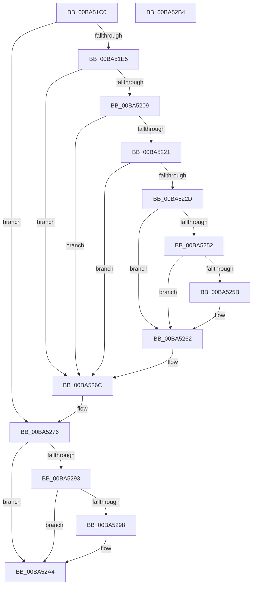

# VerifierKeAcquireInStackQueuedSpinLockRaiseToSynch

- RVA: `0x00BA51C0`–`0x00BA52B5` (길이 `245` bytes)
- VA: `0x0000000140BA51C0`
- 실행 섹션: `PAGEVRFY`
- PDB 이름 있음: `예`; PDB Function 태그: `아니요`
- unwind 정보 RVA: `0x00086C28`
- 디코드: `63`개 명령, `245/245` bytes 표시
- 미해석 바이트: `0` (있으면 어셈블리에 `.byte`로 보존)

> 이 문서는 커널 이미지의 기계어와 PDB 기호를 분석해 생성했습니다. 4번과 5번은 함수 원형과 자료형을 바이너리 사용 방식에서 추정한 C 해석이며 원본 소스 복구 결과는 아닙니다.

## 1. Dependencies

- 직접 호출 지점: **7**; 고유 호출 대상: **7**
- 직접 호출자로 확인된 함수: **0**
- RIP 상대 이미지 참조: **6**

### Outgoing calls
- `0x00BA5218` → [ViTargetUpdateTreeAllowed](../B9/ViTargetUpdateTreeAllowed_function_00B9BC04.md) (function, `0x00B9BC04`)
- `0x00BA5224` → [VfDriverIsKernelImageAddress](../BB/VfDriverIsKernelImageAddress_function_00BB7EBC.md) (function, `0x00BB7EBC`)
- `0x00BA5234` → [VfAvlInitializeLockContext](../../text/4A/VfAvlInitializeLockContext_function_004A686C.md) (function, `0x004A686C`)
- `0x00BA5248` → [VfAvlLookupTreeNode](../../text/3E/VfAvlLookupTreeNode_function_003EF1B4.md) (function, `0x003EF1B4`)
- `0x00BA5267` → [VfAvlCleanupLockContext](../../text/3E/VfAvlCleanupLockContext_function_003EF56C.md) (function, `0x003EF56C`)
- `0x00BA526E` → [ViKeIrqlLogAndTrimMemory](../BB/ViKeIrqlLogAndTrimMemory_function_00BB7F58.md) (function, `0x00BB7F58`)
- `0x00BA5283` → [guard_dispatch_icall](../../text/6B/guard_dispatch_icall_function_006BAAD0.md) (function, `0x006BAAD0`)

### Direct callers
- 이 함수 시작 RVA로 연결되는 직접 call은 확인되지 않았습니다. 간접 호출은 완전히 역산할 수 없습니다.

### Static image references
- `0x00BA51CF` → RVA `0x00E681A0` (`.data`; read)
- `0x00BA51E5` → RVA `0x00F04A28` (`.data`; read)
- `0x00BA51F2` → RVA `0x00F04A20` (`.data`; read)
- `0x00BA51FC` → RVA `0x00F04A28` (`.data`; write)
- `0x00BA5241` → RVA `0x00F049A0` (`.data`; read)
- `0x00BA5276` → RVA `0x00FFE678` (`PAGEVRFD`; read)

## 2. Other-region calls and transfers

- 다른 실행 섹션으로 향하는 call: **4**
  - `0x00BA5234` → [VfAvlInitializeLockContext](../../text/4A/VfAvlInitializeLockContext_function_004A686C.md) (`PAGEVRFY` → `.text`)
  - `0x00BA5248` → [VfAvlLookupTreeNode](../../text/3E/VfAvlLookupTreeNode_function_003EF1B4.md) (`PAGEVRFY` → `.text`)
  - `0x00BA5267` → [VfAvlCleanupLockContext](../../text/3E/VfAvlCleanupLockContext_function_003EF56C.md) (`PAGEVRFY` → `.text`)
  - `0x00BA5283` → [guard_dispatch_icall](../../text/6B/guard_dispatch_icall_function_006BAAD0.md) (`PAGEVRFY` → `.text`)
- 별도 외부 분기/꼬리 이동을 확인하지 못했습니다.

## 3. Assembly (complete function range)

```asm
00BA51C0  48 89 5C 24 08                  mov qword ptr [rsp + 8], rbx
00BA51C5  48 89 74 24 10                  mov qword ptr [rsp + 0x10], rsi
00BA51CA  57                              push rdi
00BA51CB  48 83 EC 40                     sub rsp, 0x40
00BA51CF  8B 05 CB 2F 2C 00               mov eax, dword ptr [rip + 0x2c2fcb]
00BA51D5  33 DB                           xor ebx, ebx
00BA51D7  48 8B FA                        mov rdi, rdx
00BA51DA  48 8B F1                        mov rsi, rcx
00BA51DD  A8 02                           test al, 2
00BA51DF  0F 84 91 00 00 00               je 0x140ba5276
00BA51E5  8B 05 3D F8 35 00               mov eax, dword ptr [rip + 0x35f83d]
00BA51EB  BB 01 00 00 00                  mov ebx, 1
00BA51F0  03 C3                           add eax, ebx
00BA51F2  F7 05 24 F8 35 00 00 10 00 00   test dword ptr [rip + 0x35f824], 0x1000
00BA51FC  89 05 26 F8 35 00               mov dword ptr [rip + 0x35f826], eax
00BA5202  4C 8B 44 24 48                  mov r8, qword ptr [rsp + 0x48]
00BA5207  74 63                           je 0x140ba526c
00BA5209  33 C0                           xor eax, eax
00BA520B  0F 57 C0                        xorps xmm0, xmm0
00BA520E  0F 11 44 24 20                  movups xmmword ptr [rsp + 0x20], xmm0
00BA5213  48 89 44 24 30                  mov qword ptr [rsp + 0x30], rax
00BA5218  E8 E7 69 FF FF                  call 0x140b9bc04
00BA521D  85 C0                           test eax, eax
00BA521F  74 4B                           je 0x140ba526c
00BA5221  49 8B C8                        mov rcx, r8
00BA5224  E8 93 2C 01 00                  call 0x140bb7ebc
00BA5229  85 C0                           test eax, eax
00BA522B  75 3F                           jne 0x140ba526c
00BA522D  8B D3                           mov edx, ebx
00BA522F  48 8D 4C 24 20                  lea rcx, [rsp + 0x20]
00BA5234  E8 33 16 90 FF                  call 0x1404a686c
00BA5239  44 8B CB                        mov r9d, ebx
00BA523C  48 8D 54 24 20                  lea rdx, [rsp + 0x20]
00BA5241  48 8D 0D 58 F7 35 00            lea rcx, [rip + 0x35f758]
00BA5248  E8 67 9F 84 FF                  call 0x1403ef1b4
00BA524D  48 85 C0                        test rax, rax
00BA5250  74 10                           je 0x140ba5262
00BA5252  48 8B 40 40                     mov rax, qword ptr [rax + 0x40]
00BA5256  48 85 C0                        test rax, rax
00BA5259  74 07                           je 0x140ba5262
00BA525B  F0 01 98 A4 00 00 00            lock add dword ptr [rax + 0xa4], ebx
00BA5262  48 8D 4C 24 20                  lea rcx, [rsp + 0x20]
00BA5267  E8 00 A3 84 FF                  call 0x1403ef56c
00BA526C  B1 0C                           mov cl, 0xc
00BA526E  E8 E5 2C 01 00                  call 0x140bb7f58
00BA5273  48 8B D8                        mov rbx, rax
00BA5276  48 8B 05 FB 93 45 00            mov rax, qword ptr [rip + 0x4593fb]
00BA527D  48 8B D7                        mov rdx, rdi
00BA5280  48 8B CE                        mov rcx, rsi
00BA5283  E8 48 58 B1 FF                  call 0x1406baad0
00BA5288  8B 0D 12 2F 2C 00               mov ecx, dword ptr [rip + 0x2c2f12]
00BA528E  F6 C1 02                        test cl, 2
00BA5291  74 11                           je 0x140ba52a4
00BA5293  48 85 DB                        test rbx, rbx
00BA5296  74 0C                           je 0x140ba52a4
00BA5298  65 8B 04 25 A4 01 00 00         mov eax, dword ptr gs:[0x1a4]
00BA52A0  66 89 43 0A                     mov word ptr [rbx + 0xa], ax
00BA52A4  48 8B 5C 24 50                  mov rbx, qword ptr [rsp + 0x50]
00BA52A9  48 8B 74 24 58                  mov rsi, qword ptr [rsp + 0x58]
00BA52AE  48 83 C4 40                     add rsp, 0x40
00BA52B2  5F                              pop rdi
00BA52B3  C3                              ret
00BA52B4  CC                              int3
```

## 4. C-style interpretation (structured pseudocode)

```c
__int64 __fastcall VerifierKeAcquireInStackQueuedSpinLockRaiseToSynch(__int64 a1, __int64 a2)
{
    __int64 result;
    __int64 v_rbx;
    __int64 v_rsp;
    unsigned __int64 v_stack_m18;
    unsigned __int64 v_stack_m28;
    unsigned __int64 v_stack_p0;
    unsigned __int64 v_stack_p10;
    unsigned __int64 v_stack_p8;

    v_stack_p8 = v_rbx;
    v_stack_p10 = v_rsi;
    v_rsp = (v_rsp) - (64);
    v_rbx = 0;
    if ((((unsigned __int8)((unsigned int)(*(unsigned int *)(v_rip + 2895819)))) & (2)) == 0) goto loc_00BA5276;
    result = (unsigned int)(((unsigned int)(*(unsigned int *)(v_rip + 3536957))) + (1));
    *(unsigned int *)(v_rip + 3536934) = (unsigned int)(result);
    if (((*(unsigned int *)(v_rip + 3536932)) & (0x1000ULL)) == 0) goto loc_00BA526C;
    result = 0;
    v_stack_m28 = v_xmm0;
    v_stack_m18 = 0;
    result = ViTargetUpdateTreeAllowed(a1, a2, v_stack_p0, a4);
    if ((unsigned int)(result) == 0) goto loc_00BA526C;
    result = VfDriverIsKernelImageAddress(v_stack_p0, a2, v_stack_p0, a4);
    if ((unsigned int)(result) != 0) goto loc_00BA526C;
    result = VfAvlInitializeLockContext(v_stack_m28, 1, v_stack_p0, a4);
    result = VfAvlLookupTreeNode(v_rip + 3536728, v_stack_m28, v_stack_p0, 1);
    if (result == 0) goto loc_00BA5262;
    if (*(unsigned __int64 *)(result + 64) != 0) {
    }
    result = VfAvlCleanupLockContext(v_stack_m28, v_stack_m28, v_stack_p0, 1);
loc_00BA526C:
    result = ViKeIrqlLogAndTrimMemory(12, v_stack_m28, v_stack_p0, 1);
loc_00BA5276:
    result = guard_dispatch_icall(a1, a2, v_stack_p0, 1);
    if ((((unsigned __int8)((unsigned int)(*(unsigned int *)(v_rip + 2895634)))) & (2)) == 0) goto loc_00BA52A4;
    if (result != 0) {
        result = *(unsigned int *)(gs_base + (0 + 420));
        *(unsigned __int16 *)(result + 10) = (unsigned __int16)(result);
    }
    v_rsp = (v_rsp) + (64);
    return result;
}
```

## 5. (Beta) C Style

```c
int64_t VerifierKeAcquireInStackQueuedSpinLockRaiseToSynch(int64_t Arg1, int64_t Arg2)
{
    int64_t result;
    int64_t local_rbx;
    int64_t local_rsp;
    uint64_t v_stack_m18;
    uint64_t v_stack_m28;
    uint64_t v_stack_p0;
    uint64_t v_stack_p10;
    uint64_t v_stack_p8;

    v_stack_p8 = local_rbx;
    v_stack_p10 = local_rsi;
    local_rsp = (local_rsp) - (64);
    local_rbx = 0;
    if ((((uint8_t)((uint32_t)(*(uint32_t *)(v_rip + 0x2C2FCB)))) & (2)) == 0) goto loc_00BA5276;
    result = (uint32_t)(((uint32_t)(*(uint32_t *)(v_rip + 0x35F83D))) + (1));
    *(uint32_t *)(v_rip + 0x35F826) = (uint32_t)(result);
    if (((*(uint32_t *)(v_rip + 0x35F824)) & (0x1000ULL)) == 0) goto loc_00BA526C;
    result = 0;
    v_stack_m28 = v_xmm0;
    v_stack_m18 = 0;
    result = ViTargetUpdateTreeAllowed(Arg1, Arg2, v_stack_p0, a4);
    if ((uint32_t)(result) == 0) goto loc_00BA526C;
    result = VfDriverIsKernelImageAddress(v_stack_p0, Arg2, v_stack_p0, a4);
    if ((uint32_t)(result) != 0) goto loc_00BA526C;
    result = VfAvlInitializeLockContext(v_stack_m28, 1, v_stack_p0, a4);
    result = VfAvlLookupTreeNode(v_rip + 3536728, v_stack_m28, v_stack_p0, 1);
    if (result == 0) goto loc_00BA5262;
    if (*(uint64_t *)(result + 0x40) != 0) {
    }
    result = VfAvlCleanupLockContext(v_stack_m28, v_stack_m28, v_stack_p0, 1);
loc_00BA526C:
    result = ViKeIrqlLogAndTrimMemory(12, v_stack_m28, v_stack_p0, 1);
loc_00BA5276:
    result = guard_dispatch_icall(Arg1, Arg2, v_stack_p0, 1);
    if ((((uint8_t)((uint32_t)(*(uint32_t *)(v_rip + 0x2C2F12)))) & (2)) == 0) goto loc_00BA52A4;
    if (result != 0) {
        result = *(uint32_t *)(gs_base + (0 + 0x1A4));
        *(uint16_t *)(result + 0xA) = (uint16_t)(result);
    }
    local_rsp = (local_rsp) + (64);
    return result;
}
```

## 6. Execution-region graph

[열기: 2D/3D 그래프와 함수 탐색 컨트롤 패널](../../../control-panel.html?section=pagevrfy&rva=0x00BA51C0&view=graph)

- 2D 그래프는 위에서 아래로 흐르고, 3D 그래프는 빈 공간을 드래그해 회전합니다. Shift+드래그는 이동, 휠은 확대·축소, 함수 노드 선택은 대상 보고서 이동입니다.

### Static fallback


