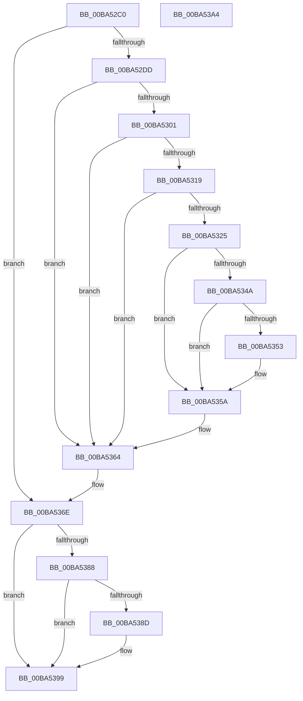

# VerifierKeAcquireQueuedSpinLockRaiseToSynch

- RVA: `0x00BA52C0`–`0x00BA53A5` (길이 `229` bytes)
- VA: `0x0000000140BA52C0`
- 실행 섹션: `PAGEVRFY`
- PDB 이름 있음: `예`; PDB Function 태그: `아니요`
- unwind 정보 RVA: `0x00065960`
- 디코드: `59`개 명령, `229/229` bytes 표시
- 미해석 바이트: `0` (있으면 어셈블리에 `.byte`로 보존)

> 이 문서는 커널 이미지의 기계어와 PDB 기호를 분석해 생성했습니다. 4번과 5번은 함수 원형과 자료형을 바이너리 사용 방식에서 추정한 C 해석이며 원본 소스 복구 결과는 아닙니다.

## 1. Dependencies

- 직접 호출 지점: **7**; 고유 호출 대상: **7**
- 직접 호출자로 확인된 함수: **0**
- RIP 상대 이미지 참조: **6**

### Outgoing calls
- `0x00BA5310` → [ViTargetUpdateTreeAllowed](../B9/ViTargetUpdateTreeAllowed_function_00B9BC04.md) (function, `0x00B9BC04`)
- `0x00BA531C` → [VfDriverIsKernelImageAddress](../BB/VfDriverIsKernelImageAddress_function_00BB7EBC.md) (function, `0x00BB7EBC`)
- `0x00BA532C` → [VfAvlInitializeLockContext](../../text/4A/VfAvlInitializeLockContext_function_004A686C.md) (function, `0x004A686C`)
- `0x00BA5340` → [VfAvlLookupTreeNode](../../text/3E/VfAvlLookupTreeNode_function_003EF1B4.md) (function, `0x003EF1B4`)
- `0x00BA535F` → [VfAvlCleanupLockContext](../../text/3E/VfAvlCleanupLockContext_function_003EF56C.md) (function, `0x003EF56C`)
- `0x00BA5366` → [ViKeIrqlLogAndTrimMemory](../BB/ViKeIrqlLogAndTrimMemory_function_00BB7F58.md) (function, `0x00BB7F58`)
- `0x00BA5378` → [guard_dispatch_icall](../../text/6B/guard_dispatch_icall_function_006BAAD0.md) (function, `0x006BAAD0`)

### Direct callers
- 이 함수 시작 RVA로 연결되는 직접 call은 확인되지 않았습니다. 간접 호출은 완전히 역산할 수 없습니다.

### Static image references
- `0x00BA52CA` → RVA `0x00E681A0` (`.data`; read)
- `0x00BA52DD` → RVA `0x00F04A28` (`.data`; read)
- `0x00BA52EA` → RVA `0x00F04A20` (`.data`; read)
- `0x00BA52F4` → RVA `0x00F04A28` (`.data`; write)
- `0x00BA5339` → RVA `0x00F049A0` (`.data`; read)
- `0x00BA536E` → RVA `0x00FFE660` (`PAGEVRFD`; read)

## 2. Other-region calls and transfers

- 다른 실행 섹션으로 향하는 call: **4**
  - `0x00BA532C` → [VfAvlInitializeLockContext](../../text/4A/VfAvlInitializeLockContext_function_004A686C.md) (`PAGEVRFY` → `.text`)
  - `0x00BA5340` → [VfAvlLookupTreeNode](../../text/3E/VfAvlLookupTreeNode_function_003EF1B4.md) (`PAGEVRFY` → `.text`)
  - `0x00BA535F` → [VfAvlCleanupLockContext](../../text/3E/VfAvlCleanupLockContext_function_003EF56C.md) (`PAGEVRFY` → `.text`)
  - `0x00BA5378` → [guard_dispatch_icall](../../text/6B/guard_dispatch_icall_function_006BAAD0.md) (`PAGEVRFY` → `.text`)
- 별도 외부 분기/꼬리 이동을 확인하지 못했습니다.

## 3. Assembly (complete function range)

```asm
00BA52C0  48 89 5C 24 08                  mov qword ptr [rsp + 8], rbx
00BA52C5  57                              push rdi
00BA52C6  48 83 EC 40                     sub rsp, 0x40
00BA52CA  8B 05 D0 2E 2C 00               mov eax, dword ptr [rip + 0x2c2ed0]
00BA52D0  33 DB                           xor ebx, ebx
00BA52D2  48 8B F9                        mov rdi, rcx
00BA52D5  A8 02                           test al, 2
00BA52D7  0F 84 91 00 00 00               je 0x140ba536e
00BA52DD  8B 05 45 F7 35 00               mov eax, dword ptr [rip + 0x35f745]
00BA52E3  BB 01 00 00 00                  mov ebx, 1
00BA52E8  03 C3                           add eax, ebx
00BA52EA  F7 05 2C F7 35 00 00 10 00 00   test dword ptr [rip + 0x35f72c], 0x1000
00BA52F4  89 05 2E F7 35 00               mov dword ptr [rip + 0x35f72e], eax
00BA52FA  4C 8B 44 24 48                  mov r8, qword ptr [rsp + 0x48]
00BA52FF  74 63                           je 0x140ba5364
00BA5301  33 C0                           xor eax, eax
00BA5303  0F 57 C0                        xorps xmm0, xmm0
00BA5306  0F 11 44 24 20                  movups xmmword ptr [rsp + 0x20], xmm0
00BA530B  48 89 44 24 30                  mov qword ptr [rsp + 0x30], rax
00BA5310  E8 EF 68 FF FF                  call 0x140b9bc04
00BA5315  85 C0                           test eax, eax
00BA5317  74 4B                           je 0x140ba5364
00BA5319  49 8B C8                        mov rcx, r8
00BA531C  E8 9B 2B 01 00                  call 0x140bb7ebc
00BA5321  85 C0                           test eax, eax
00BA5323  75 3F                           jne 0x140ba5364
00BA5325  8B D3                           mov edx, ebx
00BA5327  48 8D 4C 24 20                  lea rcx, [rsp + 0x20]
00BA532C  E8 3B 15 90 FF                  call 0x1404a686c
00BA5331  44 8B CB                        mov r9d, ebx
00BA5334  48 8D 54 24 20                  lea rdx, [rsp + 0x20]
00BA5339  48 8D 0D 60 F6 35 00            lea rcx, [rip + 0x35f660]
00BA5340  E8 6F 9E 84 FF                  call 0x1403ef1b4
00BA5345  48 85 C0                        test rax, rax
00BA5348  74 10                           je 0x140ba535a
00BA534A  48 8B 40 40                     mov rax, qword ptr [rax + 0x40]
00BA534E  48 85 C0                        test rax, rax
00BA5351  74 07                           je 0x140ba535a
00BA5353  F0 01 98 A4 00 00 00            lock add dword ptr [rax + 0xa4], ebx
00BA535A  48 8D 4C 24 20                  lea rcx, [rsp + 0x20]
00BA535F  E8 08 A2 84 FF                  call 0x1403ef56c
00BA5364  B1 0C                           mov cl, 0xc
00BA5366  E8 ED 2B 01 00                  call 0x140bb7f58
00BA536B  48 8B D8                        mov rbx, rax
00BA536E  48 8B 05 EB 92 45 00            mov rax, qword ptr [rip + 0x4592eb]
00BA5375  48 8B CF                        mov rcx, rdi
00BA5378  E8 53 57 B1 FF                  call 0x1406baad0
00BA537D  8B 0D 1D 2E 2C 00               mov ecx, dword ptr [rip + 0x2c2e1d]
00BA5383  F6 C1 02                        test cl, 2
00BA5386  74 11                           je 0x140ba5399
00BA5388  48 85 DB                        test rbx, rbx
00BA538B  74 0C                           je 0x140ba5399
00BA538D  65 8B 0C 25 A4 01 00 00         mov ecx, dword ptr gs:[0x1a4]
00BA5395  66 89 4B 0A                     mov word ptr [rbx + 0xa], cx
00BA5399  48 8B 5C 24 50                  mov rbx, qword ptr [rsp + 0x50]
00BA539E  48 83 C4 40                     add rsp, 0x40
00BA53A2  5F                              pop rdi
00BA53A3  C3                              ret
00BA53A4  CC                              int3
```

## 4. C-style interpretation (structured pseudocode)

```c
__int64 __fastcall VerifierKeAcquireQueuedSpinLockRaiseToSynch(__int64 a1)
{
    __int64 result;
    __int64 v_rbx;
    __int64 v_rsp;
    unsigned __int64 v_stack_m18;
    unsigned __int64 v_stack_m28;
    unsigned __int64 v_stack_p0;
    unsigned __int64 v_stack_p8;

    v_stack_p8 = v_rbx;
    v_rsp = (v_rsp) - (64);
    v_rbx = 0;
    if ((((unsigned __int8)((unsigned int)(*(unsigned int *)(v_rip + 2895568)))) & (2)) == 0) goto loc_00BA536E;
    result = (unsigned int)(((unsigned int)(*(unsigned int *)(v_rip + 3536709))) + (1));
    *(unsigned int *)(v_rip + 3536686) = (unsigned int)(result);
    if (((*(unsigned int *)(v_rip + 3536684)) & (0x1000ULL)) == 0) goto loc_00BA5364;
    result = 0;
    v_stack_m28 = v_xmm0;
    v_stack_m18 = 0;
    result = ViTargetUpdateTreeAllowed(a1, a2, v_stack_p0, a4);
    if ((unsigned int)(result) == 0) goto loc_00BA5364;
    result = VfDriverIsKernelImageAddress(v_stack_p0, a2, v_stack_p0, a4);
    if ((unsigned int)(result) != 0) goto loc_00BA5364;
    result = VfAvlInitializeLockContext(v_stack_m28, 1, v_stack_p0, a4);
    result = VfAvlLookupTreeNode(v_rip + 3536480, v_stack_m28, v_stack_p0, 1);
    if (result == 0) goto loc_00BA535A;
    if (*(unsigned __int64 *)(result + 64) != 0) {
    }
    result = VfAvlCleanupLockContext(v_stack_m28, v_stack_m28, v_stack_p0, 1);
loc_00BA5364:
    result = ViKeIrqlLogAndTrimMemory(12, v_stack_m28, v_stack_p0, 1);
loc_00BA536E:
    result = guard_dispatch_icall(a1, v_stack_m28, v_stack_p0, 1);
    if ((((unsigned __int8)((unsigned int)(*(unsigned int *)(v_rip + 2895389)))) & (2)) == 0) goto loc_00BA5399;
    if (result != 0) {
        a1 = *(unsigned int *)(gs_base + (0 + 420));
        *(unsigned __int16 *)(result + 10) = (unsigned __int16)(a1);
    }
    v_rsp = (v_rsp) + (64);
    return result;
}
```

## 5. (Beta) C Style

```c
int64_t VerifierKeAcquireQueuedSpinLockRaiseToSynch(int64_t Arg1)
{
    int64_t result;
    int64_t local_rbx;
    int64_t local_rsp;
    uint64_t v_stack_m18;
    uint64_t v_stack_m28;
    uint64_t v_stack_p0;
    uint64_t v_stack_p8;

    v_stack_p8 = local_rbx;
    local_rsp = (local_rsp) - (64);
    local_rbx = 0;
    if ((((uint8_t)((uint32_t)(*(uint32_t *)(v_rip + 0x2C2ED0)))) & (2)) == 0) goto loc_00BA536E;
    result = (uint32_t)(((uint32_t)(*(uint32_t *)(v_rip + 0x35F745))) + (1));
    *(uint32_t *)(v_rip + 0x35F72E) = (uint32_t)(result);
    if (((*(uint32_t *)(v_rip + 0x35F72C)) & (0x1000ULL)) == 0) goto loc_00BA5364;
    result = 0;
    v_stack_m28 = v_xmm0;
    v_stack_m18 = 0;
    result = ViTargetUpdateTreeAllowed(Arg1, a2, v_stack_p0, a4);
    if ((uint32_t)(result) == 0) goto loc_00BA5364;
    result = VfDriverIsKernelImageAddress(v_stack_p0, a2, v_stack_p0, a4);
    if ((uint32_t)(result) != 0) goto loc_00BA5364;
    result = VfAvlInitializeLockContext(v_stack_m28, 1, v_stack_p0, a4);
    result = VfAvlLookupTreeNode(v_rip + 3536480, v_stack_m28, v_stack_p0, 1);
    if (result == 0) goto loc_00BA535A;
    if (*(uint64_t *)(result + 0x40) != 0) {
    }
    result = VfAvlCleanupLockContext(v_stack_m28, v_stack_m28, v_stack_p0, 1);
loc_00BA5364:
    result = ViKeIrqlLogAndTrimMemory(12, v_stack_m28, v_stack_p0, 1);
loc_00BA536E:
    result = guard_dispatch_icall(Arg1, v_stack_m28, v_stack_p0, 1);
    if ((((uint8_t)((uint32_t)(*(uint32_t *)(v_rip + 0x2C2E1D)))) & (2)) == 0) goto loc_00BA5399;
    if (result != 0) {
        Arg1 = *(uint32_t *)(gs_base + (0 + 0x1A4));
        *(uint16_t *)(result + 0xA) = (uint16_t)(Arg1);
    }
    local_rsp = (local_rsp) + (64);
    return result;
}
```

## 6. Execution-region graph

[열기: 2D/3D 그래프와 함수 탐색 컨트롤 패널](../../../control-panel.html?section=pagevrfy&rva=0x00BA52C0&view=graph)

- 2D 그래프는 위에서 아래로 흐르고, 3D 그래프는 빈 공간을 드래그해 회전합니다. Shift+드래그는 이동, 휠은 확대·축소, 함수 노드 선택은 대상 보고서 이동입니다.

### Static fallback


