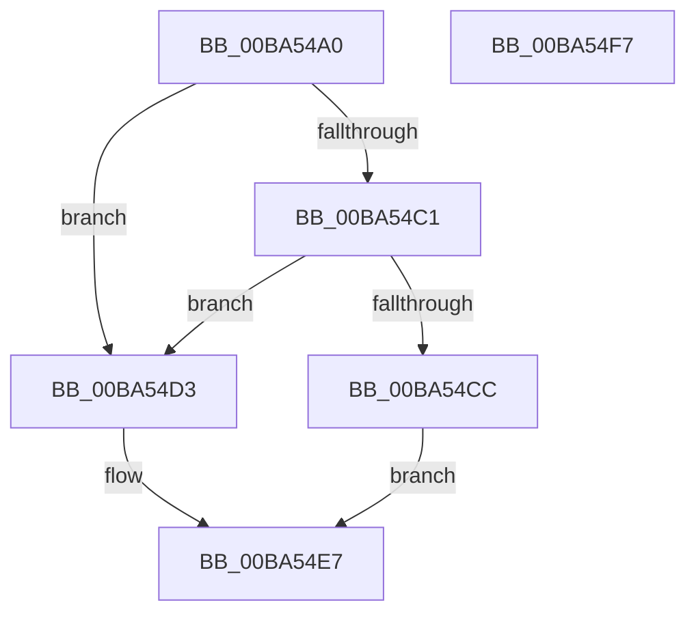

# VerifierKeDelayExecutionThread

- RVA: `0x00BA54A0`–`0x00BA54F8` (길이 `88` bytes)
- VA: `0x0000000140BA54A0`
- 실행 섹션: `PAGEVRFY`
- PDB 이름 있음: `예`; PDB Function 태그: `아니요`
- unwind 정보 RVA: `0x00060BC4`
- 디코드: `27`개 명령, `88/88` bytes 표시
- 미해석 바이트: `0` (있으면 어셈블리에 `.byte`로 보존)

> 이 문서는 커널 이미지의 기계어와 PDB 기호를 분석해 생성했습니다. 4번과 5번은 함수 원형과 자료형을 바이너리 사용 방식에서 추정한 C 해석이며 원본 소스 복구 결과는 아닙니다.

## 1. Dependencies

- 직접 호출 지점: **2**; 고유 호출 대상: **2**
- 직접 호출자로 확인된 함수: **0**
- RIP 상대 이미지 참조: **2**

### Outgoing calls
- `0x00BA54C3` → [VfRlrsKeInjectStatusAlerted](VfRlrsKeInjectStatusAlerted_function_00BAF6F4.md) (function, `0x00BAF6F4`)
- `0x00BA54E2` → [guard_dispatch_icall](../../text/6B/guard_dispatch_icall_function_006BAAD0.md) (function, `0x006BAAD0`)

### Direct callers
- 이 함수 시작 RVA로 연결되는 직접 call은 확인되지 않았습니다. 간접 호출은 완전히 역산할 수 없습니다.

### Static image references
- `0x00BA54AF` → RVA `0x00E681A0` (`.data`; read)
- `0x00BA54D3` → RVA `0x00FFDF08` (`PAGEVRFD`; read)

## 2. Other-region calls and transfers

- 다른 실행 섹션으로 향하는 call: **1**
  - `0x00BA54E2` → [guard_dispatch_icall](../../text/6B/guard_dispatch_icall_function_006BAAD0.md) (`PAGEVRFY` → `.text`)
- 별도 외부 분기/꼬리 이동을 확인하지 못했습니다.

## 3. Assembly (complete function range)

```asm
00BA54A0  48 89 5C 24 08                  mov qword ptr [rsp + 8], rbx
00BA54A5  48 89 74 24 10                  mov qword ptr [rsp + 0x10], rsi
00BA54AA  57                              push rdi
00BA54AB  48 83 EC 20                     sub rsp, 0x20
00BA54AF  8B 05 EB 2C 2C 00               mov eax, dword ptr [rip + 0x2c2ceb]
00BA54B5  49 8B F8                        mov rdi, r8
00BA54B8  8A DA                           mov bl, dl
00BA54BA  40 8A F1                        mov sil, cl
00BA54BD  A8 04                           test al, 4
00BA54BF  74 12                           je 0x140ba54d3
00BA54C1  8A CA                           mov cl, dl
00BA54C3  E8 2C A2 00 00                  call 0x140baf6f4
00BA54C8  85 C0                           test eax, eax
00BA54CA  74 07                           je 0x140ba54d3
00BA54CC  B8 01 01 00 00                  mov eax, 0x101
00BA54D1  EB 14                           jmp 0x140ba54e7
00BA54D3  48 8B 05 2E 8A 45 00            mov rax, qword ptr [rip + 0x458a2e]
00BA54DA  4C 8B C7                        mov r8, rdi
00BA54DD  8A D3                           mov dl, bl
00BA54DF  40 8A CE                        mov cl, sil
00BA54E2  E8 E9 55 B1 FF                  call 0x1406baad0
00BA54E7  48 8B 5C 24 30                  mov rbx, qword ptr [rsp + 0x30]
00BA54EC  48 8B 74 24 38                  mov rsi, qword ptr [rsp + 0x38]
00BA54F1  48 83 C4 20                     add rsp, 0x20
00BA54F5  5F                              pop rdi
00BA54F6  C3                              ret
00BA54F7  CC                              int3
```

## 4. C-style interpretation (structured pseudocode)

```c
__int64 __fastcall VerifierKeDelayExecutionThread(unsigned __int8 a1, unsigned __int8 a2, __int64 a3)
{
    __int64 result;
    __int64 v_rsp;
    unsigned __int64 v_stack_p10;
    unsigned __int64 v_stack_p8;

    v_stack_p8 = v_rbx;
    v_stack_p10 = v_rsi;
    v_rsp = (v_rsp) - (32);
    if ((((unsigned __int8)((unsigned int)(*(unsigned int *)(v_rip + 2895083)))) & (4)) == 0) goto loc_00BA54D3;
    result = VfRlrsKeInjectStatusAlerted(a2, a2, a3, a4);
    if ((unsigned int)(result) == 0) goto loc_00BA54D3;
    goto loc_00BA54E7;
loc_00BA54D3:
    result = guard_dispatch_icall(a1, a2, a3, a4);
loc_00BA54E7:
    v_rsp = (v_rsp) + (32);
    return result;
}
```

## 5. (Beta) C Style

```c
int64_t VerifierKeDelayExecutionThread(uint8_t Arg1, uint8_t Arg2, int64_t Arg3)
{
    int64_t result;
    int64_t local_rsp;
    uint64_t v_stack_p10;
    uint64_t v_stack_p8;

    v_stack_p8 = local_rbx;
    v_stack_p10 = local_rsi;
    local_rsp = (local_rsp) - (32);
    if ((((uint8_t)((uint32_t)(*(uint32_t *)(v_rip + 0x2C2CEB)))) & (4)) == 0) goto loc_00BA54D3;
    result = VfRlrsKeInjectStatusAlerted(Arg2, Arg2, Arg3, a4);
    if ((uint32_t)(result) == 0) goto loc_00BA54D3;
    goto loc_00BA54E7;
loc_00BA54D3:
    result = guard_dispatch_icall(Arg1, Arg2, Arg3, a4);
loc_00BA54E7:
    local_rsp = (local_rsp) + (32);
    return result;
}
```

## 6. Execution-region graph

[열기: 2D/3D 그래프와 함수 탐색 컨트롤 패널](../../../control-panel.html?section=pagevrfy&rva=0x00BA54A0&view=graph)

- 2D 그래프는 위에서 아래로 흐르고, 3D 그래프는 빈 공간을 드래그해 회전합니다. Shift+드래그는 이동, 휠은 확대·축소, 함수 노드 선택은 대상 보고서 이동입니다.

### Static fallback


