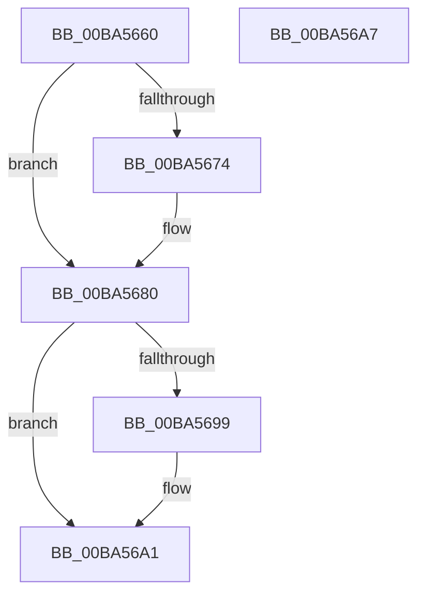

# VerifierKeLowerIrql

- RVA: `0x00BA5660`–`0x00BA56A8` (길이 `72` bytes)
- VA: `0x0000000140BA5660`
- 실행 섹션: `PAGEVRFY`
- PDB 이름 있음: `예`; PDB Function 태그: `아니요`
- unwind 정보 RVA: `0x0005CF00`
- 디코드: `22`개 명령, `72/72` bytes 표시
- 미해석 바이트: `0` (있으면 어셈블리에 `.byte`로 보존)

> 이 문서는 커널 이미지의 기계어와 PDB 기호를 분석해 생성했습니다. 4번과 5번은 함수 원형과 자료형을 바이너리 사용 방식에서 추정한 C 해석이며 원본 소스 복구 결과는 아닙니다.

## 1. Dependencies

- 직접 호출 지점: **3**; 고유 호출 대상: **3**
- 직접 호출자로 확인된 함수: **0**
- RIP 상대 이미지 참조: **2**

### Outgoing calls
- `0x00BA5678` → [VfKeIrqlTransitionReserveLogEntry](../BB/VfKeIrqlTransitionReserveLogEntry_function_00BB80A8.md) (function, `0x00BB80A8`)
- `0x00BA5689` → [guard_dispatch_icall](../../text/6B/guard_dispatch_icall_function_006BAAD0.md) (function, `0x006BAAD0`)
- `0x00BA569C` → [VfKeIrqlLogLower](../BB/VfKeIrqlLogLower_function_00BB91EC.md) (function, `0x00BB91EC`)

### Direct callers
- 이 함수 시작 RVA로 연결되는 직접 call은 확인되지 않았습니다. 간접 호출은 완전히 역산할 수 없습니다.

### Static image references
- `0x00BA5666` → RVA `0x00F04A20` (`.data`; read)
- `0x00BA5680` → RVA `0x00E681C0` (`.data`; read)

## 2. Other-region calls and transfers

- 다른 실행 섹션으로 향하는 call: **1**
  - `0x00BA5689` → [guard_dispatch_icall](../../text/6B/guard_dispatch_icall_function_006BAAD0.md) (`PAGEVRFY` → `.text`)
- 별도 외부 분기/꼬리 이동을 확인하지 못했습니다.

## 3. Assembly (complete function range)

```asm
00BA5660  40 53                           push rbx
00BA5662  48 83 EC 20                     sub rsp, 0x20
00BA5666  8B 05 B4 F3 35 00               mov eax, dword ptr [rip + 0x35f3b4]
00BA566C  33 DB                           xor ebx, ebx
00BA566E  8A D1                           mov dl, cl
00BA5670  A8 01                           test al, 1
00BA5672  74 0C                           je 0x140ba5680
00BA5674  44 0F 20 C1                     mov rcx, cr8
00BA5678  E8 2B 2A 01 00                  call 0x140bb80a8
00BA567D  48 8B D8                        mov rbx, rax
00BA5680  48 8B 05 39 2B 2C 00            mov rax, qword ptr [rip + 0x2c2b39]
00BA5687  8A CA                           mov cl, dl
00BA5689  E8 42 54 B1 FF                  call 0x1406baad0
00BA568E  8B 0D 8C F3 35 00               mov ecx, dword ptr [rip + 0x35f38c]
00BA5694  F6 C1 01                        test cl, 1
00BA5697  74 08                           je 0x140ba56a1
00BA5699  48 8B CB                        mov rcx, rbx
00BA569C  E8 4B 3B 01 00                  call 0x140bb91ec
00BA56A1  48 83 C4 20                     add rsp, 0x20
00BA56A5  5B                              pop rbx
00BA56A6  C3                              ret
00BA56A7  CC                              int3
```

## 4. C-style interpretation (structured pseudocode)

```c
__int64 __fastcall VerifierKeLowerIrql(unsigned __int8 a1)
{
    __int64 result;
    __int64 v_rbx;
    __int64 v_rsp;

    v_rsp = (v_rsp) - (32);
    v_rbx = 0;
    result = (unsigned int)(*(unsigned int *)(v_rip + 3535796));
    if ((((unsigned __int8)((unsigned int)(*(unsigned int *)(v_rip + 3535796)))) & (1)) != 0) {
        a1 = v_cr8;
        result = VfKeIrqlTransitionReserveLogEntry(a1, a1, a3, a4);
        v_rbx = result;
    }
    result = guard_dispatch_icall(a1, a1, a3, a4);
    if ((((unsigned __int8)((unsigned int)(*(unsigned int *)(v_rip + 3535756)))) & (1)) != 0) {
        a1 = v_rbx;
        result = VfKeIrqlLogLower(a1, a1, a3, a4);
    }
    v_rsp = (v_rsp) + (32);
    return result;
}
```

## 5. (Beta) C Style

```c
int64_t VerifierKeLowerIrql(uint8_t Arg1)
{
    int64_t result;
    int64_t local_rbx;
    int64_t local_rsp;

    local_rsp = (local_rsp) - (32);
    local_rbx = 0;
    result = (uint32_t)(*(uint32_t *)(v_rip + 0x35F3B4));
    if ((((uint8_t)((uint32_t)(*(uint32_t *)(v_rip + 0x35F3B4)))) & (1)) != 0) {
        Arg1 = v_cr8;
        result = VfKeIrqlTransitionReserveLogEntry(Arg1, Arg1, a3, a4);
        local_rbx = result;
    }
    result = guard_dispatch_icall(Arg1, Arg1, a3, a4);
    if ((((uint8_t)((uint32_t)(*(uint32_t *)(v_rip + 0x35F38C)))) & (1)) != 0) {
        Arg1 = local_rbx;
        result = VfKeIrqlLogLower(Arg1, Arg1, a3, a4);
    }
    local_rsp = (local_rsp) + (32);
    return result;
}
```

## 6. Execution-region graph

[열기: 2D/3D 그래프와 함수 탐색 컨트롤 패널](../../../control-panel.html?section=pagevrfy&rva=0x00BA5660&view=graph)

- 2D 그래프는 위에서 아래로 흐르고, 3D 그래프는 빈 공간을 드래그해 회전합니다. Shift+드래그는 이동, 휠은 확대·축소, 함수 노드 선택은 대상 보고서 이동입니다.

### Static fallback


