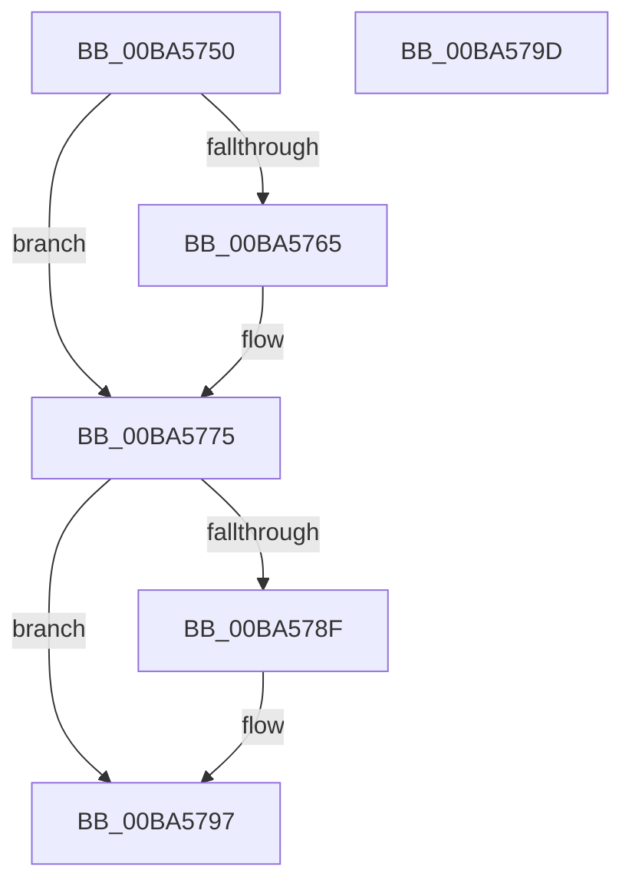

# VerifierKeReleaseInStackQueuedSpinLock

- RVA: `0x00BA5750`–`0x00BA579E` (길이 `78` bytes)
- VA: `0x0000000140BA5750`
- 실행 섹션: `PAGEVRFY`
- PDB 이름 있음: `예`; PDB Function 태그: `아니요`
- unwind 정보 RVA: `0x0005CF00`
- 디코드: `23`개 명령, `78/78` bytes 표시
- 미해석 바이트: `0` (있으면 어셈블리에 `.byte`로 보존)

> 이 문서는 커널 이미지의 기계어와 PDB 기호를 분석해 생성했습니다. 4번과 5번은 함수 원형과 자료형을 바이너리 사용 방식에서 추정한 C 해석이며 원본 소스 복구 결과는 아닙니다.

## 1. Dependencies

- 직접 호출 지점: **3**; 고유 호출 대상: **3**
- 직접 호출자로 확인된 함수: **0**
- RIP 상대 이미지 참조: **2**

### Outgoing calls
- `0x00BA576D` → [VfKeIrqlTransitionReserveLogEntry](../BB/VfKeIrqlTransitionReserveLogEntry_function_00BB80A8.md) (function, `0x00BB80A8`)
- `0x00BA577F` → [guard_dispatch_icall](../../text/6B/guard_dispatch_icall_function_006BAAD0.md) (function, `0x006BAAD0`)
- `0x00BA5792` → [VfKeIrqlLogLower](../BB/VfKeIrqlLogLower_function_00BB91EC.md) (function, `0x00BB91EC`)

### Direct callers
- 이 함수 시작 RVA로 연결되는 직접 call은 확인되지 않았습니다. 간접 호출은 완전히 역산할 수 없습니다.

### Static image references
- `0x00BA5756` → RVA `0x00E681A0` (`.data`; read)
- `0x00BA5775` → RVA `0x00FFE5C8` (`PAGEVRFD`; read)

## 2. Other-region calls and transfers

- 다른 실행 섹션으로 향하는 call: **1**
  - `0x00BA577F` → [guard_dispatch_icall](../../text/6B/guard_dispatch_icall_function_006BAAD0.md) (`PAGEVRFY` → `.text`)
- 별도 외부 분기/꼬리 이동을 확인하지 못했습니다.

## 3. Assembly (complete function range)

```asm
00BA5750  40 53                           push rbx
00BA5752  48 83 EC 20                     sub rsp, 0x20
00BA5756  8B 05 44 2A 2C 00               mov eax, dword ptr [rip + 0x2c2a44]
00BA575C  33 DB                           xor ebx, ebx
00BA575E  4C 8B C9                        mov r9, rcx
00BA5761  A8 02                           test al, 2
00BA5763  74 10                           je 0x140ba5775
00BA5765  44 0F 20 C1                     mov rcx, cr8
00BA5769  41 8A 51 10                     mov dl, byte ptr [r9 + 0x10]
00BA576D  E8 36 29 01 00                  call 0x140bb80a8
00BA5772  48 8B D8                        mov rbx, rax
00BA5775  48 8B 05 4C 8E 45 00            mov rax, qword ptr [rip + 0x458e4c]
00BA577C  49 8B C9                        mov rcx, r9
00BA577F  E8 4C 53 B1 FF                  call 0x1406baad0
00BA5784  8B 0D 16 2A 2C 00               mov ecx, dword ptr [rip + 0x2c2a16]
00BA578A  F6 C1 02                        test cl, 2
00BA578D  74 08                           je 0x140ba5797
00BA578F  48 8B CB                        mov rcx, rbx
00BA5792  E8 55 3A 01 00                  call 0x140bb91ec
00BA5797  48 83 C4 20                     add rsp, 0x20
00BA579B  5B                              pop rbx
00BA579C  C3                              ret
00BA579D  CC                              int3
```

## 4. C-style interpretation (structured pseudocode)

```c
__int64 __fastcall VerifierKeReleaseInStackQueuedSpinLock(__int64 a1)
{
    __int64 result;
    __int64 v_rbx;
    __int64 v_rsp;

    v_rsp = (v_rsp) - (32);
    v_rbx = 0;
    result = (unsigned int)(*(unsigned int *)(v_rip + 2894404));
    if ((((unsigned __int8)((unsigned int)(*(unsigned int *)(v_rip + 2894404)))) & (2)) != 0) {
        a1 = v_cr8;
        a2 = *(unsigned __int8 *)(a1 + 16);
        result = VfKeIrqlTransitionReserveLogEntry(a1, a2, a3, a1);
        v_rbx = result;
    }
    result = guard_dispatch_icall(a1, a2, a3, a1);
    if ((((unsigned __int8)((unsigned int)(*(unsigned int *)(v_rip + 2894358)))) & (2)) != 0) {
        a1 = v_rbx;
        result = VfKeIrqlLogLower(a1, a2, a3, a1);
    }
    v_rsp = (v_rsp) + (32);
    return result;
}
```

## 5. (Beta) C Style

```c
int64_t VerifierKeReleaseInStackQueuedSpinLock(void *Arg1)
{
    uint8_t *arg1 = (uint8_t *)Arg1;

    int64_t result;
    int64_t local_rbx;
    int64_t local_rsp;

    local_rsp = (local_rsp) - (32);
    local_rbx = 0;
    result = (uint32_t)(*(uint32_t *)(v_rip + 0x2C2A44));
    if ((((uint8_t)((uint32_t)(*(uint32_t *)(v_rip + 0x2C2A44)))) & (2)) != 0) {
        Arg1 = v_cr8;
        a2 = *(uint8_t *)(arg1 + 0x10);
        result = VfKeIrqlTransitionReserveLogEntry(Arg1, a2, a3, Arg1);
        local_rbx = result;
    }
    result = guard_dispatch_icall(Arg1, a2, a3, Arg1);
    if ((((uint8_t)((uint32_t)(*(uint32_t *)(v_rip + 0x2C2A16)))) & (2)) != 0) {
        Arg1 = local_rbx;
        result = VfKeIrqlLogLower(Arg1, a2, a3, Arg1);
    }
    local_rsp = (local_rsp) + (32);
    return result;
}
```

### 관측된 메모리 오프셋

구조체 형식이 확인되지 않은 접근은 인자 기준의 오프셋으로만 기록했습니다.

| 기준 인자 | 오프셋 표현 | 폭 (bit) | 접근 |
|---|---:|---:|---|
| `Arg1` | `+ 0x10` | `8` | `R` |

## 6. Execution-region graph

[열기: 2D/3D 그래프와 함수 탐색 컨트롤 패널](../../../control-panel.html?section=pagevrfy&rva=0x00BA5750&view=graph)

- 2D 그래프는 위에서 아래로 흐르고, 3D 그래프는 빈 공간을 드래그해 회전합니다. Shift+드래그는 이동, 휠은 확대·축소, 함수 노드 선택은 대상 보고서 이동입니다.

### Static fallback


