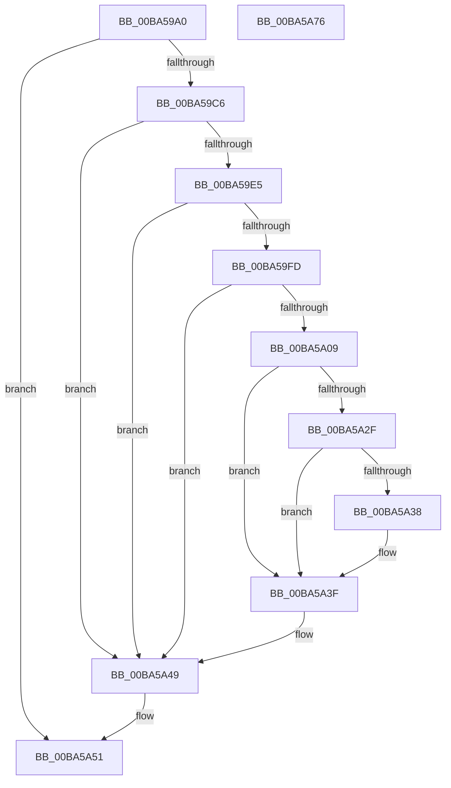

# VerifierKeSynchronizeExecution

- RVA: `0x00BA59A0`–`0x00BA5A77` (길이 `215` bytes)
- VA: `0x0000000140BA59A0`
- 실행 섹션: `PAGEVRFY`
- PDB 이름 있음: `예`; PDB Function 태그: `아니요`
- unwind 정보 RVA: `0x00086C28`
- 디코드: `55`개 명령, `215/215` bytes 표시
- 미해석 바이트: `0` (있으면 어셈블리에 `.byte`로 보존)

> 이 문서는 커널 이미지의 기계어와 PDB 기호를 분석해 생성했습니다. 4번과 5번은 함수 원형과 자료형을 바이너리 사용 방식에서 추정한 C 해석이며 원본 소스 복구 결과는 아닙니다.

## 1. Dependencies

- 직접 호출 지점: **7**; 고유 호출 대상: **7**
- 직접 호출자로 확인된 함수: **0**
- RIP 상대 이미지 참조: **6**

### Outgoing calls
- `0x00BA59F4` → [ViTargetUpdateTreeAllowed](../B9/ViTargetUpdateTreeAllowed_function_00B9BC04.md) (function, `0x00B9BC04`)
- `0x00BA5A00` → [VfDriverIsKernelImageAddress](../BB/VfDriverIsKernelImageAddress_function_00BB7EBC.md) (function, `0x00BB7EBC`)
- `0x00BA5A11` → [VfAvlInitializeLockContext](../../text/4A/VfAvlInitializeLockContext_function_004A686C.md) (function, `0x004A686C`)
- `0x00BA5A25` → [VfAvlLookupTreeNode](../../text/3E/VfAvlLookupTreeNode_function_003EF1B4.md) (function, `0x003EF1B4`)
- `0x00BA5A44` → [VfAvlCleanupLockContext](../../text/3E/VfAvlCleanupLockContext_function_003EF56C.md) (function, `0x003EF56C`)
- `0x00BA5A4C` → [ViKeIrqlLogAndTrimMemory](../BB/ViKeIrqlLogAndTrimMemory_function_00BB7F58.md) (function, `0x00BB7F58`)
- `0x00BA5A61` → [guard_dispatch_icall](../../text/6B/guard_dispatch_icall_function_006BAAD0.md) (function, `0x006BAAD0`)

### Direct callers
- 이 함수 시작 RVA로 연결되는 직접 call은 확인되지 않았습니다. 간접 호출은 완전히 역산할 수 없습니다.

### Static image references
- `0x00BA59AF` → RVA `0x00E681A0` (`.data`; read)
- `0x00BA59C6` → RVA `0x00F04A2C` (`.data`; read)
- `0x00BA59CE` → RVA `0x00F04A20` (`.data`; read)
- `0x00BA59D8` → RVA `0x00F04A2C` (`.data`; write)
- `0x00BA5A19` → RVA `0x00F049A0` (`.data`; read)
- `0x00BA5A51` → RVA `0x00FFDF00` (`PAGEVRFD`; read)

## 2. Other-region calls and transfers

- 다른 실행 섹션으로 향하는 call: **4**
  - `0x00BA5A11` → [VfAvlInitializeLockContext](../../text/4A/VfAvlInitializeLockContext_function_004A686C.md) (`PAGEVRFY` → `.text`)
  - `0x00BA5A25` → [VfAvlLookupTreeNode](../../text/3E/VfAvlLookupTreeNode_function_003EF1B4.md) (`PAGEVRFY` → `.text`)
  - `0x00BA5A44` → [VfAvlCleanupLockContext](../../text/3E/VfAvlCleanupLockContext_function_003EF56C.md) (`PAGEVRFY` → `.text`)
  - `0x00BA5A61` → [guard_dispatch_icall](../../text/6B/guard_dispatch_icall_function_006BAAD0.md) (`PAGEVRFY` → `.text`)
- 별도 외부 분기/꼬리 이동을 확인하지 못했습니다.

## 3. Assembly (complete function range)

```asm
00BA59A0  48 89 5C 24 08                  mov qword ptr [rsp + 8], rbx
00BA59A5  48 89 74 24 10                  mov qword ptr [rsp + 0x10], rsi
00BA59AA  57                              push rdi
00BA59AB  48 83 EC 40                     sub rsp, 0x40
00BA59AF  8B 05 EB 27 2C 00               mov eax, dword ptr [rip + 0x2c27eb]
00BA59B5  49 8B F8                        mov rdi, r8
00BA59B8  48 8B F2                        mov rsi, rdx
00BA59BB  48 8B D9                        mov rbx, rcx
00BA59BE  A8 02                           test al, 2
00BA59C0  0F 84 8B 00 00 00               je 0x140ba5a51
00BA59C6  8B 05 60 F0 35 00               mov eax, dword ptr [rip + 0x35f060]
00BA59CC  FF C0                           inc eax
00BA59CE  F7 05 48 F0 35 00 00 10 00 00   test dword ptr [rip + 0x35f048], 0x1000
00BA59D8  89 05 4E F0 35 00               mov dword ptr [rip + 0x35f04e], eax
00BA59DE  4C 8B 44 24 48                  mov r8, qword ptr [rsp + 0x48]
00BA59E3  74 64                           je 0x140ba5a49
00BA59E5  33 C0                           xor eax, eax
00BA59E7  0F 57 C0                        xorps xmm0, xmm0
00BA59EA  0F 11 44 24 20                  movups xmmword ptr [rsp + 0x20], xmm0
00BA59EF  48 89 44 24 30                  mov qword ptr [rsp + 0x30], rax
00BA59F4  E8 0B 62 FF FF                  call 0x140b9bc04
00BA59F9  85 C0                           test eax, eax
00BA59FB  74 4C                           je 0x140ba5a49
00BA59FD  49 8B C8                        mov rcx, r8
00BA5A00  E8 B7 24 01 00                  call 0x140bb7ebc
00BA5A05  85 C0                           test eax, eax
00BA5A07  75 40                           jne 0x140ba5a49
00BA5A09  8D 50 01                        lea edx, [rax + 1]
00BA5A0C  48 8D 4C 24 20                  lea rcx, [rsp + 0x20]
00BA5A11  E8 56 0E 90 FF                  call 0x1404a686c
00BA5A16  44 8B CA                        mov r9d, edx
00BA5A19  48 8D 0D 80 EF 35 00            lea rcx, [rip + 0x35ef80]
00BA5A20  48 8D 54 24 20                  lea rdx, [rsp + 0x20]
00BA5A25  E8 8A 97 84 FF                  call 0x1403ef1b4
00BA5A2A  48 85 C0                        test rax, rax
00BA5A2D  74 10                           je 0x140ba5a3f
00BA5A2F  48 8B 40 40                     mov rax, qword ptr [rax + 0x40]
00BA5A33  48 85 C0                        test rax, rax
00BA5A36  74 07                           je 0x140ba5a3f
00BA5A38  F0 FF 80 A8 00 00 00            lock inc dword ptr [rax + 0xa8]
00BA5A3F  48 8D 4C 24 20                  lea rcx, [rsp + 0x20]
00BA5A44  E8 23 9B 84 FF                  call 0x1403ef56c
00BA5A49  8A 4B 5D                        mov cl, byte ptr [rbx + 0x5d]
00BA5A4C  E8 07 25 01 00                  call 0x140bb7f58
00BA5A51  48 8B 05 A8 84 45 00            mov rax, qword ptr [rip + 0x4584a8]
00BA5A58  4C 8B C7                        mov r8, rdi
00BA5A5B  48 8B D6                        mov rdx, rsi
00BA5A5E  48 8B CB                        mov rcx, rbx
00BA5A61  E8 6A 50 B1 FF                  call 0x1406baad0
00BA5A66  48 8B 5C 24 50                  mov rbx, qword ptr [rsp + 0x50]
00BA5A6B  48 8B 74 24 58                  mov rsi, qword ptr [rsp + 0x58]
00BA5A70  48 83 C4 40                     add rsp, 0x40
00BA5A74  5F                              pop rdi
00BA5A75  C3                              ret
00BA5A76  CC                              int3
```

## 4. C-style interpretation (structured pseudocode)

```c
__int64 __fastcall VerifierKeSynchronizeExecution(__int64 a1, __int64 a2, __int64 a3)
{
    __int64 result;
    __int64 v_rsp;
    unsigned __int64 v_stack_m18;
    unsigned __int64 v_stack_m28;
    unsigned __int64 v_stack_p0;
    unsigned __int64 v_stack_p10;
    unsigned __int64 v_stack_p8;

    v_stack_p8 = v_rbx;
    v_stack_p10 = v_rsi;
    v_rsp = (v_rsp) - (64);
    if ((((unsigned __int8)((unsigned int)(*(unsigned int *)(v_rip + 2893803)))) & (2)) == 0) goto loc_00BA5A51;
    result = (unsigned int)(((unsigned int)(*(unsigned int *)(v_rip + 3534944))) + 1);
    *(unsigned int *)(v_rip + 3534926) = (unsigned int)(result);
    if (((*(unsigned int *)(v_rip + 3534920)) & (0x1000ULL)) == 0) goto loc_00BA5A49;
    result = 0;
    v_stack_m28 = v_xmm0;
    v_stack_m18 = 0;
    result = ViTargetUpdateTreeAllowed(a1, a2, v_stack_p0, a4);
    if ((unsigned int)(result) == 0) goto loc_00BA5A49;
    result = VfDriverIsKernelImageAddress(v_stack_p0, a2, v_stack_p0, a4);
    if ((unsigned int)(result) != 0) goto loc_00BA5A49;
    result = VfAvlInitializeLockContext(v_stack_m28, result + 1, v_stack_p0, a4);
    result = VfAvlLookupTreeNode(v_rip + 3534720, v_stack_m28, v_stack_p0, (unsigned int)((unsigned int)(result + 1)));
    if (result == 0) goto loc_00BA5A3F;
    if (*(unsigned __int64 *)(result + 64) != 0) {
    }
    result = VfAvlCleanupLockContext(v_stack_m28, v_stack_m28, v_stack_p0, (unsigned int)((unsigned int)(result + 1)));
loc_00BA5A49:
    result = ViKeIrqlLogAndTrimMemory(*(unsigned __int8 *)(a1 + 93), v_stack_m28, v_stack_p0, (unsigned int)((unsigned int)(result + 1)));
loc_00BA5A51:
    result = guard_dispatch_icall(a1, a2, a3, (unsigned int)((unsigned int)(result + 1)));
    v_rsp = (v_rsp) + (64);
    return result;
}
```

## 5. (Beta) C Style

```c
int64_t VerifierKeSynchronizeExecution(void *Arg1, int64_t Arg2, int64_t Arg3)
{
    uint8_t *arg1 = (uint8_t *)Arg1;

    int64_t result;
    int64_t local_rsp;
    uint64_t v_stack_m18;
    uint64_t v_stack_m28;
    uint64_t v_stack_p0;
    uint64_t v_stack_p10;
    uint64_t v_stack_p8;

    v_stack_p8 = local_rbx;
    v_stack_p10 = local_rsi;
    local_rsp = (local_rsp) - (64);
    if ((((uint8_t)((uint32_t)(*(uint32_t *)(v_rip + 0x2C27EB)))) & (2)) == 0) goto loc_00BA5A51;
    result = (uint32_t)(((uint32_t)(*(uint32_t *)(v_rip + 0x35F060))) + 1);
    *(uint32_t *)(v_rip + 0x35F04E) = (uint32_t)(result);
    if (((*(uint32_t *)(v_rip + 0x35F048)) & (0x1000ULL)) == 0) goto loc_00BA5A49;
    result = 0;
    v_stack_m28 = v_xmm0;
    v_stack_m18 = 0;
    result = ViTargetUpdateTreeAllowed(Arg1, Arg2, v_stack_p0, a4);
    if ((uint32_t)(result) == 0) goto loc_00BA5A49;
    result = VfDriverIsKernelImageAddress(v_stack_p0, Arg2, v_stack_p0, a4);
    if ((uint32_t)(result) != 0) goto loc_00BA5A49;
    result = VfAvlInitializeLockContext(v_stack_m28, result + 1, v_stack_p0, a4);
    result = VfAvlLookupTreeNode(v_rip + 3534720, v_stack_m28, v_stack_p0, (uint32_t)((uint32_t)(result + 1)));
    if (result == 0) goto loc_00BA5A3F;
    if (*(uint64_t *)(result + 0x40) != 0) {
    }
    result = VfAvlCleanupLockContext(v_stack_m28, v_stack_m28, v_stack_p0, (uint32_t)((uint32_t)(result + 1)));
loc_00BA5A49:
    result = ViKeIrqlLogAndTrimMemory(*(uint8_t *)(arg1 + 0x5D), v_stack_m28, v_stack_p0, (uint32_t)((uint32_t)(result + 1)));
loc_00BA5A51:
    result = guard_dispatch_icall(Arg1, Arg2, Arg3, (uint32_t)((uint32_t)(result + 1)));
    local_rsp = (local_rsp) + (64);
    return result;
}
```

### 관측된 메모리 오프셋

구조체 형식이 확인되지 않은 접근은 인자 기준의 오프셋으로만 기록했습니다.

| 기준 인자 | 오프셋 표현 | 폭 (bit) | 접근 |
|---|---:|---:|---|
| `Arg1` | `+ 0x5D` | `8` | `R` |

## 6. Execution-region graph

[열기: 2D/3D 그래프와 함수 탐색 컨트롤 패널](../../../control-panel.html?section=pagevrfy&rva=0x00BA59A0&view=graph)

- 2D 그래프는 위에서 아래로 흐르고, 3D 그래프는 빈 공간을 드래그해 회전합니다. Shift+드래그는 이동, 휠은 확대·축소, 함수 노드 선택은 대상 보고서 이동입니다.

### Static fallback


