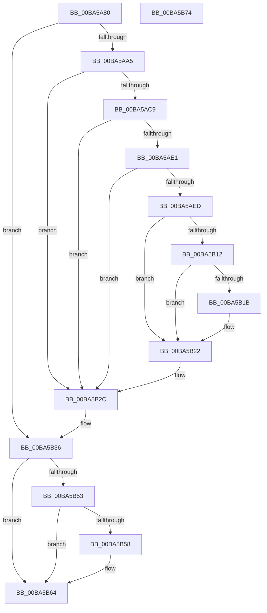

# VerifierKeTryToAcquireQueuedSpinLock

- RVA: `0x00BA5A80`–`0x00BA5B75` (길이 `245` bytes)
- VA: `0x0000000140BA5A80`
- 실행 섹션: `PAGEVRFY`
- PDB 이름 있음: `예`; PDB Function 태그: `아니요`
- unwind 정보 RVA: `0x00086C28`
- 디코드: `63`개 명령, `245/245` bytes 표시
- 미해석 바이트: `0` (있으면 어셈블리에 `.byte`로 보존)

> 이 문서는 커널 이미지의 기계어와 PDB 기호를 분석해 생성했습니다. 4번과 5번은 함수 원형과 자료형을 바이너리 사용 방식에서 추정한 C 해석이며 원본 소스 복구 결과는 아닙니다.

## 1. Dependencies

- 직접 호출 지점: **7**; 고유 호출 대상: **7**
- 직접 호출자로 확인된 함수: **0**
- RIP 상대 이미지 참조: **6**

### Outgoing calls
- `0x00BA5AD8` → [ViTargetUpdateTreeAllowed](../B9/ViTargetUpdateTreeAllowed_function_00B9BC04.md) (function, `0x00B9BC04`)
- `0x00BA5AE4` → [VfDriverIsKernelImageAddress](../BB/VfDriverIsKernelImageAddress_function_00BB7EBC.md) (function, `0x00BB7EBC`)
- `0x00BA5AF4` → [VfAvlInitializeLockContext](../../text/4A/VfAvlInitializeLockContext_function_004A686C.md) (function, `0x004A686C`)
- `0x00BA5B08` → [VfAvlLookupTreeNode](../../text/3E/VfAvlLookupTreeNode_function_003EF1B4.md) (function, `0x003EF1B4`)
- `0x00BA5B27` → [VfAvlCleanupLockContext](../../text/3E/VfAvlCleanupLockContext_function_003EF56C.md) (function, `0x003EF56C`)
- `0x00BA5B2E` → [ViKeIrqlLogAndTrimMemory](../BB/ViKeIrqlLogAndTrimMemory_function_00BB7F58.md) (function, `0x00BB7F58`)
- `0x00BA5B43` → [guard_dispatch_icall](../../text/6B/guard_dispatch_icall_function_006BAAD0.md) (function, `0x006BAAD0`)

### Direct callers
- 이 함수 시작 RVA로 연결되는 직접 call은 확인되지 않았습니다. 간접 호출은 완전히 역산할 수 없습니다.

### Static image references
- `0x00BA5A8F` → RVA `0x00E681A0` (`.data`; read)
- `0x00BA5AA5` → RVA `0x00F04A28` (`.data`; read)
- `0x00BA5AB2` → RVA `0x00F04A20` (`.data`; read)
- `0x00BA5ABC` → RVA `0x00F04A28` (`.data`; write)
- `0x00BA5B01` → RVA `0x00F049A0` (`.data`; read)
- `0x00BA5B36` → RVA `0x00FFE090` (`PAGEVRFD`; read)

## 2. Other-region calls and transfers

- 다른 실행 섹션으로 향하는 call: **4**
  - `0x00BA5AF4` → [VfAvlInitializeLockContext](../../text/4A/VfAvlInitializeLockContext_function_004A686C.md) (`PAGEVRFY` → `.text`)
  - `0x00BA5B08` → [VfAvlLookupTreeNode](../../text/3E/VfAvlLookupTreeNode_function_003EF1B4.md) (`PAGEVRFY` → `.text`)
  - `0x00BA5B27` → [VfAvlCleanupLockContext](../../text/3E/VfAvlCleanupLockContext_function_003EF56C.md) (`PAGEVRFY` → `.text`)
  - `0x00BA5B43` → [guard_dispatch_icall](../../text/6B/guard_dispatch_icall_function_006BAAD0.md) (`PAGEVRFY` → `.text`)
- 별도 외부 분기/꼬리 이동을 확인하지 못했습니다.

## 3. Assembly (complete function range)

```asm
00BA5A80  48 89 5C 24 08                  mov qword ptr [rsp + 8], rbx
00BA5A85  48 89 74 24 10                  mov qword ptr [rsp + 0x10], rsi
00BA5A8A  57                              push rdi
00BA5A8B  48 83 EC 40                     sub rsp, 0x40
00BA5A8F  8B 05 0B 27 2C 00               mov eax, dword ptr [rip + 0x2c270b]
00BA5A95  33 DB                           xor ebx, ebx
00BA5A97  48 8B FA                        mov rdi, rdx
00BA5A9A  48 8B F1                        mov rsi, rcx
00BA5A9D  A8 02                           test al, 2
00BA5A9F  0F 84 91 00 00 00               je 0x140ba5b36
00BA5AA5  8B 05 7D EF 35 00               mov eax, dword ptr [rip + 0x35ef7d]
00BA5AAB  BB 01 00 00 00                  mov ebx, 1
00BA5AB0  03 C3                           add eax, ebx
00BA5AB2  F7 05 64 EF 35 00 00 10 00 00   test dword ptr [rip + 0x35ef64], 0x1000
00BA5ABC  89 05 66 EF 35 00               mov dword ptr [rip + 0x35ef66], eax
00BA5AC2  4C 8B 44 24 48                  mov r8, qword ptr [rsp + 0x48]
00BA5AC7  74 63                           je 0x140ba5b2c
00BA5AC9  33 C0                           xor eax, eax
00BA5ACB  0F 57 C0                        xorps xmm0, xmm0
00BA5ACE  0F 11 44 24 20                  movups xmmword ptr [rsp + 0x20], xmm0
00BA5AD3  48 89 44 24 30                  mov qword ptr [rsp + 0x30], rax
00BA5AD8  E8 27 61 FF FF                  call 0x140b9bc04
00BA5ADD  85 C0                           test eax, eax
00BA5ADF  74 4B                           je 0x140ba5b2c
00BA5AE1  49 8B C8                        mov rcx, r8
00BA5AE4  E8 D3 23 01 00                  call 0x140bb7ebc
00BA5AE9  85 C0                           test eax, eax
00BA5AEB  75 3F                           jne 0x140ba5b2c
00BA5AED  8B D3                           mov edx, ebx
00BA5AEF  48 8D 4C 24 20                  lea rcx, [rsp + 0x20]
00BA5AF4  E8 73 0D 90 FF                  call 0x1404a686c
00BA5AF9  44 8B CB                        mov r9d, ebx
00BA5AFC  48 8D 54 24 20                  lea rdx, [rsp + 0x20]
00BA5B01  48 8D 0D 98 EE 35 00            lea rcx, [rip + 0x35ee98]
00BA5B08  E8 A7 96 84 FF                  call 0x1403ef1b4
00BA5B0D  48 85 C0                        test rax, rax
00BA5B10  74 10                           je 0x140ba5b22
00BA5B12  48 8B 40 40                     mov rax, qword ptr [rax + 0x40]
00BA5B16  48 85 C0                        test rax, rax
00BA5B19  74 07                           je 0x140ba5b22
00BA5B1B  F0 01 98 A4 00 00 00            lock add dword ptr [rax + 0xa4], ebx
00BA5B22  48 8D 4C 24 20                  lea rcx, [rsp + 0x20]
00BA5B27  E8 40 9A 84 FF                  call 0x1403ef56c
00BA5B2C  B1 02                           mov cl, 2
00BA5B2E  E8 25 24 01 00                  call 0x140bb7f58
00BA5B33  48 8B D8                        mov rbx, rax
00BA5B36  48 8B 05 53 85 45 00            mov rax, qword ptr [rip + 0x458553]
00BA5B3D  48 8B D7                        mov rdx, rdi
00BA5B40  48 8B CE                        mov rcx, rsi
00BA5B43  E8 88 4F B1 FF                  call 0x1406baad0
00BA5B48  8B 0D 52 26 2C 00               mov ecx, dword ptr [rip + 0x2c2652]
00BA5B4E  F6 C1 02                        test cl, 2
00BA5B51  74 11                           je 0x140ba5b64
00BA5B53  48 85 DB                        test rbx, rbx
00BA5B56  74 0C                           je 0x140ba5b64
00BA5B58  65 8B 0C 25 A4 01 00 00         mov ecx, dword ptr gs:[0x1a4]
00BA5B60  66 89 4B 0A                     mov word ptr [rbx + 0xa], cx
00BA5B64  48 8B 5C 24 50                  mov rbx, qword ptr [rsp + 0x50]
00BA5B69  48 8B 74 24 58                  mov rsi, qword ptr [rsp + 0x58]
00BA5B6E  48 83 C4 40                     add rsp, 0x40
00BA5B72  5F                              pop rdi
00BA5B73  C3                              ret
00BA5B74  CC                              int3
```

## 4. C-style interpretation (structured pseudocode)

```c
__int64 __fastcall VerifierKeTryToAcquireQueuedSpinLock(__int64 a1, __int64 a2)
{
    __int64 result;
    __int64 v_rbx;
    __int64 v_rsp;
    unsigned __int64 v_stack_m18;
    unsigned __int64 v_stack_m28;
    unsigned __int64 v_stack_p0;
    unsigned __int64 v_stack_p10;
    unsigned __int64 v_stack_p8;

    v_stack_p8 = v_rbx;
    v_stack_p10 = v_rsi;
    v_rsp = (v_rsp) - (64);
    v_rbx = 0;
    if ((((unsigned __int8)((unsigned int)(*(unsigned int *)(v_rip + 2893579)))) & (2)) == 0) goto loc_00BA5B36;
    result = (unsigned int)(((unsigned int)(*(unsigned int *)(v_rip + 3534717))) + (1));
    *(unsigned int *)(v_rip + 3534694) = (unsigned int)(result);
    if (((*(unsigned int *)(v_rip + 3534692)) & (0x1000ULL)) == 0) goto loc_00BA5B2C;
    result = 0;
    v_stack_m28 = v_xmm0;
    v_stack_m18 = 0;
    result = ViTargetUpdateTreeAllowed(a1, a2, v_stack_p0, a4);
    if ((unsigned int)(result) == 0) goto loc_00BA5B2C;
    result = VfDriverIsKernelImageAddress(v_stack_p0, a2, v_stack_p0, a4);
    if ((unsigned int)(result) != 0) goto loc_00BA5B2C;
    result = VfAvlInitializeLockContext(v_stack_m28, 1, v_stack_p0, a4);
    result = VfAvlLookupTreeNode(v_rip + 3534488, v_stack_m28, v_stack_p0, 1);
    if (result == 0) goto loc_00BA5B22;
    if (*(unsigned __int64 *)(result + 64) != 0) {
    }
    result = VfAvlCleanupLockContext(v_stack_m28, v_stack_m28, v_stack_p0, 1);
loc_00BA5B2C:
    result = ViKeIrqlLogAndTrimMemory(2, v_stack_m28, v_stack_p0, 1);
loc_00BA5B36:
    result = guard_dispatch_icall(a1, a2, v_stack_p0, 1);
    if ((((unsigned __int8)((unsigned int)(*(unsigned int *)(v_rip + 2893394)))) & (2)) == 0) goto loc_00BA5B64;
    if (result != 0) {
        a1 = *(unsigned int *)(gs_base + (0 + 420));
        *(unsigned __int16 *)(result + 10) = (unsigned __int16)(a1);
    }
    v_rsp = (v_rsp) + (64);
    return result;
}
```

## 5. (Beta) C Style

```c
int64_t VerifierKeTryToAcquireQueuedSpinLock(int64_t Arg1, int64_t Arg2)
{
    int64_t result;
    int64_t local_rbx;
    int64_t local_rsp;
    uint64_t v_stack_m18;
    uint64_t v_stack_m28;
    uint64_t v_stack_p0;
    uint64_t v_stack_p10;
    uint64_t v_stack_p8;

    v_stack_p8 = local_rbx;
    v_stack_p10 = local_rsi;
    local_rsp = (local_rsp) - (64);
    local_rbx = 0;
    if ((((uint8_t)((uint32_t)(*(uint32_t *)(v_rip + 0x2C270B)))) & (2)) == 0) goto loc_00BA5B36;
    result = (uint32_t)(((uint32_t)(*(uint32_t *)(v_rip + 0x35EF7D))) + (1));
    *(uint32_t *)(v_rip + 0x35EF66) = (uint32_t)(result);
    if (((*(uint32_t *)(v_rip + 0x35EF64)) & (0x1000ULL)) == 0) goto loc_00BA5B2C;
    result = 0;
    v_stack_m28 = v_xmm0;
    v_stack_m18 = 0;
    result = ViTargetUpdateTreeAllowed(Arg1, Arg2, v_stack_p0, a4);
    if ((uint32_t)(result) == 0) goto loc_00BA5B2C;
    result = VfDriverIsKernelImageAddress(v_stack_p0, Arg2, v_stack_p0, a4);
    if ((uint32_t)(result) != 0) goto loc_00BA5B2C;
    result = VfAvlInitializeLockContext(v_stack_m28, 1, v_stack_p0, a4);
    result = VfAvlLookupTreeNode(v_rip + 3534488, v_stack_m28, v_stack_p0, 1);
    if (result == 0) goto loc_00BA5B22;
    if (*(uint64_t *)(result + 0x40) != 0) {
    }
    result = VfAvlCleanupLockContext(v_stack_m28, v_stack_m28, v_stack_p0, 1);
loc_00BA5B2C:
    result = ViKeIrqlLogAndTrimMemory(2, v_stack_m28, v_stack_p0, 1);
loc_00BA5B36:
    result = guard_dispatch_icall(Arg1, Arg2, v_stack_p0, 1);
    if ((((uint8_t)((uint32_t)(*(uint32_t *)(v_rip + 0x2C2652)))) & (2)) == 0) goto loc_00BA5B64;
    if (result != 0) {
        Arg1 = *(uint32_t *)(gs_base + (0 + 0x1A4));
        *(uint16_t *)(result + 0xA) = (uint16_t)(Arg1);
    }
    local_rsp = (local_rsp) + (64);
    return result;
}
```

## 6. Execution-region graph

[열기: 2D/3D 그래프와 함수 탐색 컨트롤 패널](../../../control-panel.html?section=pagevrfy&rva=0x00BA5A80&view=graph)

- 2D 그래프는 위에서 아래로 흐르고, 3D 그래프는 빈 공간을 드래그해 회전합니다. Shift+드래그는 이동, 휠은 확대·축소, 함수 노드 선택은 대상 보고서 이동입니다.

### Static fallback


