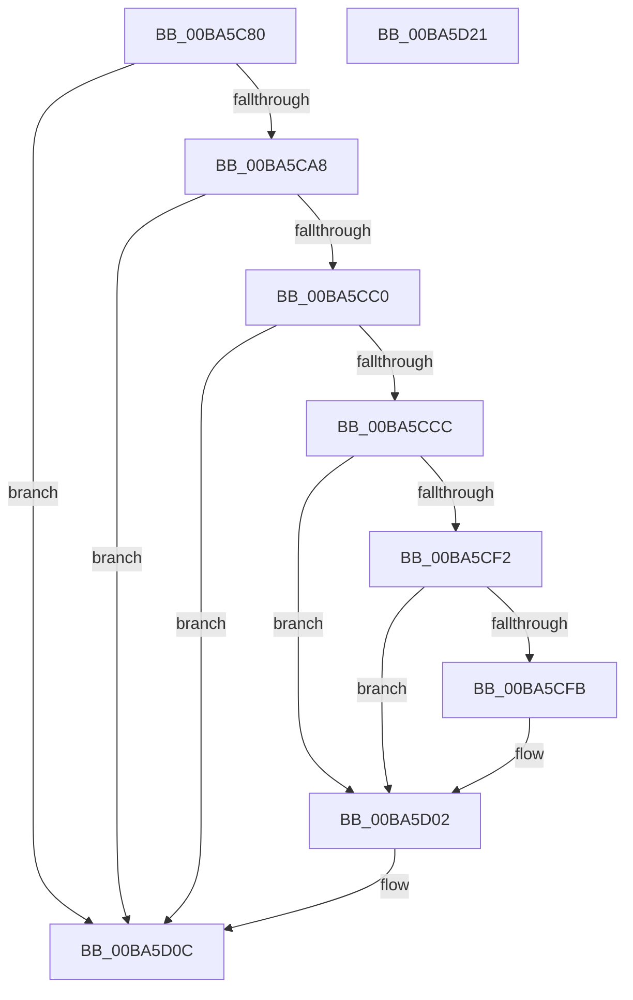

# VerifierKeTryToAcquireSpinLockAtDpcLevel

- RVA: `0x00BA5C80`–`0x00BA5D22` (길이 `162` bytes)
- VA: `0x0000000140BA5C80`
- 실행 섹션: `PAGEVRFY`
- PDB 이름 있음: `예`; PDB Function 태그: `아니요`
- unwind 정보 RVA: `0x000697A4`
- 디코드: `42`개 명령, `162/162` bytes 표시
- 미해석 바이트: `0` (있으면 어셈블리에 `.byte`로 보존)

> 이 문서는 커널 이미지의 기계어와 PDB 기호를 분석해 생성했습니다. 4번과 5번은 함수 원형과 자료형을 바이너리 사용 방식에서 추정한 C 해석이며 원본 소스 복구 결과는 아닙니다.

## 1. Dependencies

- 직접 호출 지점: **6**; 고유 호출 대상: **6**
- 직접 호출자로 확인된 함수: **0**
- RIP 상대 이미지 참조: **5**

### Outgoing calls
- `0x00BA5CB7` → [ViTargetUpdateTreeAllowed](../B9/ViTargetUpdateTreeAllowed_function_00B9BC04.md) (function, `0x00B9BC04`)
- `0x00BA5CC3` → [VfDriverIsKernelImageAddress](../BB/VfDriverIsKernelImageAddress_function_00BB7EBC.md) (function, `0x00BB7EBC`)
- `0x00BA5CD4` → [VfAvlInitializeLockContext](../../text/4A/VfAvlInitializeLockContext_function_004A686C.md) (function, `0x004A686C`)
- `0x00BA5CE8` → [VfAvlLookupTreeNode](../../text/3E/VfAvlLookupTreeNode_function_003EF1B4.md) (function, `0x003EF1B4`)
- `0x00BA5D07` → [VfAvlCleanupLockContext](../../text/3E/VfAvlCleanupLockContext_function_003EF56C.md) (function, `0x003EF56C`)
- `0x00BA5D16` → [guard_dispatch_icall](../../text/6B/guard_dispatch_icall_function_006BAAD0.md) (function, `0x006BAAD0`)

### Direct callers
- 이 함수 시작 RVA로 연결되는 직접 call은 확인되지 않았습니다. 간접 호출은 완전히 역산할 수 없습니다.

### Static image references
- `0x00BA5C86` → RVA `0x00F04A28` (`.data`; read)
- `0x00BA5C91` → RVA `0x00F04A20` (`.data`; read)
- `0x00BA5C9B` → RVA `0x00F04A28` (`.data`; write)
- `0x00BA5CDC` → RVA `0x00F049A0` (`.data`; read)
- `0x00BA5D0C` → RVA `0x00FFE670` (`PAGEVRFD`; read)

## 2. Other-region calls and transfers

- 다른 실행 섹션으로 향하는 call: **4**
  - `0x00BA5CD4` → [VfAvlInitializeLockContext](../../text/4A/VfAvlInitializeLockContext_function_004A686C.md) (`PAGEVRFY` → `.text`)
  - `0x00BA5CE8` → [VfAvlLookupTreeNode](../../text/3E/VfAvlLookupTreeNode_function_003EF1B4.md) (`PAGEVRFY` → `.text`)
  - `0x00BA5D07` → [VfAvlCleanupLockContext](../../text/3E/VfAvlCleanupLockContext_function_003EF56C.md) (`PAGEVRFY` → `.text`)
  - `0x00BA5D16` → [guard_dispatch_icall](../../text/6B/guard_dispatch_icall_function_006BAAD0.md) (`PAGEVRFY` → `.text`)
- 별도 외부 분기/꼬리 이동을 확인하지 못했습니다.

## 3. Assembly (complete function range)

```asm
00BA5C80  40 53                           push rbx
00BA5C82  48 83 EC 40                     sub rsp, 0x40
00BA5C86  8B 05 9C ED 35 00               mov eax, dword ptr [rip + 0x35ed9c]
00BA5C8C  48 8B D9                        mov rbx, rcx
00BA5C8F  FF C0                           inc eax
00BA5C91  F7 05 85 ED 35 00 00 10 00 00   test dword ptr [rip + 0x35ed85], 0x1000
00BA5C9B  89 05 87 ED 35 00               mov dword ptr [rip + 0x35ed87], eax
00BA5CA1  4C 8B 44 24 48                  mov r8, qword ptr [rsp + 0x48]
00BA5CA6  74 64                           je 0x140ba5d0c
00BA5CA8  33 C0                           xor eax, eax
00BA5CAA  0F 57 C0                        xorps xmm0, xmm0
00BA5CAD  0F 11 44 24 20                  movups xmmword ptr [rsp + 0x20], xmm0
00BA5CB2  48 89 44 24 30                  mov qword ptr [rsp + 0x30], rax
00BA5CB7  E8 48 5F FF FF                  call 0x140b9bc04
00BA5CBC  85 C0                           test eax, eax
00BA5CBE  74 4C                           je 0x140ba5d0c
00BA5CC0  49 8B C8                        mov rcx, r8
00BA5CC3  E8 F4 21 01 00                  call 0x140bb7ebc
00BA5CC8  85 C0                           test eax, eax
00BA5CCA  75 40                           jne 0x140ba5d0c
00BA5CCC  8D 50 01                        lea edx, [rax + 1]
00BA5CCF  48 8D 4C 24 20                  lea rcx, [rsp + 0x20]
00BA5CD4  E8 93 0B 90 FF                  call 0x1404a686c
00BA5CD9  44 8B CA                        mov r9d, edx
00BA5CDC  48 8D 0D BD EC 35 00            lea rcx, [rip + 0x35ecbd]
00BA5CE3  48 8D 54 24 20                  lea rdx, [rsp + 0x20]
00BA5CE8  E8 C7 94 84 FF                  call 0x1403ef1b4
00BA5CED  48 85 C0                        test rax, rax
00BA5CF0  74 10                           je 0x140ba5d02
00BA5CF2  48 8B 40 40                     mov rax, qword ptr [rax + 0x40]
00BA5CF6  48 85 C0                        test rax, rax
00BA5CF9  74 07                           je 0x140ba5d02
00BA5CFB  F0 FF 80 A4 00 00 00            lock inc dword ptr [rax + 0xa4]
00BA5D02  48 8D 4C 24 20                  lea rcx, [rsp + 0x20]
00BA5D07  E8 60 98 84 FF                  call 0x1403ef56c
00BA5D0C  48 8B 05 5D 89 45 00            mov rax, qword ptr [rip + 0x45895d]
00BA5D13  48 8B CB                        mov rcx, rbx
00BA5D16  E8 B5 4D B1 FF                  call 0x1406baad0
00BA5D1B  48 83 C4 40                     add rsp, 0x40
00BA5D1F  5B                              pop rbx
00BA5D20  C3                              ret
00BA5D21  CC                              int3
```

## 4. C-style interpretation (structured pseudocode)

```c
__int64 __fastcall VerifierKeTryToAcquireSpinLockAtDpcLevel(__int64 a1)
{
    __int64 result;
    __int64 v_rsp;
    unsigned __int64 v_stack_m18;
    unsigned __int64 v_stack_m28;
    unsigned __int64 v_stack_p0;

    v_rsp = (v_rsp) - (64);
    result = (unsigned int)(((unsigned int)(*(unsigned int *)(v_rip + 3534236))) + 1);
    *(unsigned int *)(v_rip + 3534215) = (unsigned int)(result);
    if (((*(unsigned int *)(v_rip + 3534213)) & (0x1000ULL)) == 0) goto loc_00BA5D0C;
    result = 0;
    v_stack_m28 = v_xmm0;
    v_stack_m18 = 0;
    result = ViTargetUpdateTreeAllowed(a1, a2, v_stack_p0, a4);
    if ((unsigned int)(result) == 0) goto loc_00BA5D0C;
    result = VfDriverIsKernelImageAddress(v_stack_p0, a2, v_stack_p0, a4);
    if ((unsigned int)(result) != 0) goto loc_00BA5D0C;
    result = VfAvlInitializeLockContext(v_stack_m28, result + 1, v_stack_p0, a4);
    result = VfAvlLookupTreeNode(v_rip + 3534013, v_stack_m28, v_stack_p0, (unsigned int)((unsigned int)(result + 1)));
    if (result == 0) goto loc_00BA5D02;
    if (*(unsigned __int64 *)(result + 64) != 0) {
    }
    result = VfAvlCleanupLockContext(v_stack_m28, v_stack_m28, v_stack_p0, (unsigned int)((unsigned int)(result + 1)));
loc_00BA5D0C:
    result = guard_dispatch_icall(a1, v_stack_m28, v_stack_p0, (unsigned int)((unsigned int)(result + 1)));
    v_rsp = (v_rsp) + (64);
    return result;
}
```

## 5. (Beta) C Style

```c
int64_t VerifierKeTryToAcquireSpinLockAtDpcLevel(int64_t Arg1)
{
    int64_t result;
    int64_t local_rsp;
    uint64_t v_stack_m18;
    uint64_t v_stack_m28;
    uint64_t v_stack_p0;

    local_rsp = (local_rsp) - (64);
    result = (uint32_t)(((uint32_t)(*(uint32_t *)(v_rip + 0x35ED9C))) + 1);
    *(uint32_t *)(v_rip + 0x35ED87) = (uint32_t)(result);
    if (((*(uint32_t *)(v_rip + 0x35ED85)) & (0x1000ULL)) == 0) goto loc_00BA5D0C;
    result = 0;
    v_stack_m28 = v_xmm0;
    v_stack_m18 = 0;
    result = ViTargetUpdateTreeAllowed(Arg1, a2, v_stack_p0, a4);
    if ((uint32_t)(result) == 0) goto loc_00BA5D0C;
    result = VfDriverIsKernelImageAddress(v_stack_p0, a2, v_stack_p0, a4);
    if ((uint32_t)(result) != 0) goto loc_00BA5D0C;
    result = VfAvlInitializeLockContext(v_stack_m28, result + 1, v_stack_p0, a4);
    result = VfAvlLookupTreeNode(v_rip + 3534013, v_stack_m28, v_stack_p0, (uint32_t)((uint32_t)(result + 1)));
    if (result == 0) goto loc_00BA5D02;
    if (*(uint64_t *)(result + 0x40) != 0) {
    }
    result = VfAvlCleanupLockContext(v_stack_m28, v_stack_m28, v_stack_p0, (uint32_t)((uint32_t)(result + 1)));
loc_00BA5D0C:
    result = guard_dispatch_icall(Arg1, v_stack_m28, v_stack_p0, (uint32_t)((uint32_t)(result + 1)));
    local_rsp = (local_rsp) + (64);
    return result;
}
```

## 6. Execution-region graph

[열기: 2D/3D 그래프와 함수 탐색 컨트롤 패널](../../../control-panel.html?section=pagevrfy&rva=0x00BA5C80&view=graph)

- 2D 그래프는 위에서 아래로 흐르고, 3D 그래프는 빈 공간을 드래그해 회전합니다. Shift+드래그는 이동, 휠은 확대·축소, 함수 노드 선택은 대상 보고서 이동입니다.

### Static fallback


