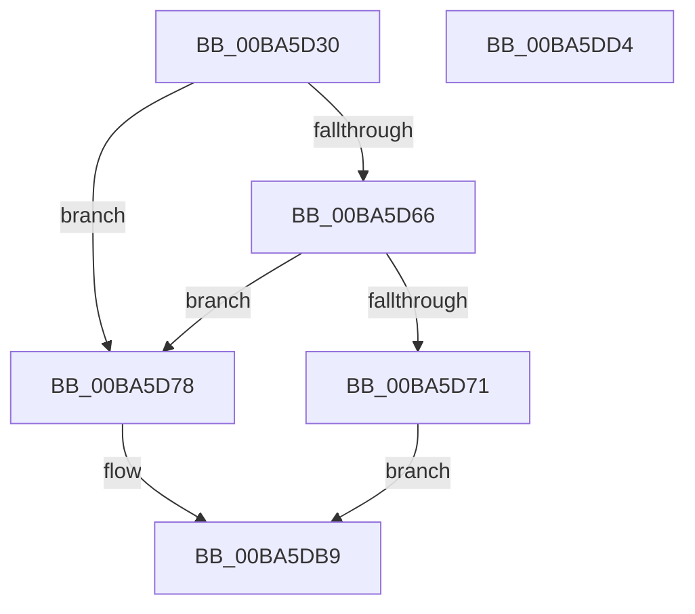

# VerifierKeWaitForMultipleObjects

- RVA: `0x00BA5D30`–`0x00BA5DD5` (길이 `165` bytes)
- VA: `0x0000000140BA5D30`
- 실행 섹션: `PAGEVRFY`
- PDB 이름 있음: `예`; PDB Function 태그: `아니요`
- unwind 정보 RVA: `0x00091ECC`
- 디코드: `42`개 명령, `165/165` bytes 표시
- 미해석 바이트: `0` (있으면 어셈블리에 `.byte`로 보존)

> 이 문서는 커널 이미지의 기계어와 PDB 기호를 분석해 생성했습니다. 4번과 5번은 함수 원형과 자료형을 바이너리 사용 방식에서 추정한 C 해석이며 원본 소스 복구 결과는 아닙니다.

## 1. Dependencies

- 직접 호출 지점: **2**; 고유 호출 대상: **2**
- 직접 호출자로 확인된 함수: **0**
- RIP 상대 이미지 참조: **2**

### Outgoing calls
- `0x00BA5D68` → [VfRlrsKeInjectStatusAlerted](VfRlrsKeInjectStatusAlerted_function_00BAF6F4.md) (function, `0x00BAF6F4`)
- `0x00BA5DB4` → [guard_dispatch_icall](../../text/6B/guard_dispatch_icall_function_006BAAD0.md) (function, `0x006BAAD0`)

### Direct callers
- 이 함수 시작 RVA로 연결되는 직접 call은 확인되지 않았습니다. 간접 호출은 완전히 역산할 수 없습니다.

### Static image references
- `0x00BA5D49` → RVA `0x00E681A0` (`.data`; read)
- `0x00BA5D83` → RVA `0x00FFE488` (`PAGEVRFD`; read)

## 2. Other-region calls and transfers

- 다른 실행 섹션으로 향하는 call: **1**
  - `0x00BA5DB4` → [guard_dispatch_icall](../../text/6B/guard_dispatch_icall_function_006BAAD0.md) (`PAGEVRFY` → `.text`)
- 별도 외부 분기/꼬리 이동을 확인하지 못했습니다.

## 3. Assembly (complete function range)

```asm
00BA5D30  48 8B C4                        mov rax, rsp
00BA5D33  48 89 58 08                     mov qword ptr [rax + 8], rbx
00BA5D37  48 89 68 10                     mov qword ptr [rax + 0x10], rbp
00BA5D3B  48 89 70 18                     mov qword ptr [rax + 0x18], rsi
00BA5D3F  48 89 78 20                     mov qword ptr [rax + 0x20], rdi
00BA5D43  41 56                           push r14
00BA5D45  48 83 EC 50                     sub rsp, 0x50
00BA5D49  8B 05 51 24 2C 00               mov eax, dword ptr [rip + 0x2c2451]
00BA5D4F  41 8B F9                        mov edi, r9d
00BA5D52  8A 9C 24 88 00 00 00            mov bl, byte ptr [rsp + 0x88]
00BA5D59  41 8B F0                        mov esi, r8d
00BA5D5C  48 8B EA                        mov rbp, rdx
00BA5D5F  44 8B F1                        mov r14d, ecx
00BA5D62  A8 04                           test al, 4
00BA5D64  74 12                           je 0x140ba5d78
00BA5D66  8A CB                           mov cl, bl
00BA5D68  E8 87 99 00 00                  call 0x140baf6f4
00BA5D6D  85 C0                           test eax, eax
00BA5D6F  74 07                           je 0x140ba5d78
00BA5D71  B8 01 01 00 00                  mov eax, 0x101
00BA5D76  EB 41                           jmp 0x140ba5db9
00BA5D78  48 8B 8C 24 98 00 00 00         mov rcx, qword ptr [rsp + 0x98]
00BA5D80  44 8B CF                        mov r9d, edi
00BA5D83  48 8B 05 FE 86 45 00            mov rax, qword ptr [rip + 0x4586fe]
00BA5D8A  44 8B C6                        mov r8d, esi
00BA5D8D  48 89 4C 24 38                  mov qword ptr [rsp + 0x38], rcx
00BA5D92  48 8B D5                        mov rdx, rbp
00BA5D95  48 8B 8C 24 90 00 00 00         mov rcx, qword ptr [rsp + 0x90]
00BA5D9D  48 89 4C 24 30                  mov qword ptr [rsp + 0x30], rcx
00BA5DA2  8A 8C 24 80 00 00 00            mov cl, byte ptr [rsp + 0x80]
00BA5DA9  88 5C 24 28                     mov byte ptr [rsp + 0x28], bl
00BA5DAD  88 4C 24 20                     mov byte ptr [rsp + 0x20], cl
00BA5DB1  41 8B CE                        mov ecx, r14d
00BA5DB4  E8 17 4D B1 FF                  call 0x1406baad0
00BA5DB9  48 8B 5C 24 60                  mov rbx, qword ptr [rsp + 0x60]
00BA5DBE  48 8B 6C 24 68                  mov rbp, qword ptr [rsp + 0x68]
00BA5DC3  48 8B 74 24 70                  mov rsi, qword ptr [rsp + 0x70]
00BA5DC8  48 8B 7C 24 78                  mov rdi, qword ptr [rsp + 0x78]
00BA5DCD  48 83 C4 50                     add rsp, 0x50
00BA5DD1  41 5E                           pop r14
00BA5DD3  C3                              ret
00BA5DD4  CC                              int3
```

## 4. C-style interpretation (structured pseudocode)

```c
__int64 __fastcall VerifierKeWaitForMultipleObjects(int a1, __int64 a2, int a3, int a4, unsigned __int8 a5, unsigned __int8 a6, __int64 a7, __int64 a8)
{
    __int64 result;
    __int64 v_rsp;
    unsigned __int64 v_stack_m20;
    unsigned __int64 v_stack_m28;
    unsigned __int8 v_stack_m30;
    unsigned __int8 v_stack_m38;
    unsigned __int64 v_stack_p10;
    unsigned __int64 v_stack_p18;
    unsigned __int64 v_stack_p20;
    unsigned __int64 v_stack_p8;

    *(unsigned __int64 *)(v_rsp + 8) = v_rbx;
    *(unsigned __int64 *)(v_rsp + 16) = v_rbp;
    *(unsigned __int64 *)(v_rsp + 24) = v_rsi;
    *(unsigned __int64 *)(v_rsp + 32) = v_rdi;
    v_rsp = (v_rsp) - (80);
    if ((((unsigned __int8)((unsigned int)(*(unsigned int *)(v_rip + 2892881)))) & (4)) == 0) goto loc_00BA5D78;
    result = VfRlrsKeInjectStatusAlerted(a6, a2, a3, a4);
    if ((unsigned int)(result) == 0) goto loc_00BA5D78;
    goto loc_00BA5DB9;
loc_00BA5D78:
    v_stack_m20 = a8;
    v_stack_m28 = a7;
    v_stack_m30 = a6;
    v_stack_m38 = a5;
    result = guard_dispatch_icall((unsigned int)((unsigned int)((unsigned int)(a1))), a2, (unsigned int)((unsigned int)((unsigned int)(a3))), (unsigned int)((unsigned int)((unsigned int)(a4))));
loc_00BA5DB9:
    v_rsp = (v_rsp) + (80);
    return result;
}
```

## 5. (Beta) C Style

```c
int64_t VerifierKeWaitForMultipleObjects(int32_t Arg1, int64_t Arg2, int32_t Arg3, int32_t Arg4, uint8_t Arg5, uint8_t Arg6, int64_t Arg7, int64_t Arg8)
{
    int64_t result;
    int64_t local_rsp;
    uint64_t v_stack_m20;
    uint64_t v_stack_m28;
    uint8_t v_stack_m30;
    uint8_t v_stack_m38;
    uint64_t v_stack_p10;
    uint64_t v_stack_p18;
    uint64_t v_stack_p20;
    uint64_t v_stack_p8;

    *(uint64_t *)(local_rsp + 0x8) = local_rbx;
    *(uint64_t *)(local_rsp + 0x10) = local_rbp;
    *(uint64_t *)(local_rsp + 0x18) = local_rsi;
    *(uint64_t *)(local_rsp + 0x20) = local_rdi;
    local_rsp = (local_rsp) - (80);
    if ((((uint8_t)((uint32_t)(*(uint32_t *)(v_rip + 0x2C2451)))) & (4)) == 0) goto loc_00BA5D78;
    result = VfRlrsKeInjectStatusAlerted(Arg6, Arg2, Arg3, Arg4);
    if ((uint32_t)(result) == 0) goto loc_00BA5D78;
    goto loc_00BA5DB9;
loc_00BA5D78:
    v_stack_m20 = Arg8;
    v_stack_m28 = Arg7;
    v_stack_m30 = Arg6;
    v_stack_m38 = Arg5;
    result = guard_dispatch_icall((uint32_t)((uint32_t)((uint32_t)(Arg1))), Arg2, (uint32_t)((uint32_t)((uint32_t)(Arg3))), (uint32_t)((uint32_t)((uint32_t)(Arg4))));
loc_00BA5DB9:
    local_rsp = (local_rsp) + (80);
    return result;
}
```

## 6. Execution-region graph

[열기: 2D/3D 그래프와 함수 탐색 컨트롤 패널](../../../control-panel.html?section=pagevrfy&rva=0x00BA5D30&view=graph)

- 2D 그래프는 위에서 아래로 흐르고, 3D 그래프는 빈 공간을 드래그해 회전합니다. Shift+드래그는 이동, 휠은 확대·축소, 함수 노드 선택은 대상 보고서 이동입니다.

### Static fallback


