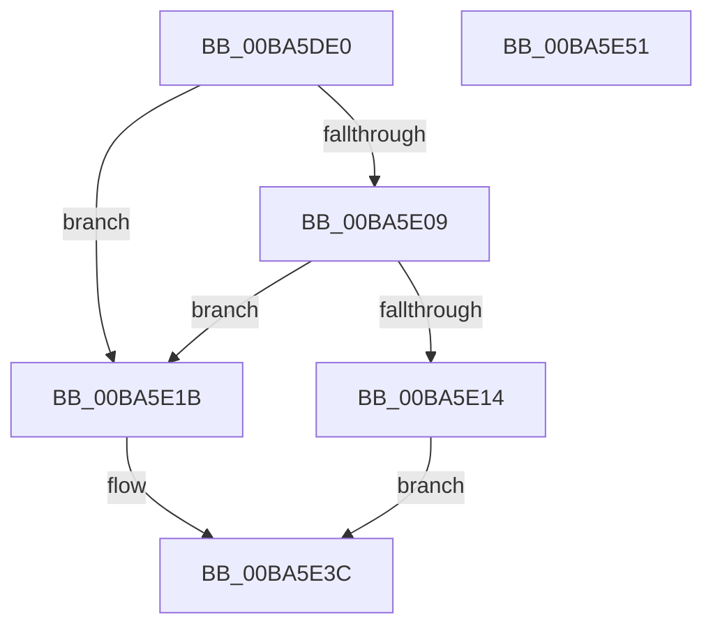

# VerifierKeWaitForSingleObject

- RVA: `0x00BA5DE0`–`0x00BA5E52` (길이 `114` bytes)
- VA: `0x0000000140BA5DE0`
- 실행 섹션: `PAGEVRFY`
- PDB 이름 있음: `예`; PDB Function 태그: `아니요`
- unwind 정보 RVA: `0x00066400`
- 디코드: `33`개 명령, `114/114` bytes 표시
- 미해석 바이트: `0` (있으면 어셈블리에 `.byte`로 보존)

> 이 문서는 커널 이미지의 기계어와 PDB 기호를 분석해 생성했습니다. 4번과 5번은 함수 원형과 자료형을 바이너리 사용 방식에서 추정한 C 해석이며 원본 소스 복구 결과는 아닙니다.

## 1. Dependencies

- 직접 호출 지점: **2**; 고유 호출 대상: **2**
- 직접 호출자로 확인된 함수: **0**
- RIP 상대 이미지 참조: **2**

### Outgoing calls
- `0x00BA5E0B` → [VfRlrsKeInjectStatusAlerted](VfRlrsKeInjectStatusAlerted_function_00BAF6F4.md) (function, `0x00BAF6F4`)
- `0x00BA5E37` → [guard_dispatch_icall](../../text/6B/guard_dispatch_icall_function_006BAAD0.md) (function, `0x006BAAD0`)

### Direct callers
- 이 함수 시작 RVA로 연결되는 직접 call은 확인되지 않았습니다. 간접 호출은 완전히 역산할 수 없습니다.

### Static image references
- `0x00BA5DF4` → RVA `0x00E681A0` (`.data`; read)
- `0x00BA5E23` → RVA `0x00FFE480` (`PAGEVRFD`; read)

## 2. Other-region calls and transfers

- 다른 실행 섹션으로 향하는 call: **1**
  - `0x00BA5E37` → [guard_dispatch_icall](../../text/6B/guard_dispatch_icall_function_006BAAD0.md) (`PAGEVRFY` → `.text`)
- 별도 외부 분기/꼬리 이동을 확인하지 못했습니다.

## 3. Assembly (complete function range)

```asm
00BA5DE0  48 89 5C 24 08                  mov qword ptr [rsp + 8], rbx
00BA5DE5  48 89 6C 24 10                  mov qword ptr [rsp + 0x10], rbp
00BA5DEA  48 89 74 24 18                  mov qword ptr [rsp + 0x18], rsi
00BA5DEF  57                              push rdi
00BA5DF0  48 83 EC 30                     sub rsp, 0x30
00BA5DF4  8B 05 A6 23 2C 00               mov eax, dword ptr [rip + 0x2c23a6]
00BA5DFA  41 8A D9                        mov bl, r9b
00BA5DFD  41 8A F8                        mov dil, r8b
00BA5E00  8B F2                           mov esi, edx
00BA5E02  48 8B E9                        mov rbp, rcx
00BA5E05  A8 04                           test al, 4
00BA5E07  74 12                           je 0x140ba5e1b
00BA5E09  8A CB                           mov cl, bl
00BA5E0B  E8 E4 98 00 00                  call 0x140baf6f4
00BA5E10  85 C0                           test eax, eax
00BA5E12  74 07                           je 0x140ba5e1b
00BA5E14  B8 01 01 00 00                  mov eax, 0x101
00BA5E19  EB 21                           jmp 0x140ba5e3c
00BA5E1B  48 8B 4C 24 60                  mov rcx, qword ptr [rsp + 0x60]
00BA5E20  44 8A CB                        mov r9b, bl
00BA5E23  48 8B 05 56 86 45 00            mov rax, qword ptr [rip + 0x458656]
00BA5E2A  44 8A C7                        mov r8b, dil
00BA5E2D  48 89 4C 24 20                  mov qword ptr [rsp + 0x20], rcx
00BA5E32  8B D6                           mov edx, esi
00BA5E34  48 8B CD                        mov rcx, rbp
00BA5E37  E8 94 4C B1 FF                  call 0x1406baad0
00BA5E3C  48 8B 5C 24 40                  mov rbx, qword ptr [rsp + 0x40]
00BA5E41  48 8B 6C 24 48                  mov rbp, qword ptr [rsp + 0x48]
00BA5E46  48 8B 74 24 50                  mov rsi, qword ptr [rsp + 0x50]
00BA5E4B  48 83 C4 30                     add rsp, 0x30
00BA5E4F  5F                              pop rdi
00BA5E50  C3                              ret
00BA5E51  CC                              int3
```

## 4. C-style interpretation (structured pseudocode)

```c
__int64 __fastcall VerifierKeWaitForSingleObject(__int64 a1, int a2, unsigned __int8 a3, unsigned __int8 a4, __int64 a5)
{
    __int64 result;
    __int64 v_rsp;
    unsigned __int64 v_stack_m18;
    unsigned __int64 v_stack_p10;
    unsigned __int64 v_stack_p18;
    unsigned __int64 v_stack_p8;

    v_stack_p8 = v_rbx;
    v_stack_p10 = v_rbp;
    v_stack_p18 = v_rsi;
    v_rsp = (v_rsp) - (48);
    if ((((unsigned __int8)((unsigned int)(*(unsigned int *)(v_rip + 2892710)))) & (4)) == 0) goto loc_00BA5E1B;
    result = VfRlrsKeInjectStatusAlerted(a4, a2, a3, a4);
    if ((unsigned int)(result) == 0) goto loc_00BA5E1B;
    goto loc_00BA5E3C;
loc_00BA5E1B:
    v_stack_m18 = a5;
    result = guard_dispatch_icall(a1, (unsigned int)((unsigned int)((unsigned int)(a2))), a3, a4);
loc_00BA5E3C:
    v_rsp = (v_rsp) + (48);
    return result;
}
```

## 5. (Beta) C Style

```c
int64_t VerifierKeWaitForSingleObject(int64_t Arg1, int32_t Arg2, uint8_t Arg3, uint8_t Arg4, int64_t Arg5)
{
    int64_t result;
    int64_t local_rsp;
    uint64_t v_stack_m18;
    uint64_t v_stack_p10;
    uint64_t v_stack_p18;
    uint64_t v_stack_p8;

    v_stack_p8 = local_rbx;
    v_stack_p10 = local_rbp;
    v_stack_p18 = local_rsi;
    local_rsp = (local_rsp) - (48);
    if ((((uint8_t)((uint32_t)(*(uint32_t *)(v_rip + 0x2C23A6)))) & (4)) == 0) goto loc_00BA5E1B;
    result = VfRlrsKeInjectStatusAlerted(Arg4, Arg2, Arg3, Arg4);
    if ((uint32_t)(result) == 0) goto loc_00BA5E1B;
    goto loc_00BA5E3C;
loc_00BA5E1B:
    v_stack_m18 = Arg5;
    result = guard_dispatch_icall(Arg1, (uint32_t)((uint32_t)((uint32_t)(Arg2))), Arg3, Arg4);
loc_00BA5E3C:
    local_rsp = (local_rsp) + (48);
    return result;
}
```

## 6. Execution-region graph

[열기: 2D/3D 그래프와 함수 탐색 컨트롤 패널](../../../control-panel.html?section=pagevrfy&rva=0x00BA5DE0&view=graph)

- 2D 그래프는 위에서 아래로 흐르고, 3D 그래프는 빈 공간을 드래그해 회전합니다. Shift+드래그는 이동, 휠은 확대·축소, 함수 노드 선택은 대상 보고서 이동입니다.

### Static fallback


