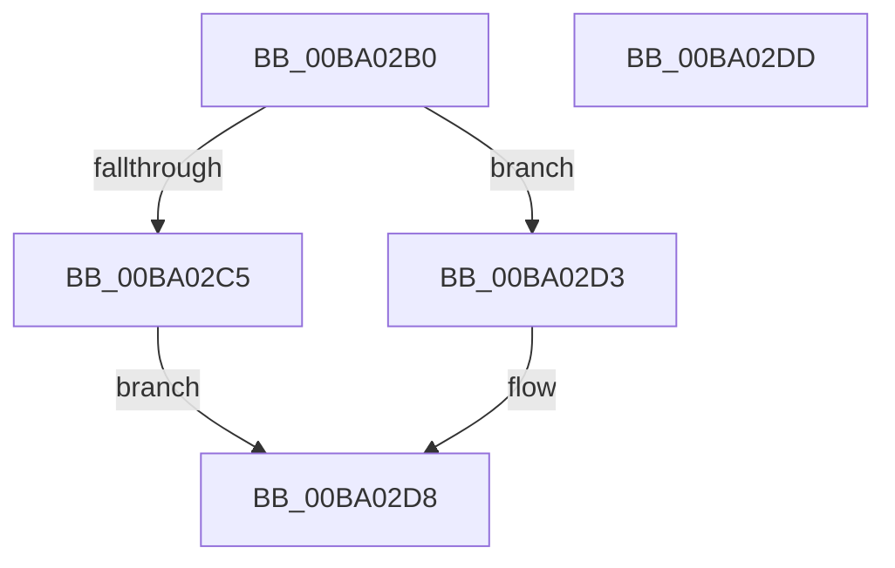

# VerifierPoCallDriver

- RVA: `0x00BA02B0`–`0x00BA02DE` (길이 `46` bytes)
- VA: `0x0000000140BA02B0`
- 실행 섹션: `PAGEVRFY`
- PDB 이름 있음: `예`; PDB Function 태그: `아니요`
- unwind 정보 RVA: `0x0005D2F4`
- 디코드: `12`개 명령, `46/46` bytes 표시
- 미해석 바이트: `0` (있으면 어셈블리에 `.byte`로 보존)

> 이 문서는 커널 이미지의 기계어와 PDB 기호를 분석해 생성했습니다. 4번과 5번은 함수 원형과 자료형을 바이너리 사용 방식에서 추정한 C 해석이며 원본 소스 복구 결과는 아닙니다.

## 1. Dependencies

- 직접 호출 지점: **2**; 고유 호출 대상: **2**
- 직접 호출자로 확인된 함수: **0**
- RIP 상대 이미지 참조: **2**

### Outgoing calls
- `0x00BA02CC` → [guard_dispatch_icall](../../text/6B/guard_dispatch_icall_function_006BAAD0.md) (function, `0x006BAAD0`)
- `0x00BA02D3` → [IofCallDriverSpecifyReturn](../../text/4A/IofCallDriverSpecifyReturn_function_004A8AE0.md) (function, `0x004A8AE0`)

### Direct callers
- 이 함수 시작 RVA로 연결되는 직접 call은 확인되지 않았습니다. 간접 호출은 완전히 역산할 수 없습니다.

### Static image references
- `0x00BA02B4` → RVA `0x00FF4058` (`PAGEVRFD`; read)
- `0x00BA02C5` → RVA `0x004A8AE0` (`IofCallDriverSpecifyReturn`; read)

## 2. Other-region calls and transfers

- 다른 실행 섹션으로 향하는 call: **2**
  - `0x00BA02CC` → [guard_dispatch_icall](../../text/6B/guard_dispatch_icall_function_006BAAD0.md) (`PAGEVRFY` → `.text`)
  - `0x00BA02D3` → [IofCallDriverSpecifyReturn](../../text/4A/IofCallDriverSpecifyReturn_function_004A8AE0.md) (`PAGEVRFY` → `.text`)
- 별도 외부 분기/꼬리 이동을 확인하지 못했습니다.

## 3. Assembly (complete function range)

```asm
00BA02B0  48 83 EC 38                     sub rsp, 0x38
00BA02B4  48 8B 05 9D 3D 45 00            mov rax, qword ptr [rip + 0x453d9d]
00BA02BB  4C 8B 44 24 38                  mov r8, qword ptr [rsp + 0x38]
00BA02C0  48 85 C0                        test rax, rax
00BA02C3  74 0E                           je 0x140ba02d3
00BA02C5  4C 8D 0D 14 88 90 FF            lea r9, [rip - 0x6f77ec]
00BA02CC  E8 FF A7 B1 FF                  call 0x1406baad0
00BA02D1  EB 05                           jmp 0x140ba02d8
00BA02D3  E8 08 88 90 FF                  call 0x1404a8ae0
00BA02D8  48 83 C4 38                     add rsp, 0x38
00BA02DC  C3                              ret
00BA02DD  CC                              int3
```

## 4. C-style interpretation (structured pseudocode)

```c
__int64 __fastcall VerifierPoCallDriver(void)
{
    __int64 result;
    __int64 v_rsp;
    unsigned __int64 v_stack_p0;

    v_rsp = (v_rsp) - (56);
    if (*(unsigned __int64 *)(v_rip + 4537757) == 0) goto loc_00BA02D3;
    result = guard_dispatch_icall(a1, a2, v_stack_p0, v_rip - 7305196);
    goto loc_00BA02D8;
loc_00BA02D3:
    result = IofCallDriverSpecifyReturn(a1, a2, v_stack_p0, v_rip - 7305196);
loc_00BA02D8:
    v_rsp = (v_rsp) + (56);
    return result;
}
```

## 5. (Beta) C Style

```c
void VerifierPoCallDriver(void)
{
    int64_t result;
    int64_t local_rsp;
    uint64_t v_stack_p0;

    local_rsp = (local_rsp) - (56);
    if (*(uint64_t *)(v_rip + 0x453D9D) == 0) goto loc_00BA02D3;
    result = guard_dispatch_icall(a1, a2, v_stack_p0, v_rip - 7305196);
    goto loc_00BA02D8;
loc_00BA02D3:
    result = IofCallDriverSpecifyReturn(a1, a2, v_stack_p0, v_rip - 7305196);
loc_00BA02D8:
    local_rsp = (local_rsp) + (56);
    return result;
}
```

## 6. Execution-region graph

[열기: 2D/3D 그래프와 함수 탐색 컨트롤 패널](../../../control-panel.html?section=pagevrfy&rva=0x00BA02B0&view=graph)

- 2D 그래프는 위에서 아래로 흐르고, 3D 그래프는 빈 공간을 드래그해 회전합니다. Shift+드래그는 이동, 휠은 확대·축소, 함수 노드 선택은 대상 보고서 이동입니다.

### Static fallback


