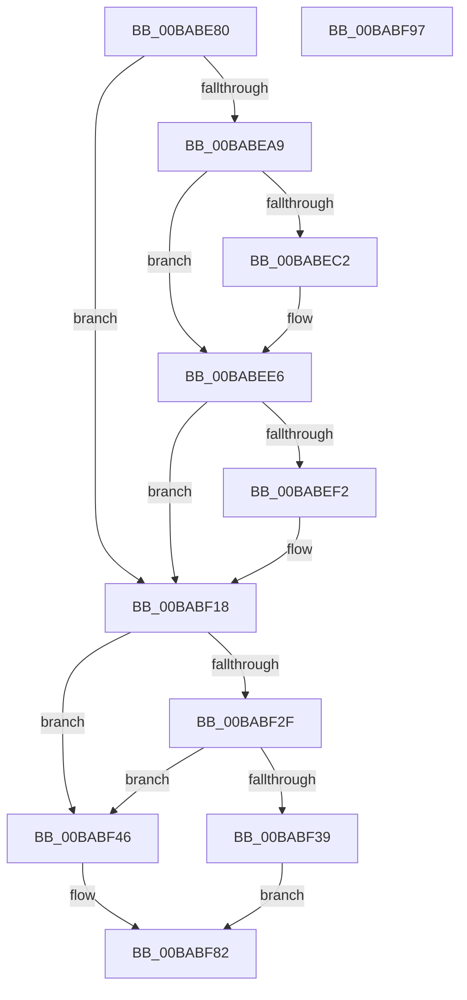

# VerifierPortExAllocatePoolWithQuotaTag

- RVA: `0x00BABE80`–`0x00BABF98` (길이 `280` bytes)
- VA: `0x0000000140BABE80`
- 실행 섹션: `PAGEVRFY`
- PDB 이름 있음: `예`; PDB Function 태그: `아니요`
- unwind 정보 RVA: `0x0006F874`
- 디코드: `68`개 명령, `280/280` bytes 표시
- 미해석 바이트: `0` (있으면 어셈블리에 `.byte`로 보존)

> 이 문서는 커널 이미지의 기계어와 PDB 기호를 분석해 생성했습니다. 4번과 5번은 함수 원형과 자료형을 바이너리 사용 방식에서 추정한 C 해석이며 원본 소스 복구 결과는 아닙니다.

## 1. Dependencies

- 직접 호출 지점: **4**; 고유 호출 대상: **3**
- 직접 호출자로 확인된 함수: **0**
- RIP 상대 이미지 참조: **5**

### Outgoing calls
- `0x00BABEE1` → [CarReportRuleViolationFromNt](../B9/CarReportRuleViolationFromNt_function_00B9D904.md) (function, `0x00B9D904`)
- `0x00BABF13` → [CarReportRuleViolationFromNt](../B9/CarReportRuleViolationFromNt_function_00B9D904.md) (function, `0x00B9D904`)
- `0x00BABF3F` → [ExAllocatePoolWithQuotaTag](../../text/49/ExAllocatePoolWithQuotaTag_function_004987E0.md) (function, `0x004987E0`)
- `0x00BABF7D` → [guard_dispatch_icall](../../text/6B/guard_dispatch_icall_function_006BAAD0.md) (function, `0x006BAAD0`)

### Direct callers
- 이 함수 시작 RVA로 연결되는 직접 call은 확인되지 않았습니다. 간접 호출은 완전히 역산할 수 없습니다.

### Static image references
- `0x00BABE94` → RVA `0x00F04A20` (`.data`; read)
- `0x00BABEB2` → RVA `0x00FC6B70` (`ALMOSTRO`; read)
- `0x00BABF23` → RVA `0x00E681A0` (`.data`; read)
- `0x00BABF46` → RVA `0x00FF4010` (`PAGEVRFD`; read)
- `0x00BABF4D` → RVA `0x00BB8A90` (`VfHandlePoolAlloc`; read)

## 2. Other-region calls and transfers

- 다른 실행 섹션으로 향하는 call: **2**
  - `0x00BABF3F` → [ExAllocatePoolWithQuotaTag](../../text/49/ExAllocatePoolWithQuotaTag_function_004987E0.md) (`PAGEVRFY` → `.text`)
  - `0x00BABF7D` → [guard_dispatch_icall](../../text/6B/guard_dispatch_icall_function_006BAAD0.md) (`PAGEVRFY` → `.text`)
- 별도 외부 분기/꼬리 이동을 확인하지 못했습니다.

## 3. Assembly (complete function range)

```asm
00BABE80  4C 8B DC                        mov r11, rsp
00BABE83  49 89 5B 08                     mov qword ptr [r11 + 8], rbx
00BABE87  49 89 6B 10                     mov qword ptr [r11 + 0x10], rbp
00BABE8B  49 89 73 18                     mov qword ptr [r11 + 0x18], rsi
00BABE8F  57                              push rdi
00BABE90  48 83 EC 50                     sub rsp, 0x50
00BABE94  8B 05 86 8B 35 00               mov eax, dword ptr [rip + 0x358b86]
00BABE9A  49 8B F9                        mov rdi, r9
00BABE9D  41 8B F0                        mov esi, r8d
00BABEA0  48 8B EA                        mov rbp, rdx
00BABEA3  8B D9                           mov ebx, ecx
00BABEA5  A8 08                           test al, 8
00BABEA7  74 6F                           je 0x140babf18
00BABEA9  65 4C 8B 14 25 88 01 00 00      mov r10, qword ptr gs:[0x188]
00BABEB2  48 8B 05 B7 AC 41 00            mov rax, qword ptr [rip + 0x41acb7]
00BABEB9  49 39 82 B8 00 00 00            cmp qword ptr [r10 + 0xb8], rax
00BABEC0  75 24                           jne 0x140babee6
00BABEC2  4D 89 4B D8                     mov qword ptr [r11 - 0x28], r9
00BABEC6  BA 0A 01 00 00                  mov edx, 0x10a
00BABECB  C7 44 24 28 03 00 00 00         mov dword ptr [rsp + 0x28], 3
00BABED3  45 33 C9                        xor r9d, r9d
00BABED6  49 83 63 C8 00                  and qword ptr [r11 - 0x38], 0
00BABEDB  45 33 C0                        xor r8d, r8d
00BABEDE  8D 4A BA                        lea ecx, [rdx - 0x46]
00BABEE1  E8 1E 1A FF FF                  call 0x140b9d904
00BABEE6  65 8A 04 25 3C 3A 00 00         mov al, byte ptr gs:[0x3a3c]
00BABEEE  A8 01                           test al, 1
00BABEF0  74 26                           je 0x140babf18
00BABEF2  BA 0B 01 00 00                  mov edx, 0x10b
00BABEF7  48 89 7C 24 30                  mov qword ptr [rsp + 0x30], rdi
00BABEFC  C7 44 24 28 03 00 00 00         mov dword ptr [rsp + 0x28], 3
00BABF04  45 33 C9                        xor r9d, r9d
00BABF07  48 83 64 24 20 00               and qword ptr [rsp + 0x20], 0
00BABF0D  45 33 C0                        xor r8d, r8d
00BABF10  8D 4A B9                        lea ecx, [rdx - 0x47]
00BABF13  E8 EC 19 FF FF                  call 0x140b9d904
00BABF18  8B CB                           mov ecx, ebx
00BABF1A  83 E1 F7                        and ecx, 0xfffffff7
00BABF1D  F6 C3 08                        test bl, 8
00BABF20  0F 44 CB                        cmove ecx, ebx
00BABF23  F7 05 73 C2 2B 00 00 00 40 00   test dword ptr [rip + 0x2bc273], 0x400000
00BABF2D  74 17                           je 0x140babf46
00BABF2F  8B 05 EB 8A 35 00               mov eax, dword ptr [rip + 0x358aeb]
00BABF35  A8 01                           test al, 1
00BABF37  75 0D                           jne 0x140babf46
00BABF39  44 8B C6                        mov r8d, esi
00BABF3C  48 8B D5                        mov rdx, rbp
00BABF3F  E8 9C C8 8E FF                  call 0x1404987e0
00BABF44  EB 3C                           jmp 0x140babf82
00BABF46  48 8B 05 C3 80 44 00            mov rax, qword ptr [rip + 0x4480c3]
00BABF4D  48 8D 15 3C CB 00 00            lea rdx, [rip + 0xcb3c]
00BABF54  48 89 54 24 40                  mov qword ptr [rsp + 0x40], rdx
00BABF59  0F BA E9 07                     bts ecx, 7
00BABF5D  48 89 7C 24 38                  mov qword ptr [rsp + 0x38], rdi
00BABF62  44 8B CE                        mov r9d, esi
00BABF65  83 64 24 30 00                  and dword ptr [rsp + 0x30], 0
00BABF6A  4C 8B C5                        mov r8, rbp
00BABF6D  48 83 64 24 28 00               and qword ptr [rsp + 0x28], 0
00BABF73  33 D2                           xor edx, edx
00BABF75  C7 44 24 20 20 00 00 00         mov dword ptr [rsp + 0x20], 0x20
00BABF7D  E8 4E EB B0 FF                  call 0x1406baad0
00BABF82  48 8B 5C 24 60                  mov rbx, qword ptr [rsp + 0x60]
00BABF87  48 8B 6C 24 68                  mov rbp, qword ptr [rsp + 0x68]
00BABF8C  48 8B 74 24 70                  mov rsi, qword ptr [rsp + 0x70]
00BABF91  48 83 C4 50                     add rsp, 0x50
00BABF95  5F                              pop rdi
00BABF96  C3                              ret
00BABF97  CC                              int3
```

## 4. C-style interpretation (structured pseudocode)

```c
__int64 __fastcall VerifierPortExAllocatePoolWithQuotaTag(int a1, __int64 a2, int a3, __int64 a4)
{
    __int64 result;
    __int64 v_rsp;
    unsigned __int64 v_stack_m18;
    unsigned __int64 v_stack_m20;
    unsigned __int64 v_stack_m28;
    unsigned int v_stack_m30;
    unsigned __int64 v_stack_m38;
    unsigned __int64 v_stack_p10;
    unsigned __int64 v_stack_p18;
    unsigned __int64 v_stack_p8;

    *(unsigned __int64 *)(v_rsp + 8) = v_rbx;
    *(unsigned __int64 *)(v_rsp + 16) = v_rbp;
    *(unsigned __int64 *)(v_rsp + 24) = v_rsi;
    v_rsp = (v_rsp) - (80);
    if ((((unsigned __int8)((unsigned int)(*(unsigned int *)(v_rip + 3509126)))) & (8)) == 0) goto loc_00BABF18;
    result = *(unsigned __int64 *)(v_rip + 4304055);
    if ((*(unsigned __int64 *)(*(unsigned __int64 *)(gs_base + (0 + 392)) + 184)) == (*(unsigned __int64 *)(v_rip + 4304055))) {
        *(unsigned __int64 *)(v_rsp - 40) = a4;
        a2 = 266;
        v_stack_m30 = 3;
        a4 = 0;
        a3 = 0;
        a1 = a2 - 70;
        result = CarReportRuleViolationFromNt(a1, a2, a3, a4);
    }
    result = *(unsigned __int8 *)(gs_base + (0 + 14908));
    if ((((unsigned __int8)(*(unsigned __int8 *)(gs_base + (0 + 14908)))) & (1)) != 0) {
        a2 = 267;
        v_stack_m28 = 0;
        v_stack_m30 = 3;
        a4 = 0;
        a3 = 0;
        a1 = a2 - 71;
        result = CarReportRuleViolationFromNt(a1, a2, a3, a4);
    }
    a1 = (unsigned int)(((unsigned int)((unsigned int)((unsigned int)(a1)))) & (0xFFFFFFF7ULL));
    if ((((unsigned __int8)((unsigned int)(a1))) & (8)) == 0) { a1 = (unsigned int)((unsigned int)(a1)); }
    if (((*(unsigned int *)(v_rip + 2867827)) & (0x400000ULL)) == 0) goto loc_00BABF46;
    if ((((unsigned __int8)((unsigned int)(*(unsigned int *)(v_rip + 3508971)))) & (1)) != 0) goto loc_00BABF46;
    result = ExAllocatePoolWithQuotaTag(a1, a2, (unsigned int)((unsigned int)((unsigned int)(a3))), a4);
    goto loc_00BABF82;
loc_00BABF46:
    v_stack_m18 = v_rip + 52028;
    v_stack_m20 = 0;
    a2 = 0;
    v_stack_m38 = 32;
    result = guard_dispatch_icall(a1, a2, a2, (unsigned int)((unsigned int)((unsigned int)(a3))));
loc_00BABF82:
    v_rsp = (v_rsp) + (80);
    return result;
}
```

## 5. (Beta) C Style

```c
int64_t VerifierPortExAllocatePoolWithQuotaTag(int32_t Arg1, int64_t Arg2, int32_t Arg3, int64_t Arg4)
{
    int64_t result;
    int64_t local_rsp;
    uint64_t v_stack_m18;
    uint64_t v_stack_m20;
    uint64_t v_stack_m28;
    uint32_t v_stack_m30;
    uint64_t v_stack_m38;
    uint64_t v_stack_p10;
    uint64_t v_stack_p18;
    uint64_t v_stack_p8;

    *(uint64_t *)(local_rsp + 0x8) = local_rbx;
    *(uint64_t *)(local_rsp + 0x10) = local_rbp;
    *(uint64_t *)(local_rsp + 0x18) = local_rsi;
    local_rsp = (local_rsp) - (80);
    if ((((uint8_t)((uint32_t)(*(uint32_t *)(v_rip + 0x358B86)))) & (8)) == 0) goto loc_00BABF18;
    result = *(uint64_t *)(v_rip + 0x41ACB7);
    if ((*(uint64_t *)(*(uint64_t *)(gs_base + (0 + 0x188)) + 0xB8)) == (*(uint64_t *)(v_rip + 0x41ACB7))) {
        *(uint64_t *)(local_rsp - 0x28) = Arg4;
        Arg2 = 266;
        v_stack_m30 = 3;
        Arg4 = 0;
        Arg3 = 0;
        Arg1 = Arg2 - 70;
        result = CarReportRuleViolationFromNt(Arg1, Arg2, Arg3, Arg4);
    }
    result = *(uint8_t *)(gs_base + (0 + 0x3A3C));
    if ((((uint8_t)(*(uint8_t *)(gs_base + (0 + 0x3A3C)))) & (1)) != 0) {
        Arg2 = 267;
        v_stack_m28 = 0;
        v_stack_m30 = 3;
        Arg4 = 0;
        Arg3 = 0;
        Arg1 = Arg2 - 71;
        result = CarReportRuleViolationFromNt(Arg1, Arg2, Arg3, Arg4);
    }
    Arg1 = (uint32_t)(((uint32_t)((uint32_t)((uint32_t)(Arg1)))) & (0xFFFFFFF7ULL));
    if ((((uint8_t)((uint32_t)(Arg1))) & (8)) == 0) { Arg1 = (uint32_t)((uint32_t)(Arg1)); }
    if (((*(uint32_t *)(v_rip + 0x2BC273)) & (0x400000ULL)) == 0) goto loc_00BABF46;
    if ((((uint8_t)((uint32_t)(*(uint32_t *)(v_rip + 0x358AEB)))) & (1)) != 0) goto loc_00BABF46;
    result = ExAllocatePoolWithQuotaTag(Arg1, Arg2, (uint32_t)((uint32_t)((uint32_t)(Arg3))), Arg4);
    goto loc_00BABF82;
loc_00BABF46:
    v_stack_m18 = v_rip + 52028;
    v_stack_m20 = 0;
    Arg2 = 0;
    v_stack_m38 = 32;
    result = guard_dispatch_icall(Arg1, Arg2, Arg2, (uint32_t)((uint32_t)((uint32_t)(Arg3))));
loc_00BABF82:
    local_rsp = (local_rsp) + (80);
    return result;
}
```

## 6. Execution-region graph

[열기: 2D/3D 그래프와 함수 탐색 컨트롤 패널](../../../control-panel.html?section=pagevrfy&rva=0x00BABE80&view=graph)

- 2D 그래프는 위에서 아래로 흐르고, 3D 그래프는 빈 공간을 드래그해 회전합니다. Shift+드래그는 이동, 휠은 확대·축소, 함수 노드 선택은 대상 보고서 이동입니다.

### Static fallback


