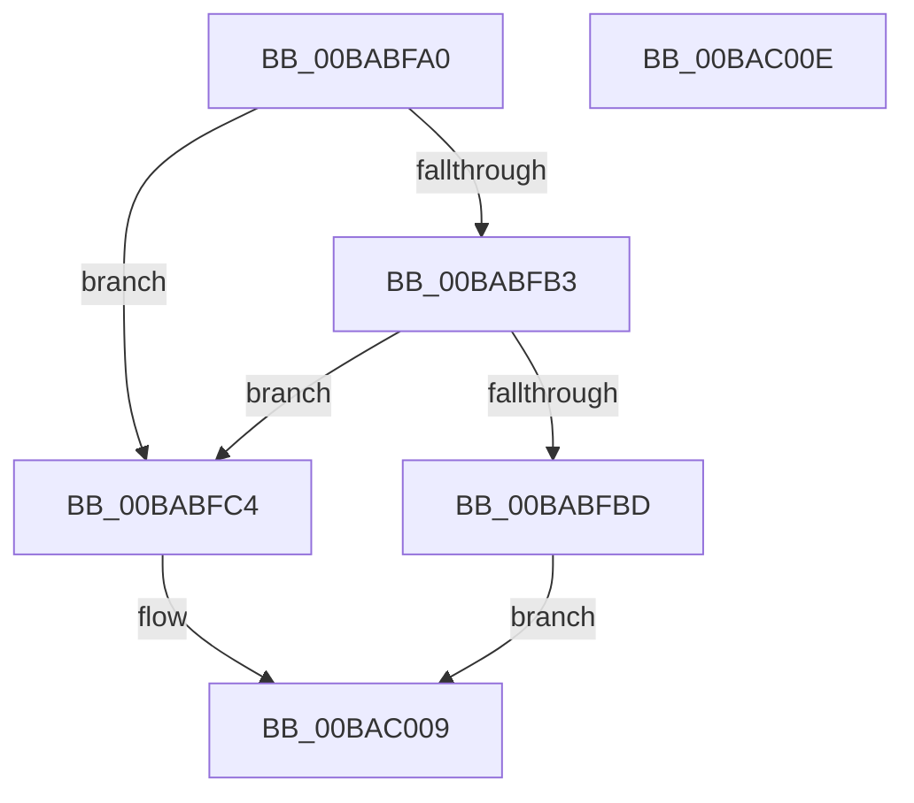

# VerifierPortExAllocatePoolWithTagPriority

- RVA: `0x00BABFA0`–`0x00BAC00F` (길이 `111` bytes)
- VA: `0x0000000140BABFA0`
- 실행 섹션: `PAGEVRFY`
- PDB 이름 있음: `예`; PDB Function 태그: `아니요`
- unwind 정보 RVA: `0x0006C2A4`
- 디코드: `26`개 명령, `111/111` bytes 표시
- 미해석 바이트: `0` (있으면 어셈블리에 `.byte`로 보존)

> 이 문서는 커널 이미지의 기계어와 PDB 기호를 분석해 생성했습니다. 4번과 5번은 함수 원형과 자료형을 바이너리 사용 방식에서 추정한 C 해석이며 원본 소스 복구 결과는 아닙니다.

## 1. Dependencies

- 직접 호출 지점: **2**; 고유 호출 대상: **2**
- 직접 호출자로 확인된 함수: **0**
- RIP 상대 이미지 참조: **4**

### Outgoing calls
- `0x00BABFBD` → [ExAllocatePoolWithTagPriority](../../text/43/ExAllocatePoolWithTagPriority_function_0043E5F0.md) (function, `0x0043E5F0`)
- `0x00BAC004` → [guard_dispatch_icall](../../text/6B/guard_dispatch_icall_function_006BAAD0.md) (function, `0x006BAAD0`)

### Direct callers
- 이 함수 시작 RVA로 연결되는 직접 call은 확인되지 않았습니다. 간접 호출은 완전히 역산할 수 없습니다.

### Static image references
- `0x00BABFA4` → RVA `0x00E681A0` (`.data`; read)
- `0x00BABFB3` → RVA `0x00F04A20` (`.data`; read)
- `0x00BABFC4` → RVA `0x00FF4010` (`PAGEVRFD`; read)
- `0x00BABFCB` → RVA `0x00BB8A90` (`VfHandlePoolAlloc`; read)

## 2. Other-region calls and transfers

- 다른 실행 섹션으로 향하는 call: **2**
  - `0x00BABFBD` → [ExAllocatePoolWithTagPriority](../../text/43/ExAllocatePoolWithTagPriority_function_0043E5F0.md) (`PAGEVRFY` → `.text`)
  - `0x00BAC004` → [guard_dispatch_icall](../../text/6B/guard_dispatch_icall_function_006BAAD0.md) (`PAGEVRFY` → `.text`)
- 별도 외부 분기/꼬리 이동을 확인하지 못했습니다.

## 3. Assembly (complete function range)

```asm
00BABFA0  48 83 EC 58                     sub rsp, 0x58
00BABFA4  F7 05 F2 C1 2B 00 00 00 40 00   test dword ptr [rip + 0x2bc1f2], 0x400000
00BABFAE  44 8B D1                        mov r10d, ecx
00BABFB1  74 11                           je 0x140babfc4
00BABFB3  8B 05 67 8A 35 00               mov eax, dword ptr [rip + 0x358a67]
00BABFB9  A8 01                           test al, 1
00BABFBB  75 07                           jne 0x140babfc4
00BABFBD  E8 2E 26 89 FF                  call 0x14043e5f0
00BABFC2  EB 45                           jmp 0x140bac009
00BABFC4  48 8B 05 45 80 44 00            mov rax, qword ptr [rip + 0x448045]
00BABFCB  48 8D 0D BE CA 00 00            lea rcx, [rip + 0xcabe]
00BABFD2  48 89 4C 24 40                  mov qword ptr [rsp + 0x40], rcx
00BABFD7  41 0F BA EA 07                  bts r10d, 7
00BABFDC  48 8B 8C 24 80 00 00 00         mov rcx, qword ptr [rsp + 0x80]
00BABFE4  48 89 4C 24 38                  mov qword ptr [rsp + 0x38], rcx
00BABFE9  41 8B CA                        mov ecx, r10d
00BABFEC  83 64 24 30 00                  and dword ptr [rsp + 0x30], 0
00BABFF1  48 83 64 24 28 00               and qword ptr [rsp + 0x28], 0
00BABFF7  44 89 4C 24 20                  mov dword ptr [rsp + 0x20], r9d
00BABFFC  45 8B C8                        mov r9d, r8d
00BABFFF  4C 8B C2                        mov r8, rdx
00BAC002  33 D2                           xor edx, edx
00BAC004  E8 C7 EA B0 FF                  call 0x1406baad0
00BAC009  48 83 C4 58                     add rsp, 0x58
00BAC00D  C3                              ret
00BAC00E  CC                              int3
```

## 4. C-style interpretation (structured pseudocode)

```c
__int64 __fastcall VerifierPortExAllocatePoolWithTagPriority(int a1, __int64 a2, int a3, int a4, __int64 a5)
{
    __int64 result;
    __int64 v_rsp;
    unsigned __int64 v_stack_m18;
    unsigned __int64 v_stack_m20;
    unsigned int v_stack_m28;
    unsigned __int64 v_stack_m30;
    unsigned int v_stack_m38;

    v_rsp = (v_rsp) - (88);
    if (((*(unsigned int *)(v_rip + 2867698)) & (0x400000ULL)) == 0) goto loc_00BABFC4;
    if ((((unsigned __int8)((unsigned int)(*(unsigned int *)(v_rip + 3508839)))) & (1)) != 0) goto loc_00BABFC4;
    result = ExAllocatePoolWithTagPriority(a1, a2, a3, a4);
    goto loc_00BAC009;
loc_00BABFC4:
    v_stack_m18 = v_rip + 51902;
    v_stack_m20 = a5;
    v_stack_m38 = a4;
    a2 = 0;
    result = guard_dispatch_icall((unsigned int)((unsigned int)((unsigned int)(a1))), a2, a2, (unsigned int)(a3));
loc_00BAC009:
    v_rsp = (v_rsp) + (88);
    return result;
}
```

## 5. (Beta) C Style

```c
int64_t VerifierPortExAllocatePoolWithTagPriority(int32_t Arg1, int64_t Arg2, int32_t Arg3, int32_t Arg4, int64_t Arg5)
{
    int64_t result;
    int64_t local_rsp;
    uint64_t v_stack_m18;
    uint64_t v_stack_m20;
    uint32_t v_stack_m28;
    uint64_t v_stack_m30;
    uint32_t v_stack_m38;

    local_rsp = (local_rsp) - (88);
    if (((*(uint32_t *)(v_rip + 0x2BC1F2)) & (0x400000ULL)) == 0) goto loc_00BABFC4;
    if ((((uint8_t)((uint32_t)(*(uint32_t *)(v_rip + 0x358A67)))) & (1)) != 0) goto loc_00BABFC4;
    result = ExAllocatePoolWithTagPriority(Arg1, Arg2, Arg3, Arg4);
    goto loc_00BAC009;
loc_00BABFC4:
    v_stack_m18 = v_rip + 51902;
    v_stack_m20 = Arg5;
    v_stack_m38 = Arg4;
    Arg2 = 0;
    result = guard_dispatch_icall((uint32_t)((uint32_t)((uint32_t)(Arg1))), Arg2, Arg2, (uint32_t)(Arg3));
loc_00BAC009:
    local_rsp = (local_rsp) + (88);
    return result;
}
```

## 6. Execution-region graph

[열기: 2D/3D 그래프와 함수 탐색 컨트롤 패널](../../../control-panel.html?section=pagevrfy&rva=0x00BABFA0&view=graph)

- 2D 그래프는 위에서 아래로 흐르고, 3D 그래프는 빈 공간을 드래그해 회전합니다. Shift+드래그는 이동, 휠은 확대·축소, 함수 노드 선택은 대상 보고서 이동입니다.

### Static fallback


