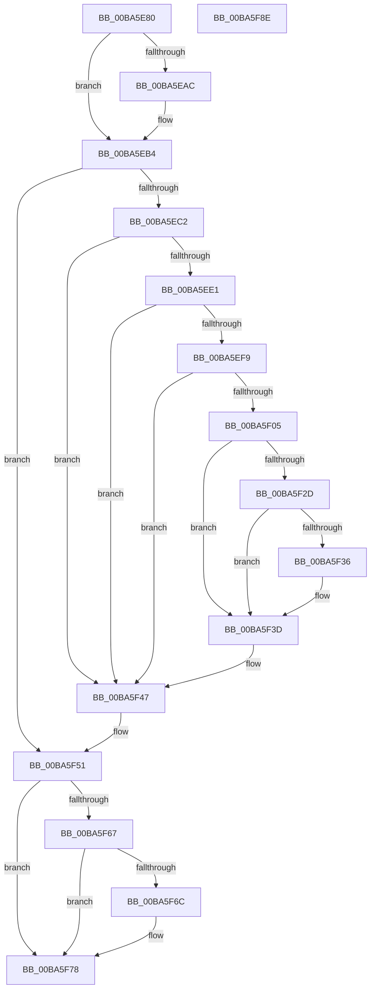

# VerifierPortKeAcquireSpinLockNoXdv

- RVA: `0x00BA5E80`–`0x00BA5F8F` (길이 `271` bytes)
- VA: `0x0000000140BA5E80`
- 실행 섹션: `PAGEVRFY`
- PDB 이름 있음: `예`; PDB Function 태그: `아니요`
- unwind 정보 RVA: `0x000BCAF8`
- 디코드: `69`개 명령, `271/271` bytes 표시
- 미해석 바이트: `0` (있으면 어셈블리에 `.byte`로 보존)

> 이 문서는 커널 이미지의 기계어와 PDB 기호를 분석해 생성했습니다. 4번과 5번은 함수 원형과 자료형을 바이너리 사용 방식에서 추정한 C 해석이며 원본 소스 복구 결과는 아닙니다.

## 1. Dependencies

- 직접 호출 지점: **8**; 고유 호출 대상: **8**
- 직접 호출자로 확인된 함수: **0**
- RIP 상대 이미지 참조: **5**

### Outgoing calls
- `0x00BA5EAF` → [VfMiscCheckKernelAddress](../../text/4B/VfMiscCheckKernelAddress_function_004BC694.md) (function, `0x004BC694`)
- `0x00BA5EF0` → [ViTargetUpdateTreeAllowed](../B9/ViTargetUpdateTreeAllowed_function_00B9BC04.md) (function, `0x00B9BC04`)
- `0x00BA5EFC` → [VfDriverIsKernelImageAddress](../BB/VfDriverIsKernelImageAddress_function_00BB7EBC.md) (function, `0x00BB7EBC`)
- `0x00BA5F0C` → [VfAvlInitializeLockContext](../../text/4A/VfAvlInitializeLockContext_function_004A686C.md) (function, `0x004A686C`)
- `0x00BA5F23` → [VfAvlLookupTreeNode](../../text/3E/VfAvlLookupTreeNode_function_003EF1B4.md) (function, `0x003EF1B4`)
- `0x00BA5F42` → [VfAvlCleanupLockContext](../../text/3E/VfAvlCleanupLockContext_function_003EF56C.md) (function, `0x003EF56C`)
- `0x00BA5F49` → [ViKeIrqlLogAndTrimMemory](../BB/ViKeIrqlLogAndTrimMemory_function_00BB7F58.md) (function, `0x00BB7F58`)
- `0x00BA5F54` → [KeAcquireSpinLockRaiseToDpc](../../text/20/KeAcquireSpinLockRaiseToDpc_function_00208470.md) (function, `0x00208470`)

### Direct callers
- 이 함수 시작 RVA로 연결되는 직접 call은 확인되지 않았습니다. 간접 호출은 완전히 역산할 수 없습니다.

### Static image references
- `0x00BA5E9A` → RVA `0x00E681A0` (`.data`; read)
- `0x00BA5EC2` → RVA `0x00F04A28` (`.data`; read)
- `0x00BA5ECF` → RVA `0x00F04A20` (`.data`; read)
- `0x00BA5ED9` → RVA `0x00F04A28` (`.data`; write)
- `0x00BA5F1C` → RVA `0x00F049A0` (`.data`; read)

## 2. Other-region calls and transfers

- 다른 실행 섹션으로 향하는 call: **5**
  - `0x00BA5EAF` → [VfMiscCheckKernelAddress](../../text/4B/VfMiscCheckKernelAddress_function_004BC694.md) (`PAGEVRFY` → `.text`)
  - `0x00BA5F0C` → [VfAvlInitializeLockContext](../../text/4A/VfAvlInitializeLockContext_function_004A686C.md) (`PAGEVRFY` → `.text`)
  - `0x00BA5F23` → [VfAvlLookupTreeNode](../../text/3E/VfAvlLookupTreeNode_function_003EF1B4.md) (`PAGEVRFY` → `.text`)
  - `0x00BA5F42` → [VfAvlCleanupLockContext](../../text/3E/VfAvlCleanupLockContext_function_003EF56C.md) (`PAGEVRFY` → `.text`)
  - `0x00BA5F54` → [KeAcquireSpinLockRaiseToDpc](../../text/20/KeAcquireSpinLockRaiseToDpc_function_00208470.md) (`PAGEVRFY` → `.text`)
- 별도 외부 분기/꼬리 이동을 확인하지 못했습니다.

## 3. Assembly (complete function range)

```asm
00BA5E80  48 89 5C 24 08                  mov qword ptr [rsp + 8], rbx
00BA5E85  48 89 74 24 10                  mov qword ptr [rsp + 0x10], rsi
00BA5E8A  48 89 7C 24 18                  mov qword ptr [rsp + 0x18], rdi
00BA5E8F  41 56                           push r14
00BA5E91  48 83 EC 40                     sub rsp, 0x40
00BA5E95  33 DB                           xor ebx, ebx
00BA5E97  49 8B F8                        mov rdi, r8
00BA5E9A  F7 05 FC 22 2C 00 00 08 00 00   test dword ptr [rip + 0x2c22fc], 0x800
00BA5EA4  4C 8B F2                        mov r14, rdx
00BA5EA7  48 8B F1                        mov rsi, rcx
00BA5EAA  74 08                           je 0x140ba5eb4
00BA5EAC  8D 53 08                        lea edx, [rbx + 8]
00BA5EAF  E8 E0 67 91 FF                  call 0x1404bc694
00BA5EB4  8B 05 E6 22 2C 00               mov eax, dword ptr [rip + 0x2c22e6]
00BA5EBA  A8 02                           test al, 2
00BA5EBC  0F 84 8F 00 00 00               je 0x140ba5f51
00BA5EC2  8B 05 60 EB 35 00               mov eax, dword ptr [rip + 0x35eb60]
00BA5EC8  BB 01 00 00 00                  mov ebx, 1
00BA5ECD  03 C3                           add eax, ebx
00BA5ECF  F7 05 47 EB 35 00 00 10 00 00   test dword ptr [rip + 0x35eb47], 0x1000
00BA5ED9  89 05 49 EB 35 00               mov dword ptr [rip + 0x35eb49], eax
00BA5EDF  74 66                           je 0x140ba5f47
00BA5EE1  33 C0                           xor eax, eax
00BA5EE3  0F 57 C0                        xorps xmm0, xmm0
00BA5EE6  0F 11 44 24 20                  movups xmmword ptr [rsp + 0x20], xmm0
00BA5EEB  48 89 44 24 30                  mov qword ptr [rsp + 0x30], rax
00BA5EF0  E8 0F 5D FF FF                  call 0x140b9bc04
00BA5EF5  85 C0                           test eax, eax
00BA5EF7  74 4E                           je 0x140ba5f47
00BA5EF9  48 8B CF                        mov rcx, rdi
00BA5EFC  E8 BB 1F 01 00                  call 0x140bb7ebc
00BA5F01  85 C0                           test eax, eax
00BA5F03  75 42                           jne 0x140ba5f47
00BA5F05  8B D3                           mov edx, ebx
00BA5F07  48 8D 4C 24 20                  lea rcx, [rsp + 0x20]
00BA5F0C  E8 5B 09 90 FF                  call 0x1404a686c
00BA5F11  44 8B CB                        mov r9d, ebx
00BA5F14  48 8D 54 24 20                  lea rdx, [rsp + 0x20]
00BA5F19  4C 8B C7                        mov r8, rdi
00BA5F1C  48 8D 0D 7D EA 35 00            lea rcx, [rip + 0x35ea7d]
00BA5F23  E8 8C 92 84 FF                  call 0x1403ef1b4
00BA5F28  48 85 C0                        test rax, rax
00BA5F2B  74 10                           je 0x140ba5f3d
00BA5F2D  48 8B 40 40                     mov rax, qword ptr [rax + 0x40]
00BA5F31  48 85 C0                        test rax, rax
00BA5F34  74 07                           je 0x140ba5f3d
00BA5F36  F0 01 98 A4 00 00 00            lock add dword ptr [rax + 0xa4], ebx
00BA5F3D  48 8D 4C 24 20                  lea rcx, [rsp + 0x20]
00BA5F42  E8 25 96 84 FF                  call 0x1403ef56c
00BA5F47  B1 02                           mov cl, 2
00BA5F49  E8 0A 20 01 00                  call 0x140bb7f58
00BA5F4E  48 8B D8                        mov rbx, rax
00BA5F51  48 8B CE                        mov rcx, rsi
00BA5F54  E8 17 25 66 FF                  call 0x140208470
00BA5F59  41 88 06                        mov byte ptr [r14], al
00BA5F5C  8B 0D 3E 22 2C 00               mov ecx, dword ptr [rip + 0x2c223e]
00BA5F62  F6 C1 02                        test cl, 2
00BA5F65  74 11                           je 0x140ba5f78
00BA5F67  48 85 DB                        test rbx, rbx
00BA5F6A  74 0C                           je 0x140ba5f78
00BA5F6C  65 8B 0C 25 A4 01 00 00         mov ecx, dword ptr gs:[0x1a4]
00BA5F74  66 89 4B 0A                     mov word ptr [rbx + 0xa], cx
00BA5F78  48 8B 5C 24 50                  mov rbx, qword ptr [rsp + 0x50]
00BA5F7D  48 8B 74 24 58                  mov rsi, qword ptr [rsp + 0x58]
00BA5F82  48 8B 7C 24 60                  mov rdi, qword ptr [rsp + 0x60]
00BA5F87  48 83 C4 40                     add rsp, 0x40
00BA5F8B  41 5E                           pop r14
00BA5F8D  C3                              ret
00BA5F8E  CC                              int3
```

## 4. C-style interpretation (structured pseudocode)

```c
__int64 __fastcall VerifierPortKeAcquireSpinLockNoXdv(__int64 a1, __int64 a2, __int64 a3)
{
    __int64 result;
    __int64 v_rbx;
    __int64 v_rsp;
    unsigned __int64 v_stack_m18;
    unsigned __int64 v_stack_m28;
    unsigned __int64 v_stack_p10;
    unsigned __int64 v_stack_p18;
    unsigned __int64 v_stack_p8;

    v_stack_p8 = v_rbx;
    v_stack_p10 = v_rsi;
    v_stack_p18 = v_rdi;
    v_rsp = (v_rsp) - (64);
    v_rbx = 0;
    if (((*(unsigned int *)(v_rip + 2892540)) & (0x800ULL)) != 0) {
        a2 = v_rbx + 8;
        result = VfMiscCheckKernelAddress(a1, a2, a3, a4);
    }
    if ((((unsigned __int8)((unsigned int)(*(unsigned int *)(v_rip + 2892518)))) & (2)) == 0) goto loc_00BA5F51;
    result = (unsigned int)(((unsigned int)(*(unsigned int *)(v_rip + 3533664))) + (1));
    *(unsigned int *)(v_rip + 3533641) = (unsigned int)(result);
    if (((*(unsigned int *)(v_rip + 3533639)) & (0x1000ULL)) == 0) goto loc_00BA5F47;
    result = 0;
    v_stack_m28 = v_xmm0;
    v_stack_m18 = 0;
    result = ViTargetUpdateTreeAllowed(a1, a2, a3, a4);
    if ((unsigned int)(result) == 0) goto loc_00BA5F47;
    result = VfDriverIsKernelImageAddress(a3, a2, a3, a4);
    if ((unsigned int)(result) != 0) goto loc_00BA5F47;
    result = VfAvlInitializeLockContext(v_stack_m28, 1, a3, a4);
    result = VfAvlLookupTreeNode(v_rip + 3533437, v_stack_m28, a3, 1);
    if (result == 0) goto loc_00BA5F3D;
    if (*(unsigned __int64 *)(result + 64) != 0) {
    }
    result = VfAvlCleanupLockContext(v_stack_m28, v_stack_m28, a3, 1);
loc_00BA5F47:
    result = ViKeIrqlLogAndTrimMemory(2, v_stack_m28, a3, 1);
loc_00BA5F51:
    result = KeAcquireSpinLockRaiseToDpc(a1, v_stack_m28, a3, 1);
    *(unsigned __int8 *)(a2) = (unsigned __int8)(result);
    if ((((unsigned __int8)((unsigned int)(*(unsigned int *)(v_rip + 2892350)))) & (2)) == 0) goto loc_00BA5F78;
    if (result != 0) {
        a1 = *(unsigned int *)(gs_base + (0 + 420));
        *(unsigned __int16 *)(result + 10) = (unsigned __int16)(a1);
    }
    v_rsp = (v_rsp) + (64);
    return result;
}
```

## 5. (Beta) C Style

```c
int64_t VerifierPortKeAcquireSpinLockNoXdv(int64_t Arg1, void *Arg2, int64_t Arg3)
{
    uint8_t *arg2 = (uint8_t *)Arg2;

    int64_t result;
    int64_t local_rbx;
    int64_t local_rsp;
    uint64_t v_stack_m18;
    uint64_t v_stack_m28;
    uint64_t v_stack_p10;
    uint64_t v_stack_p18;
    uint64_t v_stack_p8;

    v_stack_p8 = local_rbx;
    v_stack_p10 = local_rsi;
    v_stack_p18 = local_rdi;
    local_rsp = (local_rsp) - (64);
    local_rbx = 0;
    if (((*(uint32_t *)(v_rip + 0x2C22FC)) & (0x800ULL)) != 0) {
        Arg2 = local_rbx + 8;
        result = VfMiscCheckKernelAddress(Arg1, Arg2, Arg3, a4);
    }
    if ((((uint8_t)((uint32_t)(*(uint32_t *)(v_rip + 0x2C22E6)))) & (2)) == 0) goto loc_00BA5F51;
    result = (uint32_t)(((uint32_t)(*(uint32_t *)(v_rip + 0x35EB60))) + (1));
    *(uint32_t *)(v_rip + 0x35EB49) = (uint32_t)(result);
    if (((*(uint32_t *)(v_rip + 0x35EB47)) & (0x1000ULL)) == 0) goto loc_00BA5F47;
    result = 0;
    v_stack_m28 = v_xmm0;
    v_stack_m18 = 0;
    result = ViTargetUpdateTreeAllowed(Arg1, Arg2, Arg3, a4);
    if ((uint32_t)(result) == 0) goto loc_00BA5F47;
    result = VfDriverIsKernelImageAddress(Arg3, Arg2, Arg3, a4);
    if ((uint32_t)(result) != 0) goto loc_00BA5F47;
    result = VfAvlInitializeLockContext(v_stack_m28, 1, Arg3, a4);
    result = VfAvlLookupTreeNode(v_rip + 3533437, v_stack_m28, Arg3, 1);
    if (result == 0) goto loc_00BA5F3D;
    if (*(uint64_t *)(result + 0x40) != 0) {
    }
    result = VfAvlCleanupLockContext(v_stack_m28, v_stack_m28, Arg3, 1);
loc_00BA5F47:
    result = ViKeIrqlLogAndTrimMemory(2, v_stack_m28, Arg3, 1);
loc_00BA5F51:
    result = KeAcquireSpinLockRaiseToDpc(Arg1, v_stack_m28, Arg3, 1);
    *(uint8_t *)(arg2) = (uint8_t)(result);
    if ((((uint8_t)((uint32_t)(*(uint32_t *)(v_rip + 0x2C223E)))) & (2)) == 0) goto loc_00BA5F78;
    if (result != 0) {
        Arg1 = *(uint32_t *)(gs_base + (0 + 0x1A4));
        *(uint16_t *)(result + 0xA) = (uint16_t)(Arg1);
    }
    local_rsp = (local_rsp) + (64);
    return result;
}
```

### 관측된 메모리 오프셋

구조체 형식이 확인되지 않은 접근은 인자 기준의 오프셋으로만 기록했습니다.

| 기준 인자 | 오프셋 표현 | 폭 (bit) | 접근 |
|---|---:|---:|---|
| `Arg2` | `+ 0x0` | `8` | `W` |

## 6. Execution-region graph

[열기: 2D/3D 그래프와 함수 탐색 컨트롤 패널](../../../control-panel.html?section=pagevrfy&rva=0x00BA5E80&view=graph)

- 2D 그래프는 위에서 아래로 흐르고, 3D 그래프는 빈 공간을 드래그해 회전합니다. Shift+드래그는 이동, 휠은 확대·축소, 함수 노드 선택은 대상 보고서 이동입니다.

### Static fallback


