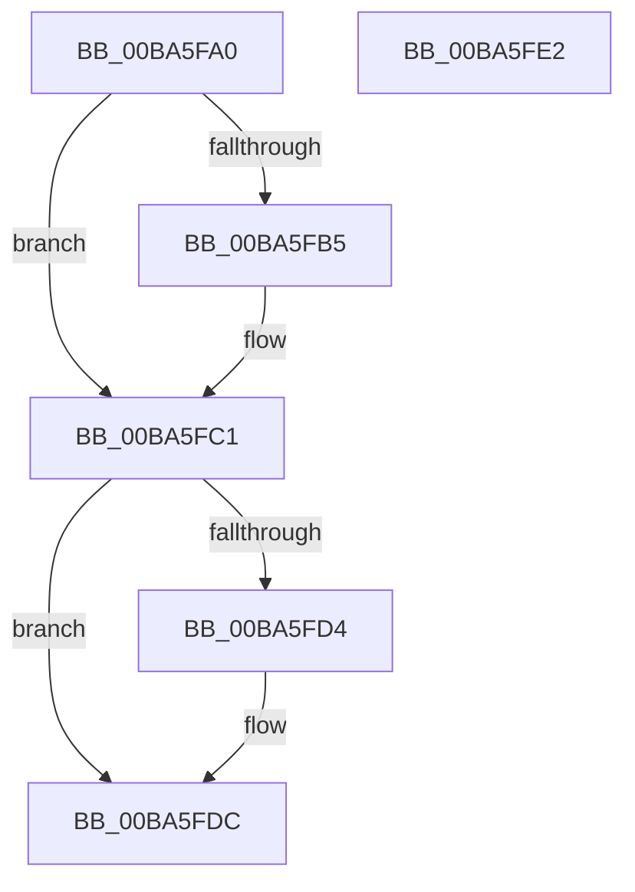

# VerifierPortKeReleaseSpinLockNoXdv

- RVA: `0x00BA5FA0`–`0x00BA5FE3` (길이 `67` bytes)
- VA: `0x0000000140BA5FA0`
- 실행 섹션: `PAGEVRFY`
- PDB 이름 있음: `예`; PDB Function 태그: `아니요`
- unwind 정보 RVA: `0x0005CF00`
- 디코드: `21`개 명령, `67/67` bytes 표시
- 미해석 바이트: `0` (있으면 어셈블리에 `.byte`로 보존)

> 이 문서는 커널 이미지의 기계어와 PDB 기호를 분석해 생성했습니다. 4번과 5번은 함수 원형과 자료형을 바이너리 사용 방식에서 추정한 C 해석이며 원본 소스 복구 결과는 아닙니다.

## 1. Dependencies

- 직접 호출 지점: **3**; 고유 호출 대상: **3**
- 직접 호출자로 확인된 함수: **0**
- RIP 상대 이미지 참조: **1**

### Outgoing calls
- `0x00BA5FB9` → [VfKeIrqlTransitionReserveLogEntry](../BB/VfKeIrqlTransitionReserveLogEntry_function_00BB80A8.md) (function, `0x00BB80A8`)
- `0x00BA5FC4` → [KeReleaseSpinLock](../../text/39/KeReleaseSpinLock_function_00392BA0.md) (function, `0x00392BA0`)
- `0x00BA5FD7` → [VfKeIrqlLogLower](../BB/VfKeIrqlLogLower_function_00BB91EC.md) (function, `0x00BB91EC`)

### Direct callers
- 이 함수 시작 RVA로 연결되는 직접 call은 확인되지 않았습니다. 간접 호출은 완전히 역산할 수 없습니다.

### Static image references
- `0x00BA5FA6` → RVA `0x00F04A20` (`.data`; read)

## 2. Other-region calls and transfers

- 다른 실행 섹션으로 향하는 call: **1**
  - `0x00BA5FC4` → [KeReleaseSpinLock](../../text/39/KeReleaseSpinLock_function_00392BA0.md) (`PAGEVRFY` → `.text`)
- 별도 외부 분기/꼬리 이동을 확인하지 못했습니다.

## 3. Assembly (complete function range)

```asm
00BA5FA0  40 53                           push rbx
00BA5FA2  48 83 EC 20                     sub rsp, 0x20
00BA5FA6  8B 05 74 EA 35 00               mov eax, dword ptr [rip + 0x35ea74]
00BA5FAC  33 DB                           xor ebx, ebx
00BA5FAE  4C 8B C9                        mov r9, rcx
00BA5FB1  A8 01                           test al, 1
00BA5FB3  74 0C                           je 0x140ba5fc1
00BA5FB5  44 0F 20 C1                     mov rcx, cr8
00BA5FB9  E8 EA 20 01 00                  call 0x140bb80a8
00BA5FBE  48 8B D8                        mov rbx, rax
00BA5FC1  49 8B C9                        mov rcx, r9
00BA5FC4  E8 D7 CB 7E FF                  call 0x140392ba0
00BA5FC9  8B 0D 51 EA 35 00               mov ecx, dword ptr [rip + 0x35ea51]
00BA5FCF  F6 C1 01                        test cl, 1
00BA5FD2  74 08                           je 0x140ba5fdc
00BA5FD4  48 8B CB                        mov rcx, rbx
00BA5FD7  E8 10 32 01 00                  call 0x140bb91ec
00BA5FDC  48 83 C4 20                     add rsp, 0x20
00BA5FE0  5B                              pop rbx
00BA5FE1  C3                              ret
00BA5FE2  CC                              int3
```

## 4. C-style interpretation (structured pseudocode)

```c
__int64 __fastcall VerifierPortKeReleaseSpinLockNoXdv(__int64 a1)
{
    __int64 result;
    __int64 v_rbx;
    __int64 v_rsp;

    v_rsp = (v_rsp) - (32);
    v_rbx = 0;
    result = (unsigned int)(*(unsigned int *)(v_rip + 3533428));
    if ((((unsigned __int8)((unsigned int)(*(unsigned int *)(v_rip + 3533428)))) & (1)) != 0) {
        a1 = v_cr8;
        result = VfKeIrqlTransitionReserveLogEntry(a1, a2, a3, a1);
        v_rbx = result;
    }
    result = KeReleaseSpinLock(a1, a2, a3, a1);
    if ((((unsigned __int8)((unsigned int)(*(unsigned int *)(v_rip + 3533393)))) & (1)) != 0) {
        a1 = v_rbx;
        result = VfKeIrqlLogLower(a1, a2, a3, a1);
    }
    v_rsp = (v_rsp) + (32);
    return result;
}
```

## 5. (Beta) C Style

```c
int64_t VerifierPortKeReleaseSpinLockNoXdv(int64_t Arg1)
{
    int64_t result;
    int64_t local_rbx;
    int64_t local_rsp;

    local_rsp = (local_rsp) - (32);
    local_rbx = 0;
    result = (uint32_t)(*(uint32_t *)(v_rip + 0x35EA74));
    if ((((uint8_t)((uint32_t)(*(uint32_t *)(v_rip + 0x35EA74)))) & (1)) != 0) {
        Arg1 = v_cr8;
        result = VfKeIrqlTransitionReserveLogEntry(Arg1, a2, a3, Arg1);
        local_rbx = result;
    }
    result = KeReleaseSpinLock(Arg1, a2, a3, Arg1);
    if ((((uint8_t)((uint32_t)(*(uint32_t *)(v_rip + 0x35EA51)))) & (1)) != 0) {
        Arg1 = local_rbx;
        result = VfKeIrqlLogLower(Arg1, a2, a3, Arg1);
    }
    local_rsp = (local_rsp) + (32);
    return result;
}
```

## 6. Execution-region graph

[열기: 2D/3D 그래프와 함수 탐색 컨트롤 패널](../../../control-panel.html?section=pagevrfy&rva=0x00BA5FA0&view=graph)

- 2D 그래프는 위에서 아래로 흐르고, 3D 그래프는 빈 공간을 드래그해 회전합니다. Shift+드래그는 이동, 휠은 확대·축소, 함수 노드 선택은 대상 보고서 이동입니다.

### Static fallback


