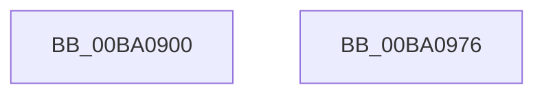

# VerifierSeAccessCheck

- RVA: `0x00BA0900`–`0x00BA0977` (길이 `119` bytes)
- VA: `0x0000000140BA0900`
- 실행 섹션: `PAGEVRFY`
- PDB 이름 있음: `예`; PDB Function 태그: `아니요`
- unwind 정보 RVA: `0x0008C33C`
- 디코드: `27`개 명령, `119/119` bytes 표시
- 미해석 바이트: `0` (있으면 어셈블리에 `.byte`로 보존)

> 이 문서는 커널 이미지의 기계어와 PDB 기호를 분석해 생성했습니다. 4번과 5번은 함수 원형과 자료형을 바이너리 사용 방식에서 추정한 C 해석이며 원본 소스 복구 결과는 아닙니다.

## 1. Dependencies

- 직접 호출 지점: **1**; 고유 호출 대상: **1**
- 직접 호출자로 확인된 함수: **0**
- RIP 상대 이미지 참조: **1**

### Outgoing calls
- `0x00BA0966` → [guard_dispatch_icall](../../text/6B/guard_dispatch_icall_function_006BAAD0.md) (function, `0x006BAAD0`)

### Direct callers
- 이 함수 시작 RVA로 연결되는 직접 call은 확인되지 않았습니다. 간접 호출은 완전히 역산할 수 없습니다.

### Static image references
- `0x00BA0935` → RVA `0x00FFEDA8` (`PAGEVRFD`; read)

## 2. Other-region calls and transfers

- 다른 실행 섹션으로 향하는 call: **1**
  - `0x00BA0966` → [guard_dispatch_icall](../../text/6B/guard_dispatch_icall_function_006BAAD0.md) (`PAGEVRFY` → `.text`)
- 별도 외부 분기/꼬리 이동을 확인하지 못했습니다.

## 3. Assembly (complete function range)

```asm
00BA0900  4C 8B DC                        mov r11, rsp
00BA0903  49 89 5B 08                     mov qword ptr [r11 + 8], rbx
00BA0907  57                              push rdi
00BA0908  48 83 EC 60                     sub rsp, 0x60
00BA090C  4C 8B 94 24 B0 00 00 00         mov r10, qword ptr [rsp + 0xb0]
00BA0914  41 8B D9                        mov ebx, r9d
00BA0917  4C 8B 8C 24 98 00 00 00         mov r9, qword ptr [rsp + 0x98]
00BA091F  48 8B FA                        mov rdi, rdx
00BA0922  48 8B 84 24 B8 00 00 00         mov rax, qword ptr [rsp + 0xb8]
00BA092A  8B 94 24 90 00 00 00            mov edx, dword ptr [rsp + 0x90]
00BA0931  49 89 43 E0                     mov qword ptr [r11 - 0x20], rax
00BA0935  48 8B 05 6C E4 45 00            mov rax, qword ptr [rip + 0x45e46c]
00BA093C  4D 89 53 D8                     mov qword ptr [r11 - 0x28], r10
00BA0940  44 8A 94 24 A8 00 00 00         mov r10b, byte ptr [rsp + 0xa8]
00BA0948  45 88 53 D0                     mov byte ptr [r11 - 0x30], r10b
00BA094C  4C 8B 94 24 A0 00 00 00         mov r10, qword ptr [rsp + 0xa0]
00BA0954  4D 89 53 C8                     mov qword ptr [r11 - 0x38], r10
00BA0958  4D 89 4B C0                     mov qword ptr [r11 - 0x40], r9
00BA095C  44 8B CB                        mov r9d, ebx
00BA095F  89 54 24 20                     mov dword ptr [rsp + 0x20], edx
00BA0963  48 8B D7                        mov rdx, rdi
00BA0966  E8 65 A1 B1 FF                  call 0x1406baad0
00BA096B  48 8B 5C 24 70                  mov rbx, qword ptr [rsp + 0x70]
00BA0970  48 83 C4 60                     add rsp, 0x60
00BA0974  5F                              pop rdi
00BA0975  C3                              ret
00BA0976  CC                              int3
```

## 4. C-style interpretation (structured pseudocode)

```c
__int64 __fastcall VerifierSeAccessCheck(__int64 a1, __int64 a2, __int64 a3, int a4, unsigned int a5, __int64 a6, __int64 a7, unsigned __int8 a8, __int64 a9, __int64 a10)
{
    __int64 result;
    __int64 v_rsp;
    unsigned int v_stack_m48;
    unsigned __int64 v_stack_p8;

    *(unsigned __int64 *)(v_rsp + 8) = v_rbx;
    v_rsp = (v_rsp) - (96);
    *(unsigned __int64 *)(v_rsp - 32) = a10;
    *(unsigned __int64 *)(v_rsp - 40) = a9;
    *(unsigned __int8 *)(v_rsp - 48) = a8;
    *(unsigned __int64 *)(v_rsp - 56) = a7;
    *(unsigned __int64 *)(v_rsp - 64) = a6;
    v_stack_m48 = (unsigned int)((unsigned int)(a5));
    result = guard_dispatch_icall(a1, a2, a3, (unsigned int)((unsigned int)((unsigned int)(a4))));
    v_rsp = (v_rsp) + (96);
    return result;
}
```

## 5. (Beta) C Style

```c
int64_t VerifierSeAccessCheck(int64_t Arg1, int64_t Arg2, int64_t Arg3, int32_t Arg4, uint32_t Arg5, int64_t Arg6, int64_t Arg7, uint8_t Arg8, int64_t Arg9, int64_t Arg10)
{
    int64_t result;
    int64_t local_rsp;
    uint32_t v_stack_m48;
    uint64_t v_stack_p8;

    *(uint64_t *)(local_rsp + 0x8) = local_rbx;
    local_rsp = (local_rsp) - (96);
    *(uint64_t *)(local_rsp - 0x20) = Arg10;
    *(uint64_t *)(local_rsp - 0x28) = Arg9;
    *(uint8_t *)(local_rsp - 0x30) = Arg8;
    *(uint64_t *)(local_rsp - 0x38) = Arg7;
    *(uint64_t *)(local_rsp - 0x40) = Arg6;
    v_stack_m48 = (uint32_t)((uint32_t)(Arg5));
    result = guard_dispatch_icall(Arg1, Arg2, Arg3, (uint32_t)((uint32_t)((uint32_t)(Arg4))));
    local_rsp = (local_rsp) + (96);
    return result;
}
```

## 6. Execution-region graph

[열기: 2D/3D 그래프와 함수 탐색 컨트롤 패널](../../../control-panel.html?section=pagevrfy&rva=0x00BA0900&view=graph)

- 2D 그래프는 위에서 아래로 흐르고, 3D 그래프는 빈 공간을 드래그해 회전합니다. Shift+드래그는 이동, 휠은 확대·축소, 함수 노드 선택은 대상 보고서 이동입니다.

### Static fallback


