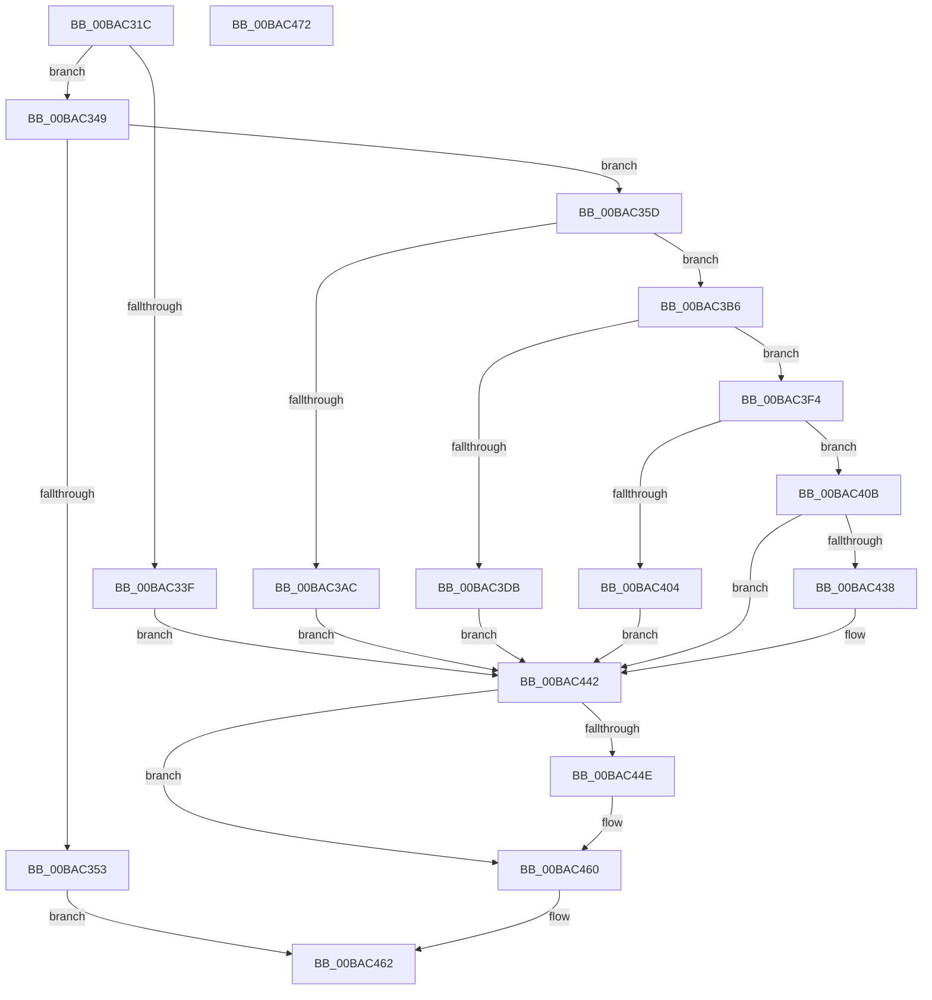

# VfAddVerifierEntry

- RVA: `0x00BAC31C`–`0x00BAC473` (길이 `343` bytes)
- VA: `0x0000000140BAC31C`
- 실행 섹션: `PAGEVRFY`
- PDB 이름 있음: `예`; PDB Function 태그: `아니요`
- unwind 정보 RVA: `0x0009A6A8`
- 디코드: `84`개 명령, `343/343` bytes 표시
- 미해석 바이트: `0` (있으면 어셈블리에 `.byte`로 보존)

> 이 문서는 커널 이미지의 기계어와 PDB 기호를 분석해 생성했습니다. 4번과 5번은 함수 원형과 자료형을 바이너리 사용 방식에서 추정한 C 해석이며 원본 소스 복구 결과는 아닙니다.

## 1. Dependencies

- 직접 호출 지점: **15**; 고유 호출 대상: **12**
- 직접 호출자로 확인된 함수: **1**
- RIP 상대 이미지 참조: **8**

### Outgoing calls
- `0x00BAC35D` → [VfDriverLock](../B9/VfDriverLock_function_00B9A4A4.md) (function, `0x00B9A4A4`)
- `0x00BAC364` → [VfInitSystemNoRebootNeeded](../B9/VfInitSystemNoRebootNeeded_function_00B93970.md) (function, `0x00B93970`)
- `0x00BAC37D` → [KeReleaseMutex](../../text/39/KeReleaseMutex_function_00396810.md) (function, `0x00396810`)
- `0x00BAC39B` → [ExAllocatePool2](../../poolcode/B8/ExAllocatePool2_function_00B820F0.md) (function, `0x00B820F0`)
- `0x00BAC3C2` → [RtlInitUnicodeString](../../text/42/RtlInitUnicodeString_function_0042A780.md) (function, `0x0042A780`)
- `0x00BAC3D2` → [RtlEqualUnicodeString](../../page/93/RtlEqualUnicodeString_function_00932A20.md) (function, `0x00932A20`)
- `0x00BAC3DB` → [MmAcquireLoadLock](../../text/4D/MmAcquireLoadLock_function_004DC2A0.md) (function, `0x004DC2A0`)
- `0x00BAC3E3` → [VfDriverEnableVerifierForAll](../B9/VfDriverEnableVerifierForAll_function_00B9A3A4.md) (function, `0x00B9A3A4`)
- `0x00BAC3ED` → [MmReleaseLoadLock](../../text/4D/MmReleaseLoadLock_function_004D36D0.md) (function, `0x004D36D0`)
- `0x00BAC3F7` → [VfSuspectDriversAllocateEntry](VfSuspectDriversAllocateEntry_function_00BAA690.md) (function, `0x00BAA690`)
- `0x00BAC410` → [MmAcquireLoadLock](../../text/4D/MmAcquireLoadLock_function_004DC2A0.md) (function, `0x004DC2A0`)
- `0x00BAC422` → [VfDriverEnableVerifier](../B9/VfDriverEnableVerifier_function_00B9A240.md) (function, `0x00B9A240`)
- `0x00BAC42C` → [MmReleaseLoadLock](../../text/4D/MmReleaseLoadLock_function_004D36D0.md) (function, `0x004D36D0`)
- `0x00BAC43D` → [ExFreePoolWithTag](../../poolcode/B8/ExFreePoolWithTag_function_00B82870.md) (function, `0x00B82870`)
- `0x00BAC453` → [ExFreePoolWithTag](../../poolcode/B8/ExFreePoolWithTag_function_00B82870.md) (function, `0x00B82870`)

### Direct callers
- [NtSetSystemInformation](../../page/AF/NtSetSystemInformation_function_00AF4A60.md) at `0x00AF52C0`

### Static image references
- `0x00BAC32B` → RVA `0x00FC41C4` (`.data`; read)
- `0x00BAC349` → RVA `0x00F04390` (`.data`; read)
- `0x00BAC36B` → RVA `0x00F04938` (`.data`; write)
- `0x00BAC376` → RVA `0x00F04900` (`.data`; read)
- `0x00BAC382` → RVA `0x00F044C4` (`.data`; read)
- `0x00BAC3A0` → RVA `0x00F04390` (`.data`; write)
- `0x00BAC3B6` → RVA `0x00BBB230` (` ?? ::JKADOLAD::`string'`; read)
- `0x00BAC458` → RVA `0x00F04390` (`.data`; read/write)

## 2. Other-region calls and transfers

- 다른 실행 섹션으로 향하는 call: **10**
  - `0x00BAC37D` → [KeReleaseMutex](../../text/39/KeReleaseMutex_function_00396810.md) (`PAGEVRFY` → `.text`)
  - `0x00BAC39B` → [ExAllocatePool2](../../poolcode/B8/ExAllocatePool2_function_00B820F0.md) (`PAGEVRFY` → `POOLCODE`)
  - `0x00BAC3C2` → [RtlInitUnicodeString](../../text/42/RtlInitUnicodeString_function_0042A780.md) (`PAGEVRFY` → `.text`)
  - `0x00BAC3D2` → [RtlEqualUnicodeString](../../page/93/RtlEqualUnicodeString_function_00932A20.md) (`PAGEVRFY` → `PAGE`)
  - `0x00BAC3DB` → [MmAcquireLoadLock](../../text/4D/MmAcquireLoadLock_function_004DC2A0.md) (`PAGEVRFY` → `.text`)
  - `0x00BAC3ED` → [MmReleaseLoadLock](../../text/4D/MmReleaseLoadLock_function_004D36D0.md) (`PAGEVRFY` → `.text`)
  - `0x00BAC410` → [MmAcquireLoadLock](../../text/4D/MmAcquireLoadLock_function_004DC2A0.md) (`PAGEVRFY` → `.text`)
  - `0x00BAC42C` → [MmReleaseLoadLock](../../text/4D/MmReleaseLoadLock_function_004D36D0.md) (`PAGEVRFY` → `.text`)
  - `0x00BAC43D` → [ExFreePoolWithTag](../../poolcode/B8/ExFreePoolWithTag_function_00B82870.md) (`PAGEVRFY` → `POOLCODE`)
  - `0x00BAC453` → [ExFreePoolWithTag](../../poolcode/B8/ExFreePoolWithTag_function_00B82870.md) (`PAGEVRFY` → `POOLCODE`)
- 별도 외부 분기/꼬리 이동을 확인하지 못했습니다.

## 3. Assembly (complete function range)

```asm
00BAC31C  48 89 5C 24 08                  mov qword ptr [rsp + 8], rbx
00BAC321  48 89 74 24 18                  mov qword ptr [rsp + 0x18], rsi
00BAC326  57                              push rdi
00BAC327  48 83 EC 30                     sub rsp, 0x30
00BAC32B  83 3D 92 7E 41 00 00            cmp dword ptr [rip + 0x417e92], 0
00BAC332  0F 57 C0                        xorps xmm0, xmm0
00BAC335  0F 11 44 24 20                  movups xmmword ptr [rsp + 0x20], xmm0
00BAC33A  48 8B D9                        mov rbx, rcx
00BAC33D  74 0A                           je 0x140bac349
00BAC33F  BF 0A 0C 00 C0                  mov edi, 0xc0000c0a
00BAC344  E9 F9 00 00 00                  jmp 0x140bac442
00BAC349  48 83 3D 3F 80 35 00 00         cmp qword ptr [rip + 0x35803f], 0
00BAC351  74 0A                           je 0x140bac35d
00BAC353  B8 0B 0C 00 C0                  mov eax, 0xc0000c0b
00BAC358  E9 05 01 00 00                  jmp 0x140bac462
00BAC35D  E8 42 E1 FE FF                  call 0x140b9a4a4
00BAC362  33 D2                           xor edx, edx
00BAC364  E8 07 76 FE FF                  call 0x140b93970
00BAC369  33 D2                           xor edx, edx
00BAC36B  48 C7 05 C2 85 35 00 00 00 00 00  mov qword ptr [rip + 0x3585c2], 0
00BAC376  48 8D 0D 83 85 35 00            lea rcx, [rip + 0x358583]
00BAC37D  E8 8E A4 7E FF                  call 0x140396810
00BAC382  8B 05 3C 81 35 00               mov eax, dword ptr [rip + 0x35813c]
00BAC388  B9 40 00 00 00                  mov ecx, 0x40
00BAC38D  41 B8 44 76 4D 6D               mov r8d, 0x6d4d7644
00BAC393  48 8D 14 40                     lea rdx, [rax + rax*2]
00BAC397  48 C1 E2 03                     shl rdx, 3
00BAC39B  E8 50 5D FD FF                  call 0x140b820f0
00BAC3A0  48 89 05 E9 7F 35 00            mov qword ptr [rip + 0x357fe9], rax
00BAC3A7  48 85 C0                        test rax, rax
00BAC3AA  75 0A                           jne 0x140bac3b6
00BAC3AC  BF 17 00 00 C0                  mov edi, 0xc0000017
00BAC3B1  E9 8C 00 00 00                  jmp 0x140bac442
00BAC3B6  48 8D 15 73 EE 00 00            lea rdx, [rip + 0xee73]
00BAC3BD  48 8D 4C 24 20                  lea rcx, [rsp + 0x20]
00BAC3C2  E8 B9 E3 87 FF                  call 0x14042a780
00BAC3C7  41 B0 01                        mov r8b, 1
00BAC3CA  48 8D 4C 24 20                  lea rcx, [rsp + 0x20]
00BAC3CF  48 8B D3                        mov rdx, rbx
00BAC3D2  E8 49 66 D8 FF                  call 0x140932a20
00BAC3D7  84 C0                           test al, al
00BAC3D9  74 19                           je 0x140bac3f4
00BAC3DB  E8 C0 FE 92 FF                  call 0x1404dc2a0
00BAC3E0  48 8B D8                        mov rbx, rax
00BAC3E3  E8 BC DF FE FF                  call 0x140b9a3a4
00BAC3E8  48 8B CB                        mov rcx, rbx
00BAC3EB  8B F8                           mov edi, eax
00BAC3ED  E8 DE 72 92 FF                  call 0x1404d36d0
00BAC3F2  EB 4E                           jmp 0x140bac442
00BAC3F4  48 8B CB                        mov rcx, rbx
00BAC3F7  E8 94 E2 FF FF                  call 0x140baa690
00BAC3FC  48 8B F0                        mov rsi, rax
00BAC3FF  48 85 C0                        test rax, rax
00BAC402  75 07                           jne 0x140bac40b
00BAC404  BF 9A 00 00 C0                  mov edi, 0xc000009a
00BAC409  EB 37                           jmp 0x140bac442
00BAC40B  83 64 24 48 00                  and dword ptr [rsp + 0x48], 0
00BAC410  E8 8B FE 92 FF                  call 0x1404dc2a0
00BAC415  4C 8D 44 24 48                  lea r8, [rsp + 0x48]
00BAC41A  33 D2                           xor edx, edx
00BAC41C  48 8B CE                        mov rcx, rsi
00BAC41F  48 8B D8                        mov rbx, rax
00BAC422  E8 19 DE FE FF                  call 0x140b9a240
00BAC427  48 8B CB                        mov rcx, rbx
00BAC42A  8B F8                           mov edi, eax
00BAC42C  E8 9F 72 92 FF                  call 0x1404d36d0
00BAC431  83 7C 24 48 00                  cmp dword ptr [rsp + 0x48], 0
00BAC436  75 0A                           jne 0x140bac442
00BAC438  33 D2                           xor edx, edx
00BAC43A  48 8B CE                        mov rcx, rsi
00BAC43D  E8 2E 64 FD FF                  call 0x140b82870
00BAC442  48 8B 0D 47 7F 35 00            mov rcx, qword ptr [rip + 0x357f47]
00BAC449  48 85 C9                        test rcx, rcx
00BAC44C  74 12                           je 0x140bac460
00BAC44E  BA 44 76 4D 6D                  mov edx, 0x6d4d7644
00BAC453  E8 18 64 FD FF                  call 0x140b82870
00BAC458  48 83 25 30 7F 35 00 00         and qword ptr [rip + 0x357f30], 0
00BAC460  8B C7                           mov eax, edi
00BAC462  48 8B 5C 24 40                  mov rbx, qword ptr [rsp + 0x40]
00BAC467  48 8B 74 24 50                  mov rsi, qword ptr [rsp + 0x50]
00BAC46C  48 83 C4 30                     add rsp, 0x30
00BAC470  5F                              pop rdi
00BAC471  C3                              ret
00BAC472  CC                              int3
```

## 4. C-style interpretation (structured pseudocode)

```c
__int64 __fastcall VfAddVerifierEntry(__int64 a1, int a2)
{
    __int64 result;
    __int64 v_rsp;
    unsigned __int64 v_stack_m18;
    unsigned int v_stack_p10;
    unsigned __int64 v_stack_p18;
    unsigned __int64 v_stack_p8;

    v_stack_p8 = v_rbx;
    v_stack_p18 = v_rsi;
    v_rsp = (v_rsp) - (48);
    v_stack_m18 = v_xmm0;
    if ((*(unsigned int *)(v_rip + 4292242)) == 0) goto loc_00BAC349;
    goto loc_00BAC442;
loc_00BAC349:
    if ((*(unsigned __int64 *)(v_rip + 3506239)) == 0) goto loc_00BAC35D;
    goto loc_00BAC462;
loc_00BAC35D:
    result = VfDriverLock(a1, a2, a3, a4);
    a2 = 0;
    result = VfInitSystemNoRebootNeeded(a1, a2, a3, a4);
    a2 = 0;
    *(unsigned __int64 *)(v_rip + 3507650) = 0;
    result = KeReleaseMutex(v_rip + 3507587, a2, a3, a4);
    a2 = ((unsigned int)(*(unsigned int *)(v_rip + 3506492)) + (unsigned int)(*(unsigned int *)(v_rip + 3506492)) * 2) << (3);
    result = ExAllocatePool2(64, a2, (unsigned int)(0x6D4D7644ULL), a4);
    *(unsigned __int64 *)(v_rip + 3506153) = result;
    if (result != 0) goto loc_00BAC3B6;
    goto loc_00BAC442;
loc_00BAC3B6:
    result = RtlInitUnicodeString(v_stack_m18, v_rip + 61043, (unsigned int)(0x6D4D7644ULL), a4);
    result = RtlEqualUnicodeString(v_stack_m18, a1, 1, a4);
    if ((unsigned __int8)(result) == 0) goto loc_00BAC3F4;
    result = MmAcquireLoadLock(v_stack_m18, a1, 1, a4);
    result = VfDriverEnableVerifierForAll(v_stack_m18, a1, 1, a4);
    result = MmReleaseLoadLock(result, a1, 1, a4);
    goto loc_00BAC442;
loc_00BAC3F4:
    result = VfSuspectDriversAllocateEntry(result, a1, 1, a4);
    if (result != 0) goto loc_00BAC40B;
    goto loc_00BAC442;
loc_00BAC40B:
    result = MmAcquireLoadLock(result, a1, 1, a4);
    a2 = 0;
    result = VfDriverEnableVerifier(result, a2, v_stack_p10, a4);
    result = MmReleaseLoadLock(result, a2, v_stack_p10, a4);
    if (v_stack_p10 == 0) {
        a2 = 0;
        a1 = result;
        result = ExFreePoolWithTag(a1, a2, v_stack_p10, a4);
    }
    if (*(unsigned __int64 *)(v_rip + 3505991) != 0) {
        a2 = 0x6D4D7644ULL;
        result = ExFreePoolWithTag(*(unsigned __int64 *)(v_rip + 3505991), a2, v_stack_p10, a4);
    }
loc_00BAC462:
    v_rsp = (v_rsp) + (48);
    return (unsigned int)((unsigned int)((unsigned int)((unsigned int)(result))));
}
```

## 5. (Beta) C Style

```c
int64_t VfAddVerifierEntry(int64_t Arg1, int32_t Arg2)
{
    int64_t result;
    int64_t local_rsp;
    uint64_t v_stack_m18;
    uint32_t v_stack_p10;
    uint64_t v_stack_p18;
    uint64_t v_stack_p8;

    v_stack_p8 = local_rbx;
    v_stack_p18 = local_rsi;
    local_rsp = (local_rsp) - (48);
    v_stack_m18 = v_xmm0;
    if ((*(uint32_t *)(v_rip + 0x417E92)) == 0) goto loc_00BAC349;
    goto loc_00BAC442;
loc_00BAC349:
    if ((*(uint64_t *)(v_rip + 0x35803F)) == 0) goto loc_00BAC35D;
    goto loc_00BAC462;
loc_00BAC35D:
    result = VfDriverLock(Arg1, Arg2, a3, a4);
    Arg2 = 0;
    result = VfInitSystemNoRebootNeeded(Arg1, Arg2, a3, a4);
    Arg2 = 0;
    *(uint64_t *)(v_rip + 0x3585C2) = 0;
    result = KeReleaseMutex(v_rip + 3507587, Arg2, a3, a4);
    Arg2 = ((uint32_t)(*(uint32_t *)(v_rip + 0x35813C)) + (uint32_t)(*(uint32_t *)(v_rip + 0x35813C)) * 2) << (3);
    result = ExAllocatePool2(64, Arg2, (uint32_t)(0x6D4D7644ULL), a4);
    *(uint64_t *)(v_rip + 0x357FE9) = result;
    if (result != 0) goto loc_00BAC3B6;
    goto loc_00BAC442;
loc_00BAC3B6:
    result = RtlInitUnicodeString(v_stack_m18, v_rip + 61043, (uint32_t)(0x6D4D7644ULL), a4);
    result = RtlEqualUnicodeString(v_stack_m18, Arg1, 1, a4);
    if ((uint8_t)(result) == 0) goto loc_00BAC3F4;
    result = MmAcquireLoadLock(v_stack_m18, Arg1, 1, a4);
    result = VfDriverEnableVerifierForAll(v_stack_m18, Arg1, 1, a4);
    result = MmReleaseLoadLock(result, Arg1, 1, a4);
    goto loc_00BAC442;
loc_00BAC3F4:
    result = VfSuspectDriversAllocateEntry(result, Arg1, 1, a4);
    if (result != 0) goto loc_00BAC40B;
    goto loc_00BAC442;
loc_00BAC40B:
    result = MmAcquireLoadLock(result, Arg1, 1, a4);
    Arg2 = 0;
    result = VfDriverEnableVerifier(result, Arg2, v_stack_p10, a4);
    result = MmReleaseLoadLock(result, Arg2, v_stack_p10, a4);
    if (v_stack_p10 == 0) {
        Arg2 = 0;
        Arg1 = result;
        result = ExFreePoolWithTag(Arg1, Arg2, v_stack_p10, a4);
    }
    if (*(uint64_t *)(v_rip + 0x357F47) != 0) {
        Arg2 = 0x6D4D7644ULL;
        result = ExFreePoolWithTag(*(uint64_t *)(v_rip + 0x357F47), Arg2, v_stack_p10, a4);
    }
loc_00BAC462:
    local_rsp = (local_rsp) + (48);
    return (uint32_t)((uint32_t)((uint32_t)((uint32_t)(result))));
}
```

## 6. Execution-region graph

[열기: 2D/3D 그래프와 함수 탐색 컨트롤 패널](../../../control-panel.html?section=pagevrfy&rva=0x00BAC31C&view=graph)

- 2D 그래프는 위에서 아래로 흐르고, 3D 그래프는 빈 공간을 드래그해 회전합니다. Shift+드래그는 이동, 휠은 확대·축소, 함수 노드 선택은 대상 보고서 이동입니다.

### Static fallback


