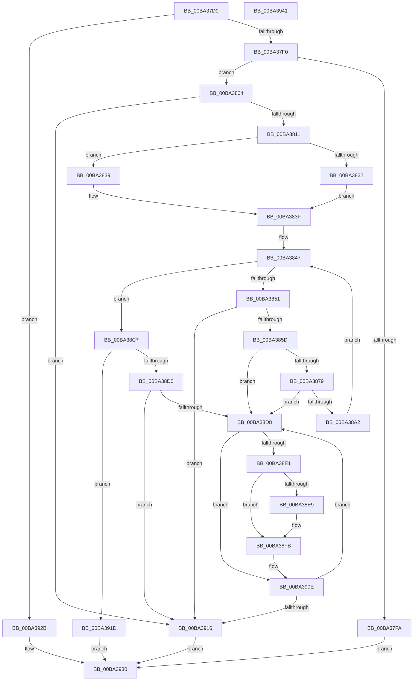

# VfBranchTracingPluginEntry

- RVA: `0x00BA37D0`–`0x00BA3942` (길이 `370` bytes)
- VA: `0x0000000140BA37D0`
- 실행 섹션: `PAGEVRFY`
- PDB 이름 있음: `예`; PDB Function 태그: `아니요`
- unwind 정보 RVA: `0x000C6F0C`
- 디코드: `95`개 명령, `370/370` bytes 표시
- 미해석 바이트: `0` (있으면 어셈블리에 `.byte`로 보존)

> 이 문서는 커널 이미지의 기계어와 PDB 기호를 분석해 생성했습니다. 4번과 5번은 함수 원형과 자료형을 바이너리 사용 방식에서 추정한 C 해석이며 원본 소스 복구 결과는 아닙니다.

## 1. Dependencies

- 직접 호출 지점: **7**; 고유 호출 대상: **5**
- 직접 호출자로 확인된 함수: **1**
- RIP 상대 이미지 참조: **7**

### Outgoing calls
- `0x00BA3804` → [ViIsBTSSupported](ViIsBTSSupported_function_00BA3A44.md) (function, `0x00BA3A44`)
- `0x00BA3823` → [memset](../../text/6C/memset_function_006C6C40.md) (function, `0x006C6C40`)
- `0x00BA386B` → [ExAllocatePool2](../../poolcode/B8/ExAllocatePool2_function_00B820F0.md) (function, `0x00B820F0`)
- `0x00BA388A` → [ExAllocatePool2](../../poolcode/B8/ExAllocatePool2_function_00B820F0.md) (function, `0x00B820F0`)
- `0x00BA38C7` → [ViSetupBTSPerProcNoEnable](ViSetupBTSPerProcNoEnable_function_00BA3B70.md) (function, `0x00BA3B70`)
- `0x00BA38EE` → [ExFreePoolWithTag](../../poolcode/B8/ExFreePoolWithTag_function_00B82870.md) (function, `0x00B82870`)
- `0x00BA3904` → [ExFreePoolWithTag](../../poolcode/B8/ExFreePoolWithTag_function_00B82870.md) (function, `0x00B82870`)

### Direct callers
- [VfNotifyVerifierOfEvent](../B9/VfNotifyVerifierOfEvent_function_00B92E90.md) at `0x00B92F8A`

### Static image references
- `0x00BA37E0` → RVA `0x00F04A20` (`.data`; read)
- `0x00BA37F0` → RVA `0x00FFDAA4` (`PAGEVRFD`; read)
- `0x00BA3811` → RVA `0x01000C50` (`PAGEVRFD`; read)
- `0x00BA3828` → RVA `0x00FFDA58` (`PAGEVRFD`; read)
- `0x00BA383F` → RVA `0x00FFDA58` (`PAGEVRFD`; write)
- `0x00BA3847` → RVA `0x00FC6A80` (`ALMOSTRO`; read)
- `0x00BA391D` → RVA `0x00FFDAA4` (`PAGEVRFD`; write)

## 2. Other-region calls and transfers

- 다른 실행 섹션으로 향하는 call: **5**
  - `0x00BA3823` → [memset](../../text/6C/memset_function_006C6C40.md) (`PAGEVRFY` → `.text`)
  - `0x00BA386B` → [ExAllocatePool2](../../poolcode/B8/ExAllocatePool2_function_00B820F0.md) (`PAGEVRFY` → `POOLCODE`)
  - `0x00BA388A` → [ExAllocatePool2](../../poolcode/B8/ExAllocatePool2_function_00B820F0.md) (`PAGEVRFY` → `POOLCODE`)
  - `0x00BA38EE` → [ExFreePoolWithTag](../../poolcode/B8/ExFreePoolWithTag_function_00B82870.md) (`PAGEVRFY` → `POOLCODE`)
  - `0x00BA3904` → [ExFreePoolWithTag](../../poolcode/B8/ExFreePoolWithTag_function_00B82870.md) (`PAGEVRFY` → `POOLCODE`)
- 별도 외부 분기/꼬리 이동을 확인하지 못했습니다.

## 3. Assembly (complete function range)

```asm
00BA37D0  48 89 5C 24 08                  mov qword ptr [rsp + 8], rbx
00BA37D5  48 89 7C 24 10                  mov qword ptr [rsp + 0x10], rdi
00BA37DA  41 56                           push r14
00BA37DC  48 83 EC 20                     sub rsp, 0x20
00BA37E0  F7 05 36 12 36 00 00 00 00 08   test dword ptr [rip + 0x361236], 0x8000000
00BA37EA  0F 84 3B 01 00 00               je 0x140ba392b
00BA37F0  8B 05 AE A2 45 00               mov eax, dword ptr [rip + 0x45a2ae]
00BA37F6  85 C0                           test eax, eax
00BA37F8  74 0A                           je 0x140ba3804
00BA37FA  B8 2A 04 00 C0                  mov eax, 0xc000042a
00BA37FF  E9 2C 01 00 00                  jmp 0x140ba3930
00BA3804  E8 3B 02 00 00                  call 0x140ba3a44
00BA3809  85 C0                           test eax, eax
00BA380B  0F 84 05 01 00 00               je 0x140ba3916
00BA3811  4C 8D 35 38 D4 45 00            lea r14, [rip + 0x45d438]
00BA3818  33 D2                           xor edx, edx
00BA381A  49 8B CE                        mov rcx, r14
00BA381D  41 B8 00 40 00 00               mov r8d, 0x4000
00BA3823  E8 18 34 B2 FF                  call 0x1406c6c40
00BA3828  8B 05 2A A2 45 00               mov eax, dword ptr [rip + 0x45a22a]
00BA382E  85 C0                           test eax, eax
00BA3830  75 07                           jne 0x140ba3839
00BA3832  B8 80 A9 03 00                  mov eax, 0x3a980
00BA3837  EB 06                           jmp 0x140ba383f
00BA3839  8D 04 40                        lea eax, [rax + rax*2]
00BA383C  C1 E0 03                        shl eax, 3
00BA383F  89 05 13 A2 45 00               mov dword ptr [rip + 0x45a213], eax
00BA3845  33 DB                           xor ebx, ebx
00BA3847  8B 05 33 32 42 00               mov eax, dword ptr [rip + 0x423233]
00BA384D  3B D8                           cmp ebx, eax
00BA384F  73 76                           jae 0x140ba38c7
00BA3851  81 FB 00 08 00 00               cmp ebx, 0x800
00BA3857  0F 83 B9 00 00 00               jae 0x140ba3916
00BA385D  BA 58 00 00 00                  mov edx, 0x58
00BA3862  41 B8 42 54 53 6D               mov r8d, 0x6d535442
00BA3868  8D 4A E8                        lea ecx, [rdx - 0x18]
00BA386B  E8 80 E8 FD FF                  call 0x140b820f0
00BA3870  49 89 04 DE                     mov qword ptr [r14 + rbx*8], rax
00BA3874  48 85 C0                        test rax, rax
00BA3877  74 5F                           je 0x140ba38d8
00BA3879  8B 15 D9 A1 45 00               mov edx, dword ptr [rip + 0x45a1d9]
00BA387F  B9 40 00 00 00                  mov ecx, 0x40
00BA3884  41 B8 42 54 53 62               mov r8d, 0x62535442
00BA388A  E8 61 E8 FD FF                  call 0x140b820f0
00BA388F  49 8B 0C DE                     mov rcx, qword ptr [r14 + rbx*8]
00BA3893  48 89 01                        mov qword ptr [rcx], rax
00BA3896  49 8B 04 DE                     mov rax, qword ptr [r14 + rbx*8]
00BA389A  48 8B 08                        mov rcx, qword ptr [rax]
00BA389D  48 85 C9                        test rcx, rcx
00BA38A0  74 36                           je 0x140ba38d8
00BA38A2  48 89 48 08                     mov qword ptr [rax + 8], rcx
00BA38A6  49 8B 04 DE                     mov rax, qword ptr [r14 + rbx*8]
00BA38AA  48 83 60 18 00                  and qword ptr [rax + 0x18], 0
00BA38AF  49 8B 14 DE                     mov rdx, qword ptr [r14 + rbx*8]
00BA38B3  8B 0D 9F A1 45 00               mov ecx, dword ptr [rip + 0x45a19f]
00BA38B9  48 FF C1                        inc rcx
00BA38BC  48 03 0A                        add rcx, qword ptr [rdx]
00BA38BF  48 89 4A 10                     mov qword ptr [rdx + 0x10], rcx
00BA38C3  FF C3                           inc ebx
00BA38C5  EB 80                           jmp 0x140ba3847
00BA38C7  E8 A4 02 00 00                  call 0x140ba3b70
00BA38CC  85 C0                           test eax, eax
00BA38CE  75 4D                           jne 0x140ba391d
00BA38D0  81 FB 00 08 00 00               cmp ebx, 0x800
00BA38D6  73 3E                           jae 0x140ba3916
00BA38D8  49 8B 0C DE                     mov rcx, qword ptr [r14 + rbx*8]
00BA38DC  48 85 C9                        test rcx, rcx
00BA38DF  74 2D                           je 0x140ba390e
00BA38E1  48 8B 09                        mov rcx, qword ptr [rcx]
00BA38E4  48 85 C9                        test rcx, rcx
00BA38E7  74 12                           je 0x140ba38fb
00BA38E9  BA 42 54 53 62                  mov edx, 0x62535442
00BA38EE  E8 7D EF FD FF                  call 0x140b82870
00BA38F3  49 8B 04 DE                     mov rax, qword ptr [r14 + rbx*8]
00BA38F7  48 83 20 00                     and qword ptr [rax], 0
00BA38FB  49 8B 0C DE                     mov rcx, qword ptr [r14 + rbx*8]
00BA38FF  BA 42 54 53 6D                  mov edx, 0x6d535442
00BA3904  E8 67 EF FD FF                  call 0x140b82870
00BA3909  49 83 24 DE 00                  and qword ptr [r14 + rbx*8], 0
00BA390E  8B C3                           mov eax, ebx
00BA3910  FF CB                           dec ebx
00BA3912  85 C0                           test eax, eax
00BA3914  75 C2                           jne 0x140ba38d8
00BA3916  B8 29 04 00 C0                  mov eax, 0xc0000429
00BA391B  EB 13                           jmp 0x140ba3930
00BA391D  C7 05 7D A1 45 00 01 00 00 00   mov dword ptr [rip + 0x45a17d], 1
00BA3927  33 C0                           xor eax, eax
00BA3929  EB 05                           jmp 0x140ba3930
00BA392B  B8 02 00 00 C0                  mov eax, 0xc0000002
00BA3930  48 8B 5C 24 30                  mov rbx, qword ptr [rsp + 0x30]
00BA3935  48 8B 7C 24 38                  mov rdi, qword ptr [rsp + 0x38]
00BA393A  48 83 C4 20                     add rsp, 0x20
00BA393E  41 5E                           pop r14
00BA3940  C3                              ret
00BA3941  CC                              int3
```

## 4. C-style interpretation (structured pseudocode)

```c
__int64 __fastcall VfBranchTracingPluginEntry(__int64 a1, int a2)
{
    __int64 result;
    __int64 v_rbx;
    __int64 v_rsp;
    unsigned __int64 v_stack_p10;
    unsigned __int64 v_stack_p8;

    v_stack_p8 = v_rbx;
    v_stack_p10 = v_rdi;
    v_rsp = (v_rsp) - (32);
    if (((*(unsigned int *)(v_rip + 3543606)) & (0x8000000ULL)) == 0) goto loc_00BA392B;
    if ((unsigned int)((unsigned int)(*(unsigned int *)(v_rip + 4563630))) == 0) goto loc_00BA3804;
    goto loc_00BA3930;
loc_00BA3804:
    result = ViIsBTSSupported(a1, a2, a3, a4);
    if ((unsigned int)(result) == 0) goto loc_00BA3916;
    a2 = 0;
    result = memset(v_rip + 4576312, a2, (unsigned int)(0x4000ULL), a4);
    if ((unsigned int)((unsigned int)(*(unsigned int *)(v_rip + 4563498))) != 0) goto loc_00BA3839;
    goto loc_00BA383F;
loc_00BA3839:
    result = (unsigned int)(((unsigned int)(0x3A980ULL) + (unsigned int)(0x3A980ULL) * 2) << (3));
loc_00BA383F:
    *(unsigned int *)(v_rip + 4563475) = (unsigned int)(result);
    v_rbx = 0;
loc_00BA3847:
    if (0 >= ((unsigned int)((unsigned int)(*(unsigned int *)(v_rip + 4338227))))) goto loc_00BA38C7;
    if (0 >= 0x800ULL) goto loc_00BA3916;
    result = ExAllocatePool2(88 - 24, 88, (unsigned int)(0x6D535442ULL), a4);
    *(unsigned __int64 *)(v_rip + 4576312 + v_rbx * 8) = result;
    if (result == 0) goto loc_00BA38D8;
    result = ExAllocatePool2(64, (unsigned int)(*(unsigned int *)(v_rip + 4563417)), (unsigned int)(0x62535442ULL), a4);
    *(unsigned __int64 *)(*(unsigned __int64 *)(v_rip + 4576312 + v_rbx * 8)) = result;
    if (*(unsigned __int64 *)(*(unsigned __int64 *)(v_rip + 4576312 + v_rbx * 8)) == 0) goto loc_00BA38D8;
    *(unsigned __int64 *)(*(unsigned __int64 *)(v_rip + 4576312 + v_rbx * 8) + 8) = *(unsigned __int64 *)(*(unsigned __int64 *)(v_rip + 4576312 + v_rbx * 8));
    a1 = ((unsigned int)(*(unsigned int *)(v_rip + 4563359))) + 1;
    a1 = (a1) + (*(unsigned __int64 *)(*(unsigned __int64 *)(v_rip + 4576312 + v_rbx * 8)));
    *(unsigned __int64 *)(*(unsigned __int64 *)(v_rip + 4576312 + v_rbx * 8) + 16) = a1;
    v_rbx = (unsigned int)((v_rbx) + 1);
    goto loc_00BA3847;
loc_00BA38C7:
    result = ViSetupBTSPerProcNoEnable(a1, *(unsigned __int64 *)(v_rip + 4576312 + v_rbx * 8), (unsigned int)(0x62535442ULL), a4);
    if ((unsigned int)(result) != 0) goto loc_00BA391D;
    if (((unsigned int)(v_rbx)) >= 0x800ULL) goto loc_00BA3916;
loc_00BA38D8:
    if (*(unsigned __int64 *)(v_rip + 4576312 + v_rbx * 8) == 0) goto loc_00BA390E;
    if (*(unsigned __int64 *)(*(unsigned __int64 *)(v_rip + 4576312 + v_rbx * 8)) != 0) {
        a2 = 0x62535442ULL;
        result = ExFreePoolWithTag(*(unsigned __int64 *)(*(unsigned __int64 *)(v_rip + 4576312 + v_rbx * 8)), a2, (unsigned int)(0x62535442ULL), a4);
        result = *(unsigned __int64 *)(v_rip + 4576312 + v_rbx * 8);
    }
    result = ExFreePoolWithTag(*(unsigned __int64 *)(v_rip + 4576312 + v_rbx * 8), (unsigned int)(0x6D535442ULL), (unsigned int)(0x62535442ULL), a4);
loc_00BA390E:
    v_rbx = (unsigned int)((v_rbx) - 1);
    if ((unsigned int)((unsigned int)((unsigned int)(v_rbx))) != 0) goto loc_00BA38D8;
loc_00BA3916:
    goto loc_00BA3930;
loc_00BA391D:
    *(unsigned int *)(v_rip + 4563325) = 1;
    result = 0;
    goto loc_00BA3930;
loc_00BA392B:
loc_00BA3930:
    v_rsp = (v_rsp) + (32);
    return (unsigned int)(0xC0000002ULL);
}
```

## 5. (Beta) C Style

```c
int64_t VfBranchTracingPluginEntry(int64_t Arg1, int32_t Arg2)
{
    int64_t result;
    int64_t local_rbx;
    int64_t local_rsp;
    uint64_t v_stack_p10;
    uint64_t v_stack_p8;

    v_stack_p8 = local_rbx;
    v_stack_p10 = local_rdi;
    local_rsp = (local_rsp) - (32);
    if (((*(uint32_t *)(v_rip + 0x361236)) & (0x8000000ULL)) == 0) goto loc_00BA392B;
    if ((uint32_t)((uint32_t)(*(uint32_t *)(v_rip + 0x45A2AE))) == 0) goto loc_00BA3804;
    goto loc_00BA3930;
loc_00BA3804:
    result = ViIsBTSSupported(Arg1, Arg2, a3, a4);
    if ((uint32_t)(result) == 0) goto loc_00BA3916;
    Arg2 = 0;
    result = memset(v_rip + 4576312, Arg2, (uint32_t)(0x4000ULL), a4);
    if ((uint32_t)((uint32_t)(*(uint32_t *)(v_rip + 0x45A22A))) != 0) goto loc_00BA3839;
    goto loc_00BA383F;
loc_00BA3839:
    result = (uint32_t)(((uint32_t)(0x3A980ULL) + (uint32_t)(0x3A980ULL) * 2) << (3));
loc_00BA383F:
    *(uint32_t *)(v_rip + 0x45A213) = (uint32_t)(result);
    local_rbx = 0;
loc_00BA3847:
    if (0 >= ((uint32_t)((uint32_t)(*(uint32_t *)(v_rip + 0x423233))))) goto loc_00BA38C7;
    if (0 >= 0x800ULL) goto loc_00BA3916;
    result = ExAllocatePool2(88 - 24, 88, (uint32_t)(0x6D535442ULL), a4);
    *(uint64_t *)(v_rip + 0x45D438 + local_rbx * 8) = result;
    if (result == 0) goto loc_00BA38D8;
    result = ExAllocatePool2(64, (uint32_t)(*(uint32_t *)(v_rip + 0x45A1D9)), (uint32_t)(0x62535442ULL), a4);
    *(uint64_t *)(*(uint64_t *)(v_rip + 0x45D438 + local_rbx * 8)) = result;
    if (*(uint64_t *)(*(uint64_t *)(v_rip + 0x45D438 + local_rbx * 8)) == 0) goto loc_00BA38D8;
    *(uint64_t *)(*(uint64_t *)(v_rip + 0x45D438 + local_rbx * 8) + 0x8) = *(uint64_t *)(*(uint64_t *)(v_rip + 0x45D438 + local_rbx * 8));
    Arg1 = ((uint32_t)(*(uint32_t *)(v_rip + 0x45A19F))) + 1;
    Arg1 = (Arg1) + (*(uint64_t *)(*(uint64_t *)(v_rip + 0x45D438 + local_rbx * 8)));
    *(uint64_t *)(*(uint64_t *)(v_rip + 0x45D438 + local_rbx * 8) + 0x10) = Arg1;
    local_rbx = (uint32_t)((local_rbx) + 1);
    goto loc_00BA3847;
loc_00BA38C7:
    result = ViSetupBTSPerProcNoEnable(Arg1, *(uint64_t *)(v_rip + 0x45D438 + local_rbx * 8), (uint32_t)(0x62535442ULL), a4);
    if ((uint32_t)(result) != 0) goto loc_00BA391D;
    if (((uint32_t)(local_rbx)) >= 0x800ULL) goto loc_00BA3916;
loc_00BA38D8:
    if (*(uint64_t *)(v_rip + 0x45D438 + local_rbx * 8) == 0) goto loc_00BA390E;
    if (*(uint64_t *)(*(uint64_t *)(v_rip + 0x45D438 + local_rbx * 8)) != 0) {
        Arg2 = 0x62535442ULL;
        result = ExFreePoolWithTag(*(uint64_t *)(*(uint64_t *)(v_rip + 0x45D438 + local_rbx * 8)), Arg2, (uint32_t)(0x62535442ULL), a4);
        result = *(uint64_t *)(v_rip + 0x45D438 + local_rbx * 8);
    }
    result = ExFreePoolWithTag(*(uint64_t *)(v_rip + 0x45D438 + local_rbx * 8), (uint32_t)(0x6D535442ULL), (uint32_t)(0x62535442ULL), a4);
loc_00BA390E:
    local_rbx = (uint32_t)((local_rbx) - 1);
    if ((uint32_t)((uint32_t)((uint32_t)(local_rbx))) != 0) goto loc_00BA38D8;
loc_00BA3916:
    goto loc_00BA3930;
loc_00BA391D:
    *(uint32_t *)(v_rip + 0x45A17D) = 1;
    result = 0;
    goto loc_00BA3930;
loc_00BA392B:
loc_00BA3930:
    local_rsp = (local_rsp) + (32);
    return (uint32_t)(0xC0000002ULL);
}
```

## 6. Execution-region graph

[열기: 2D/3D 그래프와 함수 탐색 컨트롤 패널](../../../control-panel.html?section=pagevrfy&rva=0x00BA37D0&view=graph)

- 2D 그래프는 위에서 아래로 흐르고, 3D 그래프는 빈 공간을 드래그해 회전합니다. Shift+드래그는 이동, 휠은 확대·축소, 함수 노드 선택은 대상 보고서 이동입니다.

### Static fallback


