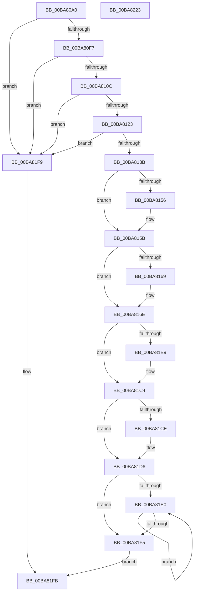

# VfDeadlockInitializeResource

- RVA: `0x00BA80A0`–`0x00BA8224` (길이 `388` bytes)
- VA: `0x0000000140BA80A0`
- 실행 섹션: `PAGEVRFY`
- PDB 이름 있음: `예`; PDB Function 태그: `아니요`
- unwind 정보 RVA: `0x000D2640`
- 디코드: `103`개 명령, `388/388` bytes 표시
- 미해석 바이트: `0` (있으면 어셈블리에 `.byte`로 보존)

> 이 문서는 커널 이미지의 기계어와 PDB 기호를 분석해 생성했습니다. 4번과 5번은 함수 원형과 자료형을 바이너리 사용 방식에서 추정한 C 해석이며 원본 소스 복구 결과는 아닙니다.

## 1. Dependencies

- 직접 호출 지점: **13**; 고유 호출 대상: **11**
- 직접 호출자로 확인된 함수: **2**
- RIP 상대 이미지 참조: **2**

### Outgoing calls
- `0x00BA80E2` → [memset](../../text/6C/memset_function_006C6C40.md) (function, `0x006C6C40`)
- `0x00BA80EA` → [ViDeadlockCanProceed](../BB/ViDeadlockCanProceed_function_00BB7B84.md) (function, `0x00BB7B84`)
- `0x00BA812A` → [ViDeadlockAllocate](ViDeadlockAllocate_function_00BA8B78.md) (function, `0x00BA8B78`)
- `0x00BA8149` → [RtlCaptureStackBackTrace](../../text/2F/RtlCaptureStackBackTrace_function_002F9FF0.md) (function, `0x002F9FF0`)
- `0x00BA816E` → [ViRaiseIrqlToDpcLevel](../../text/61/ViRaiseIrqlToDpcLevel_function_006162B0.md) (function, `0x006162B0`)
- `0x00BA8178` → [ViDeadlockDetectionLock](ViDeadlockDetectionLock_function_00BA91C4.md) (function, `0x00BA91C4`)
- `0x00BA819F` → [ViDeadlockAddResource](ViDeadlockAddResource_function_00BA8870.md) (function, `0x00BA8870`)
- `0x00BA81A9` → [ViDeadlockDetectionUnlock](ViDeadlockDetectionUnlock_function_00BA91FC.md) (function, `0x00BA91FC`)
- `0x00BA81B0` → [ViLowerIrql](../../text/61/ViLowerIrql_function_00616278.md) (function, `0x00616278`)
- `0x00BA81BF` → [ViDeadlockFree](ViDeadlockFree_function_00BA9670.md) (function, `0x00BA9670`)
- `0x00BA81D1` → [ViDeadlockFree](ViDeadlockFree_function_00BA9670.md) (function, `0x00BA9670`)
- `0x00BA81E8` → [ViDeadlockFree](ViDeadlockFree_function_00BA9670.md) (function, `0x00BA9670`)
- `0x00BA8206` → [_security_check_cookie](../../text/6A/_security_check_cookie_function_006AC640.md) (function, `0x006AC640`)

### Direct callers
- [ViDeadlockKeInitializeMutant_Exit](ViDeadlockKeInitializeMutant_Exit_function_00BA9700.md) at `0x00BA9710`
- [ViDeadlockKeInitializeMutex_Exit](ViDeadlockKeInitializeMutex_Exit_function_00BA9750.md) at `0x00BA975B`

### Static image references
- `0x00BA80B6` → RVA `0x00E0A740` (`.data`; read)
- `0x00BA80F7` → RVA `0x00FFDA00` (`PAGEVRFD`; read)

## 2. Other-region calls and transfers

- 다른 실행 섹션으로 향하는 call: **5**
  - `0x00BA80E2` → [memset](../../text/6C/memset_function_006C6C40.md) (`PAGEVRFY` → `.text`)
  - `0x00BA8149` → [RtlCaptureStackBackTrace](../../text/2F/RtlCaptureStackBackTrace_function_002F9FF0.md) (`PAGEVRFY` → `.text`)
  - `0x00BA816E` → [ViRaiseIrqlToDpcLevel](../../text/61/ViRaiseIrqlToDpcLevel_function_006162B0.md) (`PAGEVRFY` → `.text`)
  - `0x00BA81B0` → [ViLowerIrql](../../text/61/ViLowerIrql_function_00616278.md) (`PAGEVRFY` → `.text`)
  - `0x00BA8206` → [_security_check_cookie](../../text/6A/_security_check_cookie_function_006AC640.md) (`PAGEVRFY` → `.text`)
- 별도 외부 분기/꼬리 이동을 확인하지 못했습니다.

## 3. Assembly (complete function range)

```asm
00BA80A0  4C 8B DC                        mov r11, rsp
00BA80A3  49 89 5B 10                     mov qword ptr [r11 + 0x10], rbx
00BA80A7  49 89 6B 18                     mov qword ptr [r11 + 0x18], rbp
00BA80AB  56                              push rsi
00BA80AC  57                              push rdi
00BA80AD  41 56                           push r14
00BA80AF  48 81 EC 90 00 00 00            sub rsp, 0x90
00BA80B6  48 8B 05 83 26 26 00            mov rax, qword ptr [rip + 0x262683]
00BA80BD  48 33 C4                        xor rax, rsp
00BA80C0  48 89 84 24 80 00 00 00         mov qword ptr [rsp + 0x80], rax
00BA80C8  33 ED                           xor ebp, ebp
00BA80CA  49 8B D8                        mov rbx, r8
00BA80CD  48 8B F1                        mov rsi, rcx
00BA80D0  49 89 6B 88                     mov qword ptr [r11 - 0x78], rbp
00BA80D4  33 D2                           xor edx, edx
00BA80D6  49 89 6B 90                     mov qword ptr [r11 - 0x70], rbp
00BA80DA  49 8D 4B 98                     lea rcx, [r11 - 0x68]
00BA80DE  44 8D 45 40                     lea r8d, [rbp + 0x40]
00BA80E2  E8 59 EB B1 FF                  call 0x1406c6c40
00BA80E7  48 8B CE                        mov rcx, rsi
00BA80EA  E8 95 FA 00 00                  call 0x140bb7b84
00BA80EF  85 C0                           test eax, eax
00BA80F1  0F 84 02 01 00 00               je 0x140ba81f9
00BA80F7  48 8B 05 02 59 45 00            mov rax, qword ptr [rip + 0x455902]
00BA80FE  8B 88 10 80 00 00               mov ecx, dword ptr [rax + 0x8010]
00BA8104  85 C9                           test ecx, ecx
00BA8106  0F 85 ED 00 00 00               jne 0x140ba81f9
00BA810C  48 8B 05 ED 58 45 00            mov rax, qword ptr [rip + 0x4558ed]
00BA8113  81 B8 68 81 00 00 00 04 00 00   cmp dword ptr [rax + 0x8168], 0x400
00BA811D  0F 8F D6 00 00 00               jg 0x140ba81f9
00BA8123  44 8D 75 01                     lea r14d, [rbp + 1]
00BA8127  41 8B CE                        mov ecx, r14d
00BA812A  E8 49 0A 00 00                  call 0x140ba8b78
00BA812F  48 8B F8                        mov rdi, rax
00BA8132  48 85 C0                        test rax, rax
00BA8135  0F 84 BE 00 00 00               je 0x140ba81f9
00BA813B  45 33 C9                        xor r9d, r9d
00BA813E  4C 8D 44 24 40                  lea r8, [rsp + 0x40]
00BA8143  8D 55 08                        lea edx, [rbp + 8]
00BA8146  8D 4D 02                        lea ecx, [rbp + 2]
00BA8149  E8 A2 1E 75 FF                  call 0x1402f9ff0
00BA814E  0F B7 C8                        movzx ecx, ax
00BA8151  66 85 C9                        test cx, cx
00BA8154  75 05                           jne 0x140ba815b
00BA8156  48 89 5C 24 40                  mov qword ptr [rsp + 0x40], rbx
00BA815B  66 85 C9                        test cx, cx
00BA815E  8D 41 01                        lea eax, [rcx + 1]
00BA8161  0F 45 C1                        cmovne eax, ecx
00BA8164  83 F8 08                        cmp eax, 8
00BA8167  73 05                           jae 0x140ba816e
00BA8169  48 89 6C C4 40                  mov qword ptr [rsp + rax*8 + 0x40], rbp
00BA816E  E8 3D E1 A6 FF                  call 0x1406162b0
00BA8173  41 8B CE                        mov ecx, r14d
00BA8176  8A D8                           mov bl, al
00BA8178  E8 47 10 00 00                  call 0x140ba91c4
00BA817D  48 8D 44 24 38                  lea rax, [rsp + 0x38]
00BA8182  4C 8B C7                        mov r8, rdi
00BA8185  48 89 44 24 28                  mov qword ptr [rsp + 0x28], rax
00BA818A  4C 8D 4C 24 40                  lea r9, [rsp + 0x40]
00BA818F  48 8D 44 24 30                  lea rax, [rsp + 0x30]
00BA8194  41 8B D6                        mov edx, r14d
00BA8197  48 8B CE                        mov rcx, rsi
00BA819A  48 89 44 24 20                  mov qword ptr [rsp + 0x20], rax
00BA819F  E8 CC 06 00 00                  call 0x140ba8870
00BA81A4  41 8B CE                        mov ecx, r14d
00BA81A7  8B F0                           mov esi, eax
00BA81A9  E8 4E 10 00 00                  call 0x140ba91fc
00BA81AE  8A CB                           mov cl, bl
00BA81B0  E8 C3 E0 A6 FF                  call 0x140616278
00BA81B5  85 F6                           test esi, esi
00BA81B7  75 0B                           jne 0x140ba81c4
00BA81B9  41 8B D6                        mov edx, r14d
00BA81BC  48 8B CF                        mov rcx, rdi
00BA81BF  E8 AC 14 00 00                  call 0x140ba9670
00BA81C4  48 8B 4C 24 30                  mov rcx, qword ptr [rsp + 0x30]
00BA81C9  48 85 C9                        test rcx, rcx
00BA81CC  74 08                           je 0x140ba81d6
00BA81CE  41 8B D6                        mov edx, r14d
00BA81D1  E8 9A 14 00 00                  call 0x140ba9670
00BA81D6  48 8B 4C 24 38                  mov rcx, qword ptr [rsp + 0x38]
00BA81DB  48 85 C9                        test rcx, rcx
00BA81DE  74 15                           je 0x140ba81f5
00BA81E0  48 8B 19                        mov rbx, qword ptr [rcx]
00BA81E3  BA 02 00 00 00                  mov edx, 2
00BA81E8  E8 83 14 00 00                  call 0x140ba9670
00BA81ED  48 8B CB                        mov rcx, rbx
00BA81F0  48 85 DB                        test rbx, rbx
00BA81F3  75 EB                           jne 0x140ba81e0
00BA81F5  8B C6                           mov eax, esi
00BA81F7  EB 02                           jmp 0x140ba81fb
00BA81F9  33 C0                           xor eax, eax
00BA81FB  48 8B 8C 24 80 00 00 00         mov rcx, qword ptr [rsp + 0x80]
00BA8203  48 33 CC                        xor rcx, rsp
00BA8206  E8 35 44 B0 FF                  call 0x1406ac640
00BA820B  4C 8D 9C 24 90 00 00 00         lea r11, [rsp + 0x90]
00BA8213  49 8B 5B 28                     mov rbx, qword ptr [r11 + 0x28]
00BA8217  49 8B 6B 30                     mov rbp, qword ptr [r11 + 0x30]
00BA821B  49 8B E3                        mov rsp, r11
00BA821E  41 5E                           pop r14
00BA8220  5F                              pop rdi
00BA8221  5E                              pop rsi
00BA8222  C3                              ret
00BA8223  CC                              int3
```

## 4. C-style interpretation (structured pseudocode)

```c
__int64 __fastcall VfDeadlockInitializeResource(__int64 a1, int a2, __int64 a3, int a4)
{
    __int64 result;
    __int64 v_rbp;
    __int64 v_rsp;
    unsigned __int64 v_stack_m18;
    unsigned __int64 v_stack_m28;
    unsigned __int64 v_stack_m68;
    unsigned __int64 v_stack_m70;
    unsigned __int64 v_stack_m78;
    unsigned __int64 v_stack_m80;
    unsigned __int64 v_stack_m88;

    *(unsigned __int64 *)(v_rsp + 16) = v_rbx;
    *(unsigned __int64 *)(v_rsp + 24) = v_rbp;
    v_rsp = (v_rsp) - (144);
    result = (*(unsigned __int64 *)(v_rip + 2500227)) ^ (v_rsp);
    v_stack_m28 = result;
    v_rbp = 0;
    *(unsigned __int64 *)(v_rsp - 120) = 0;
    a2 = 0;
    *(unsigned __int64 *)(v_rsp - 112) = 0;
    result = memset(v_rsp - 104, a2, v_rbp + 64, a4);
    result = ViDeadlockCanProceed(a1, a2, v_rbp + 64, a4);
    if ((unsigned int)(result) == 0) goto loc_00BA81F9;
    if ((unsigned int)((unsigned int)(*(unsigned int *)(*(unsigned __int64 *)(v_rip + 4544770) + 32784))) != 0) goto loc_00BA81F9;
    if ((*(unsigned int *)(*(unsigned __int64 *)(v_rip + 4544749) + 33128)) > 0x400ULL) goto loc_00BA81F9;
    result = ViDeadlockAllocate((unsigned int)((unsigned int)(v_rbp + 1)), a2, v_rbp + 64, a4);
    if (result == 0) goto loc_00BA81F9;
    a4 = 0;
    result = RtlCaptureStackBackTrace(v_rbp + 2, v_rbp + 8, v_stack_m68, a4);
    if ((unsigned __int16)((unsigned __int16)(result)) == 0) {
        v_stack_m68 = a3;
    }
    result = (unsigned __int16)(result) + 1;
    if ((unsigned __int16)((unsigned __int16)(result)) != 0) { result = (unsigned int)((unsigned __int16)(result)); }
    if (((unsigned int)(result)) < 8) {
        *(unsigned __int64 *)(v_rsp + result * 8 + 64) = 0;
    }
    result = ViRaiseIrqlToDpcLevel((unsigned __int16)(result), v_rbp + 8, v_stack_m68, a4);
    result = ViDeadlockDetectionLock((unsigned int)((unsigned int)(v_rbp + 1)), v_rbp + 8, v_stack_m68, a4);
    v_stack_m80 = v_stack_m70;
    v_stack_m88 = v_stack_m78;
    result = ViDeadlockAddResource(a1, (unsigned int)((unsigned int)(v_rbp + 1)), result, v_stack_m68);
    result = ViDeadlockDetectionUnlock((unsigned int)((unsigned int)(v_rbp + 1)), (unsigned int)((unsigned int)(v_rbp + 1)), result, v_stack_m68);
    result = ViLowerIrql((unsigned __int8)((unsigned __int8)(result)), (unsigned int)((unsigned int)(v_rbp + 1)), result, v_stack_m68);
    if ((unsigned int)((unsigned int)((unsigned int)(result))) == 0) {
        a2 = (unsigned int)(v_rbp + 1);
        a1 = result;
        result = ViDeadlockFree(a1, a2, result, v_stack_m68);
    }
    if (v_stack_m78 != 0) {
        a2 = (unsigned int)(v_rbp + 1);
        result = ViDeadlockFree(v_stack_m78, a2, result, v_stack_m68);
    }
    if (v_stack_m70 == 0) goto loc_00BA81F5;
loc_00BA81E0:
    result = ViDeadlockFree(v_stack_m70, 2, result, v_stack_m68);
    if (*(unsigned __int64 *)(v_stack_m70) != 0) goto loc_00BA81E0;
loc_00BA81F5:
    goto loc_00BA81FB;
loc_00BA81F9:
    result = 0;
loc_00BA81FB:
    a1 = (v_stack_m28) ^ (v_rsp);
    result = _security_check_cookie(a1, 2, result, v_stack_m68);
    return result;
}
```

## 5. (Beta) C Style

```c
int64_t VfDeadlockInitializeResource(int64_t Arg1, int32_t Arg2, int64_t Arg3, int32_t Arg4)
{
    int64_t result;
    int64_t local_rbp;
    int64_t local_rsp;
    uint64_t v_stack_m18;
    uint64_t v_stack_m28;
    uint64_t v_stack_m68;
    uint64_t v_stack_m70;
    uint64_t v_stack_m78;
    uint64_t v_stack_m80;
    uint64_t v_stack_m88;

    *(uint64_t *)(local_rsp + 0x10) = local_rbx;
    *(uint64_t *)(local_rsp + 0x18) = local_rbp;
    local_rsp = (local_rsp) - (144);
    result = (*(uint64_t *)(v_rip + 0x262683)) ^ (local_rsp);
    v_stack_m28 = result;
    local_rbp = 0;
    *(uint64_t *)(local_rsp - 0x78) = 0;
    Arg2 = 0;
    *(uint64_t *)(local_rsp - 0x70) = 0;
    result = memset(local_rsp - 104, Arg2, local_rbp + 64, Arg4);
    result = ViDeadlockCanProceed(Arg1, Arg2, local_rbp + 64, Arg4);
    if ((uint32_t)(result) == 0) goto loc_00BA81F9;
    if ((uint32_t)((uint32_t)(*(uint32_t *)(*(uint64_t *)(v_rip + 0x455902) + 0x8010))) != 0) goto loc_00BA81F9;
    if ((*(uint32_t *)(*(uint64_t *)(v_rip + 0x4558ED) + 0x8168)) > 0x400ULL) goto loc_00BA81F9;
    result = ViDeadlockAllocate((uint32_t)((uint32_t)(local_rbp + 1)), Arg2, local_rbp + 64, Arg4);
    if (result == 0) goto loc_00BA81F9;
    Arg4 = 0;
    result = RtlCaptureStackBackTrace(local_rbp + 2, local_rbp + 8, v_stack_m68, Arg4);
    if ((uint16_t)((uint16_t)(result)) == 0) {
        v_stack_m68 = Arg3;
    }
    result = (uint16_t)(result) + 1;
    if ((uint16_t)((uint16_t)(result)) != 0) { result = (uint32_t)((uint16_t)(result)); }
    if (((uint32_t)(result)) < 8) {
        *(uint64_t *)(local_rsp + result * 8 + 0x40) = 0;
    }
    result = ViRaiseIrqlToDpcLevel((uint16_t)(result), local_rbp + 8, v_stack_m68, Arg4);
    result = ViDeadlockDetectionLock((uint32_t)((uint32_t)(local_rbp + 1)), local_rbp + 8, v_stack_m68, Arg4);
    v_stack_m80 = v_stack_m70;
    v_stack_m88 = v_stack_m78;
    result = ViDeadlockAddResource(Arg1, (uint32_t)((uint32_t)(local_rbp + 1)), result, v_stack_m68);
    result = ViDeadlockDetectionUnlock((uint32_t)((uint32_t)(local_rbp + 1)), (uint32_t)((uint32_t)(local_rbp + 1)), result, v_stack_m68);
    result = ViLowerIrql((uint8_t)((uint8_t)(result)), (uint32_t)((uint32_t)(local_rbp + 1)), result, v_stack_m68);
    if ((uint32_t)((uint32_t)((uint32_t)(result))) == 0) {
        Arg2 = (uint32_t)(local_rbp + 1);
        Arg1 = result;
        result = ViDeadlockFree(Arg1, Arg2, result, v_stack_m68);
    }
    if (v_stack_m78 != 0) {
        Arg2 = (uint32_t)(local_rbp + 1);
        result = ViDeadlockFree(v_stack_m78, Arg2, result, v_stack_m68);
    }
    if (v_stack_m70 == 0) goto loc_00BA81F5;
loc_00BA81E0:
    result = ViDeadlockFree(v_stack_m70, 2, result, v_stack_m68);
    if (*(uint64_t *)(v_stack_m70) != 0) goto loc_00BA81E0;
loc_00BA81F5:
    goto loc_00BA81FB;
loc_00BA81F9:
    result = 0;
loc_00BA81FB:
    Arg1 = (v_stack_m28) ^ (local_rsp);
    result = _security_check_cookie(Arg1, 2, result, v_stack_m68);
    return result;
}
```

## 6. Execution-region graph

[열기: 2D/3D 그래프와 함수 탐색 컨트롤 패널](../../../control-panel.html?section=pagevrfy&rva=0x00BA80A0&view=graph)

- 2D 그래프는 위에서 아래로 흐르고, 3D 그래프는 빈 공간을 드래그해 회전합니다. Shift+드래그는 이동, 휠은 확대·축소, 함수 노드 선택은 대상 보고서 이동입니다.

### Static fallback


