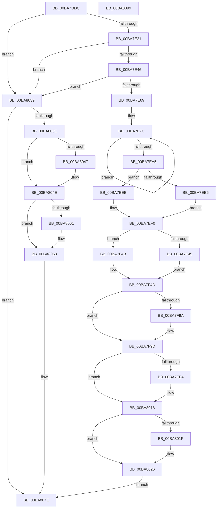

# VfDeadlockInitialize

- RVA: `0x00BA7DDC`–`0x00BA809A` (길이 `702` bytes)
- VA: `0x0000000140BA7DDC`
- 실행 섹션: `PAGEVRFY`
- PDB 이름 있음: `예`; PDB Function 태그: `아니요`
- unwind 정보 RVA: `0x000D2664`
- 디코드: `160`개 명령, `702/702` bytes 표시
- 미해석 바이트: `0` (있으면 어셈블리에 `.byte`로 보존)

> 이 문서는 커널 이미지의 기계어와 PDB 기호를 분석해 생성했습니다. 4번과 5번은 함수 원형과 자료형을 바이너리 사용 방식에서 추정한 C 해석이며 원본 소스 복구 결과는 아닙니다.

## 1. Dependencies

- 직접 호출 지점: **13**; 고유 호출 대상: **5**
- 직접 호출자로 확인된 함수: **1**
- RIP 상대 이미지 참조: **16**

### Outgoing calls
- `0x00BA7E09` → [ExAllocatePool2](../../poolcode/B8/ExAllocatePool2_function_00B820F0.md) (function, `0x00B820F0`)
- `0x00BA7E2D` → [ExAllocatePool2](../../poolcode/B8/ExAllocatePool2_function_00B820F0.md) (function, `0x00B820F0`)
- `0x00BA7E4D` → [ExAllocatePool2](../../poolcode/B8/ExAllocatePool2_function_00B820F0.md) (function, `0x00B820F0`)
- `0x00BA7F30` → [ExInitializeNPagedLookasideListInternal](../../text/46/ExInitializeNPagedLookasideListInternal_function_00468720.md) (function, `0x00468720`)
- `0x00BA7F86` → [ExInitializeNPagedLookasideListInternal](../../text/46/ExInitializeNPagedLookasideListInternal_function_00468720.md) (function, `0x00468720`)
- `0x00BA7FD6` → [ExInitializeNPagedLookasideListInternal](../../text/46/ExInitializeNPagedLookasideListInternal_function_00468720.md) (function, `0x00468720`)
- `0x00BA7FED` → [ViDeadlockPopulateLookasideCache](ViDeadlockPopulateLookasideCache_function_00BA9B4C.md) (function, `0x00BA9B4C`)
- `0x00BA7FFB` → [ViDeadlockPopulateLookasideCache](ViDeadlockPopulateLookasideCache_function_00BA9B4C.md) (function, `0x00BA9B4C`)
- `0x00BA800A` → [ViDeadlockPopulateLookasideCache](ViDeadlockPopulateLookasideCache_function_00BA9B4C.md) (function, `0x00BA9B4C`)
- `0x00BA8032` → [ViDeadlockDetectionApplySettings](ViDeadlockDetectionApplySettings_function_00BA9178.md) (function, `0x00BA9178`)
- `0x00BA8049` → [ExFreePoolWithTag](../../poolcode/B8/ExFreePoolWithTag_function_00B82870.md) (function, `0x00B82870`)
- `0x00BA8063` → [ExFreePoolWithTag](../../poolcode/B8/ExFreePoolWithTag_function_00B82870.md) (function, `0x00B82870`)
- `0x00BA8071` → [ExFreePoolWithTag](../../poolcode/B8/ExFreePoolWithTag_function_00B82870.md) (function, `0x00B82870`)

### Direct callers
- [VfDeadlockPluginEntry](VfDeadlockPluginEntry_function_00BA8230.md) at `0x00BA87F5`

### Static image references
- `0x00BA7E0E` → RVA `0x00FFDA00` (`PAGEVRFD`; write)
- `0x00BA7E32` → RVA `0x00FFDA00` (`PAGEVRFD`; read)
- `0x00BA7E69` → RVA `0x00F04060` (`.data`; write)
- `0x00BA7EA5` → RVA `0x00FFDAF8` (`PAGEVRFD`; read)
- `0x00BA7ECB` → RVA `0x00FFDAF4` (`PAGEVRFD`; read)
- `0x00BA7EDC` → RVA `0x00F04ABC` (`.data`; read)
- `0x00BA7EF2` → RVA `0x00BA9910` (`ViDeadlockKernelVerifierLookasideAllocate`; read)
- `0x00BA7EF9` → RVA `0x00F04368` (`.data`; read)
- `0x00BA7EFF` → RVA `0x004C65D0` (`VfUtilFreePoolCheckIRQL`; read)
- `0x00BA7F1D` → RVA `0x00FFF300` (`PAGEVRFD`; read)
- `0x00BA7F76` → RVA `0x00FFF380` (`PAGEVRFD`; read)
- `0x00BA7FAC` → RVA `0x00FFF400` (`PAGEVRFD`; read)
- `0x00BA800F` → RVA `0x00FFDA20` (`PAGEVRFD`; read/write)
- `0x00BA8016` → RVA `0x00F04A04` (`.data`; read)
- `0x00BA8026` → RVA `0x00F04A20` (`.data`; read)
- `0x00BA8076` → RVA `0x00FFDA00` (`PAGEVRFD`; read/write)

## 2. Other-region calls and transfers

- 다른 실행 섹션으로 향하는 call: **9**
  - `0x00BA7E09` → [ExAllocatePool2](../../poolcode/B8/ExAllocatePool2_function_00B820F0.md) (`PAGEVRFY` → `POOLCODE`)
  - `0x00BA7E2D` → [ExAllocatePool2](../../poolcode/B8/ExAllocatePool2_function_00B820F0.md) (`PAGEVRFY` → `POOLCODE`)
  - `0x00BA7E4D` → [ExAllocatePool2](../../poolcode/B8/ExAllocatePool2_function_00B820F0.md) (`PAGEVRFY` → `POOLCODE`)
  - `0x00BA7F30` → [ExInitializeNPagedLookasideListInternal](../../text/46/ExInitializeNPagedLookasideListInternal_function_00468720.md) (`PAGEVRFY` → `.text`)
  - `0x00BA7F86` → [ExInitializeNPagedLookasideListInternal](../../text/46/ExInitializeNPagedLookasideListInternal_function_00468720.md) (`PAGEVRFY` → `.text`)
  - `0x00BA7FD6` → [ExInitializeNPagedLookasideListInternal](../../text/46/ExInitializeNPagedLookasideListInternal_function_00468720.md) (`PAGEVRFY` → `.text`)
  - `0x00BA8049` → [ExFreePoolWithTag](../../poolcode/B8/ExFreePoolWithTag_function_00B82870.md) (`PAGEVRFY` → `POOLCODE`)
  - `0x00BA8063` → [ExFreePoolWithTag](../../poolcode/B8/ExFreePoolWithTag_function_00B82870.md) (`PAGEVRFY` → `POOLCODE`)
  - `0x00BA8071` → [ExFreePoolWithTag](../../poolcode/B8/ExFreePoolWithTag_function_00B82870.md) (`PAGEVRFY` → `POOLCODE`)
- 별도 외부 분기/꼬리 이동을 확인하지 못했습니다.

## 3. Assembly (complete function range)

```asm
00BA7DDC  48 8B C4                        mov rax, rsp
00BA7DDF  48 89 58 08                     mov qword ptr [rax + 8], rbx
00BA7DE3  48 89 68 10                     mov qword ptr [rax + 0x10], rbp
00BA7DE7  48 89 70 18                     mov qword ptr [rax + 0x18], rsi
00BA7DEB  4C 89 60 20                     mov qword ptr [rax + 0x20], r12
00BA7DEF  41 56                           push r14
00BA7DF1  48 83 EC 40                     sub rsp, 0x40
00BA7DF5  BE 44 6C 63 6B                  mov esi, 0x6b636c44
00BA7DFA  BB 40 00 00 00                  mov ebx, 0x40
00BA7DFF  44 8B C6                        mov r8d, esi
00BA7E02  8B CB                           mov ecx, ebx
00BA7E04  BA 80 81 00 00                  mov edx, 0x8180
00BA7E09  E8 E2 A2 FD FF                  call 0x140b820f0
00BA7E0E  48 89 05 EB 5B 45 00            mov qword ptr [rip + 0x455beb], rax
00BA7E15  48 8B D0                        mov rdx, rax
00BA7E18  48 85 C0                        test rax, rax
00BA7E1B  0F 84 18 02 00 00               je 0x140ba8039
00BA7E21  BD F0 3F 00 00                  mov ebp, 0x3ff0
00BA7E26  44 8B C6                        mov r8d, esi
00BA7E29  8B D5                           mov edx, ebp
00BA7E2B  8B CB                           mov ecx, ebx
00BA7E2D  E8 BE A2 FD FF                  call 0x140b820f0
00BA7E32  48 8B 15 C7 5B 45 00            mov rdx, qword ptr [rip + 0x455bc7]
00BA7E39  48 89 42 10                     mov qword ptr [rdx + 0x10], rax
00BA7E3D  48 85 C0                        test rax, rax
00BA7E40  0F 84 F3 01 00 00               je 0x140ba8039
00BA7E46  44 8B C6                        mov r8d, esi
00BA7E49  8B D5                           mov edx, ebp
00BA7E4B  8B CB                           mov ecx, ebx
00BA7E4D  E8 9E A2 FD FF                  call 0x140b820f0
00BA7E52  48 8B 15 A7 5B 45 00            mov rdx, qword ptr [rip + 0x455ba7]
00BA7E59  48 89 82 10 40 00 00            mov qword ptr [rdx + 0x4010], rax
00BA7E60  48 85 C0                        test rax, rax
00BA7E63  0F 84 D0 01 00 00               je 0x140ba8039
00BA7E69  C7 05 ED C1 35 00 00 00 00 00   mov dword ptr [rip + 0x35c1ed], 0
00BA7E73  45 33 C0                        xor r8d, r8d
00BA7E76  41 B9 FF 03 00 00               mov r9d, 0x3ff
00BA7E7C  48 8B 4A 10                     mov rcx, qword ptr [rdx + 0x10]
00BA7E80  49 03 C8                        add rcx, r8
00BA7E83  48 89 49 08                     mov qword ptr [rcx + 8], rcx
00BA7E87  48 89 09                        mov qword ptr [rcx], rcx
00BA7E8A  48 8B 8A 10 40 00 00            mov rcx, qword ptr [rdx + 0x4010]
00BA7E91  49 03 C8                        add rcx, r8
00BA7E94  49 83 C0 10                     add r8, 0x10
00BA7E98  48 89 49 08                     mov qword ptr [rcx + 8], rcx
00BA7E9C  48 89 09                        mov qword ptr [rcx], rcx
00BA7E9F  49 83 E9 01                     sub r9, 1
00BA7EA3  75 D7                           jne 0x140ba7e7c
00BA7EA5  8B 05 4D 5C 45 00               mov eax, dword ptr [rip + 0x455c4d]
00BA7EAB  41 8D 49 04                     lea ecx, [r9 + 4]
00BA7EAF  48 8B 15 4A 5B 45 00            mov rdx, qword ptr [rip + 0x455b4a]
00BA7EB6  85 C0                           test eax, eax
00BA7EB8  BE 00 02 00 00                  mov esi, 0x200
00BA7EBD  0F 45 C8                        cmovne ecx, eax
00BA7EC0  89 8A 28 80 00 00               mov dword ptr [rdx + 0x8028], ecx
00BA7EC6  B9 E8 03 00 00                  mov ecx, 0x3e8
00BA7ECB  8B 05 23 5C 45 00               mov eax, dword ptr [rip + 0x455c23]
00BA7ED1  85 C0                           test eax, eax
00BA7ED3  0F 45 C8                        cmovne ecx, eax
00BA7ED6  89 8A 2C 80 00 00               mov dword ptr [rdx + 0x802c], ecx
00BA7EDC  8B 05 DA CB 35 00               mov eax, dword ptr [rip + 0x35cbda]
00BA7EE2  85 C0                           test eax, eax
00BA7EE4  74 05                           je 0x140ba7eeb
00BA7EE6  0F B7 CE                        movzx ecx, si
00BA7EE9  EB 05                           jmp 0x140ba7ef0
00BA7EEB  B9 20 00 00 00                  mov ecx, 0x20
00BA7EF0  F7 D8                           neg eax
00BA7EF2  4C 8D 25 17 1A 00 00            lea r12, [rip + 0x1a17]
00BA7EF9  8B 05 69 C4 35 00               mov eax, dword ptr [rip + 0x35c469]
00BA7EFF  4C 8D 05 CA E6 91 FF            lea r8, [rip - 0x6e1936]
00BA7F06  89 44 24 38                     mov dword ptr [rsp + 0x38], eax
00BA7F0A  48 1B D2                        sbb rdx, rdx
00BA7F0D  66 89 4C 24 30                  mov word ptr [rsp + 0x30], cx
00BA7F12  49 23 D4                        and rdx, r12
00BA7F15  C7 44 24 28 56 54 68 72         mov dword ptr [rsp + 0x28], 0x72685456
00BA7F1D  48 8D 0D DC 73 45 00            lea rcx, [rip + 0x4573dc]
00BA7F24  44 8B CE                        mov r9d, esi
00BA7F27  48 C7 44 24 20 38 00 00 00      mov qword ptr [rsp + 0x20], 0x38
00BA7F30  E8 EB 07 8C FF                  call 0x140468720
00BA7F35  8B 05 81 CB 35 00               mov eax, dword ptr [rip + 0x35cb81]
00BA7F3B  41 BE 00 20 00 00               mov r14d, 0x2000
00BA7F41  85 C0                           test eax, eax
00BA7F43  74 06                           je 0x140ba7f4b
00BA7F45  41 0F B7 CE                     movzx ecx, r14w
00BA7F49  EB 02                           jmp 0x140ba7f4d
00BA7F4B  8B CB                           mov ecx, ebx
00BA7F4D  F7 D8                           neg eax
00BA7F4F  4C 8D 05 7A E6 91 FF            lea r8, [rip - 0x6e1986]
00BA7F56  8B 05 0C C4 35 00               mov eax, dword ptr [rip + 0x35c40c]
00BA7F5C  44 8B CE                        mov r9d, esi
00BA7F5F  89 44 24 38                     mov dword ptr [rsp + 0x38], eax
00BA7F63  48 1B D2                        sbb rdx, rdx
00BA7F66  66 89 4C 24 30                  mov word ptr [rsp + 0x30], cx
00BA7F6B  49 23 D4                        and rdx, r12
00BA7F6E  C7 44 24 28 56 52 65 73         mov dword ptr [rsp + 0x28], 0x73655256
00BA7F76  48 8D 0D 03 74 45 00            lea rcx, [rip + 0x457403]
00BA7F7D  48 C7 44 24 20 F8 00 00 00      mov qword ptr [rsp + 0x20], 0xf8
00BA7F86  E8 95 07 8C FF                  call 0x140468720
00BA7F8B  8B 05 2B CB 35 00               mov eax, dword ptr [rip + 0x35cb2b]
00BA7F91  BD 00 40 00 00                  mov ebp, 0x4000
00BA7F96  85 C0                           test eax, eax
00BA7F98  74 03                           je 0x140ba7f9d
00BA7F9A  0F B7 DD                        movzx ebx, bp
00BA7F9D  F7 D8                           neg eax
00BA7F9F  4C 8D 05 2A E6 91 FF            lea r8, [rip - 0x6e19d6]
00BA7FA6  8B 05 BC C3 35 00               mov eax, dword ptr [rip + 0x35c3bc]
00BA7FAC  48 8D 0D 4D 74 45 00            lea rcx, [rip + 0x45744d]
00BA7FB3  89 44 24 38                     mov dword ptr [rsp + 0x38], eax
00BA7FB7  48 1B D2                        sbb rdx, rdx
00BA7FBA  66 89 5C 24 30                  mov word ptr [rsp + 0x30], bx
00BA7FBF  49 23 D4                        and rdx, r12
00BA7FC2  C7 44 24 28 56 4E 6F 64         mov dword ptr [rsp + 0x28], 0x646f4e56
00BA7FCA  44 8B CE                        mov r9d, esi
00BA7FCD  48 C7 44 24 20 D0 00 00 00      mov qword ptr [rsp + 0x20], 0xd0
00BA7FD6  E8 45 07 8C FF                  call 0x140468720
00BA7FDB  83 3D DA CA 35 00 00            cmp dword ptr [rip + 0x35cada], 0
00BA7FE2  74 32                           je 0x140ba8016
00BA7FE4  8B D6                           mov edx, esi
00BA7FE6  48 8D 0D 13 73 45 00            lea rcx, [rip + 0x457313]
00BA7FED  E8 5A 1B 00 00                  call 0x140ba9b4c
00BA7FF2  8B D5                           mov edx, ebp
00BA7FF4  48 8D 0D 05 74 45 00            lea rcx, [rip + 0x457405]
00BA7FFB  E8 4C 1B 00 00                  call 0x140ba9b4c
00BA8000  41 8B D6                        mov edx, r14d
00BA8003  48 8D 0D 76 73 45 00            lea rcx, [rip + 0x457376]
00BA800A  E8 3D 1B 00 00                  call 0x140ba9b4c
00BA800F  83 0D 0A 5A 45 00 02            or dword ptr [rip + 0x455a0a], 2
00BA8016  83 3D E7 C9 35 00 01            cmp dword ptr [rip + 0x35c9e7], 1
00BA801D  75 07                           jne 0x140ba8026
00BA801F  83 0D FA 59 45 00 04            or dword ptr [rip + 0x4559fa], 4
00BA8026  8B 0D F4 C9 35 00               mov ecx, dword ptr [rip + 0x35c9f4]
00BA802C  C1 E9 05                        shr ecx, 5
00BA802F  83 E1 01                        and ecx, 1
00BA8032  E8 41 11 00 00                  call 0x140ba9178
00BA8037  EB 45                           jmp 0x140ba807e
00BA8039  48 85 D2                        test rdx, rdx
00BA803C  74 40                           je 0x140ba807e
00BA803E  48 8B 4A 10                     mov rcx, qword ptr [rdx + 0x10]
00BA8042  48 85 C9                        test rcx, rcx
00BA8045  74 07                           je 0x140ba804e
00BA8047  33 D2                           xor edx, edx
00BA8049  E8 22 A8 FD FF                  call 0x140b82870
00BA804E  48 8B 05 AB 59 45 00            mov rax, qword ptr [rip + 0x4559ab]
00BA8055  48 8B 88 10 40 00 00            mov rcx, qword ptr [rax + 0x4010]
00BA805C  48 85 C9                        test rcx, rcx
00BA805F  74 07                           je 0x140ba8068
00BA8061  33 D2                           xor edx, edx
00BA8063  E8 08 A8 FD FF                  call 0x140b82870
00BA8068  48 8B 0D 91 59 45 00            mov rcx, qword ptr [rip + 0x455991]
00BA806F  33 D2                           xor edx, edx
00BA8071  E8 FA A7 FD FF                  call 0x140b82870
00BA8076  48 83 25 82 59 45 00 00         and qword ptr [rip + 0x455982], 0
00BA807E  48 8B 5C 24 50                  mov rbx, qword ptr [rsp + 0x50]
00BA8083  48 8B 6C 24 58                  mov rbp, qword ptr [rsp + 0x58]
00BA8088  48 8B 74 24 60                  mov rsi, qword ptr [rsp + 0x60]
00BA808D  4C 8B 64 24 68                  mov r12, qword ptr [rsp + 0x68]
00BA8092  48 83 C4 40                     add rsp, 0x40
00BA8096  41 5E                           pop r14
00BA8098  C3                              ret
00BA8099  CC                              int3
```

## 4. C-style interpretation (structured pseudocode)

```c
__int64 __fastcall VfDeadlockInitialize(void)
{
    __int64 result;
    __int64 v_rbx;
    __int64 v_rsp;
    unsigned int v_stack_m10;
    unsigned __int16 v_stack_m18;
    unsigned int v_stack_m20;
    unsigned __int64 v_stack_m28;
    unsigned __int64 v_stack_p10;
    unsigned __int64 v_stack_p18;
    unsigned __int64 v_stack_p20;
    unsigned __int64 v_stack_p8;

    *(unsigned __int64 *)(v_rsp + 8) = v_rbx;
    *(unsigned __int64 *)(v_rsp + 16) = v_rbp;
    *(unsigned __int64 *)(v_rsp + 24) = v_rsi;
    *(unsigned __int64 *)(v_rsp + 32) = v_r12;
    v_rsp = (v_rsp) - (64);
    result = ExAllocatePool2(64, (unsigned int)(0x8180ULL), (unsigned int)((unsigned int)((unsigned int)(0x6B636C44ULL))), a4);
    *(unsigned __int64 *)(v_rip + 4545515) = result;
    if (result == 0) goto loc_00BA8039;
    result = ExAllocatePool2(64, (unsigned int)((unsigned int)((unsigned int)(0x3FF0ULL))), (unsigned int)((unsigned int)((unsigned int)(0x6B636C44ULL))), a4);
    *(unsigned __int64 *)(*(unsigned __int64 *)(v_rip + 4545479) + 16) = result;
    if (result == 0) goto loc_00BA8039;
    result = ExAllocatePool2(64, (unsigned int)((unsigned int)((unsigned int)(0x3FF0ULL))), (unsigned int)((unsigned int)((unsigned int)(0x6B636C44ULL))), a4);
    *(unsigned __int64 *)(*(unsigned __int64 *)(v_rip + 4545447) + 16400) = result;
    if (result == 0) goto loc_00BA8039;
    *(unsigned int *)(v_rip + 3523053) = 0;
    a3 = 0;
loc_00BA7E7C:
    a1 = (*(unsigned __int64 *)(*(unsigned __int64 *)(v_rip + 4545447) + 16)) + (0);
    *(unsigned __int64 *)(a1 + 8) = a1;
    *(unsigned __int64 *)(a1) = a1;
    a1 = (*(unsigned __int64 *)(*(unsigned __int64 *)(v_rip + 4545447) + 16400)) + (0);
    a3 = (a3) + (16);
    *(unsigned __int64 *)(a1 + 8) = a1;
    *(unsigned __int64 *)(a1) = a1;
    a4 = ((unsigned int)(0x3FFULL)) - (1);
    if (condition_is_not_equal) goto loc_00BA7E7C;
    a1 = a4 + 4;
    if ((unsigned int)((unsigned int)(*(unsigned int *)(v_rip + 4545613))) != 0) { a1 = (unsigned int)((unsigned int)(*(unsigned int *)(v_rip + 4545613))); }
    *(unsigned int *)(*(unsigned __int64 *)(v_rip + 4545354) + 32808) = (unsigned int)(a1);
    a1 = 1000;
    if ((unsigned int)((unsigned int)(*(unsigned int *)(v_rip + 4545571))) != 0) { a1 = (unsigned int)((unsigned int)(*(unsigned int *)(v_rip + 4545571))); }
    *(unsigned int *)(*(unsigned __int64 *)(v_rip + 4545354) + 32812) = (unsigned int)(a1);
    if ((unsigned int)((unsigned int)(*(unsigned int *)(v_rip + 3525594))) == 0) goto loc_00BA7EEB;
    goto loc_00BA7EF0;
loc_00BA7EEB:
loc_00BA7EF0:
    result = (unsigned int)(-((unsigned int)(*(unsigned int *)(v_rip + 3525594))));
    v_stack_m10 = (unsigned int)((unsigned int)(*(unsigned int *)(v_rip + 3523689)));
    v_stack_m18 = 32;
    a2 = (*(unsigned __int64 *)(v_rip + 4545354)) & (v_rip + 6679);
    v_stack_m20 = 0x72685456ULL;
    v_stack_m28 = 56;
    result = ExInitializeNPagedLookasideListInternal(v_rip + 4551644, a2, v_rip - 7215414, 512);
    if ((unsigned int)((unsigned int)(*(unsigned int *)(v_rip + 3525505))) == 0) goto loc_00BA7F4B;
    goto loc_00BA7F4D;
loc_00BA7F4B:
loc_00BA7F4D:
    result = (unsigned int)(-((unsigned int)(*(unsigned int *)(v_rip + 3525505))));
    v_stack_m10 = (unsigned int)((unsigned int)(*(unsigned int *)(v_rip + 3523596)));
    v_stack_m18 = 64;
    a2 = (a2) & (v_rip + 6679);
    v_stack_m20 = 0x73655256ULL;
    v_stack_m28 = 248;
    result = ExInitializeNPagedLookasideListInternal(v_rip + 4551683, a2, v_rip - 7215494, 512);
    v_rbx = 64;
    if ((unsigned int)((unsigned int)(*(unsigned int *)(v_rip + 3525419))) != 0) {
        v_rbx = (unsigned __int16)((unsigned int)(0x4000ULL));
    }
    result = (unsigned int)(-((unsigned int)(*(unsigned int *)(v_rip + 3525419))));
    v_stack_m10 = (unsigned int)((unsigned int)(*(unsigned int *)(v_rip + 3523516)));
    v_stack_m18 = (unsigned __int16)(v_rbx);
    a2 = (a2) & (v_rip + 6679);
    v_stack_m20 = 0x646F4E56ULL;
    v_stack_m28 = 208;
    result = ExInitializeNPagedLookasideListInternal(v_rip + 4551757, a2, v_rip - 7215574, 512);
    if ((*(unsigned int *)(v_rip + 3525338)) != 0) {
        a2 = 512;
        a1 = v_rip + 4551443;
        result = ViDeadlockPopulateLookasideCache(a1, a2, v_rip - 7215574, 512);
        a2 = (unsigned int)((unsigned int)(0x4000ULL));
        a1 = v_rip + 4551685;
        result = ViDeadlockPopulateLookasideCache(a1, a2, v_rip - 7215574, 512);
        a2 = (unsigned int)((unsigned int)(0x2000ULL));
        a1 = v_rip + 4551542;
        result = ViDeadlockPopulateLookasideCache(a1, a2, v_rip - 7215574, 512);
    }
    if ((*(unsigned int *)(v_rip + 3525095)) == 1) {
    }
    a1 = (unsigned int)(((unsigned int)(*(unsigned int *)(v_rip + 3525108))) >> (5));
    a1 = (unsigned int)((a1) & (1));
    result = ViDeadlockDetectionApplySettings(a1, a2, v_rip - 7215574, 512);
    goto loc_00BA807E;
loc_00BA8039:
    if (a2 == 0) goto loc_00BA807E;
    if (*(unsigned __int64 *)(a2 + 16) != 0) {
        a2 = 0;
        result = ExFreePoolWithTag(*(unsigned __int64 *)(a2 + 16), a2, v_rip - 7215574, 512);
    }
    result = *(unsigned __int64 *)(v_rip + 4544939);
    if (*(unsigned __int64 *)(*(unsigned __int64 *)(v_rip + 4544939) + 16400) != 0) {
        a2 = 0;
        result = ExFreePoolWithTag(*(unsigned __int64 *)(*(unsigned __int64 *)(v_rip + 4544939) + 16400), a2, v_rip - 7215574, 512);
    }
    a2 = 0;
    result = ExFreePoolWithTag(*(unsigned __int64 *)(v_rip + 4544913), a2, v_rip - 7215574, 512);
loc_00BA807E:
    v_rsp = (v_rsp) + (64);
    return result;
}
```

## 5. (Beta) C Style

```c
void VfDeadlockInitialize(void)
{
    int64_t result;
    int64_t local_rbx;
    int64_t local_rsp;
    uint32_t v_stack_m10;
    uint16_t v_stack_m18;
    uint32_t v_stack_m20;
    uint64_t v_stack_m28;
    uint64_t v_stack_p10;
    uint64_t v_stack_p18;
    uint64_t v_stack_p20;
    uint64_t v_stack_p8;

    *(uint64_t *)(local_rsp + 0x8) = local_rbx;
    *(uint64_t *)(local_rsp + 0x10) = local_rbp;
    *(uint64_t *)(local_rsp + 0x18) = local_rsi;
    *(uint64_t *)(local_rsp + 0x20) = local_r12;
    local_rsp = (local_rsp) - (64);
    result = ExAllocatePool2(64, (uint32_t)(0x8180ULL), (uint32_t)((uint32_t)((uint32_t)(0x6B636C44ULL))), a4);
    *(uint64_t *)(v_rip + 0x455BEB) = result;
    if (result == 0) goto loc_00BA8039;
    result = ExAllocatePool2(64, (uint32_t)((uint32_t)((uint32_t)(0x3FF0ULL))), (uint32_t)((uint32_t)((uint32_t)(0x6B636C44ULL))), a4);
    *(uint64_t *)(*(uint64_t *)(v_rip + 0x455BC7) + 0x10) = result;
    if (result == 0) goto loc_00BA8039;
    result = ExAllocatePool2(64, (uint32_t)((uint32_t)((uint32_t)(0x3FF0ULL))), (uint32_t)((uint32_t)((uint32_t)(0x6B636C44ULL))), a4);
    *(uint64_t *)(*(uint64_t *)(v_rip + 0x455BA7) + 0x4010) = result;
    if (result == 0) goto loc_00BA8039;
    *(uint32_t *)(v_rip + 0x35C1ED) = 0;
    a3 = 0;
loc_00BA7E7C:
    a1 = (*(uint64_t *)(*(uint64_t *)(v_rip + 0x455BA7) + 0x10)) + (0);
    *(uint64_t *)(a1 + 0x8) = a1;
    *(uint64_t *)(a1) = a1;
    a1 = (*(uint64_t *)(*(uint64_t *)(v_rip + 0x455BA7) + 0x4010)) + (0);
    a3 = (a3) + (16);
    *(uint64_t *)(a1 + 0x8) = a1;
    *(uint64_t *)(a1) = a1;
    a4 = ((uint32_t)(0x3FFULL)) - (1);
    if (condition_is_not_equal) goto loc_00BA7E7C;
    a1 = a4 + 4;
    if ((uint32_t)((uint32_t)(*(uint32_t *)(v_rip + 0x455C4D))) != 0) { a1 = (uint32_t)((uint32_t)(*(uint32_t *)(v_rip + 0x455C4D))); }
    *(uint32_t *)(*(uint64_t *)(v_rip + 0x455B4A) + 0x8028) = (uint32_t)(a1);
    a1 = 1000;
    if ((uint32_t)((uint32_t)(*(uint32_t *)(v_rip + 0x455C23))) != 0) { a1 = (uint32_t)((uint32_t)(*(uint32_t *)(v_rip + 0x455C23))); }
    *(uint32_t *)(*(uint64_t *)(v_rip + 0x455B4A) + 0x802C) = (uint32_t)(a1);
    if ((uint32_t)((uint32_t)(*(uint32_t *)(v_rip + 0x35CBDA))) == 0) goto loc_00BA7EEB;
    goto loc_00BA7EF0;
loc_00BA7EEB:
loc_00BA7EF0:
    result = (uint32_t)(-((uint32_t)(*(uint32_t *)(v_rip + 0x35CBDA))));
    v_stack_m10 = (uint32_t)((uint32_t)(*(uint32_t *)(v_rip + 0x35C469)));
    v_stack_m18 = 32;
    a2 = (*(uint64_t *)(v_rip + 0x455B4A)) & (v_rip + 6679);
    v_stack_m20 = 0x72685456ULL;
    v_stack_m28 = 56;
    result = ExInitializeNPagedLookasideListInternal(v_rip + 4551644, a2, v_rip - 7215414, 512);
    if ((uint32_t)((uint32_t)(*(uint32_t *)(v_rip + 0x35CB81))) == 0) goto loc_00BA7F4B;
    goto loc_00BA7F4D;
loc_00BA7F4B:
loc_00BA7F4D:
    result = (uint32_t)(-((uint32_t)(*(uint32_t *)(v_rip + 0x35CB81))));
    v_stack_m10 = (uint32_t)((uint32_t)(*(uint32_t *)(v_rip + 0x35C40C)));
    v_stack_m18 = 64;
    a2 = (a2) & (v_rip + 6679);
    v_stack_m20 = 0x73655256ULL;
    v_stack_m28 = 248;
    result = ExInitializeNPagedLookasideListInternal(v_rip + 4551683, a2, v_rip - 7215494, 512);
    local_rbx = 64;
    if ((uint32_t)((uint32_t)(*(uint32_t *)(v_rip + 0x35CB2B))) != 0) {
        local_rbx = (uint16_t)((uint32_t)(0x4000ULL));
    }
    result = (uint32_t)(-((uint32_t)(*(uint32_t *)(v_rip + 0x35CB2B))));
    v_stack_m10 = (uint32_t)((uint32_t)(*(uint32_t *)(v_rip + 0x35C3BC)));
    v_stack_m18 = (uint16_t)(local_rbx);
    a2 = (a2) & (v_rip + 6679);
    v_stack_m20 = 0x646F4E56ULL;
    v_stack_m28 = 208;
    result = ExInitializeNPagedLookasideListInternal(v_rip + 4551757, a2, v_rip - 7215574, 512);
    if ((*(uint32_t *)(v_rip + 0x35CADA)) != 0) {
        a2 = 512;
        a1 = v_rip + 4551443;
        result = ViDeadlockPopulateLookasideCache(a1, a2, v_rip - 7215574, 512);
        a2 = (uint32_t)((uint32_t)(0x4000ULL));
        a1 = v_rip + 4551685;
        result = ViDeadlockPopulateLookasideCache(a1, a2, v_rip - 7215574, 512);
        a2 = (uint32_t)((uint32_t)(0x2000ULL));
        a1 = v_rip + 4551542;
        result = ViDeadlockPopulateLookasideCache(a1, a2, v_rip - 7215574, 512);
    }
    if ((*(uint32_t *)(v_rip + 0x35C9E7)) == 1) {
    }
    a1 = (uint32_t)(((uint32_t)(*(uint32_t *)(v_rip + 0x35C9F4))) >> (5));
    a1 = (uint32_t)((a1) & (1));
    result = ViDeadlockDetectionApplySettings(a1, a2, v_rip - 7215574, 512);
    goto loc_00BA807E;
loc_00BA8039:
    if (a2 == 0) goto loc_00BA807E;
    if (*(uint64_t *)(a2 + 0x10) != 0) {
        a2 = 0;
        result = ExFreePoolWithTag(*(uint64_t *)(a2 + 0x10), a2, v_rip - 7215574, 512);
    }
    result = *(uint64_t *)(v_rip + 0x4559AB);
    if (*(uint64_t *)(*(uint64_t *)(v_rip + 0x4559AB) + 0x4010) != 0) {
        a2 = 0;
        result = ExFreePoolWithTag(*(uint64_t *)(*(uint64_t *)(v_rip + 0x4559AB) + 0x4010), a2, v_rip - 7215574, 512);
    }
    a2 = 0;
    result = ExFreePoolWithTag(*(uint64_t *)(v_rip + 0x455991), a2, v_rip - 7215574, 512);
loc_00BA807E:
    local_rsp = (local_rsp) + (64);
    return result;
}
```

## 6. Execution-region graph

[열기: 2D/3D 그래프와 함수 탐색 컨트롤 패널](../../../control-panel.html?section=pagevrfy&rva=0x00BA7DDC&view=graph)

- 2D 그래프는 위에서 아래로 흐르고, 3D 그래프는 빈 공간을 드래그해 회전합니다. Shift+드래그는 이동, 휠은 확대·축소, 함수 노드 선택은 대상 보고서 이동입니다.

### Static fallback


