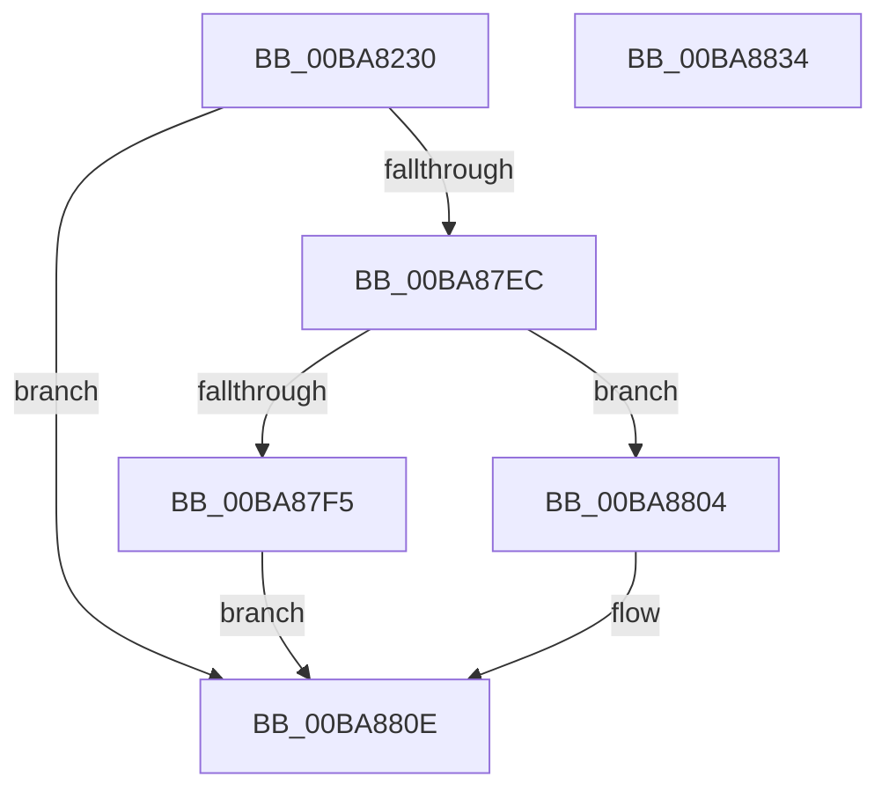

# VfDeadlockPluginEntry

- RVA: `0x00BA8230`–`0x00BA8835` (길이 `1,541` bytes)
- VA: `0x0000000140BA8230`
- 실행 섹션: `PAGEVRFY`
- PDB 이름 있음: `예`; PDB Function 태그: `아니요`
- unwind 정보 RVA: `0x000D2680`
- 디코드: `239`개 명령, `1,541/1,541` bytes 표시
- 미해석 바이트: `0` (있으면 어셈블리에 `.byte`로 보존)

> 이 문서는 커널 이미지의 기계어와 PDB 기호를 분석해 생성했습니다. 4번과 5번은 함수 원형과 자료형을 바이너리 사용 방식에서 추정한 C 해석이며 원본 소스 복구 결과는 아닙니다.

## 1. Dependencies

- 직접 호출 지점: **5**; 고유 호출 대상: **5**
- 직접 호출자로 확인된 함수: **0**
- RIP 상대 이미지 참조: **57**

### Outgoing calls
- `0x00BA87E1` → [DifRegisterPlugin](../../text/61/DifRegisterPlugin_function_0061ABE0.md) (function, `0x0061ABE0`)
- `0x00BA87F5` → [VfDeadlockInitialize](VfDeadlockInitialize_function_00BA7DDC.md) (function, `0x00BA7DDC`)
- `0x00BA87FD` → [ExSetPoolFlags](../../text/65/ExSetPoolFlags_function_006567C4.md) (function, `0x006567C4`)
- `0x00BA8809` → [ViDeadlockDetectionApplySettings](ViDeadlockDetectionApplySettings_function_00BA9178.md) (function, `0x00BA9178`)
- `0x00BA881A` → [_security_check_cookie](../../text/6A/_security_check_cookie_function_006AC640.md) (function, `0x006AC640`)

### Direct callers
- 이 함수 시작 RVA로 연결되는 직접 call은 확인되지 않았습니다. 간접 호출은 완전히 역산할 수 없습니다.

### Static image references
- `0x00BA824A` → RVA `0x00E0A740` (`.data`; read)
- `0x00BA8265` → RVA `0x00615FD0` (`ViDeadlockPluginUnload`; read)
- `0x00BA8271` → RVA `0x00F04048` (`.data`; write)
- `0x00BA8278` → RVA `0x00BBABA0` (` ?? ::JKADOLAD::`string'`; read)
- `0x00BA827F` → RVA `0x00BBAC10` (` ?? ::JKADOLAD::`string'`; read)
- `0x00BA8293` → RVA `0x00BA9700` (`ViDeadlockKeInitializeMutant_Exit`; read)
- `0x00BA829A` → RVA `0x00BA9520` (`ViDeadlockExTryToAcquireFastMutex_Exit`; read)
- `0x00BA82B0` → RVA `0x00BBAC50` (` ?? ::JKADOLAD::`string'`; read)
- `0x00BA82C4` → RVA `0x00BA9400` (`ViDeadlockExAcquireFastMutex_Exit`; read)
- `0x00BA82D0` → RVA `0x00BBAC30` (` ?? ::JKADOLAD::`string'`; read)
- `0x00BA82DC` → RVA `0x00BA93C0` (`ViDeadlockExAcquireFastMutexUnsafe_Exit`; read)
- `0x00BA82E8` → RVA `0x00BBAB70` (` ?? ::JKADOLAD::`string'`; read)
- `0x00BA82F3` → RVA `0x00BA9840` (`ViDeadlockKeTryToAcquireSpinLockAtDpcLevel_Exit`; read)
- `0x00BA82FE` → RVA `0x00BBABF0` (` ?? ::JKADOLAD::`string'`; read)
- `0x00BA8309` → RVA `0x00BA96C0` (`ViDeadlockKeAcquireInStackQueuedSpinLockAtDpcLevel_Exit`; read)
- `0x00BA8314` → RVA `0x00BBABC0` (` ?? ::JKADOLAD::`string'`; read)
- `0x00BA832A` → RVA `0x00BBAB00` (` ?? ::JKADOLAD::`string'`; read)
- `0x00BA8340` → RVA `0x00BBAAE0` (` ?? ::JKADOLAD::`string'`; read)
- `0x00BA834B` → RVA `0x00BA98E0` (`ViDeadlockKeWaitForSingleObject_Exit`; read)
- `0x00BA8356` → RVA `0x00BBAB50` (` ?? ::JKADOLAD::`string'`; read)
- `0x00BA8361` → RVA `0x00BA9880` (`ViDeadlockKeWaitForMultipleObjects_Exit`; read)
- `0x00BA836C` → RVA `0x00BBAB30` (` ?? ::JKADOLAD::`string'`; read)
- `0x00BA8377` → RVA `0x00BA9440` (`ViDeadlockExAcquireResourceExclusiveLite_Exit`; read)
- `0x00BA8382` → RVA `0x00BBAA50` (` ?? ::JKADOLAD::`string'`; read)
- `0x00BA8390` → RVA `0x00BA9480` (`ViDeadlockExEnterCriticalRegionAndAcquireResourceExclusive_Exit`; read)
- `0x00BA839E` → RVA `0x00BBAA10` (` ?? ::JKADOLAD::`string'`; read)
- `0x00BA843D` → RVA `0x00BBAAC0` (` ?? ::JKADOLAD::`string'`; read)
- `0x00BA8459` → RVA `0x00BBAA90` (` ?? ::JKADOLAD::`string'`; read)
- `0x00BA8475` → RVA `0x00BBAE00` (` ?? ::JKADOLAD::`string'`; read)
- `0x00BA8491` → RVA `0x00BBADE0` (` ?? ::JKADOLAD::`string'`; read)
- `0x00BA84AD` → RVA `0x00BBAE50` (` ?? ::JKADOLAD::`string'`; read)
- `0x00BA84C9` → RVA `0x00BBAE30` (` ?? ::JKADOLAD::`string'`; read)
- `0x00BA84D7` → RVA `0x00BA94F0` (`ViDeadlockExReleaseFastMutex_Entry`; read)
- `0x00BA84E5` → RVA `0x00BBAD90` (` ?? ::JKADOLAD::`string'`; read)
- `0x00BA84F3` → RVA `0x00BA94C0` (`ViDeadlockExReleaseFastMutexUnsafe_Entry`; read)
- `0x00BA8501` → RVA `0x00BBAD80` (` ?? ::JKADOLAD::`string'`; read)
- `0x00BA850F` → RVA `0x00BA97E0` (`ViDeadlockKeReleaseMutex_Entry`; read)
- `0x00BA851D` → RVA `0x00BBADD0` (` ?? ::JKADOLAD::`string'`; read)
- `0x00BA852B` → RVA `0x00BA97B0` (`ViDeadlockKeReleaseMutant_Entry`; read)
- `0x00BA8539` → RVA `0x00BBADB0` (` ?? ::JKADOLAD::`string'`; read)
- `0x00BA8547` → RVA `0x00BA9770` (`ViDeadlockKeReleaseInStackQueuedSpinLockForDpc_Entry`; read)
- `0x00BA8555` → RVA `0x00BBAD20` (` ?? ::JKADOLAD::`string'`; read)
- `0x00BA8571` → RVA `0x00BBACF0` (` ?? ::JKADOLAD::`string'`; read)
- `0x00BA858D` → RVA `0x00BBAD60` (` ?? ::JKADOLAD::`string'`; read)
- `0x00BA859B` → RVA `0x00BA9750` (`ViDeadlockKeInitializeMutex_Exit`; read)
- `0x00BA8693` → RVA `0x00BBAD50` (` ?? ::JKADOLAD::`string'`; read)
- `0x00BA86A8` → RVA `0x00F04040` (`.data`; read)
- `0x00BA86AF` → RVA `0x00BBAC90` (` ?? ::JKADOLAD::`string'`; read)
- `0x00BA86C7` → RVA `0x00BBAC70` (` ?? ::JKADOLAD::`string'`; read)
- `0x00BA86E3` → RVA `0x00BB8380` (`ViDeadlockKeAcquireSpinLockAtDpcLevel_Exit`; read)
- `0x00BA86FD` → RVA `0x00BBACD0` (` ?? ::JKADOLAD::`string'`; read)
- `0x00BA8720` → RVA `0x00BBACB0` (` ?? ::JKADOLAD::`string'`; read)
- `0x00BA872E` → RVA `0x00BB7570` (`ViDeadlockKeReleaseSpinLock_Entry`; read)
- `0x00BA873C` → RVA `0x00BBB180` (` ?? ::JKADOLAD::`string'`; read)
- `0x00BA874A` → RVA `0x00BA9810` (`ViDeadlockKeReleaseSpinLockFromDpcLevel_Entry`; read)
- `0x00BA8758` → RVA `0x00BBB150` (` ?? ::JKADOLAD::`string'`; read)
- `0x00BA87EC` → RVA `0x00FFDA00` (`PAGEVRFD`; read)

## 2. Other-region calls and transfers

- 다른 실행 섹션으로 향하는 call: **3**
  - `0x00BA87E1` → [DifRegisterPlugin](../../text/61/DifRegisterPlugin_function_0061ABE0.md) (`PAGEVRFY` → `.text`)
  - `0x00BA87FD` → [ExSetPoolFlags](../../text/65/ExSetPoolFlags_function_006567C4.md) (`PAGEVRFY` → `.text`)
  - `0x00BA881A` → [_security_check_cookie](../../text/6A/_security_check_cookie_function_006AC640.md) (`PAGEVRFY` → `.text`)
- 별도 외부 분기/꼬리 이동을 확인하지 못했습니다.

## 3. Assembly (complete function range)

```asm
00BA8230  48 89 5C 24 08                  mov qword ptr [rsp + 8], rbx
00BA8235  48 89 7C 24 10                  mov qword ptr [rsp + 0x10], rdi
00BA823A  55                              push rbp
00BA823B  48 8D AC 24 90 FC FF FF         lea rbp, [rsp - 0x370]
00BA8243  48 81 EC 70 04 00 00            sub rsp, 0x470
00BA824A  48 8B 05 EF 24 26 00            mov rax, qword ptr [rip + 0x2624ef]
00BA8251  48 33 C4                        xor rax, rsp
00BA8254  48 89 85 60 03 00 00            mov qword ptr [rbp + 0x360], rax
00BA825B  33 FF                           xor edi, edi
00BA825D  C7 44 24 28 7F 01 00 00         mov dword ptr [rsp + 0x28], 0x17f
00BA8265  48 8D 05 64 DD A6 FF            lea rax, [rip - 0x59229c]
00BA826C  48 89 7C 24 30                  mov qword ptr [rsp + 0x30], rdi
00BA8271  48 89 05 D0 BD 35 00            mov qword ptr [rip + 0x35bdd0], rax
00BA8278  4C 8D 05 21 29 01 00            lea r8, [rip + 0x12921]
00BA827F  48 8D 05 8A 29 01 00            lea rax, [rip + 0x1298a]
00BA8286  C7 44 24 48 A9 01 00 00         mov dword ptr [rsp + 0x48], 0x1a9
00BA828E  48 89 44 24 20                  mov qword ptr [rsp + 0x20], rax
00BA8293  48 8D 0D 66 14 00 00            lea rcx, [rip + 0x1466]
00BA829A  48 8D 05 7F 12 00 00            lea rax, [rip + 0x127f]
00BA82A1  48 89 7C 24 50                  mov qword ptr [rsp + 0x50], rdi
00BA82A6  48 89 44 24 38                  mov qword ptr [rsp + 0x38], rax
00BA82AB  BA 1A 01 00 00                  mov edx, 0x11a
00BA82B0  48 8D 05 99 29 01 00            lea rax, [rip + 0x12999]
00BA82B7  C7 44 24 68 A8 01 00 00         mov dword ptr [rsp + 0x68], 0x1a8
00BA82BF  48 89 44 24 40                  mov qword ptr [rsp + 0x40], rax
00BA82C4  48 8D 05 35 11 00 00            lea rax, [rip + 0x1135]
00BA82CB  48 89 44 24 58                  mov qword ptr [rsp + 0x58], rax
00BA82D0  48 8D 05 59 29 01 00            lea rax, [rip + 0x12959]
00BA82D7  48 89 44 24 60                  mov qword ptr [rsp + 0x60], rax
00BA82DC  48 8D 05 DD 10 00 00            lea rax, [rip + 0x10dd]
00BA82E3  48 89 44 24 78                  mov qword ptr [rsp + 0x78], rax
00BA82E8  48 8D 05 81 28 01 00            lea rax, [rip + 0x12881]
00BA82EF  48 89 45 A0                     mov qword ptr [rbp - 0x60], rax
00BA82F3  48 8D 05 46 15 00 00            lea rax, [rip + 0x1546]
00BA82FA  48 89 45 B8                     mov qword ptr [rbp - 0x48], rax
00BA82FE  48 8D 05 EB 28 01 00            lea rax, [rip + 0x128eb]
00BA8305  48 89 45 C0                     mov qword ptr [rbp - 0x40], rax
00BA8309  48 8D 05 B0 13 00 00            lea rax, [rip + 0x13b0]
00BA8310  48 89 45 D8                     mov qword ptr [rbp - 0x28], rax
00BA8314  48 8D 05 A5 28 01 00            lea rax, [rip + 0x128a5]
00BA831B  48 89 45 E0                     mov qword ptr [rbp - 0x20], rax
00BA831F  48 8D 05 9A 13 00 00            lea rax, [rip + 0x139a]
00BA8326  48 89 45 F8                     mov qword ptr [rbp - 8], rax
00BA832A  48 8D 05 CF 27 01 00            lea rax, [rip + 0x127cf]
00BA8331  48 89 45 00                     mov qword ptr [rbp], rax
00BA8335  48 8D 05 84 13 00 00            lea rax, [rip + 0x1384]
00BA833C  48 89 45 18                     mov qword ptr [rbp + 0x18], rax
00BA8340  48 8D 05 99 27 01 00            lea rax, [rip + 0x12799]
00BA8347  48 89 45 20                     mov qword ptr [rbp + 0x20], rax
00BA834B  48 8D 05 8E 15 00 00            lea rax, [rip + 0x158e]
00BA8352  48 89 45 38                     mov qword ptr [rbp + 0x38], rax
00BA8356  48 8D 05 F3 27 01 00            lea rax, [rip + 0x127f3]
00BA835D  48 89 45 40                     mov qword ptr [rbp + 0x40], rax
00BA8361  48 8D 05 18 15 00 00            lea rax, [rip + 0x1518]
00BA8368  48 89 45 58                     mov qword ptr [rbp + 0x58], rax
00BA836C  48 8D 05 BD 27 01 00            lea rax, [rip + 0x127bd]
00BA8373  48 89 45 60                     mov qword ptr [rbp + 0x60], rax
00BA8377  48 8D 05 C2 10 00 00            lea rax, [rip + 0x10c2]
00BA837E  48 89 45 78                     mov qword ptr [rbp + 0x78], rax
00BA8382  48 8D 05 C7 26 01 00            lea rax, [rip + 0x126c7]
00BA8389  48 89 85 80 00 00 00            mov qword ptr [rbp + 0x80], rax
00BA8390  48 8D 05 E9 10 00 00            lea rax, [rip + 0x10e9]
00BA8397  48 89 85 98 00 00 00            mov qword ptr [rbp + 0x98], rax
00BA839E  48 8D 05 6B 26 01 00            lea rax, [rip + 0x1266b]
00BA83A5  48 89 85 A0 00 00 00            mov qword ptr [rbp + 0xa0], rax
00BA83AC  48 8D 05 CD 10 00 00            lea rax, [rip + 0x10cd]
00BA83B3  48 89 7C 24 70                  mov qword ptr [rsp + 0x70], rdi
00BA83B8  4C 89 45 80                     mov qword ptr [rbp - 0x80], r8
00BA83BC  89 55 88                        mov dword ptr [rbp - 0x78], edx
00BA83BF  48 89 7D 90                     mov qword ptr [rbp - 0x70], rdi
00BA83C3  48 89 4D 98                     mov qword ptr [rbp - 0x68], rcx
00BA83C7  C7 45 A8 F2 00 00 00            mov dword ptr [rbp - 0x58], 0xf2
00BA83CE  48 89 7D B0                     mov qword ptr [rbp - 0x50], rdi
00BA83D2  C7 45 C8 2A 01 00 00            mov dword ptr [rbp - 0x38], 0x12a
00BA83D9  48 89 7D D0                     mov qword ptr [rbp - 0x30], rdi
00BA83DD  C7 45 E8 29 01 00 00            mov dword ptr [rbp - 0x18], 0x129
00BA83E4  48 89 7D F0                     mov qword ptr [rbp - 0x10], rdi
00BA83E8  C7 45 08 28 01 00 00            mov dword ptr [rbp + 8], 0x128
00BA83EF  48 89 7D 10                     mov qword ptr [rbp + 0x10], rdi
00BA83F3  C7 45 28 F0 00 00 00            mov dword ptr [rbp + 0x28], 0xf0
00BA83FA  48 89 7D 30                     mov qword ptr [rbp + 0x30], rdi
00BA83FE  C7 45 48 F1 00 00 00            mov dword ptr [rbp + 0x48], 0xf1
00BA8405  48 89 7D 50                     mov qword ptr [rbp + 0x50], rdi
00BA8409  C7 45 68 A7 01 00 00            mov dword ptr [rbp + 0x68], 0x1a7
00BA8410  48 89 7D 70                     mov qword ptr [rbp + 0x70], rdi
00BA8414  C7 85 88 00 00 00 96 01 00 00   mov dword ptr [rbp + 0x88], 0x196
00BA841E  48 89 BD 90 00 00 00            mov qword ptr [rbp + 0x90], rdi
00BA8425  C7 85 A8 00 00 00 93 01 00 00   mov dword ptr [rbp + 0xa8], 0x193
00BA842F  48 89 BD B0 00 00 00            mov qword ptr [rbp + 0xb0], rdi
00BA8436  48 89 85 B8 00 00 00            mov qword ptr [rbp + 0xb8], rax
00BA843D  48 8D 05 7C 26 01 00            lea rax, [rip + 0x1267c]
00BA8444  48 89 85 C0 00 00 00            mov qword ptr [rbp + 0xc0], rax
00BA844B  48 8D 05 EE 0F 00 00            lea rax, [rip + 0xfee]
00BA8452  48 89 85 D8 00 00 00            mov qword ptr [rbp + 0xd8], rax
00BA8459  48 8D 05 30 26 01 00            lea rax, [rip + 0x12630]
00BA8460  48 89 85 E0 00 00 00            mov qword ptr [rbp + 0xe0], rax
00BA8467  48 8D 05 12 10 00 00            lea rax, [rip + 0x1012]
00BA846E  48 89 85 F8 00 00 00            mov qword ptr [rbp + 0xf8], rax
00BA8475  48 8D 05 84 29 01 00            lea rax, [rip + 0x12984]
00BA847C  48 89 85 00 01 00 00            mov qword ptr [rbp + 0x100], rax
00BA8483  48 8D 05 F6 0F 00 00            lea rax, [rip + 0xff6]
00BA848A  48 89 85 18 01 00 00            mov qword ptr [rbp + 0x118], rax
00BA8491  48 8D 05 48 29 01 00            lea rax, [rip + 0x12948]
00BA8498  48 89 85 20 01 00 00            mov qword ptr [rbp + 0x120], rax
00BA849F  48 8D 05 9A 0F 00 00            lea rax, [rip + 0xf9a]
00BA84A6  48 89 85 38 01 00 00            mov qword ptr [rbp + 0x138], rax
00BA84AD  48 8D 05 9C 29 01 00            lea rax, [rip + 0x1299c]
00BA84B4  48 89 85 40 01 00 00            mov qword ptr [rbp + 0x140], rax
00BA84BB  48 8D 05 7E 0F 00 00            lea rax, [rip + 0xf7e]
00BA84C2  48 89 85 58 01 00 00            mov qword ptr [rbp + 0x158], rax
00BA84C9  48 8D 05 60 29 01 00            lea rax, [rip + 0x12960]
00BA84D0  48 89 85 60 01 00 00            mov qword ptr [rbp + 0x160], rax
00BA84D7  48 8D 05 12 10 00 00            lea rax, [rip + 0x1012]
00BA84DE  48 89 85 70 01 00 00            mov qword ptr [rbp + 0x170], rax
00BA84E5  48 8D 05 A4 28 01 00            lea rax, [rip + 0x128a4]
00BA84EC  48 89 85 80 01 00 00            mov qword ptr [rbp + 0x180], rax
00BA84F3  48 8D 05 C6 0F 00 00            lea rax, [rip + 0xfc6]
00BA84FA  48 89 85 90 01 00 00            mov qword ptr [rbp + 0x190], rax
00BA8501  48 8D 05 78 28 01 00            lea rax, [rip + 0x12878]
00BA8508  48 89 85 A0 01 00 00            mov qword ptr [rbp + 0x1a0], rax
00BA850F  48 8D 05 CA 12 00 00            lea rax, [rip + 0x12ca]
00BA8516  48 89 85 B0 01 00 00            mov qword ptr [rbp + 0x1b0], rax
00BA851D  48 8D 05 AC 28 01 00            lea rax, [rip + 0x128ac]
00BA8524  48 89 85 C0 01 00 00            mov qword ptr [rbp + 0x1c0], rax
00BA852B  48 8D 05 7E 12 00 00            lea rax, [rip + 0x127e]
00BA8532  48 89 85 D0 01 00 00            mov qword ptr [rbp + 0x1d0], rax
00BA8539  48 8D 05 70 28 01 00            lea rax, [rip + 0x12870]
00BA8540  48 89 85 E0 01 00 00            mov qword ptr [rbp + 0x1e0], rax
00BA8547  48 8D 05 22 12 00 00            lea rax, [rip + 0x1222]
00BA854E  48 89 85 F0 01 00 00            mov qword ptr [rbp + 0x1f0], rax
00BA8555  48 8D 05 C4 27 01 00            lea rax, [rip + 0x127c4]
00BA855C  48 89 85 00 02 00 00            mov qword ptr [rbp + 0x200], rax
00BA8563  48 8D 05 06 12 00 00            lea rax, [rip + 0x1206]
00BA856A  48 89 85 10 02 00 00            mov qword ptr [rbp + 0x210], rax
00BA8571  48 8D 05 78 27 01 00            lea rax, [rip + 0x12778]
00BA8578  48 89 85 20 02 00 00            mov qword ptr [rbp + 0x220], rax
00BA857F  48 8D 05 EA 11 00 00            lea rax, [rip + 0x11ea]
00BA8586  48 89 85 30 02 00 00            mov qword ptr [rbp + 0x230], rax
00BA858D  48 8D 05 CC 27 01 00            lea rax, [rip + 0x127cc]
00BA8594  48 89 85 40 02 00 00            mov qword ptr [rbp + 0x240], rax
00BA859B  48 8D 05 AE 11 00 00            lea rax, [rip + 0x11ae]
00BA85A2  48 89 85 58 02 00 00            mov qword ptr [rbp + 0x258], rax
00BA85A9  C7 85 C8 00 00 00 A6 01 00 00   mov dword ptr [rbp + 0xc8], 0x1a6
00BA85B3  48 89 BD D0 00 00 00            mov qword ptr [rbp + 0xd0], rdi
00BA85BA  C7 85 E8 00 00 00 95 01 00 00   mov dword ptr [rbp + 0xe8], 0x195
00BA85C4  48 89 BD F0 00 00 00            mov qword ptr [rbp + 0xf0], rdi
00BA85CB  C7 85 08 01 00 00 92 01 00 00   mov dword ptr [rbp + 0x108], 0x192
00BA85D5  48 89 BD 10 01 00 00            mov qword ptr [rbp + 0x110], rdi
00BA85DC  C7 85 28 01 00 00 A5 01 00 00   mov dword ptr [rbp + 0x128], 0x1a5
00BA85E6  48 89 BD 30 01 00 00            mov qword ptr [rbp + 0x130], rdi
00BA85ED  C7 85 48 01 00 00 A4 01 00 00   mov dword ptr [rbp + 0x148], 0x1a4
00BA85F7  48 89 BD 50 01 00 00            mov qword ptr [rbp + 0x150], rdi
00BA85FE  C7 85 68 01 00 00 86 01 00 00   mov dword ptr [rbp + 0x168], 0x186
00BA8608  48 89 BD 78 01 00 00            mov qword ptr [rbp + 0x178], rdi
00BA860F  C7 85 88 01 00 00 85 01 00 00   mov dword ptr [rbp + 0x188], 0x185
00BA8619  48 89 BD 98 01 00 00            mov qword ptr [rbp + 0x198], rdi
00BA8620  C7 85 A8 01 00 00 04 01 00 00   mov dword ptr [rbp + 0x1a8], 0x104
00BA862A  48 89 BD B8 01 00 00            mov qword ptr [rbp + 0x1b8], rdi
00BA8631  C7 85 C8 01 00 00 05 01 00 00   mov dword ptr [rbp + 0x1c8], 0x105
00BA863B  48 89 BD D8 01 00 00            mov qword ptr [rbp + 0x1d8], rdi
00BA8642  C7 85 E8 01 00 00 08 01 00 00   mov dword ptr [rbp + 0x1e8], 0x108
00BA864C  48 89 BD F8 01 00 00            mov qword ptr [rbp + 0x1f8], rdi
00BA8653  C7 85 08 02 00 00 06 01 00 00   mov dword ptr [rbp + 0x208], 0x106
00BA865D  48 89 BD 18 02 00 00            mov qword ptr [rbp + 0x218], rdi
00BA8664  C7 85 28 02 00 00 07 01 00 00   mov dword ptr [rbp + 0x228], 0x107
00BA866E  48 89 BD 38 02 00 00            mov qword ptr [rbp + 0x238], rdi
00BA8675  C7 85 48 02 00 00 19 01 00 00   mov dword ptr [rbp + 0x248], 0x119
00BA867F  48 89 BD 50 02 00 00            mov qword ptr [rbp + 0x250], rdi
00BA8686  4C 89 85 60 02 00 00            mov qword ptr [rbp + 0x260], r8
00BA868D  89 95 68 02 00 00               mov dword ptr [rbp + 0x268], edx
00BA8693  48 8D 05 B6 26 01 00            lea rax, [rip + 0x126b6]
00BA869A  48 89 8D 78 02 00 00            mov qword ptr [rbp + 0x278], rcx
00BA86A1  48 89 85 80 02 00 00            mov qword ptr [rbp + 0x280], rax
00BA86A8  4C 8D 0D 91 B9 35 00            lea r9, [rip + 0x35b991]
00BA86AF  48 8D 05 DA 25 01 00            lea rax, [rip + 0x125da]
00BA86B6  48 89 BD 70 02 00 00            mov qword ptr [rbp + 0x270], rdi
00BA86BD  48 89 85 A0 02 00 00            mov qword ptr [rbp + 0x2a0], rax
00BA86C4  8D 57 22                        lea edx, [rdi + 0x22]
00BA86C7  48 8D 05 A2 25 01 00            lea rax, [rip + 0x125a2]
00BA86CE  C7 85 88 02 00 00 91 01 00 00   mov dword ptr [rbp + 0x288], 0x191
00BA86D8  48 89 85 C0 02 00 00            mov qword ptr [rbp + 0x2c0], rax
00BA86DF  44 8D 47 05                     lea r8d, [rdi + 5]
00BA86E3  48 8D 05 96 FC 00 00            lea rax, [rip + 0xfc96]
00BA86EA  48 89 BD 90 02 00 00            mov qword ptr [rbp + 0x290], rdi
00BA86F1  48 89 85 D8 02 00 00            mov qword ptr [rbp + 0x2d8], rax
00BA86F8  48 8D 4C 24 20                  lea rcx, [rsp + 0x20]
00BA86FD  48 8D 05 CC 25 01 00            lea rax, [rip + 0x125cc]
00BA8704  48 89 BD 98 02 00 00            mov qword ptr [rbp + 0x298], rdi
00BA870B  48 89 85 E0 02 00 00            mov qword ptr [rbp + 0x2e0], rax
00BA8712  48 8D 05 67 FC 00 00            lea rax, [rip + 0xfc67]
00BA8719  48 89 85 F8 02 00 00            mov qword ptr [rbp + 0x2f8], rax
00BA8720  48 8D 05 89 25 01 00            lea rax, [rip + 0x12589]
00BA8727  48 89 85 00 03 00 00            mov qword ptr [rbp + 0x300], rax
00BA872E  48 8D 05 3B EE 00 00            lea rax, [rip + 0xee3b]
00BA8735  48 89 85 10 03 00 00            mov qword ptr [rbp + 0x310], rax
00BA873C  48 8D 05 3D 2A 01 00            lea rax, [rip + 0x12a3d]
00BA8743  48 89 85 20 03 00 00            mov qword ptr [rbp + 0x320], rax
00BA874A  48 8D 05 BF 10 00 00            lea rax, [rip + 0x10bf]
00BA8751  48 89 85 30 03 00 00            mov qword ptr [rbp + 0x330], rax
00BA8758  48 8D 05 F1 29 01 00            lea rax, [rip + 0x129f1]
00BA875F  48 89 85 40 03 00 00            mov qword ptr [rbp + 0x340], rax
00BA8766  48 8D 05 53 0F 00 00            lea rax, [rip + 0xf53]
00BA876D  48 89 85 58 03 00 00            mov qword ptr [rbp + 0x358], rax
00BA8774  C7 85 A8 02 00 00 90 01 00 00   mov dword ptr [rbp + 0x2a8], 0x190
00BA877E  48 89 BD B0 02 00 00            mov qword ptr [rbp + 0x2b0], rdi
00BA8785  48 89 BD B8 02 00 00            mov qword ptr [rbp + 0x2b8], rdi
00BA878C  C7 85 C8 02 00 00 23 01 00 00   mov dword ptr [rbp + 0x2c8], 0x123
00BA8796  48 89 BD D0 02 00 00            mov qword ptr [rbp + 0x2d0], rdi
00BA879D  C7 85 E8 02 00 00 24 01 00 00   mov dword ptr [rbp + 0x2e8], 0x124
00BA87A7  48 89 BD F0 02 00 00            mov qword ptr [rbp + 0x2f0], rdi
00BA87AE  C7 85 08 03 00 00 02 01 00 00   mov dword ptr [rbp + 0x308], 0x102
00BA87B8  48 89 BD 18 03 00 00            mov qword ptr [rbp + 0x318], rdi
00BA87BF  C7 85 28 03 00 00 01 01 00 00   mov dword ptr [rbp + 0x328], 0x101
00BA87C9  48 89 BD 38 03 00 00            mov qword ptr [rbp + 0x338], rdi
00BA87D0  C7 85 48 03 00 00 27 01 00 00   mov dword ptr [rbp + 0x348], 0x127
00BA87DA  48 89 BD 50 03 00 00            mov qword ptr [rbp + 0x350], rdi
00BA87E1  E8 FA 23 A7 FF                  call 0x14061abe0
00BA87E6  8B D8                           mov ebx, eax
00BA87E8  85 C0                           test eax, eax
00BA87EA  78 22                           js 0x140ba880e
00BA87EC  48 39 3D 0D 52 45 00            cmp qword ptr [rip + 0x45520d], rdi
00BA87F3  75 0F                           jne 0x140ba8804
00BA87F5  E8 E2 F5 FF FF                  call 0x140ba7ddc
00BA87FA  8D 4F 10                        lea ecx, [rdi + 0x10]
00BA87FD  E8 C2 DF AA FF                  call 0x1406567c4
00BA8802  EB 0A                           jmp 0x140ba880e
00BA8804  B9 01 00 00 00                  mov ecx, 1
00BA8809  E8 6A 09 00 00                  call 0x140ba9178
00BA880E  8B C3                           mov eax, ebx
00BA8810  48 8B 8D 60 03 00 00            mov rcx, qword ptr [rbp + 0x360]
00BA8817  48 33 CC                        xor rcx, rsp
00BA881A  E8 21 3E B0 FF                  call 0x1406ac640
00BA881F  4C 8D 9C 24 70 04 00 00         lea r11, [rsp + 0x470]
00BA8827  49 8B 5B 10                     mov rbx, qword ptr [r11 + 0x10]
00BA882B  49 8B 7B 18                     mov rdi, qword ptr [r11 + 0x18]
00BA882F  49 8B E3                        mov rsp, r11
00BA8832  5D                              pop rbp
00BA8833  C3                              ret
00BA8834  CC                              int3
```

## 4. C-style interpretation (structured pseudocode)

```c
__int64 __fastcall VfDeadlockPluginEntry(void)
{
    __int64 result;
    __int64 v_rdi;
    __int64 v_rsp;
    unsigned __int64 v_stack_m100;
    unsigned __int64 v_stack_m108;
    unsigned int v_stack_m110;
    unsigned __int64 v_stack_m118;
    unsigned __int64 v_stack_m120;
    unsigned __int64 v_stack_m128;
    unsigned int v_stack_m130;
    unsigned __int64 v_stack_m138;
    unsigned __int64 v_stack_m140;
    unsigned __int64 v_stack_m148;
    unsigned int v_stack_m150;
    unsigned __int64 v_stack_m158;
    unsigned __int64 v_stack_m160;
    unsigned __int64 v_stack_m168;
    unsigned int v_stack_m170;
    unsigned __int64 v_stack_m178;
    unsigned __int64 v_stack_m18;
    unsigned __int64 v_stack_m180;
    unsigned __int64 v_stack_m188;
    unsigned int v_stack_m190;
    unsigned __int64 v_stack_m198;
    unsigned __int64 v_stack_m1A0;
    unsigned __int64 v_stack_m1A8;
    unsigned int v_stack_m1B0;
    unsigned __int64 v_stack_m1B8;
    unsigned __int64 v_stack_m1C0;
    unsigned __int64 v_stack_m1C8;
    unsigned int v_stack_m1D0;
    unsigned __int64 v_stack_m1D8;
    unsigned __int64 v_stack_m1E0;
    unsigned __int64 v_stack_m1E8;
    unsigned int v_stack_m1F0;
    unsigned __int64 v_stack_m1F8;
    unsigned __int64 v_stack_m20;
    unsigned __int64 v_stack_m200;
    unsigned __int64 v_stack_m208;
    unsigned int v_stack_m210;
    unsigned __int64 v_stack_m218;
    unsigned __int64 v_stack_m220;
    unsigned __int64 v_stack_m228;
    unsigned int v_stack_m230;
    unsigned __int64 v_stack_m238;
    unsigned __int64 v_stack_m240;
    unsigned __int64 v_stack_m248;
    unsigned int v_stack_m250;
    unsigned __int64 v_stack_m258;
    unsigned __int64 v_stack_m260;
    unsigned __int64 v_stack_m268;
    unsigned int v_stack_m270;
    unsigned __int64 v_stack_m278;
    unsigned __int64 v_stack_m28;
    unsigned __int64 v_stack_m280;
    unsigned __int64 v_stack_m288;
    unsigned int v_stack_m290;
    unsigned __int64 v_stack_m298;
    unsigned __int64 v_stack_m2A0;
    unsigned __int64 v_stack_m2A8;
    unsigned int v_stack_m2B0;
    unsigned __int64 v_stack_m2B8;
    unsigned __int64 v_stack_m2C0;
    unsigned __int64 v_stack_m2C8;
    unsigned int v_stack_m2D0;
    unsigned __int64 v_stack_m2D8;
    unsigned __int64 v_stack_m2E0;
    unsigned __int64 v_stack_m2E8;
    unsigned int v_stack_m2F0;
    unsigned __int64 v_stack_m2F8;
    unsigned int v_stack_m30;
    unsigned __int64 v_stack_m300;
    unsigned __int64 v_stack_m308;
    unsigned int v_stack_m310;
    unsigned __int64 v_stack_m318;
    unsigned __int64 v_stack_m320;
    unsigned __int64 v_stack_m328;
    unsigned int v_stack_m330;
    unsigned __int64 v_stack_m338;
    unsigned __int64 v_stack_m340;
    unsigned __int64 v_stack_m348;
    unsigned int v_stack_m350;
    unsigned __int64 v_stack_m358;
    unsigned __int64 v_stack_m360;
    unsigned __int64 v_stack_m368;
    unsigned int v_stack_m370;
    unsigned __int64 v_stack_m378;
    unsigned __int64 v_stack_m38;
    unsigned __int64 v_stack_m380;
    unsigned __int64 v_stack_m388;
    unsigned int v_stack_m390;
    unsigned __int64 v_stack_m398;
    unsigned __int64 v_stack_m3A0;
    unsigned __int64 v_stack_m3A8;
    unsigned int v_stack_m3B0;
    unsigned __int64 v_stack_m3B8;
    unsigned __int64 v_stack_m3C0;
    unsigned __int64 v_stack_m3C8;
    unsigned int v_stack_m3D0;
    unsigned __int64 v_stack_m3D8;
    unsigned __int64 v_stack_m3E0;
    unsigned __int64 v_stack_m3E8;
    unsigned int v_stack_m3F0;
    unsigned __int64 v_stack_m3F8;
    unsigned __int64 v_stack_m40;
    unsigned __int64 v_stack_m400;
    unsigned __int64 v_stack_m408;
    unsigned int v_stack_m410;
    unsigned __int64 v_stack_m418;
    unsigned __int64 v_stack_m420;
    unsigned __int64 v_stack_m428;
    unsigned int v_stack_m430;
    unsigned __int64 v_stack_m438;
    unsigned __int64 v_stack_m440;
    unsigned __int64 v_stack_m448;
    unsigned int v_stack_m450;
    unsigned __int64 v_stack_m458;
    unsigned __int64 v_stack_m48;
    unsigned int v_stack_m50;
    unsigned __int64 v_stack_m58;
    unsigned __int64 v_stack_m60;
    unsigned __int64 v_stack_m68;
    unsigned int v_stack_m70;
    unsigned __int64 v_stack_m78;
    unsigned __int64 v_stack_m8;
    unsigned __int64 v_stack_m80;
    unsigned __int64 v_stack_m88;
    unsigned int v_stack_m90;
    unsigned __int64 v_stack_m98;
    unsigned __int64 v_stack_mA0;
    unsigned __int64 v_stack_mA8;
    unsigned int v_stack_mB0;
    unsigned __int64 v_stack_mB8;
    unsigned __int64 v_stack_mC0;
    unsigned __int64 v_stack_mC8;
    unsigned int v_stack_mD0;
    unsigned __int64 v_stack_mD8;
    unsigned __int64 v_stack_mE0;
    unsigned __int64 v_stack_mE8;
    unsigned int v_stack_mF0;
    unsigned __int64 v_stack_mF8;
    unsigned __int64 v_stack_p10;
    unsigned __int64 v_stack_p8;

    v_stack_p8 = v_rbx;
    v_stack_p10 = v_rdi;
    v_rsp = (v_rsp) - (0x470ULL);
    result = (*(unsigned __int64 *)(v_rip + 2499823)) ^ (v_rsp);
    v_stack_m18 = result;
    v_rdi = 0;
    v_stack_m450 = 383;
    v_stack_m448 = 0;
    *(unsigned __int64 *)(v_rip + 3522000) = v_rip - 5841564;
    v_stack_m430 = 425;
    v_stack_m458 = v_rip + 76170;
    v_stack_m428 = 0;
    v_stack_m440 = v_rip + 4735;
    v_stack_m410 = 424;
    v_stack_m438 = v_rip + 76185;
    v_stack_m420 = v_rip + 4405;
    v_stack_m418 = v_rip + 76121;
    v_stack_m400 = v_rip + 4317;
    v_stack_m3D8 = v_rip + 75905;
    v_stack_m3C0 = v_rip + 5446;
    v_stack_m3B8 = v_rip + 76011;
    v_stack_m3A0 = v_rip + 5040;
    v_stack_m398 = v_rip + 75941;
    v_stack_m380 = v_rip + 5018;
    v_stack_m378 = v_rip + 75727;
    v_stack_m360 = v_rip + 4996;
    v_stack_m358 = v_rip + 75673;
    v_stack_m340 = v_rip + 5518;
    v_stack_m338 = v_rip + 75763;
    v_stack_m320 = v_rip + 5400;
    v_stack_m318 = v_rip + 75709;
    v_stack_m300 = v_rip + 4290;
    v_stack_m2F8 = v_rip + 75463;
    v_stack_m2E0 = v_rip + 4329;
    v_stack_m2D8 = v_rip + 75371;
    v_stack_m408 = 0;
    v_stack_m3F8 = v_rip + 76065;
    v_stack_m3F0 = 282;
    v_stack_m3E8 = 0;
    v_stack_m3E0 = v_rip + 5222;
    v_stack_m3D0 = 242;
    v_stack_m3C8 = 0;
    v_stack_m3B0 = 298;
    v_stack_m3A8 = 0;
    v_stack_m390 = 297;
    v_stack_m388 = 0;
    v_stack_m370 = 296;
    v_stack_m368 = 0;
    v_stack_m350 = 240;
    v_stack_m348 = 0;
    v_stack_m330 = 241;
    v_stack_m328 = 0;
    v_stack_m310 = 423;
    v_stack_m308 = 0;
    v_stack_m2F0 = 406;
    v_stack_m2E8 = 0;
    v_stack_m2D0 = 403;
    v_stack_m2C8 = 0;
    v_stack_m2C0 = v_rip + 4301;
    v_stack_m2B8 = v_rip + 75388;
    v_stack_m2A0 = v_rip + 4078;
    v_stack_m298 = v_rip + 75312;
    v_stack_m280 = v_rip + 4114;
    v_stack_m278 = v_rip + 76164;
    v_stack_m260 = v_rip + 4086;
    v_stack_m258 = v_rip + 76104;
    v_stack_m240 = v_rip + 3994;
    v_stack_m238 = v_rip + 76188;
    v_stack_m220 = v_rip + 3966;
    v_stack_m218 = v_rip + 76128;
    v_stack_m208 = v_rip + 4114;
    v_stack_m1F8 = v_rip + 75940;
    v_stack_m1E8 = v_rip + 4038;
    v_stack_m1D8 = v_rip + 75896;
    v_stack_m1C8 = v_rip + 4810;
    v_stack_m1B8 = v_rip + 75948;
    v_stack_m1A8 = v_rip + 4734;
    v_stack_m198 = v_rip + 75888;
    v_stack_m188 = v_rip + 4642;
    v_stack_m178 = v_rip + 75716;
    v_stack_m168 = v_rip + 4614;
    v_stack_m158 = v_rip + 75640;
    v_stack_m148 = v_rip + 4586;
    v_stack_m138 = v_rip + 75724;
    v_stack_m120 = v_rip + 4526;
    v_stack_m2B0 = 422;
    v_stack_m2A8 = 0;
    v_stack_m290 = 405;
    v_stack_m288 = 0;
    v_stack_m270 = 402;
    v_stack_m268 = 0;
    v_stack_m250 = 421;
    v_stack_m248 = 0;
    v_stack_m230 = 420;
    v_stack_m228 = 0;
    v_stack_m210 = 390;
    v_stack_m200 = 0;
    v_stack_m1F0 = 389;
    v_stack_m1E0 = 0;
    v_stack_m1D0 = 260;
    v_stack_m1C0 = 0;
    v_stack_m1B0 = 261;
    v_stack_m1A0 = 0;
    v_stack_m190 = 264;
    v_stack_m180 = 0;
    v_stack_m170 = 262;
    v_stack_m160 = 0;
    v_stack_m150 = 263;
    v_stack_m140 = 0;
    v_stack_m130 = 281;
    v_stack_m128 = 0;
    v_stack_m118 = v_rip + 76065;
    v_stack_m110 = 282;
    v_stack_m100 = v_rip + 5222;
    v_stack_mF8 = v_rip + 75446;
    v_stack_m108 = 0;
    v_stack_mD8 = v_rip + 75226;
    v_stack_mF0 = 401;
    v_stack_mB8 = v_rip + 75170;
    v_stack_mE8 = 0;
    v_stack_mA0 = v_rip + 64662;
    v_stack_mE0 = 0;
    v_stack_m98 = v_rip + 75212;
    v_stack_m80 = v_rip + 64615;
    v_stack_m78 = v_rip + 75145;
    v_stack_m68 = v_rip + 60987;
    v_stack_m58 = v_rip + 76349;
    v_stack_m48 = v_rip + 4287;
    v_stack_m38 = v_rip + 76273;
    v_stack_m20 = v_rip + 3923;
    v_stack_mD0 = 400;
    v_stack_mC8 = 0;
    v_stack_mC0 = 0;
    v_stack_mB0 = 291;
    v_stack_mA8 = 0;
    v_stack_m90 = 292;
    v_stack_m88 = 0;
    v_stack_m70 = 258;
    v_stack_m60 = 0;
    v_stack_m50 = 257;
    v_stack_m40 = 0;
    v_stack_m30 = 295;
    v_stack_m28 = 0;
    result = DifRegisterPlugin(v_stack_m458, v_rdi + 34, v_rdi + 5, v_rip + 3520913);
    if (sign_flag) goto loc_00BA880E;
    if ((*(unsigned __int64 *)(v_rip + 4542989)) != 0) goto loc_00BA8804;
    result = VfDeadlockInitialize(v_stack_m458, v_rdi + 34, v_rdi + 5, v_rip + 3520913);
    result = ExSetPoolFlags(v_rdi + 16, v_rdi + 34, v_rdi + 5, v_rip + 3520913);
    goto loc_00BA880E;
loc_00BA8804:
    result = ViDeadlockDetectionApplySettings(1, v_rdi + 34, v_rdi + 5, v_rip + 3520913);
loc_00BA880E:
    a1 = (v_stack_m18) ^ (v_rsp);
    result = _security_check_cookie(a1, v_rdi + 34, v_rdi + 5, v_rip + 3520913);
    return result;
}
```

## 5. (Beta) C Style

```c
void VfDeadlockPluginEntry(void)
{
    int64_t result;
    int64_t local_rdi;
    int64_t local_rsp;
    uint64_t v_stack_m100;
    uint64_t v_stack_m108;
    uint32_t v_stack_m110;
    uint64_t v_stack_m118;
    uint64_t v_stack_m120;
    uint64_t v_stack_m128;
    uint32_t v_stack_m130;
    uint64_t v_stack_m138;
    uint64_t v_stack_m140;
    uint64_t v_stack_m148;
    uint32_t v_stack_m150;
    uint64_t v_stack_m158;
    uint64_t v_stack_m160;
    uint64_t v_stack_m168;
    uint32_t v_stack_m170;
    uint64_t v_stack_m178;
    uint64_t v_stack_m18;
    uint64_t v_stack_m180;
    uint64_t v_stack_m188;
    uint32_t v_stack_m190;
    uint64_t v_stack_m198;
    uint64_t v_stack_m1A0;
    uint64_t v_stack_m1A8;
    uint32_t v_stack_m1B0;
    uint64_t v_stack_m1B8;
    uint64_t v_stack_m1C0;
    uint64_t v_stack_m1C8;
    uint32_t v_stack_m1D0;
    uint64_t v_stack_m1D8;
    uint64_t v_stack_m1E0;
    uint64_t v_stack_m1E8;
    uint32_t v_stack_m1F0;
    uint64_t v_stack_m1F8;
    uint64_t v_stack_m20;
    uint64_t v_stack_m200;
    uint64_t v_stack_m208;
    uint32_t v_stack_m210;
    uint64_t v_stack_m218;
    uint64_t v_stack_m220;
    uint64_t v_stack_m228;
    uint32_t v_stack_m230;
    uint64_t v_stack_m238;
    uint64_t v_stack_m240;
    uint64_t v_stack_m248;
    uint32_t v_stack_m250;
    uint64_t v_stack_m258;
    uint64_t v_stack_m260;
    uint64_t v_stack_m268;
    uint32_t v_stack_m270;
    uint64_t v_stack_m278;
    uint64_t v_stack_m28;
    uint64_t v_stack_m280;
    uint64_t v_stack_m288;
    uint32_t v_stack_m290;
    uint64_t v_stack_m298;
    uint64_t v_stack_m2A0;
    uint64_t v_stack_m2A8;
    uint32_t v_stack_m2B0;
    uint64_t v_stack_m2B8;
    uint64_t v_stack_m2C0;
    uint64_t v_stack_m2C8;
    uint32_t v_stack_m2D0;
    uint64_t v_stack_m2D8;
    uint64_t v_stack_m2E0;
    uint64_t v_stack_m2E8;
    uint32_t v_stack_m2F0;
    uint64_t v_stack_m2F8;
    uint32_t v_stack_m30;
    uint64_t v_stack_m300;
    uint64_t v_stack_m308;
    uint32_t v_stack_m310;
    uint64_t v_stack_m318;
    uint64_t v_stack_m320;
    uint64_t v_stack_m328;
    uint32_t v_stack_m330;
    uint64_t v_stack_m338;
    uint64_t v_stack_m340;
    uint64_t v_stack_m348;
    uint32_t v_stack_m350;
    uint64_t v_stack_m358;
    uint64_t v_stack_m360;
    uint64_t v_stack_m368;
    uint32_t v_stack_m370;
    uint64_t v_stack_m378;
    uint64_t v_stack_m38;
    uint64_t v_stack_m380;
    uint64_t v_stack_m388;
    uint32_t v_stack_m390;
    uint64_t v_stack_m398;
    uint64_t v_stack_m3A0;
    uint64_t v_stack_m3A8;
    uint32_t v_stack_m3B0;
    uint64_t v_stack_m3B8;
    uint64_t v_stack_m3C0;
    uint64_t v_stack_m3C8;
    uint32_t v_stack_m3D0;
    uint64_t v_stack_m3D8;
    uint64_t v_stack_m3E0;
    uint64_t v_stack_m3E8;
    uint32_t v_stack_m3F0;
    uint64_t v_stack_m3F8;
    uint64_t v_stack_m40;
    uint64_t v_stack_m400;
    uint64_t v_stack_m408;
    uint32_t v_stack_m410;
    uint64_t v_stack_m418;
    uint64_t v_stack_m420;
    uint64_t v_stack_m428;
    uint32_t v_stack_m430;
    uint64_t v_stack_m438;
    uint64_t v_stack_m440;
    uint64_t v_stack_m448;
    uint32_t v_stack_m450;
    uint64_t v_stack_m458;
    uint64_t v_stack_m48;
    uint32_t v_stack_m50;
    uint64_t v_stack_m58;
    uint64_t v_stack_m60;
    uint64_t v_stack_m68;
    uint32_t v_stack_m70;
    uint64_t v_stack_m78;
    uint64_t v_stack_m8;
    uint64_t v_stack_m80;
    uint64_t v_stack_m88;
    uint32_t v_stack_m90;
    uint64_t v_stack_m98;
    uint64_t v_stack_mA0;
    uint64_t v_stack_mA8;
    uint32_t v_stack_mB0;
    uint64_t v_stack_mB8;
    uint64_t v_stack_mC0;
    uint64_t v_stack_mC8;
    uint32_t v_stack_mD0;
    uint64_t v_stack_mD8;
    uint64_t v_stack_mE0;
    uint64_t v_stack_mE8;
    uint32_t v_stack_mF0;
    uint64_t v_stack_mF8;
    uint64_t v_stack_p10;
    uint64_t v_stack_p8;

    v_stack_p8 = local_rbx;
    v_stack_p10 = local_rdi;
    local_rsp = (local_rsp) - (0x470ULL);
    result = (*(uint64_t *)(v_rip + 0x2624EF)) ^ (local_rsp);
    v_stack_m18 = result;
    local_rdi = 0;
    v_stack_m450 = 383;
    v_stack_m448 = 0;
    *(uint64_t *)(v_rip + 0x35BDD0) = v_rip - 5841564;
    v_stack_m430 = 425;
    v_stack_m458 = v_rip + 76170;
    v_stack_m428 = 0;
    v_stack_m440 = v_rip + 4735;
    v_stack_m410 = 424;
    v_stack_m438 = v_rip + 76185;
    v_stack_m420 = v_rip + 4405;
    v_stack_m418 = v_rip + 76121;
    v_stack_m400 = v_rip + 4317;
    v_stack_m3D8 = v_rip + 75905;
    v_stack_m3C0 = v_rip + 5446;
    v_stack_m3B8 = v_rip + 76011;
    v_stack_m3A0 = v_rip + 5040;
    v_stack_m398 = v_rip + 75941;
    v_stack_m380 = v_rip + 5018;
    v_stack_m378 = v_rip + 75727;
    v_stack_m360 = v_rip + 4996;
    v_stack_m358 = v_rip + 75673;
    v_stack_m340 = v_rip + 5518;
    v_stack_m338 = v_rip + 75763;
    v_stack_m320 = v_rip + 5400;
    v_stack_m318 = v_rip + 75709;
    v_stack_m300 = v_rip + 4290;
    v_stack_m2F8 = v_rip + 75463;
    v_stack_m2E0 = v_rip + 4329;
    v_stack_m2D8 = v_rip + 75371;
    v_stack_m408 = 0;
    v_stack_m3F8 = v_rip + 76065;
    v_stack_m3F0 = 282;
    v_stack_m3E8 = 0;
    v_stack_m3E0 = v_rip + 5222;
    v_stack_m3D0 = 242;
    v_stack_m3C8 = 0;
    v_stack_m3B0 = 298;
    v_stack_m3A8 = 0;
    v_stack_m390 = 297;
    v_stack_m388 = 0;
    v_stack_m370 = 296;
    v_stack_m368 = 0;
    v_stack_m350 = 240;
    v_stack_m348 = 0;
    v_stack_m330 = 241;
    v_stack_m328 = 0;
    v_stack_m310 = 423;
    v_stack_m308 = 0;
    v_stack_m2F0 = 406;
    v_stack_m2E8 = 0;
    v_stack_m2D0 = 403;
    v_stack_m2C8 = 0;
    v_stack_m2C0 = v_rip + 4301;
    v_stack_m2B8 = v_rip + 75388;
    v_stack_m2A0 = v_rip + 4078;
    v_stack_m298 = v_rip + 75312;
    v_stack_m280 = v_rip + 4114;
    v_stack_m278 = v_rip + 76164;
    v_stack_m260 = v_rip + 4086;
    v_stack_m258 = v_rip + 76104;
    v_stack_m240 = v_rip + 3994;
    v_stack_m238 = v_rip + 76188;
    v_stack_m220 = v_rip + 3966;
    v_stack_m218 = v_rip + 76128;
    v_stack_m208 = v_rip + 4114;
    v_stack_m1F8 = v_rip + 75940;
    v_stack_m1E8 = v_rip + 4038;
    v_stack_m1D8 = v_rip + 75896;
    v_stack_m1C8 = v_rip + 4810;
    v_stack_m1B8 = v_rip + 75948;
    v_stack_m1A8 = v_rip + 4734;
    v_stack_m198 = v_rip + 75888;
    v_stack_m188 = v_rip + 4642;
    v_stack_m178 = v_rip + 75716;
    v_stack_m168 = v_rip + 4614;
    v_stack_m158 = v_rip + 75640;
    v_stack_m148 = v_rip + 4586;
    v_stack_m138 = v_rip + 75724;
    v_stack_m120 = v_rip + 4526;
    v_stack_m2B0 = 422;
    v_stack_m2A8 = 0;
    v_stack_m290 = 405;
    v_stack_m288 = 0;
    v_stack_m270 = 402;
    v_stack_m268 = 0;
    v_stack_m250 = 421;
    v_stack_m248 = 0;
    v_stack_m230 = 420;
    v_stack_m228 = 0;
    v_stack_m210 = 390;
    v_stack_m200 = 0;
    v_stack_m1F0 = 389;
    v_stack_m1E0 = 0;
    v_stack_m1D0 = 260;
    v_stack_m1C0 = 0;
    v_stack_m1B0 = 261;
    v_stack_m1A0 = 0;
    v_stack_m190 = 264;
    v_stack_m180 = 0;
    v_stack_m170 = 262;
    v_stack_m160 = 0;
    v_stack_m150 = 263;
    v_stack_m140 = 0;
    v_stack_m130 = 281;
    v_stack_m128 = 0;
    v_stack_m118 = v_rip + 76065;
    v_stack_m110 = 282;
    v_stack_m100 = v_rip + 5222;
    v_stack_mF8 = v_rip + 75446;
    v_stack_m108 = 0;
    v_stack_mD8 = v_rip + 75226;
    v_stack_mF0 = 401;
    v_stack_mB8 = v_rip + 75170;
    v_stack_mE8 = 0;
    v_stack_mA0 = v_rip + 64662;
    v_stack_mE0 = 0;
    v_stack_m98 = v_rip + 75212;
    v_stack_m80 = v_rip + 64615;
    v_stack_m78 = v_rip + 75145;
    v_stack_m68 = v_rip + 60987;
    v_stack_m58 = v_rip + 76349;
    v_stack_m48 = v_rip + 4287;
    v_stack_m38 = v_rip + 76273;
    v_stack_m20 = v_rip + 3923;
    v_stack_mD0 = 400;
    v_stack_mC8 = 0;
    v_stack_mC0 = 0;
    v_stack_mB0 = 291;
    v_stack_mA8 = 0;
    v_stack_m90 = 292;
    v_stack_m88 = 0;
    v_stack_m70 = 258;
    v_stack_m60 = 0;
    v_stack_m50 = 257;
    v_stack_m40 = 0;
    v_stack_m30 = 295;
    v_stack_m28 = 0;
    result = DifRegisterPlugin(v_stack_m458, local_rdi + 34, local_rdi + 5, v_rip + 3520913);
    if (sign_flag) goto loc_00BA880E;
    if ((*(uint64_t *)(v_rip + 0x45520D)) != 0) goto loc_00BA8804;
    result = VfDeadlockInitialize(v_stack_m458, local_rdi + 34, local_rdi + 5, v_rip + 3520913);
    result = ExSetPoolFlags(local_rdi + 16, local_rdi + 34, local_rdi + 5, v_rip + 3520913);
    goto loc_00BA880E;
loc_00BA8804:
    result = ViDeadlockDetectionApplySettings(1, local_rdi + 34, local_rdi + 5, v_rip + 3520913);
loc_00BA880E:
    a1 = (v_stack_m18) ^ (local_rsp);
    result = _security_check_cookie(a1, local_rdi + 34, local_rdi + 5, v_rip + 3520913);
    return result;
}
```

## 6. Execution-region graph

[열기: 2D/3D 그래프와 함수 탐색 컨트롤 패널](../../../control-panel.html?section=pagevrfy&rva=0x00BA8230&view=graph)

- 2D 그래프는 위에서 아래로 흐르고, 3D 그래프는 빈 공간을 드래그해 회전합니다. Shift+드래그는 이동, 휠은 확대·축소, 함수 노드 선택은 대상 보고서 이동입니다.

### Static fallback


