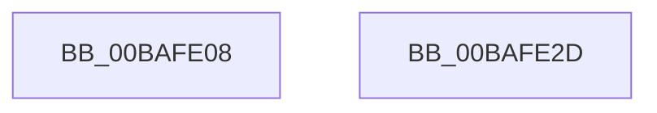

# VfDeleteLookasideTree

- RVA: `0x00BAFE08`–`0x00BAFE2E` (길이 `38` bytes)
- VA: `0x0000000140BAFE08`
- 실행 섹션: `PAGEVRFY`
- PDB 이름 있음: `예`; PDB Function 태그: `아니요`
- unwind 정보 RVA: `0x0005C788`
- 디코드: `10`개 명령, `38/38` bytes 표시
- 미해석 바이트: `0` (있으면 어셈블리에 `.byte`로 보존)

> 이 문서는 커널 이미지의 기계어와 PDB 기호를 분석해 생성했습니다. 4번과 5번은 함수 원형과 자료형을 바이너리 사용 방식에서 추정한 C 해석이며 원본 소스 복구 결과는 아닙니다.

## 1. Dependencies

- 직접 호출 지점: **1**; 고유 호출 대상: **1**
- 직접 호출자로 확인된 함수: **1**
- RIP 상대 이미지 참조: **3**

### Outgoing calls
- `0x00BAFE13` → [VfAvlDeleteAllTreeNodes](../B9/VfAvlDeleteAllTreeNodes_function_00B93B9C.md) (function, `0x00B93B9C`)

### Direct callers
- [VfMiscPluginUnload](../../text/61/VfMiscPluginUnload_function_00617050.md) at `0x00617070`

### Static image references
- `0x00BAFE0C` → RVA `0x00FFDCB0` (`PAGEVRFD`; read)
- `0x00BAFE1C` → RVA `0x00FFDA84` (`PAGEVRFD`; read/write)
- `0x00BAFE22` → RVA `0x00FFDA88` (`PAGEVRFD`; read/write)

## 2. Other-region calls and transfers

- 다른 실행 섹션으로 향하는 call: **0**
- 별도 외부 분기/꼬리 이동을 확인하지 못했습니다.

## 3. Assembly (complete function range)

```asm
00BAFE08  48 83 EC 28                     sub rsp, 0x28
00BAFE0C  48 8B 0D 9D DE 44 00            mov rcx, qword ptr [rip + 0x44de9d]
00BAFE13  E8 84 3D FE FF                  call 0x140b93b9c
00BAFE18  33 C9                           xor ecx, ecx
00BAFE1A  8B C1                           mov eax, ecx
00BAFE1C  87 05 62 DC 44 00               xchg dword ptr [rip + 0x44dc62], eax
00BAFE22  87 0D 60 DC 44 00               xchg dword ptr [rip + 0x44dc60], ecx
00BAFE28  48 83 C4 28                     add rsp, 0x28
00BAFE2C  C3                              ret
00BAFE2D  CC                              int3
```

## 4. C-style interpretation (structured pseudocode)

```c
__int64 __fastcall VfDeleteLookasideTree(void)
{
    __int64 result;
    __int64 v_rsp;

    v_rsp = (v_rsp) - (40);
    result = VfAvlDeleteAllTreeNodes(*(unsigned __int64 *)(v_rip + 4513437), a2, a3, a4);
    a1 = 0;
    v_rsp = (v_rsp) + (40);
    return 0;
}
```

## 5. (Beta) C Style

```c
void VfDeleteLookasideTree(void)
{
    int64_t result;
    int64_t local_rsp;

    local_rsp = (local_rsp) - (40);
    result = VfAvlDeleteAllTreeNodes(*(uint64_t *)(v_rip + 0x44DE9D), a2, a3, a4);
    a1 = 0;
    local_rsp = (local_rsp) + (40);
    return 0;
}
```

## 6. Execution-region graph

[열기: 2D/3D 그래프와 함수 탐색 컨트롤 패널](../../../control-panel.html?section=pagevrfy&rva=0x00BAFE08&view=graph)

- 2D 그래프는 위에서 아래로 흐르고, 3D 그래프는 빈 공간을 드래그해 회전합니다. Shift+드래그는 이동, 휠은 확대·축소, 함수 노드 선택은 대상 보고서 이동입니다.

### Static fallback


