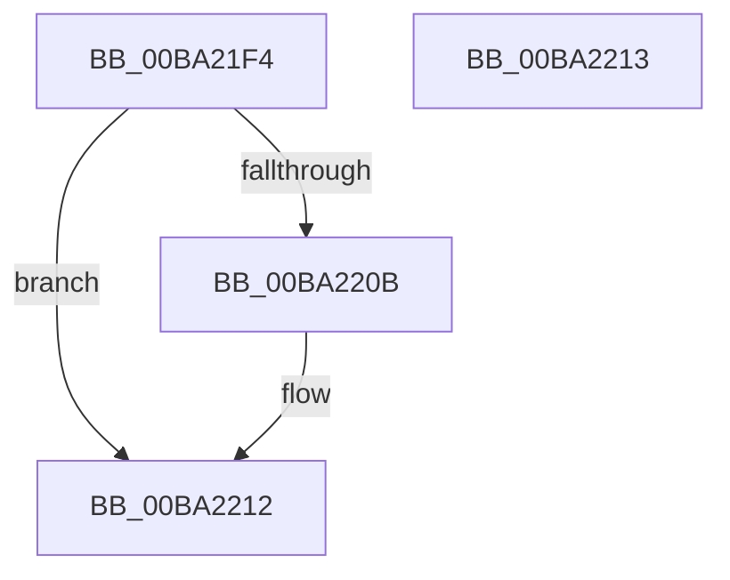

# VfDevObjAdjustFdoForVerifierFilters

- RVA: `0x00BA21F4`–`0x00BA2214` (길이 `32` bytes)
- VA: `0x0000000140BA21F4`
- 실행 섹션: `PAGEVRFY`
- PDB 이름 있음: `예`; PDB Function 태그: `아니요`
- unwind 정보 RVA: `0x000DB714`
- 디코드: `9`개 명령, `32/32` bytes 표시
- 미해석 바이트: `0` (있으면 어셈블리에 `.byte`로 보존)

> 이 문서는 커널 이미지의 기계어와 PDB 기호를 분석해 생성했습니다. 4번과 5번은 함수 원형과 자료형을 바이너리 사용 방식에서 추정한 C 해석이며 원본 소스 복구 결과는 아닙니다.

## 1. Dependencies

- 직접 호출 지점: **0**; 고유 호출 대상: **0**
- 직접 호출자로 확인된 함수: **1**
- RIP 상대 이미지 참조: **1**

### Outgoing calls
- 직접 디코드된 call 명령이 없습니다.

### Direct callers
- [IovUtilMarkStack](../../text/4B/IovUtilMarkStack_function_004B7734.md) at `0x004B778A`

### Static image references
- `0x00BA21F7` → RVA `0x00BAD0A0` (`ViFilterDispatchPnp`; read)

## 2. Other-region calls and transfers

- 다른 실행 섹션으로 향하는 call: **0**
- 별도 외부 분기/꼬리 이동을 확인하지 못했습니다.

## 3. Assembly (complete function range)

```asm
00BA21F4  48 8B 11                        mov rdx, qword ptr [rcx]
00BA21F7  4C 8D 05 A2 AE 00 00            lea r8, [rip + 0xaea2]
00BA21FE  48 8B 42 08                     mov rax, qword ptr [rdx + 8]
00BA2202  4C 39 80 48 01 00 00            cmp qword ptr [rax + 0x148], r8
00BA2209  75 07                           jne 0x140ba2212
00BA220B  48 8B 42 18                     mov rax, qword ptr [rdx + 0x18]
00BA220F  48 89 01                        mov qword ptr [rcx], rax
00BA2212  C3                              ret
00BA2213  CC                              int3
```

## 4. C-style interpretation (structured pseudocode)

```c
__int64 __fastcall VfDevObjAdjustFdoForVerifierFilters(__int64 a1)
{
    __int64 result;

    result = *(unsigned __int64 *)(*(unsigned __int64 *)(a1) + 8);
    if ((*(unsigned __int64 *)(*(unsigned __int64 *)(*(unsigned __int64 *)(a1) + 8) + 328)) == (v_rip + 44706)) {
        result = *(unsigned __int64 *)(*(unsigned __int64 *)(a1) + 24);
        *(unsigned __int64 *)(a1) = result;
    }
    return result;
}
```

## 5. (Beta) C Style

```c
int64_t VfDevObjAdjustFdoForVerifierFilters(void *Arg1)
{
    uint8_t *arg1 = (uint8_t *)Arg1;

    int64_t result;

    result = *(uint64_t *)(*(uint64_t *)(arg1) + 0x8);
    if ((*(uint64_t *)(*(uint64_t *)(*(uint64_t *)(arg1) + 0x8) + 0x148)) == (v_rip + 44706)) {
        result = *(uint64_t *)(*(uint64_t *)(arg1) + 0x18);
        *(uint64_t *)(arg1) = result;
    }
    return result;
}
```

### 관측된 메모리 오프셋

구조체 형식이 확인되지 않은 접근은 인자 기준의 오프셋으로만 기록했습니다.

| 기준 인자 | 오프셋 표현 | 폭 (bit) | 접근 |
|---|---:|---:|---|
| `Arg1` | `+ 0x0` | `64` | `R` |
| `Arg1` | `+ 0x0` | `64` | `W` |

## 6. Execution-region graph

[열기: 2D/3D 그래프와 함수 탐색 컨트롤 패널](../../../control-panel.html?section=pagevrfy&rva=0x00BA21F4&view=graph)

- 2D 그래프는 위에서 아래로 흐르고, 3D 그래프는 빈 공간을 드래그해 회전합니다. Shift+드래그는 이동, 휠은 확대·축소, 함수 노드 선택은 대상 보고서 이동입니다.

### Static fallback


