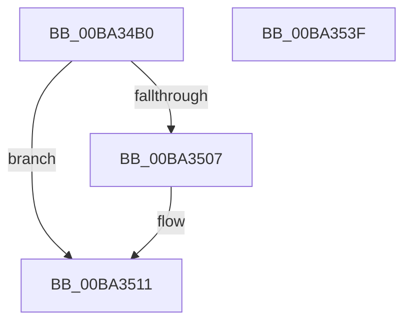

# VfErrorReport7

- RVA: `0x00BA34B0`–`0x00BA3540` (길이 `144` bytes)
- VA: `0x0000000140BA34B0`
- 실행 섹션: `PAGEVRFY`
- PDB 이름 있음: `예`; PDB Function 태그: `아니요`
- unwind 정보 RVA: `0x000A8988`
- 디코드: `37`개 명령, `144/144` bytes 표시
- 미해석 바이트: `0` (있으면 어셈블리에 `.byte`로 보존)

> 이 문서는 커널 이미지의 기계어와 PDB 기호를 분석해 생성했습니다. 4번과 5번은 함수 원형과 자료형을 바이너리 사용 방식에서 추정한 C 해석이며 원본 소스 복구 결과는 아닙니다.

## 1. Dependencies

- 직접 호출 지점: **5**; 고유 호출 대상: **5**
- 직접 호출자로 확인된 함수: **1**
- RIP 상대 이미지 참조: **2**

### Outgoing calls
- `0x00BA34DB` → [ViErrorDisplayDescription](ViErrorDisplayDescription_function_00BA361C.md) (function, `0x00BA361C`)
- `0x00BA34FE` → [RtlStringCbPrintfA](../../text/53/RtlStringCbPrintfA_function_0053BC0C.md) (function, `0x0053BC0C`)
- `0x00BA350C` → [VfUtilDbgPrint](../../text/61/VfUtilDbgPrint_function_006122AC.md) (function, `0x006122AC`)
- `0x00BA351F` → [ViErrorFinishReport](ViErrorFinishReport_function_00BA366C.md) (function, `0x00BA366C`)
- `0x00BA352F` → [_security_check_cookie](../../text/6A/_security_check_cookie_function_006AC640.md) (function, `0x006AC640`)

### Direct callers
- [PpvUtilFailDriver](../../text/5A/PpvUtilFailDriver_function_005AA498.md) at `0x005AA4C6`

### Static image references
- `0x00BA34BB` → RVA `0x00E0A740` (`.data`; read)
- `0x00BA34E8` → RVA `0x006CE740` (` ?? ::FNODOBFM::`string'`; read)

## 2. Other-region calls and transfers

- 다른 실행 섹션으로 향하는 call: **3**
  - `0x00BA34FE` → [RtlStringCbPrintfA](../../text/53/RtlStringCbPrintfA_function_0053BC0C.md) (`PAGEVRFY` → `.text`)
  - `0x00BA350C` → [VfUtilDbgPrint](../../text/61/VfUtilDbgPrint_function_006122AC.md) (`PAGEVRFY` → `.text`)
  - `0x00BA352F` → [_security_check_cookie](../../text/6A/_security_check_cookie_function_006AC640.md) (`PAGEVRFY` → `.text`)
- 별도 외부 분기/꼬리 이동을 확인하지 못했습니다.

## 3. Assembly (complete function range)

```asm
00BA34B0  40 53                           push rbx
00BA34B2  56                              push rsi
00BA34B3  57                              push rdi
00BA34B4  48 81 EC B0 00 00 00            sub rsp, 0xb0
00BA34BB  48 8B 05 7E 72 26 00            mov rax, qword ptr [rip + 0x26727e]
00BA34C2  48 33 C4                        xor rax, rsp
00BA34C5  48 89 84 24 A0 00 00 00         mov qword ptr [rsp + 0xa0], rax
00BA34CD  B9 49 02 00 00                  mov ecx, 0x249
00BA34D2  49 8B F1                        mov rsi, r9
00BA34D5  49 8B F8                        mov rdi, r8
00BA34D8  48 8B DA                        mov rbx, rdx
00BA34DB  E8 3C 01 00 00                  call 0x140ba361c
00BA34E0  4C 8B CB                        mov r9, rbx
00BA34E3  48 89 74 24 28                  mov qword ptr [rsp + 0x28], rsi
00BA34E8  4C 8D 05 51 B2 B2 FF            lea r8, [rip - 0x4d4daf]
00BA34EF  48 89 7C 24 20                  mov qword ptr [rsp + 0x20], rdi
00BA34F4  BA 6E 00 00 00                  mov edx, 0x6e
00BA34F9  48 8D 4C 24 30                  lea rcx, [rsp + 0x30]
00BA34FE  E8 09 87 99 FF                  call 0x14053bc0c
00BA3503  85 C0                           test eax, eax
00BA3505  78 0A                           js 0x140ba3511
00BA3507  48 8D 4C 24 30                  lea rcx, [rsp + 0x30]
00BA350C  E8 9B ED A6 FF                  call 0x1406122ac
00BA3511  4C 8B CE                        mov r9, rsi
00BA3514  4C 8B C7                        mov r8, rdi
00BA3517  48 8B D3                        mov rdx, rbx
00BA351A  B9 49 02 00 00                  mov ecx, 0x249
00BA351F  E8 48 01 00 00                  call 0x140ba366c
00BA3524  48 8B 8C 24 A0 00 00 00         mov rcx, qword ptr [rsp + 0xa0]
00BA352C  48 33 CC                        xor rcx, rsp
00BA352F  E8 0C 91 B0 FF                  call 0x1406ac640
00BA3534  48 81 C4 B0 00 00 00            add rsp, 0xb0
00BA353B  5F                              pop rdi
00BA353C  5E                              pop rsi
00BA353D  5B                              pop rbx
00BA353E  C3                              ret
00BA353F  CC                              int3
```

## 4. C-style interpretation (structured pseudocode)

```c
__int64 __fastcall VfErrorReport7(__int64 a1, __int64 a2, __int64 a3, __int64 a4)
{
    __int64 result;
    __int64 v_rsp;
    unsigned __int64 v_stack_m28;
    unsigned __int64 v_stack_m98;
    unsigned __int64 v_stack_mA0;
    unsigned __int64 v_stack_mA8;

    v_rsp = (v_rsp) - (176);
    result = (*(unsigned __int64 *)(v_rip + 2519678)) ^ (v_rsp);
    v_stack_m28 = result;
    result = ViErrorDisplayDescription(585, a2, a3, a4);
    v_stack_mA0 = a4;
    v_stack_mA8 = a3;
    result = RtlStringCbPrintfA(v_stack_m98, 110, v_rip - 5066159, a2);
    if (!(sign_flag)) {
        a1 = v_stack_m98;
        result = VfUtilDbgPrint(a1, 110, v_rip - 5066159, a2);
    }
    result = ViErrorFinishReport(585, a2, a3, a4);
    a1 = (v_stack_m28) ^ (v_rsp);
    result = _security_check_cookie(a1, a2, a3, a4);
    v_rsp = (v_rsp) + (176);
    return result;
}
```

## 5. (Beta) C Style

```c
int64_t VfErrorReport7(int64_t Arg1, int64_t Arg2, int64_t Arg3, int64_t Arg4)
{
    int64_t result;
    int64_t local_rsp;
    uint64_t v_stack_m28;
    uint64_t v_stack_m98;
    uint64_t v_stack_mA0;
    uint64_t v_stack_mA8;

    local_rsp = (local_rsp) - (176);
    result = (*(uint64_t *)(v_rip + 0x26727E)) ^ (local_rsp);
    v_stack_m28 = result;
    result = ViErrorDisplayDescription(585, Arg2, Arg3, Arg4);
    v_stack_mA0 = Arg4;
    v_stack_mA8 = Arg3;
    result = RtlStringCbPrintfA(v_stack_m98, 110, v_rip - 5066159, Arg2);
    if (!(sign_flag)) {
        Arg1 = v_stack_m98;
        result = VfUtilDbgPrint(Arg1, 110, v_rip - 5066159, Arg2);
    }
    result = ViErrorFinishReport(585, Arg2, Arg3, Arg4);
    Arg1 = (v_stack_m28) ^ (local_rsp);
    result = _security_check_cookie(Arg1, Arg2, Arg3, Arg4);
    local_rsp = (local_rsp) + (176);
    return result;
}
```

## 6. Execution-region graph

[열기: 2D/3D 그래프와 함수 탐색 컨트롤 패널](../../../control-panel.html?section=pagevrfy&rva=0x00BA34B0&view=graph)

- 2D 그래프는 위에서 아래로 흐르고, 3D 그래프는 빈 공간을 드래그해 회전합니다. Shift+드래그는 이동, 휠은 확대·축소, 함수 노드 선택은 대상 보고서 이동입니다.

### Static fallback


