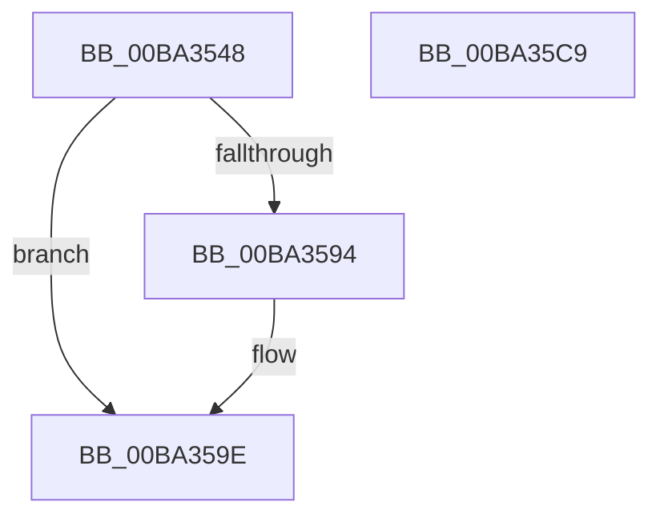

# VfErrorReport8

- RVA: `0x00BA3548`–`0x00BA35CA` (길이 `130` bytes)
- VA: `0x0000000140BA3548`
- 실행 섹션: `PAGEVRFY`
- PDB 이름 있음: `예`; PDB Function 태그: `아니요`
- unwind 정보 RVA: `0x000C5160`
- 디코드: `35`개 명령, `130/130` bytes 표시
- 미해석 바이트: `0` (있으면 어셈블리에 `.byte`로 보존)

> 이 문서는 커널 이미지의 기계어와 PDB 기호를 분석해 생성했습니다. 4번과 5번은 함수 원형과 자료형을 바이너리 사용 방식에서 추정한 C 해석이며 원본 소스 복구 결과는 아닙니다.

## 1. Dependencies

- 직접 호출 지점: **5**; 고유 호출 대상: **5**
- 직접 호출자로 확인된 함수: **1**
- RIP 상대 이미지 참조: **2**

### Outgoing calls
- `0x00BA356D` → [ViErrorDisplayDescription](ViErrorDisplayDescription_function_00BA361C.md) (function, `0x00BA361C`)
- `0x00BA358B` → [RtlStringCbPrintfA](../../text/53/RtlStringCbPrintfA_function_0053BC0C.md) (function, `0x0053BC0C`)
- `0x00BA3599` → [VfUtilDbgPrint](../../text/61/VfUtilDbgPrint_function_006122AC.md) (function, `0x006122AC`)
- `0x00BA35A9` → [ViErrorFinishReport](ViErrorFinishReport_function_00BA366C.md) (function, `0x00BA366C`)
- `0x00BA35B9` → [_security_check_cookie](../../text/6A/_security_check_cookie_function_006AC640.md) (function, `0x006AC640`)

### Direct callers
- [PpvUtilFailDriver](../../text/5A/PpvUtilFailDriver_function_005AA498.md) at `0x005AA4BF`

### Static image references
- `0x00BA3553` → RVA `0x00E0A740` (`.data`; read)
- `0x00BA357A` → RVA `0x006CE710` (` ?? ::FNODOBFM::`string'`; read)

## 2. Other-region calls and transfers

- 다른 실행 섹션으로 향하는 call: **3**
  - `0x00BA358B` → [RtlStringCbPrintfA](../../text/53/RtlStringCbPrintfA_function_0053BC0C.md) (`PAGEVRFY` → `.text`)
  - `0x00BA3599` → [VfUtilDbgPrint](../../text/61/VfUtilDbgPrint_function_006122AC.md) (`PAGEVRFY` → `.text`)
  - `0x00BA35B9` → [_security_check_cookie](../../text/6A/_security_check_cookie_function_006AC640.md) (`PAGEVRFY` → `.text`)
- 별도 외부 분기/꼬리 이동을 확인하지 못했습니다.

## 3. Assembly (complete function range)

```asm
00BA3548  40 53                           push rbx
00BA354A  56                              push rsi
00BA354B  57                              push rdi
00BA354C  48 81 EC 90 00 00 00            sub rsp, 0x90
00BA3553  48 8B 05 E6 71 26 00            mov rax, qword ptr [rip + 0x2671e6]
00BA355A  48 33 C4                        xor rax, rsp
00BA355D  48 89 84 24 80 00 00 00         mov qword ptr [rsp + 0x80], rax
00BA3565  49 8B F0                        mov rsi, r8
00BA3568  48 8B FA                        mov rdi, rdx
00BA356B  8B D9                           mov ebx, ecx
00BA356D  E8 AA 00 00 00                  call 0x140ba361c
00BA3572  4C 8B CF                        mov r9, rdi
00BA3575  48 89 74 24 20                  mov qword ptr [rsp + 0x20], rsi
00BA357A  4C 8D 05 8F B1 B2 FF            lea r8, [rip - 0x4d4e71]
00BA3581  BA 49 00 00 00                  mov edx, 0x49
00BA3586  48 8D 4C 24 30                  lea rcx, [rsp + 0x30]
00BA358B  E8 7C 86 99 FF                  call 0x14053bc0c
00BA3590  85 C0                           test eax, eax
00BA3592  78 0A                           js 0x140ba359e
00BA3594  48 8D 4C 24 30                  lea rcx, [rsp + 0x30]
00BA3599  E8 0E ED A6 FF                  call 0x1406122ac
00BA359E  45 33 C9                        xor r9d, r9d
00BA35A1  4C 8B C6                        mov r8, rsi
00BA35A4  48 8B D7                        mov rdx, rdi
00BA35A7  8B CB                           mov ecx, ebx
00BA35A9  E8 BE 00 00 00                  call 0x140ba366c
00BA35AE  48 8B 8C 24 80 00 00 00         mov rcx, qword ptr [rsp + 0x80]
00BA35B6  48 33 CC                        xor rcx, rsp
00BA35B9  E8 82 90 B0 FF                  call 0x1406ac640
00BA35BE  48 81 C4 90 00 00 00            add rsp, 0x90
00BA35C5  5F                              pop rdi
00BA35C6  5E                              pop rsi
00BA35C7  5B                              pop rbx
00BA35C8  C3                              ret
00BA35C9  CC                              int3
```

## 4. C-style interpretation (structured pseudocode)

```c
__int64 __fastcall VfErrorReport8(int a1, __int64 a2, __int64 a3)
{
    __int64 result;
    __int64 v_rsp;
    unsigned __int64 v_stack_m28;
    unsigned __int64 v_stack_m78;
    unsigned __int64 v_stack_m88;

    v_rsp = (v_rsp) - (144);
    result = (*(unsigned __int64 *)(v_rip + 2519526)) ^ (v_rsp);
    v_stack_m28 = result;
    result = ViErrorDisplayDescription(a1, a2, a3, a4);
    v_stack_m88 = a3;
    result = RtlStringCbPrintfA(v_stack_m78, 73, v_rip - 5066353, a2);
    if (!(sign_flag)) {
        a1 = v_stack_m78;
        result = VfUtilDbgPrint(a1, 73, v_rip - 5066353, a2);
    }
    a4 = 0;
    result = ViErrorFinishReport((unsigned int)((unsigned int)((unsigned int)(a1))), a2, a3, a4);
    a1 = (v_stack_m28) ^ (v_rsp);
    result = _security_check_cookie(a1, a2, a3, a4);
    v_rsp = (v_rsp) + (144);
    return result;
}
```

## 5. (Beta) C Style

```c
int64_t VfErrorReport8(int32_t Arg1, int64_t Arg2, int64_t Arg3)
{
    int64_t result;
    int64_t local_rsp;
    uint64_t v_stack_m28;
    uint64_t v_stack_m78;
    uint64_t v_stack_m88;

    local_rsp = (local_rsp) - (144);
    result = (*(uint64_t *)(v_rip + 0x2671E6)) ^ (local_rsp);
    v_stack_m28 = result;
    result = ViErrorDisplayDescription(Arg1, Arg2, Arg3, a4);
    v_stack_m88 = Arg3;
    result = RtlStringCbPrintfA(v_stack_m78, 73, v_rip - 5066353, Arg2);
    if (!(sign_flag)) {
        Arg1 = v_stack_m78;
        result = VfUtilDbgPrint(Arg1, 73, v_rip - 5066353, Arg2);
    }
    a4 = 0;
    result = ViErrorFinishReport((uint32_t)((uint32_t)((uint32_t)(Arg1))), Arg2, Arg3, a4);
    Arg1 = (v_stack_m28) ^ (local_rsp);
    result = _security_check_cookie(Arg1, Arg2, Arg3, a4);
    local_rsp = (local_rsp) + (144);
    return result;
}
```

## 6. Execution-region graph

[열기: 2D/3D 그래프와 함수 탐색 컨트롤 패널](../../../control-panel.html?section=pagevrfy&rva=0x00BA3548&view=graph)

- 2D 그래프는 위에서 아래로 흐르고, 3D 그래프는 빈 공간을 드래그해 회전합니다. Shift+드래그는 이동, 휠은 확대·축소, 함수 노드 선택은 대상 보고서 이동입니다.

### Static fallback


