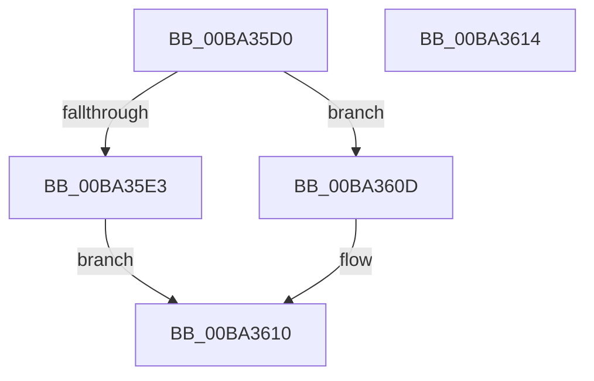

# VfErrorStoreTriageInformation

- RVA: `0x00BA35D0`–`0x00BA3615` (길이 `69` bytes)
- VA: `0x0000000140BA35D0`
- 실행 섹션: `PAGEVRFY`
- PDB 이름 있음: `예`; PDB Function 태그: `아니요`
- unwind 정보 RVA: `0x000DB714`
- 디코드: `16`개 명령, `69/69` bytes 표시
- 미해석 바이트: `0` (있으면 어셈블리에 `.byte`로 보존)

> 이 문서는 커널 이미지의 기계어와 PDB 기호를 분석해 생성했습니다. 4번과 5번은 함수 원형과 자료형을 바이너리 사용 방식에서 추정한 C 해석이며 원본 소스 복구 결과는 아닙니다.

## 1. Dependencies

- 직접 호출 지점: **0**; 고유 호출 대상: **0**
- 직접 호출자로 확인된 함수: **3**
- RIP 상대 이미지 참조: **6**

### Outgoing calls
- 직접 디코드된 call 명령이 없습니다.

### Direct callers
- [VfReportIssueWithOptions](../../text/61/VfReportIssueWithOptions_function_00614444.md) at `0x00614526`
- [ViErrorFinishReport](ViErrorFinishReport_function_00BA366C.md) at `0x00BA36D5`
- [ViCtxCheckAndReleaseIsrState](../BB/ViCtxCheckAndReleaseIsrState_function_00BB1F40.md) at `0x00BB2004`

### Static image references
- `0x00BA35D9` → RVA `0x00FFDB58` (`PAGEVRFD`; read/write)
- `0x00BA35E8` → RVA `0x00FFEFB0` (`PAGEVRFD`; write)
- `0x00BA35EF` → RVA `0x00FFEFB8` (`PAGEVRFD`; write)
- `0x00BA35F6` → RVA `0x00FFEFC0` (`PAGEVRFD`; write)
- `0x00BA35FD` → RVA `0x00FFEFC8` (`PAGEVRFD`; write)
- `0x00BA3604` → RVA `0x00FFEFD0` (`PAGEVRFD`; write)

## 2. Other-region calls and transfers

- 다른 실행 섹션으로 향하는 call: **0**
- 별도 외부 분기/꼬리 이동을 확인하지 못했습니다.

## 3. Assembly (complete function range)

```asm
00BA35D0  41 BA 01 00 00 00               mov r10d, 1
00BA35D6  41 8B C2                        mov eax, r10d
00BA35D9  87 05 79 A5 45 00               xchg dword ptr [rip + 0x45a579], eax
00BA35DF  85 C0                           test eax, eax
00BA35E1  75 2A                           jne 0x140ba360d
00BA35E3  48 8B 44 24 28                  mov rax, qword ptr [rsp + 0x28]
00BA35E8  48 89 0D C1 B9 45 00            mov qword ptr [rip + 0x45b9c1], rcx
00BA35EF  48 89 15 C2 B9 45 00            mov qword ptr [rip + 0x45b9c2], rdx
00BA35F6  4C 89 05 C3 B9 45 00            mov qword ptr [rip + 0x45b9c3], r8
00BA35FD  4C 89 0D C4 B9 45 00            mov qword ptr [rip + 0x45b9c4], r9
00BA3604  48 89 05 C5 B9 45 00            mov qword ptr [rip + 0x45b9c5], rax
00BA360B  EB 03                           jmp 0x140ba3610
00BA360D  45 33 D2                        xor r10d, r10d
00BA3610  41 8B C2                        mov eax, r10d
00BA3613  C3                              ret
00BA3614  CC                              int3
```

## 4. C-style interpretation (structured pseudocode)

```c
__int64 __fastcall VfErrorStoreTriageInformation(__int64 a1, __int64 a2, __int64 a3, __int64 a4, __int64 a5)
{
    __int64 v_r10;

    if (1 != 0) goto loc_00BA360D;
    *(unsigned __int64 *)(v_rip + 4569537) = a1;
    *(unsigned __int64 *)(v_rip + 4569538) = a2;
    *(unsigned __int64 *)(v_rip + 4569539) = a3;
    *(unsigned __int64 *)(v_rip + 4569540) = a4;
    *(unsigned __int64 *)(v_rip + 4569541) = a5;
    goto loc_00BA3610;
loc_00BA360D:
    v_r10 = 0;
loc_00BA3610:
    return 0;
}
```

## 5. (Beta) C Style

```c
int64_t VfErrorStoreTriageInformation(int64_t Arg1, int64_t Arg2, int64_t Arg3, int64_t Arg4, int64_t Arg5)
{
    int64_t local_r10;

    if (1 != 0) goto loc_00BA360D;
    *(uint64_t *)(v_rip + 0x45B9C1) = Arg1;
    *(uint64_t *)(v_rip + 0x45B9C2) = Arg2;
    *(uint64_t *)(v_rip + 0x45B9C3) = Arg3;
    *(uint64_t *)(v_rip + 0x45B9C4) = Arg4;
    *(uint64_t *)(v_rip + 0x45B9C5) = Arg5;
    goto loc_00BA3610;
loc_00BA360D:
    local_r10 = 0;
loc_00BA3610:
    return 0;
}
```

## 6. Execution-region graph

[열기: 2D/3D 그래프와 함수 탐색 컨트롤 패널](../../../control-panel.html?section=pagevrfy&rva=0x00BA35D0&view=graph)

- 2D 그래프는 위에서 아래로 흐르고, 3D 그래프는 빈 공간을 드래그해 회전합니다. Shift+드래그는 이동, 휠은 확대·축소, 함수 노드 선택은 대상 보고서 이동입니다.

### Static fallback


