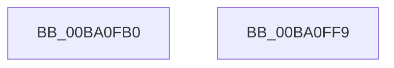

# VfExAllocPoolInternal

- RVA: `0x00BA0FB0`–`0x00BA0FFA` (길이 `74` bytes)
- VA: `0x0000000140BA0FB0`
- 실행 섹션: `PAGEVRFY`
- PDB 이름 있음: `예`; PDB Function 태그: `아니요`
- unwind 정보 RVA: `0x0005CC98`
- 디코드: `15`개 명령, `74/74` bytes 표시
- 미해석 바이트: `0` (있으면 어셈블리에 `.byte`로 보존)

> 이 문서는 커널 이미지의 기계어와 PDB 기호를 분석해 생성했습니다. 4번과 5번은 함수 원형과 자료형을 바이너리 사용 방식에서 추정한 C 해석이며 원본 소스 복구 결과는 아닙니다.

## 1. Dependencies

- 직접 호출 지점: **1**; 고유 호출 대상: **1**
- 직접 호출자로 확인된 함수: **0**
- RIP 상대 이미지 참조: **0**

### Outgoing calls
- `0x00BA0FEF` → [guard_dispatch_icall](../../text/6B/guard_dispatch_icall_function_006BAAD0.md) (function, `0x006BAAD0`)

### Direct callers
- 이 함수 시작 RVA로 연결되는 직접 call은 확인되지 않았습니다. 간접 호출은 완전히 역산할 수 없습니다.

### Static image references
- 디코드된 RIP-relative 메모리 참조가 없습니다.

## 2. Other-region calls and transfers

- 다른 실행 섹션으로 향하는 call: **1**
  - `0x00BA0FEF` → [guard_dispatch_icall](../../text/6B/guard_dispatch_icall_function_006BAAD0.md) (`PAGEVRFY` → `.text`)
- 별도 외부 분기/꼬리 이동을 확인하지 못했습니다.

## 3. Assembly (complete function range)

```asm
00BA0FB0  48 8B C4                        mov rax, rsp
00BA0FB3  48 83 EC 58                     sub rsp, 0x58
00BA0FB7  4C 8B 94 24 98 00 00 00         mov r10, qword ptr [rsp + 0x98]
00BA0FBF  4C 89 50 E0                     mov qword ptr [rax - 0x20], r10
00BA0FC3  44 8B 94 24 90 00 00 00         mov r10d, dword ptr [rsp + 0x90]
00BA0FCB  44 89 50 D8                     mov dword ptr [rax - 0x28], r10d
00BA0FCF  4C 8B 94 24 88 00 00 00         mov r10, qword ptr [rsp + 0x88]
00BA0FD7  4C 89 50 D0                     mov qword ptr [rax - 0x30], r10
00BA0FDB  44 8B 94 24 80 00 00 00         mov r10d, dword ptr [rsp + 0x80]
00BA0FE3  44 89 50 C8                     mov dword ptr [rax - 0x38], r10d
00BA0FE7  48 8B 84 24 A0 00 00 00         mov rax, qword ptr [rsp + 0xa0]
00BA0FEF  E8 DC 9A B1 FF                  call 0x1406baad0
00BA0FF4  48 83 C4 58                     add rsp, 0x58
00BA0FF8  C3                              ret
00BA0FF9  CC                              int3
```

## 4. C-style interpretation (structured pseudocode)

```c
__int64 __fastcall VfExAllocPoolInternal(__int64 a1, __int64 a2, __int64 a3, __int64 a4, unsigned int a5, __int64 a6, unsigned int a7, __int64 a8, __int64 a9)
{
    __int64 result;
    __int64 v_rsp;

    v_rsp = (v_rsp) - (88);
    *(unsigned __int64 *)(v_rsp - 32) = a8;
    *(unsigned int *)(v_rsp - 40) = (unsigned int)((unsigned int)(a7));
    *(unsigned __int64 *)(v_rsp - 48) = a6;
    *(unsigned int *)(v_rsp - 56) = (unsigned int)((unsigned int)(a5));
    result = guard_dispatch_icall(a1, a2, a3, a4);
    v_rsp = (v_rsp) + (88);
    return result;
}
```

## 5. (Beta) C Style

```c
int64_t VfExAllocPoolInternal(int64_t Arg1, int64_t Arg2, int64_t Arg3, int64_t Arg4, uint32_t Arg5, int64_t Arg6, uint32_t Arg7, int64_t Arg8, int64_t Arg9)
{
    int64_t result;
    int64_t local_rsp;

    local_rsp = (local_rsp) - (88);
    *(uint64_t *)(local_rsp - 0x20) = Arg8;
    *(uint32_t *)(local_rsp - 0x28) = (uint32_t)((uint32_t)(Arg7));
    *(uint64_t *)(local_rsp - 0x30) = Arg6;
    *(uint32_t *)(local_rsp - 0x38) = (uint32_t)((uint32_t)(Arg5));
    result = guard_dispatch_icall(Arg1, Arg2, Arg3, Arg4);
    local_rsp = (local_rsp) + (88);
    return result;
}
```

## 6. Execution-region graph

[열기: 2D/3D 그래프와 함수 탐색 컨트롤 패널](../../../control-panel.html?section=pagevrfy&rva=0x00BA0FB0&view=graph)

- 2D 그래프는 위에서 아래로 흐르고, 3D 그래프는 빈 공간을 드래그해 회전합니다. Shift+드래그는 이동, 휠은 확대·축소, 함수 노드 선택은 대상 보고서 이동입니다.

### Static fallback


