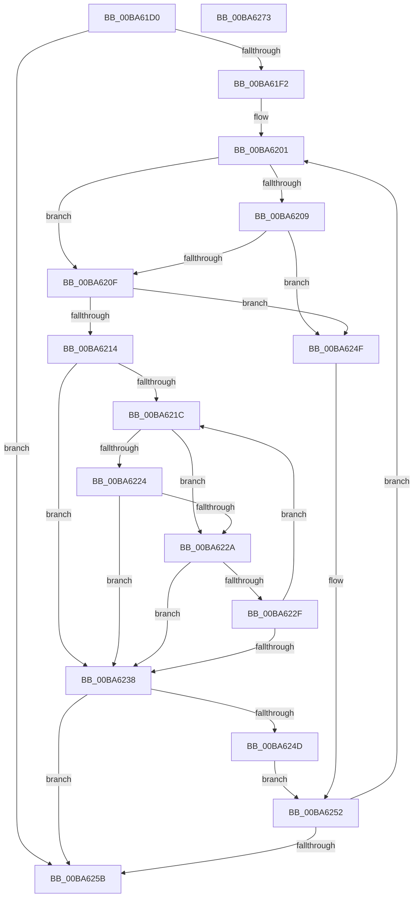

# VfFaultsAddAllApps

- RVA: `0x00BA61D0`–`0x00BA6274` (길이 `164` bytes)
- VA: `0x0000000140BA61D0`
- 실행 섹션: `PAGEVRFY`
- PDB 이름 있음: `예`; PDB Function 태그: `아니요`
- unwind 정보 RVA: `0x0005C954`
- 디코드: `52`개 명령, `164/164` bytes 표시
- 미해석 바이트: `0` (있으면 어셈블리에 `.byte`로 보존)

> 이 문서는 커널 이미지의 기계어와 PDB 기호를 분석해 생성했습니다. 4번과 5번은 함수 원형과 자료형을 바이너리 사용 방식에서 추정한 C 해석이며 원본 소스 복구 결과는 아닙니다.

## 1. Dependencies

- 직접 호출 지점: **1**; 고유 호출 대상: **1**
- 직접 호출자로 확인된 함수: **3**
- RIP 상대 이미지 참조: **0**

### Outgoing calls
- `0x00BA6241` → [ViFaultsAddAppNoDuplicates](ViFaultsAddAppNoDuplicates_function_00BA69E8.md) (function, `0x00BA69E8`)

### Direct callers
- [VfRlrsVolatileConfigUpdate](../../text/61/VfRlrsVolatileConfigUpdate_function_006174C4.md) at `0x00617544`
- [VfFaultsInitPhase0](VfFaultsInitPhase0_function_00BA6328.md) at `0x00BA643D`
- [VfFaultsSetParameters](VfFaultsSetParameters_function_00BA67E4.md) at `0x00BA6883`

### Static image references
- 디코드된 RIP-relative 메모리 참조가 없습니다.

## 2. Other-region calls and transfers

- 다른 실행 섹션으로 향하는 call: **0**
- 별도 외부 분기/꼬리 이동을 확인하지 못했습니다.

## 3. Assembly (complete function range)

```asm
00BA61D0  48 89 5C 24 08                  mov qword ptr [rsp + 8], rbx
00BA61D5  48 89 6C 24 10                  mov qword ptr [rsp + 0x10], rbp
00BA61DA  48 89 74 24 18                  mov qword ptr [rsp + 0x18], rsi
00BA61DF  57                              push rdi
00BA61E0  48 83 EC 20                     sub rsp, 0x20
00BA61E4  8B C2                           mov eax, edx
00BA61E6  45 33 C0                        xor r8d, r8d
00BA61E9  48 8D 3C 41                     lea rdi, [rcx + rax*2]
00BA61ED  48 3B CF                        cmp rcx, rdi
00BA61F0  73 69                           jae 0x140ba625b
00BA61F2  48 BD 01 26 00 00 01 00 00 00   movabs rbp, 0x100002601
00BA61FC  BE 00 30 00 00                  mov esi, 0x3000
00BA6201  0F B7 11                        movzx edx, word ptr [rcx]
00BA6204  83 FA 20                        cmp edx, 0x20
00BA6207  77 06                           ja 0x140ba620f
00BA6209  48 0F A3 D5                     bt rbp, rdx
00BA620D  72 40                           jb 0x140ba624f
00BA620F  66 3B D6                        cmp dx, si
00BA6212  74 3B                           je 0x140ba624f
00BA6214  48 8B D9                        mov rbx, rcx
00BA6217  48 3B CF                        cmp rcx, rdi
00BA621A  73 1C                           jae 0x140ba6238
00BA621C  0F B7 13                        movzx edx, word ptr [rbx]
00BA621F  83 FA 20                        cmp edx, 0x20
00BA6222  77 06                           ja 0x140ba622a
00BA6224  48 0F A3 D5                     bt rbp, rdx
00BA6228  72 0E                           jb 0x140ba6238
00BA622A  66 3B D6                        cmp dx, si
00BA622D  74 09                           je 0x140ba6238
00BA622F  48 83 C3 02                     add rbx, 2
00BA6233  48 3B DF                        cmp rbx, rdi
00BA6236  72 E4                           jb 0x140ba621c
00BA6238  48 8B D3                        mov rdx, rbx
00BA623B  48 2B D1                        sub rdx, rcx
00BA623E  48 D1 FA                        sar rdx, 1
00BA6241  E8 A2 07 00 00                  call 0x140ba69e8
00BA6246  44 8B C0                        mov r8d, eax
00BA6249  85 C0                           test eax, eax
00BA624B  78 0E                           js 0x140ba625b
00BA624D  EB 03                           jmp 0x140ba6252
00BA624F  48 8B D9                        mov rbx, rcx
00BA6252  48 8D 4B 02                     lea rcx, [rbx + 2]
00BA6256  48 3B CF                        cmp rcx, rdi
00BA6259  72 A6                           jb 0x140ba6201
00BA625B  48 8B 5C 24 30                  mov rbx, qword ptr [rsp + 0x30]
00BA6260  41 8B C0                        mov eax, r8d
00BA6263  48 8B 6C 24 38                  mov rbp, qword ptr [rsp + 0x38]
00BA6268  48 8B 74 24 40                  mov rsi, qword ptr [rsp + 0x40]
00BA626D  48 83 C4 20                     add rsp, 0x20
00BA6271  5F                              pop rdi
00BA6272  C3                              ret
00BA6273  CC                              int3
```

## 4. C-style interpretation (structured pseudocode)

```c
__int64 __fastcall VfFaultsAddAllApps(__int64 a1, int a2, int a3)
{
    __int64 result;
    __int64 v_rbx;
    __int64 v_rsp;
    unsigned __int64 v_stack_p10;
    unsigned __int64 v_stack_p18;
    unsigned __int64 v_stack_p8;

    v_stack_p8 = v_rbx;
    v_stack_p10 = v_rbp;
    v_stack_p18 = v_rsi;
    v_rsp = (v_rsp) - (32);
    a3 = 0;
    if (a1 >= (a1 + (unsigned int)(a2) * 2)) goto loc_00BA625B;
loc_00BA6201:
    if (((unsigned int)(*(unsigned __int16 *)(a1))) > 32) goto loc_00BA620F;
    if (((unsigned int)(*(unsigned __int16 *)(a1))) < 32) goto loc_00BA624F;
loc_00BA620F:
    if (((unsigned __int16)(*(unsigned __int16 *)(a1))) == ((unsigned __int16)((unsigned int)(0x3000ULL)))) goto loc_00BA624F;
    if (a1 >= (a1 + (unsigned int)(a2) * 2)) goto loc_00BA6238;
loc_00BA621C:
    if (((unsigned int)(*(unsigned __int16 *)(a1))) > 32) goto loc_00BA622A;
    if (((unsigned int)(*(unsigned __int16 *)(a1))) < 32) goto loc_00BA6238;
loc_00BA622A:
    if (((unsigned __int16)(*(unsigned __int16 *)(a1))) == ((unsigned __int16)((unsigned int)(0x3000ULL)))) goto loc_00BA6238;
    v_rbx = (a1) + (2);
    if (v_rbx < (a1 + (unsigned int)(a2) * 2)) goto loc_00BA621C;
loc_00BA6238:
    a2 = (v_rbx) - (a1);
    a2 = (a2) >> (1);
    result = ViFaultsAddAppNoDuplicates(a1, a2, a3, a4);
    if (sign_flag) goto loc_00BA625B;
    goto loc_00BA6252;
loc_00BA624F:
loc_00BA6252:
    if ((a1 + 2) < (a1 + (unsigned int)(a2) * 2)) goto loc_00BA6201;
loc_00BA625B:
    v_rsp = (v_rsp) + (32);
    return (unsigned int)((unsigned int)((unsigned int)((unsigned int)(result))));
}
```

## 5. (Beta) C Style

```c
int64_t VfFaultsAddAllApps(void *Arg1, int32_t Arg2, int32_t Arg3)
{
    uint8_t *arg1 = (uint8_t *)Arg1;

    int64_t result;
    int64_t local_rbx;
    int64_t local_rsp;
    uint64_t v_stack_p10;
    uint64_t v_stack_p18;
    uint64_t v_stack_p8;

    v_stack_p8 = local_rbx;
    v_stack_p10 = local_rbp;
    v_stack_p18 = local_rsi;
    local_rsp = (local_rsp) - (32);
    Arg3 = 0;
    if (Arg1 >= (Arg1 + (uint32_t)(Arg2) * 2)) goto loc_00BA625B;
loc_00BA6201:
    if (((uint32_t)(*(uint16_t *)(arg1))) > 32) goto loc_00BA620F;
    if (((uint32_t)(*(uint16_t *)(arg1))) < 32) goto loc_00BA624F;
loc_00BA620F:
    if (((uint16_t)(*(uint16_t *)(arg1))) == ((uint16_t)((uint32_t)(0x3000ULL)))) goto loc_00BA624F;
    if (Arg1 >= (Arg1 + (uint32_t)(Arg2) * 2)) goto loc_00BA6238;
loc_00BA621C:
    if (((uint32_t)(*(uint16_t *)(arg1))) > 32) goto loc_00BA622A;
    if (((uint32_t)(*(uint16_t *)(arg1))) < 32) goto loc_00BA6238;
loc_00BA622A:
    if (((uint16_t)(*(uint16_t *)(arg1))) == ((uint16_t)((uint32_t)(0x3000ULL)))) goto loc_00BA6238;
    local_rbx = (Arg1) + (2);
    if (local_rbx < (Arg1 + (uint32_t)(Arg2) * 2)) goto loc_00BA621C;
loc_00BA6238:
    Arg2 = (local_rbx) - (Arg1);
    Arg2 = (Arg2) >> (1);
    result = ViFaultsAddAppNoDuplicates(Arg1, Arg2, Arg3, a4);
    if (sign_flag) goto loc_00BA625B;
    goto loc_00BA6252;
loc_00BA624F:
loc_00BA6252:
    if ((Arg1 + 2) < (Arg1 + (uint32_t)(Arg2) * 2)) goto loc_00BA6201;
loc_00BA625B:
    local_rsp = (local_rsp) + (32);
    return (uint32_t)((uint32_t)((uint32_t)((uint32_t)(result))));
}
```

### 관측된 메모리 오프셋

구조체 형식이 확인되지 않은 접근은 인자 기준의 오프셋으로만 기록했습니다.

| 기준 인자 | 오프셋 표현 | 폭 (bit) | 접근 |
|---|---:|---:|---|
| `Arg1` | `+ 0x0 + rax*2` | `64` | `R` |

## 6. Execution-region graph

[열기: 2D/3D 그래프와 함수 탐색 컨트롤 패널](../../../control-panel.html?section=pagevrfy&rva=0x00BA61D0&view=graph)

- 2D 그래프는 위에서 아래로 흐르고, 3D 그래프는 빈 공간을 드래그해 회전합니다. Shift+드래그는 이동, 휠은 확대·축소, 함수 노드 선택은 대상 보고서 이동입니다.

### Static fallback


