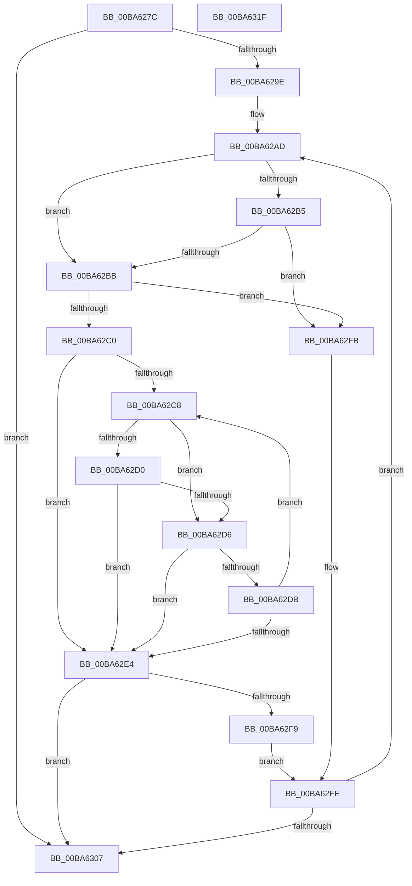

# VfFaultsAddAllTags

- RVA: `0x00BA627C`–`0x00BA6320` (길이 `164` bytes)
- VA: `0x0000000140BA627C`
- 실행 섹션: `PAGEVRFY`
- PDB 이름 있음: `예`; PDB Function 태그: `아니요`
- unwind 정보 RVA: `0x0005C954`
- 디코드: `52`개 명령, `164/164` bytes 표시
- 미해석 바이트: `0` (있으면 어셈블리에 `.byte`로 보존)

> 이 문서는 커널 이미지의 기계어와 PDB 기호를 분석해 생성했습니다. 4번과 5번은 함수 원형과 자료형을 바이너리 사용 방식에서 추정한 C 해석이며 원본 소스 복구 결과는 아닙니다.

## 1. Dependencies

- 직접 호출 지점: **1**; 고유 호출 대상: **1**
- 직접 호출자로 확인된 함수: **3**
- RIP 상대 이미지 참조: **0**

### Outgoing calls
- `0x00BA62ED` → [ViFaultsAddTagNoDuplicates](ViFaultsAddTagNoDuplicates_function_00BA6AE4.md) (function, `0x00BA6AE4`)

### Direct callers
- [VfRlrsVolatileConfigUpdate](../../text/61/VfRlrsVolatileConfigUpdate_function_006174C4.md) at `0x00617560`
- [VfFaultsInitPhase0](VfFaultsInitPhase0_function_00BA6328.md) at `0x00BA63E6`
- [VfFaultsSetParameters](VfFaultsSetParameters_function_00BA67E4.md) at `0x00BA689F`

### Static image references
- 디코드된 RIP-relative 메모리 참조가 없습니다.

## 2. Other-region calls and transfers

- 다른 실행 섹션으로 향하는 call: **0**
- 별도 외부 분기/꼬리 이동을 확인하지 못했습니다.

## 3. Assembly (complete function range)

```asm
00BA627C  48 89 5C 24 08                  mov qword ptr [rsp + 8], rbx
00BA6281  48 89 6C 24 10                  mov qword ptr [rsp + 0x10], rbp
00BA6286  48 89 74 24 18                  mov qword ptr [rsp + 0x18], rsi
00BA628B  57                              push rdi
00BA628C  48 83 EC 20                     sub rsp, 0x20
00BA6290  8B C2                           mov eax, edx
00BA6292  45 33 C0                        xor r8d, r8d
00BA6295  48 8D 3C 41                     lea rdi, [rcx + rax*2]
00BA6299  48 3B CF                        cmp rcx, rdi
00BA629C  73 69                           jae 0x140ba6307
00BA629E  48 BD 01 26 00 00 01 00 00 00   movabs rbp, 0x100002601
00BA62A8  BE 00 30 00 00                  mov esi, 0x3000
00BA62AD  0F B7 11                        movzx edx, word ptr [rcx]
00BA62B0  83 FA 20                        cmp edx, 0x20
00BA62B3  77 06                           ja 0x140ba62bb
00BA62B5  48 0F A3 D5                     bt rbp, rdx
00BA62B9  72 40                           jb 0x140ba62fb
00BA62BB  66 3B D6                        cmp dx, si
00BA62BE  74 3B                           je 0x140ba62fb
00BA62C0  48 8B D9                        mov rbx, rcx
00BA62C3  48 3B CF                        cmp rcx, rdi
00BA62C6  73 1C                           jae 0x140ba62e4
00BA62C8  0F B7 13                        movzx edx, word ptr [rbx]
00BA62CB  83 FA 20                        cmp edx, 0x20
00BA62CE  77 06                           ja 0x140ba62d6
00BA62D0  48 0F A3 D5                     bt rbp, rdx
00BA62D4  72 0E                           jb 0x140ba62e4
00BA62D6  66 3B D6                        cmp dx, si
00BA62D9  74 09                           je 0x140ba62e4
00BA62DB  48 83 C3 02                     add rbx, 2
00BA62DF  48 3B DF                        cmp rbx, rdi
00BA62E2  72 E4                           jb 0x140ba62c8
00BA62E4  48 8B D3                        mov rdx, rbx
00BA62E7  48 2B D1                        sub rdx, rcx
00BA62EA  48 D1 FA                        sar rdx, 1
00BA62ED  E8 F2 07 00 00                  call 0x140ba6ae4
00BA62F2  44 8B C0                        mov r8d, eax
00BA62F5  85 C0                           test eax, eax
00BA62F7  78 0E                           js 0x140ba6307
00BA62F9  EB 03                           jmp 0x140ba62fe
00BA62FB  48 8B D9                        mov rbx, rcx
00BA62FE  48 8D 4B 02                     lea rcx, [rbx + 2]
00BA6302  48 3B CF                        cmp rcx, rdi
00BA6305  72 A6                           jb 0x140ba62ad
00BA6307  48 8B 5C 24 30                  mov rbx, qword ptr [rsp + 0x30]
00BA630C  41 8B C0                        mov eax, r8d
00BA630F  48 8B 6C 24 38                  mov rbp, qword ptr [rsp + 0x38]
00BA6314  48 8B 74 24 40                  mov rsi, qword ptr [rsp + 0x40]
00BA6319  48 83 C4 20                     add rsp, 0x20
00BA631D  5F                              pop rdi
00BA631E  C3                              ret
00BA631F  CC                              int3
```

## 4. C-style interpretation (structured pseudocode)

```c
__int64 __fastcall VfFaultsAddAllTags(__int64 a1, int a2, int a3)
{
    __int64 result;
    __int64 v_rbx;
    __int64 v_rsp;
    unsigned __int64 v_stack_p10;
    unsigned __int64 v_stack_p18;
    unsigned __int64 v_stack_p8;

    v_stack_p8 = v_rbx;
    v_stack_p10 = v_rbp;
    v_stack_p18 = v_rsi;
    v_rsp = (v_rsp) - (32);
    a3 = 0;
    if (a1 >= (a1 + (unsigned int)(a2) * 2)) goto loc_00BA6307;
loc_00BA62AD:
    if (((unsigned int)(*(unsigned __int16 *)(a1))) > 32) goto loc_00BA62BB;
    if (((unsigned int)(*(unsigned __int16 *)(a1))) < 32) goto loc_00BA62FB;
loc_00BA62BB:
    if (((unsigned __int16)(*(unsigned __int16 *)(a1))) == ((unsigned __int16)((unsigned int)(0x3000ULL)))) goto loc_00BA62FB;
    if (a1 >= (a1 + (unsigned int)(a2) * 2)) goto loc_00BA62E4;
loc_00BA62C8:
    if (((unsigned int)(*(unsigned __int16 *)(a1))) > 32) goto loc_00BA62D6;
    if (((unsigned int)(*(unsigned __int16 *)(a1))) < 32) goto loc_00BA62E4;
loc_00BA62D6:
    if (((unsigned __int16)(*(unsigned __int16 *)(a1))) == ((unsigned __int16)((unsigned int)(0x3000ULL)))) goto loc_00BA62E4;
    v_rbx = (a1) + (2);
    if (v_rbx < (a1 + (unsigned int)(a2) * 2)) goto loc_00BA62C8;
loc_00BA62E4:
    a2 = (v_rbx) - (a1);
    a2 = (a2) >> (1);
    result = ViFaultsAddTagNoDuplicates(a1, a2, a3, a4);
    if (sign_flag) goto loc_00BA6307;
    goto loc_00BA62FE;
loc_00BA62FB:
loc_00BA62FE:
    if ((a1 + 2) < (a1 + (unsigned int)(a2) * 2)) goto loc_00BA62AD;
loc_00BA6307:
    v_rsp = (v_rsp) + (32);
    return (unsigned int)((unsigned int)((unsigned int)((unsigned int)(result))));
}
```

## 5. (Beta) C Style

```c
int64_t VfFaultsAddAllTags(void *Arg1, int32_t Arg2, int32_t Arg3)
{
    uint8_t *arg1 = (uint8_t *)Arg1;

    int64_t result;
    int64_t local_rbx;
    int64_t local_rsp;
    uint64_t v_stack_p10;
    uint64_t v_stack_p18;
    uint64_t v_stack_p8;

    v_stack_p8 = local_rbx;
    v_stack_p10 = local_rbp;
    v_stack_p18 = local_rsi;
    local_rsp = (local_rsp) - (32);
    Arg3 = 0;
    if (Arg1 >= (Arg1 + (uint32_t)(Arg2) * 2)) goto loc_00BA6307;
loc_00BA62AD:
    if (((uint32_t)(*(uint16_t *)(arg1))) > 32) goto loc_00BA62BB;
    if (((uint32_t)(*(uint16_t *)(arg1))) < 32) goto loc_00BA62FB;
loc_00BA62BB:
    if (((uint16_t)(*(uint16_t *)(arg1))) == ((uint16_t)((uint32_t)(0x3000ULL)))) goto loc_00BA62FB;
    if (Arg1 >= (Arg1 + (uint32_t)(Arg2) * 2)) goto loc_00BA62E4;
loc_00BA62C8:
    if (((uint32_t)(*(uint16_t *)(arg1))) > 32) goto loc_00BA62D6;
    if (((uint32_t)(*(uint16_t *)(arg1))) < 32) goto loc_00BA62E4;
loc_00BA62D6:
    if (((uint16_t)(*(uint16_t *)(arg1))) == ((uint16_t)((uint32_t)(0x3000ULL)))) goto loc_00BA62E4;
    local_rbx = (Arg1) + (2);
    if (local_rbx < (Arg1 + (uint32_t)(Arg2) * 2)) goto loc_00BA62C8;
loc_00BA62E4:
    Arg2 = (local_rbx) - (Arg1);
    Arg2 = (Arg2) >> (1);
    result = ViFaultsAddTagNoDuplicates(Arg1, Arg2, Arg3, a4);
    if (sign_flag) goto loc_00BA6307;
    goto loc_00BA62FE;
loc_00BA62FB:
loc_00BA62FE:
    if ((Arg1 + 2) < (Arg1 + (uint32_t)(Arg2) * 2)) goto loc_00BA62AD;
loc_00BA6307:
    local_rsp = (local_rsp) + (32);
    return (uint32_t)((uint32_t)((uint32_t)((uint32_t)(result))));
}
```

### 관측된 메모리 오프셋

구조체 형식이 확인되지 않은 접근은 인자 기준의 오프셋으로만 기록했습니다.

| 기준 인자 | 오프셋 표현 | 폭 (bit) | 접근 |
|---|---:|---:|---|
| `Arg1` | `+ 0x0 + rax*2` | `64` | `R` |

## 6. Execution-region graph

[열기: 2D/3D 그래프와 함수 탐색 컨트롤 패널](../../../control-panel.html?section=pagevrfy&rva=0x00BA627C&view=graph)

- 2D 그래프는 위에서 아래로 흐르고, 3D 그래프는 빈 공간을 드래그해 회전합니다. Shift+드래그는 이동, 휠은 확대·축소, 함수 노드 선택은 대상 보고서 이동입니다.

### Static fallback


