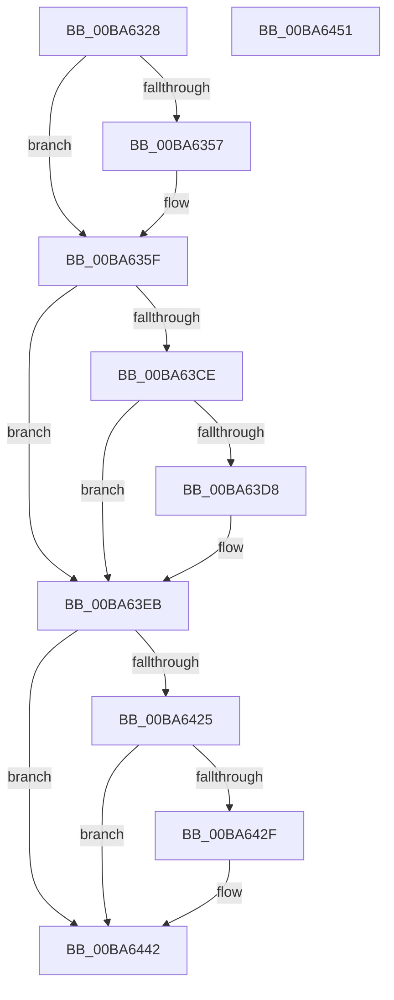

# VfFaultsInitPhase0

- RVA: `0x00BA6328`–`0x00BA6452` (길이 `298` bytes)
- VA: `0x0000000140BA6328`
- 실행 섹션: `PAGEVRFY`
- PDB 이름 있음: `예`; PDB Function 태그: `아니요`
- unwind 정보 RVA: `0x0005D2F4`
- 디코드: `60`개 명령, `298/298` bytes 표시
- 미해석 바이트: `0` (있으면 어셈블리에 `.byte`로 보존)

> 이 문서는 커널 이미지의 기계어와 PDB 기호를 분석해 생성했습니다. 4번과 5번은 함수 원형과 자료형을 바이너리 사용 방식에서 추정한 C 해석이며 원본 소스 복구 결과는 아닙니다.

## 1. Dependencies

- 직접 호출 지점: **7**; 고유 호출 대상: **5**
- 직접 호출자로 확인된 함수: **2**
- RIP 상대 이미지 참조: **20**

### Outgoing calls
- `0x00BA6381` → [ExAllocatePool3](../../poolcode/B8/ExAllocatePool3_function_00B84270.md) (function, `0x00B84270`)
- `0x00BA6394` → [KeAcquireSpinLockRaiseToDpc](../../text/20/KeAcquireSpinLockRaiseToDpc_function_00208470.md) (function, `0x00208470`)
- `0x00BA63BE` → [KeReleaseSpinLock](../../text/39/KeReleaseSpinLock_function_00392BA0.md) (function, `0x00392BA0`)
- `0x00BA63E6` → [VfFaultsAddAllTags](VfFaultsAddAllTags_function_00BA627C.md) (function, `0x00BA627C`)
- `0x00BA63F2` → [KeAcquireSpinLockRaiseToDpc](../../text/20/KeAcquireSpinLockRaiseToDpc_function_00208470.md) (function, `0x00208470`)
- `0x00BA6415` → [KeReleaseSpinLock](../../text/39/KeReleaseSpinLock_function_00392BA0.md) (function, `0x00392BA0`)
- `0x00BA643D` → [VfFaultsAddAllApps](VfFaultsAddAllApps_function_00BA61D0.md) (function, `0x00BA61D0`)

### Direct callers
- [VfRlrsEntry](../../text/61/VfRlrsEntry_function_00617090.md) at `0x00617484`
- [VfInitSystemNoRebootNeeded](../B9/VfInitSystemNoRebootNeeded_function_00B93970.md) at `0x00B93A6A`

### Static image references
- `0x00BA632C` → RVA `0x00E0E940` (`.data`; read)
- `0x00BA6332` → RVA `0x00F044C8` (`.data`; read/write)
- `0x00BA6341` → RVA `0x00FF4020` (`PAGEVRFD`; read)
- `0x00BA6347` → RVA `0x00FFDC68` (`PAGEVRFD`; write)
- `0x00BA6359` → RVA `0x00FF4020` (`PAGEVRFD`; write)
- `0x00BA636F` → RVA `0x00E681B0` (`.data`; read)
- `0x00BA6386` → RVA `0x00F044C8` (`.data`; read)
- `0x00BA638D` → RVA `0x00FFDB18` (`PAGEVRFD`; write)
- `0x00BA6399` → RVA `0x00F044F0` (`.data`; read/write)
- `0x00BA63A0` → RVA `0x00F044E0` (`.data`; read)
- `0x00BA63A7` → RVA `0x00F044E8` (`.data`; write)
- `0x00BA63B0` → RVA `0x00F044E0` (`.data`; write)
- `0x00BA63C3` → RVA `0x00E0E954` (`.data`; read)
- `0x00BA63DF` → RVA `0x00F043C0` (`.data`; read)
- `0x00BA63F7` → RVA `0x00F043A0` (`.data`; read)
- `0x00BA63FE` → RVA `0x00F043A8` (`.data`; write)
- `0x00BA640C` → RVA `0x00F043A0` (`.data`; write)
- `0x00BA641A` → RVA `0x00E0E958` (`.data`; read)
- `0x00BA6436` → RVA `0x00F04500` (`.data`; read)
- `0x00BA6442` → RVA `0x00FFDAB0` (`PAGEVRFD`; write)

## 2. Other-region calls and transfers

- 다른 실행 섹션으로 향하는 call: **5**
  - `0x00BA6381` → [ExAllocatePool3](../../poolcode/B8/ExAllocatePool3_function_00B84270.md) (`PAGEVRFY` → `POOLCODE`)
  - `0x00BA6394` → [KeAcquireSpinLockRaiseToDpc](../../text/20/KeAcquireSpinLockRaiseToDpc_function_00208470.md) (`PAGEVRFY` → `.text`)
  - `0x00BA63BE` → [KeReleaseSpinLock](../../text/39/KeReleaseSpinLock_function_00392BA0.md) (`PAGEVRFY` → `.text`)
  - `0x00BA63F2` → [KeAcquireSpinLockRaiseToDpc](../../text/20/KeAcquireSpinLockRaiseToDpc_function_00208470.md) (`PAGEVRFY` → `.text`)
  - `0x00BA6415` → [KeReleaseSpinLock](../../text/39/KeReleaseSpinLock_function_00392BA0.md) (`PAGEVRFY` → `.text`)
- 별도 외부 분기/꼬리 이동을 확인하지 못했습니다.

## 3. Assembly (complete function range)

```asm
00BA6328  48 83 EC 38                     sub rsp, 0x38
00BA632C  8B 05 0E 86 26 00               mov eax, dword ptr [rip + 0x26860e]
00BA6332  48 83 25 8E E1 35 00 00         and qword ptr [rip + 0x35e18e], 0
00BA633A  48 69 C8 60 EA 00 00            imul rcx, rax, 0xea60
00BA6341  8B 05 D9 DC 44 00               mov eax, dword ptr [rip + 0x44dcd9]
00BA6347  48 89 0D 1A 79 45 00            mov qword ptr [rip + 0x45791a], rcx
00BA634E  B9 00 10 10 00                  mov ecx, 0x101000
00BA6353  3B C1                           cmp eax, ecx
00BA6355  76 08                           jbe 0x140ba635f
00BA6357  8B C1                           mov eax, ecx
00BA6359  89 05 C1 DC 44 00               mov dword ptr [rip + 0x44dcc1], eax
00BA635F  48 8D 14 C0                     lea rdx, [rax + rax*8]
00BA6363  C7 44 24 20 01 00 00 00         mov dword ptr [rsp + 0x20], 1
00BA636B  48 C1 E2 03                     shl rdx, 3
00BA636F  4C 8D 0D 3A 1E 2C 00            lea r9, [rip + 0x2c1e3a]
00BA6376  B9 40 00 00 00                  mov ecx, 0x40
00BA637B  41 B8 46 6C 74 74               mov r8d, 0x74746c46
00BA6381  E8 EA DE FD FF                  call 0x140b84270
00BA6386  48 8D 0D 3B E1 35 00            lea rcx, [rip + 0x35e13b]
00BA638D  48 89 05 84 77 45 00            mov qword ptr [rip + 0x457784], rax
00BA6394  E8 D7 20 66 FF                  call 0x140208470
00BA6399  83 25 50 E1 35 00 00            and dword ptr [rip + 0x35e150], 0
00BA63A0  48 8D 0D 39 E1 35 00            lea rcx, [rip + 0x35e139]
00BA63A7  48 89 0D 3A E1 35 00            mov qword ptr [rip + 0x35e13a], rcx
00BA63AE  8A D0                           mov dl, al
00BA63B0  48 89 0D 29 E1 35 00            mov qword ptr [rip + 0x35e129], rcx
00BA63B7  48 8D 0D 0A E1 35 00            lea rcx, [rip + 0x35e10a]
00BA63BE  E8 DD C7 7E FF                  call 0x140392ba0
00BA63C3  8B 0D 8B 85 26 00               mov ecx, dword ptr [rip + 0x26858b]
00BA63C9  83 F9 FF                        cmp ecx, -1
00BA63CC  74 1D                           je 0x140ba63eb
00BA63CE  8D 41 FE                        lea eax, [rcx - 2]
00BA63D1  3D FE 00 00 00                  cmp eax, 0xfe
00BA63D6  77 13                           ja 0x140ba63eb
00BA63D8  48 8D 51 FE                     lea rdx, [rcx - 2]
00BA63DC  48 D1 EA                        shr rdx, 1
00BA63DF  48 8D 0D DA DF 35 00            lea rcx, [rip + 0x35dfda]
00BA63E6  E8 91 FE FF FF                  call 0x140ba627c
00BA63EB  48 8D 0D D6 E0 35 00            lea rcx, [rip + 0x35e0d6]
00BA63F2  E8 79 20 66 FF                  call 0x140208470
00BA63F7  48 8D 15 A2 DF 35 00            lea rdx, [rip + 0x35dfa2]
00BA63FE  48 89 15 A3 DF 35 00            mov qword ptr [rip + 0x35dfa3], rdx
00BA6405  48 8D 0D BC E0 35 00            lea rcx, [rip + 0x35e0bc]
00BA640C  48 89 15 8D DF 35 00            mov qword ptr [rip + 0x35df8d], rdx
00BA6413  8A D0                           mov dl, al
00BA6415  E8 86 C7 7E FF                  call 0x140392ba0
00BA641A  8B 0D 38 85 26 00               mov ecx, dword ptr [rip + 0x268538]
00BA6420  83 F9 FF                        cmp ecx, -1
00BA6423  74 1D                           je 0x140ba6442
00BA6425  8D 41 FE                        lea eax, [rcx - 2]
00BA6428  3D FE 00 00 00                  cmp eax, 0xfe
00BA642D  77 13                           ja 0x140ba6442
00BA642F  48 8D 51 FE                     lea rdx, [rcx - 2]
00BA6433  48 D1 EA                        shr rdx, 1
00BA6436  48 8D 0D C3 E0 35 00            lea rcx, [rip + 0x35e0c3]
00BA643D  E8 8E FD FF FF                  call 0x140ba61d0
00BA6442  C7 05 64 76 45 00 01 00 00 00   mov dword ptr [rip + 0x457664], 1
00BA644C  48 83 C4 38                     add rsp, 0x38
00BA6450  C3                              ret
00BA6451  CC                              int3
```

## 4. C-style interpretation (structured pseudocode)

```c
__int64 __fastcall VfFaultsInitPhase0(void)
{
    __int64 result;
    __int64 v_rsp;
    unsigned int v_stack_m18;

    v_rsp = (v_rsp) - (56);
    a1 = (a1) * ((unsigned int)(*(unsigned int *)(v_rip + 2524686)));
    *(unsigned __int64 *)(v_rip + 4552986) = a1;
    result = (unsigned int)(*(unsigned int *)(v_rip + 4512985));
    if (((unsigned int)((unsigned int)(*(unsigned int *)(v_rip + 4512985)))) >= = ((unsigned int)((unsigned int)(0x101000ULL)))) {
        result = (unsigned int)((unsigned int)(0x101000ULL));
        *(unsigned int *)(v_rip + 4512961) = (unsigned int)(result);
    }
    v_stack_m18 = 1;
    a2 = (result + result * 8) << (3);
    result = ExAllocatePool3(64, a2, (unsigned int)(0x74746C46ULL), v_rip + 2891322);
    *(unsigned __int64 *)(v_rip + 4552580) = result;
    result = KeAcquireSpinLockRaiseToDpc(v_rip + 3531067, a2, (unsigned int)(0x74746C46ULL), v_rip + 2891322);
    *(unsigned __int64 *)(v_rip + 3531066) = v_rip + 3531065;
    *(unsigned __int64 *)(v_rip + 3531049) = v_rip + 3531065;
    result = KeReleaseSpinLock(v_rip + 3531018, (unsigned __int8)(result), (unsigned int)(0x74746C46ULL), v_rip + 2891322);
    if (((unsigned int)((unsigned int)(*(unsigned int *)(v_rip + 2524555)))) == -1) goto loc_00BA63EB;
    result = (unsigned int)(*(unsigned int *)(v_rip + 2524555)) - 2;
    if (((unsigned int)((unsigned int)(*(unsigned int *)(v_rip + 2524555)) - 2)) <= 254) {
        a2 = (unsigned int)(*(unsigned int *)(v_rip + 2524555)) - 2;
        a2 = (a2) >> (1);
        a1 = v_rip + 3530714;
        result = VfFaultsAddAllTags(a1, a2, (unsigned int)(0x74746C46ULL), v_rip + 2891322);
    }
    result = KeAcquireSpinLockRaiseToDpc(v_rip + 3530966, a2, (unsigned int)(0x74746C46ULL), v_rip + 2891322);
    *(unsigned __int64 *)(v_rip + 3530659) = v_rip + 3530658;
    *(unsigned __int64 *)(v_rip + 3530637) = v_rip + 3530658;
    result = KeReleaseSpinLock(v_rip + 3530940, (unsigned __int8)(result), (unsigned int)(0x74746C46ULL), v_rip + 2891322);
    if (((unsigned int)((unsigned int)(*(unsigned int *)(v_rip + 2524472)))) == -1) goto loc_00BA6442;
    result = (unsigned int)(*(unsigned int *)(v_rip + 2524472)) - 2;
    if (((unsigned int)((unsigned int)(*(unsigned int *)(v_rip + 2524472)) - 2)) <= 254) {
        a2 = (unsigned int)(*(unsigned int *)(v_rip + 2524472)) - 2;
        a2 = (a2) >> (1);
        a1 = v_rip + 3530947;
        result = VfFaultsAddAllApps(a1, a2, (unsigned int)(0x74746C46ULL), v_rip + 2891322);
    }
    *(unsigned int *)(v_rip + 4552292) = 1;
    v_rsp = (v_rsp) + (56);
    return result;
}
```

## 5. (Beta) C Style

```c
void VfFaultsInitPhase0(void)
{
    int64_t result;
    int64_t local_rsp;
    uint32_t v_stack_m18;

    local_rsp = (local_rsp) - (56);
    a1 = (a1) * ((uint32_t)(*(uint32_t *)(v_rip + 0x26860E)));
    *(uint64_t *)(v_rip + 0x45791A) = a1;
    result = (uint32_t)(*(uint32_t *)(v_rip + 0x44DCD9));
    if (((uint32_t)((uint32_t)(*(uint32_t *)(v_rip + 0x44DCD9)))) >= = ((uint32_t)((uint32_t)(0x101000ULL)))) {
        result = (uint32_t)((uint32_t)(0x101000ULL));
        *(uint32_t *)(v_rip + 0x44DCC1) = (uint32_t)(result);
    }
    v_stack_m18 = 1;
    a2 = (result + result * 8) << (3);
    result = ExAllocatePool3(64, a2, (uint32_t)(0x74746C46ULL), v_rip + 2891322);
    *(uint64_t *)(v_rip + 0x457784) = result;
    result = KeAcquireSpinLockRaiseToDpc(v_rip + 3531067, a2, (uint32_t)(0x74746C46ULL), v_rip + 2891322);
    *(uint64_t *)(v_rip + 0x35E13A) = v_rip + 3531065;
    *(uint64_t *)(v_rip + 0x35E129) = v_rip + 3531065;
    result = KeReleaseSpinLock(v_rip + 3531018, (uint8_t)(result), (uint32_t)(0x74746C46ULL), v_rip + 2891322);
    if (((uint32_t)((uint32_t)(*(uint32_t *)(v_rip + 0x26858B)))) == -1) goto loc_00BA63EB;
    result = (uint32_t)(*(uint32_t *)(v_rip + 0x26858B)) - 2;
    if (((uint32_t)((uint32_t)(*(uint32_t *)(v_rip + 0x26858B)) - 2)) <= 254) {
        a2 = (uint32_t)(*(uint32_t *)(v_rip + 0x26858B)) - 2;
        a2 = (a2) >> (1);
        a1 = v_rip + 3530714;
        result = VfFaultsAddAllTags(a1, a2, (uint32_t)(0x74746C46ULL), v_rip + 2891322);
    }
    result = KeAcquireSpinLockRaiseToDpc(v_rip + 3530966, a2, (uint32_t)(0x74746C46ULL), v_rip + 2891322);
    *(uint64_t *)(v_rip + 0x35DFA3) = v_rip + 3530658;
    *(uint64_t *)(v_rip + 0x35DF8D) = v_rip + 3530658;
    result = KeReleaseSpinLock(v_rip + 3530940, (uint8_t)(result), (uint32_t)(0x74746C46ULL), v_rip + 2891322);
    if (((uint32_t)((uint32_t)(*(uint32_t *)(v_rip + 0x268538)))) == -1) goto loc_00BA6442;
    result = (uint32_t)(*(uint32_t *)(v_rip + 0x268538)) - 2;
    if (((uint32_t)((uint32_t)(*(uint32_t *)(v_rip + 0x268538)) - 2)) <= 254) {
        a2 = (uint32_t)(*(uint32_t *)(v_rip + 0x268538)) - 2;
        a2 = (a2) >> (1);
        a1 = v_rip + 3530947;
        result = VfFaultsAddAllApps(a1, a2, (uint32_t)(0x74746C46ULL), v_rip + 2891322);
    }
    *(uint32_t *)(v_rip + 0x457664) = 1;
    local_rsp = (local_rsp) + (56);
    return result;
}
```

## 6. Execution-region graph

[열기: 2D/3D 그래프와 함수 탐색 컨트롤 패널](../../../control-panel.html?section=pagevrfy&rva=0x00BA6328&view=graph)

- 2D 그래프는 위에서 아래로 흐르고, 3D 그래프는 빈 공간을 드래그해 회전합니다. Shift+드래그는 이동, 휠은 확대·축소, 함수 노드 선택은 대상 보고서 이동입니다.

### Static fallback


