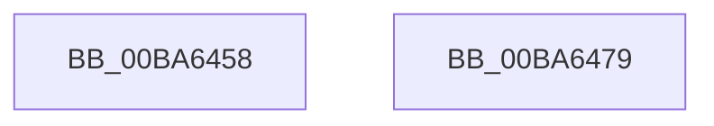

# VfFaultsInitPhase1

- RVA: `0x00BA6458`–`0x00BA647A` (길이 `34` bytes)
- VA: `0x0000000140BA6458`
- 실행 섹션: `PAGEVRFY`
- PDB 이름 있음: `예`; PDB Function 태그: `아니요`
- unwind 정보 RVA: `0x0005C788`
- 디코드: `8`개 명령, `34/34` bytes 표시
- 미해석 바이트: `0` (있으면 어셈블리에 `.byte`로 보존)

> 이 문서는 커널 이미지의 기계어와 PDB 기호를 분석해 생성했습니다. 4번과 5번은 함수 원형과 자료형을 바이너리 사용 방식에서 추정한 C 해석이며 원본 소스 복구 결과는 아닙니다.

## 1. Dependencies

- 직접 호출 지점: **1**; 고유 호출 대상: **1**
- 직접 호출자로 확인된 함수: **2**
- RIP 상대 이미지 참조: **2**

### Outgoing calls
- `0x00BA6465` → [PsSetCreateProcessNotifyRoutine](../../page/78/PsSetCreateProcessNotifyRoutine_function_00787760.md) (function, `0x00787760`)

### Direct callers
- [VfRlrsEntry](../../text/61/VfRlrsEntry_function_00617090.md) at `0x00617492`
- [VerifierInitSystem](../../init/C4/VerifierInitSystem_function_00C4BC84.md) at `0x00C4BCD8`

### Static image references
- `0x00BA645E` → RVA `0x00615F40` (`VfCreateProcessCallback`; read)
- `0x00BA646A` → RVA `0x00FFDA8C` (`PAGEVRFD`; write)

## 2. Other-region calls and transfers

- 다른 실행 섹션으로 향하는 call: **1**
  - `0x00BA6465` → [PsSetCreateProcessNotifyRoutine](../../page/78/PsSetCreateProcessNotifyRoutine_function_00787760.md) (`PAGEVRFY` → `PAGE`)
- 별도 외부 분기/꼬리 이동을 확인하지 못했습니다.

## 3. Assembly (complete function range)

```asm
00BA6458  48 83 EC 28                     sub rsp, 0x28
00BA645C  33 D2                           xor edx, edx
00BA645E  48 8D 0D DB FA A6 FF            lea rcx, [rip - 0x590525]
00BA6465  E8 F6 12 BE FF                  call 0x140787760
00BA646A  C7 05 18 76 45 00 01 00 00 00   mov dword ptr [rip + 0x457618], 1
00BA6474  48 83 C4 28                     add rsp, 0x28
00BA6478  C3                              ret
00BA6479  CC                              int3
```

## 4. C-style interpretation (structured pseudocode)

```c
__int64 __fastcall VfFaultsInitPhase1(__int64 a1, int a2)
{
    __int64 result;
    __int64 v_rsp;

    v_rsp = (v_rsp) - (40);
    a2 = 0;
    result = PsSetCreateProcessNotifyRoutine(v_rip - 5834021, a2, a3, a4);
    *(unsigned int *)(v_rip + 4552216) = 1;
    v_rsp = (v_rsp) + (40);
    return result;
}
```

## 5. (Beta) C Style

```c
int64_t VfFaultsInitPhase1(int64_t Arg1, int32_t Arg2)
{
    int64_t result;
    int64_t local_rsp;

    local_rsp = (local_rsp) - (40);
    Arg2 = 0;
    result = PsSetCreateProcessNotifyRoutine(v_rip - 5834021, Arg2, a3, a4);
    *(uint32_t *)(v_rip + 0x457618) = 1;
    local_rsp = (local_rsp) + (40);
    return result;
}
```

## 6. Execution-region graph

[열기: 2D/3D 그래프와 함수 탐색 컨트롤 패널](../../../control-panel.html?section=pagevrfy&rva=0x00BA6458&view=graph)

- 2D 그래프는 위에서 아래로 흐르고, 3D 그래프는 빈 공간을 드래그해 회전합니다. Shift+드래그는 이동, 휠은 확대·축소, 함수 노드 선택은 대상 보고서 이동입니다.

### Static fallback


