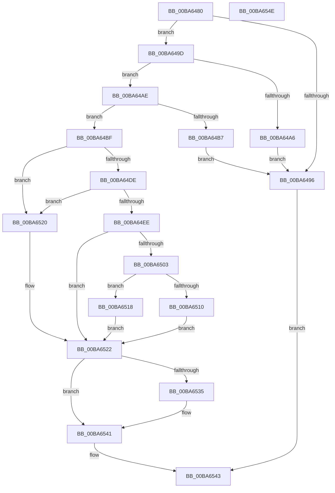

# VfFaultsInjectPoolAllocationFailure

- RVA: `0x00BA6480`–`0x00BA654F` (길이 `207` bytes)
- VA: `0x0000000140BA6480`
- 실행 섹션: `PAGEVRFY`
- PDB 이름 있음: `예`; PDB Function 태그: `아니요`
- unwind 정보 RVA: `0x0005CAAC`
- 디코드: `59`개 명령, `207/207` bytes 표시
- 미해석 바이트: `0` (있으면 어셈블리에 `.byte`로 보존)

> 이 문서는 커널 이미지의 기계어와 PDB 기호를 분석해 생성했습니다. 4번과 5번은 함수 원형과 자료형을 바이너리 사용 방식에서 추정한 C 해석이며 원본 소스 복구 결과는 아닙니다.

## 1. Dependencies

- 직접 호출 지점: **6**; 고유 호출 대상: **5**
- 직접 호출자로 확인된 함수: **5**
- RIP 상대 이미지 참조: **9**

### Outgoing calls
- `0x00BA64C6` → [KeAcquireSpinLockRaiseToDpc](../../text/20/KeAcquireSpinLockRaiseToDpc_function_00208470.md) (function, `0x00208470`)
- `0x00BA64D5` → [ExCheckSingleFilter](../../text/40/ExCheckSingleFilter_function_0040014C.md) (function, `0x0040014C`)
- `0x00BA64E5` → [ExCheckSingleFilter](../../text/40/ExCheckSingleFilter_function_0040014C.md) (function, `0x0040014C`)
- `0x00BA6505` → [ViFaultsIsTagPresentInList](ViFaultsIsTagPresentInList_function_00BA6DE4.md) (function, `0x00BA6DE4`)
- `0x00BA652C` → [KeReleaseSpinLock](../../text/39/KeReleaseSpinLock_function_00392BA0.md) (function, `0x00392BA0`)
- `0x00BA653A` → [VfFaultsInjectResourceFailure](VfFaultsInjectResourceFailure_function_00BA6558.md) (function, `0x00BA6558`)

### Direct callers
- [VerifierExAllocatePool](VerifierExAllocatePool_function_00BA1060.md) at `0x00BA10B0`
- [VerifierExAllocatePool2](VerifierExAllocatePool2_function_00BA1180.md) at `0x00BA1202`
- [VerifierExAllocatePool3](VerifierExAllocatePool3_function_00BA12D0.md) at `0x00BA130C`
- [VerifierExAllocatePoolWithTag](VerifierExAllocatePoolWithTag_function_00BA15B0.md) at `0x00BA1609`
- [VerifierExAllocatePoolWithTagPriority](VerifierExAllocatePoolWithTagPriority_function_00BA16D0.md) at `0x00BA1731`

### Static image references
- `0x00BA648A` → RVA `0x00F04A20` (`.data`; read)
- `0x00BA649D` → RVA `0x00FFDAB0` (`PAGEVRFD`; read)
- `0x00BA64A6` → RVA `0x00FFEF84` (`PAGEVRFD`; read/write)
- `0x00BA64AE` → RVA `0x00FFDB04` (`PAGEVRFD`; read)
- `0x00BA64B7` → RVA `0x00FFEFAC` (`PAGEVRFD`; read/write)
- `0x00BA64BF` → RVA `0x00F044C8` (`.data`; read)
- `0x00BA64F0` → RVA `0x00F044E0` (`.data`; read)
- `0x00BA6510` → RVA `0x00FFEFA4` (`PAGEVRFD`; read/write)
- `0x00BA6518` → RVA `0x00FFEFA8` (`PAGEVRFD`; read/write)

## 2. Other-region calls and transfers

- 다른 실행 섹션으로 향하는 call: **4**
  - `0x00BA64C6` → [KeAcquireSpinLockRaiseToDpc](../../text/20/KeAcquireSpinLockRaiseToDpc_function_00208470.md) (`PAGEVRFY` → `.text`)
  - `0x00BA64D5` → [ExCheckSingleFilter](../../text/40/ExCheckSingleFilter_function_0040014C.md) (`PAGEVRFY` → `.text`)
  - `0x00BA64E5` → [ExCheckSingleFilter](../../text/40/ExCheckSingleFilter_function_0040014C.md) (`PAGEVRFY` → `.text`)
  - `0x00BA652C` → [KeReleaseSpinLock](../../text/39/KeReleaseSpinLock_function_00392BA0.md) (`PAGEVRFY` → `.text`)
- 별도 외부 분기/꼬리 이동을 확인하지 못했습니다.

## 3. Assembly (complete function range)

```asm
00BA6480  48 89 5C 24 08                  mov qword ptr [rsp + 8], rbx
00BA6485  57                              push rdi
00BA6486  48 83 EC 20                     sub rsp, 0x20
00BA648A  8B 05 90 E5 35 00               mov eax, dword ptr [rip + 0x35e590]
00BA6490  8B F9                           mov edi, ecx
00BA6492  A8 04                           test al, 4
00BA6494  75 07                           jne 0x140ba649d
00BA6496  33 C0                           xor eax, eax
00BA6498  E9 A6 00 00 00                  jmp 0x140ba6543
00BA649D  83 3D 0C 76 45 00 00            cmp dword ptr [rip + 0x45760c], 0
00BA64A4  75 08                           jne 0x140ba64ae
00BA64A6  FF 05 D8 8A 45 00               inc dword ptr [rip + 0x458ad8]
00BA64AC  EB E8                           jmp 0x140ba6496
00BA64AE  83 3D 4F 76 45 00 00            cmp dword ptr [rip + 0x45764f], 0
00BA64B5  74 08                           je 0x140ba64bf
00BA64B7  FF 05 EF 8A 45 00               inc dword ptr [rip + 0x458aef]
00BA64BD  EB D7                           jmp 0x140ba6496
00BA64BF  48 8D 0D 02 E0 35 00            lea rcx, [rip + 0x35e002]
00BA64C6  E8 A5 1F 66 FF                  call 0x140208470
00BA64CB  BA 46 4D 76 6A                  mov edx, 0x6a764d46
00BA64D0  8B CF                           mov ecx, edi
00BA64D2  44 8A D8                        mov r11b, al
00BA64D5  E8 72 9C 85 FF                  call 0x14040014c
00BA64DA  85 C0                           test eax, eax
00BA64DC  75 42                           jne 0x140ba6520
00BA64DE  BA 46 4D 76 6C                  mov edx, 0x6c764d46
00BA64E3  8B CF                           mov ecx, edi
00BA64E5  E8 62 9C 85 FF                  call 0x14040014c
00BA64EA  85 C0                           test eax, eax
00BA64EC  75 32                           jne 0x140ba6520
00BA64EE  33 DB                           xor ebx, ebx
00BA64F0  48 8D 0D E9 DF 35 00            lea rcx, [rip + 0x35dfe9]
00BA64F7  48 39 0D E2 DF 35 00            cmp qword ptr [rip + 0x35dfe2], rcx
00BA64FE  0F 94 C3                        sete bl
00BA6501  74 1F                           je 0x140ba6522
00BA6503  8B CF                           mov ecx, edi
00BA6505  E8 DA 08 00 00                  call 0x140ba6de4
00BA650A  8B D8                           mov ebx, eax
00BA650C  85 C0                           test eax, eax
00BA650E  75 08                           jne 0x140ba6518
00BA6510  FF 05 8E 8A 45 00               inc dword ptr [rip + 0x458a8e]
00BA6516  EB 0A                           jmp 0x140ba6522
00BA6518  FF 05 8A 8A 45 00               inc dword ptr [rip + 0x458a8a]
00BA651E  EB 02                           jmp 0x140ba6522
00BA6520  33 DB                           xor ebx, ebx
00BA6522  41 8A D3                        mov dl, r11b
00BA6525  48 8D 0D 9C DF 35 00            lea rcx, [rip + 0x35df9c]
00BA652C  E8 6F C6 7E FF                  call 0x140392ba0
00BA6531  85 DB                           test ebx, ebx
00BA6533  74 0C                           je 0x140ba6541
00BA6535  B9 01 00 00 00                  mov ecx, 1
00BA653A  E8 19 00 00 00                  call 0x140ba6558
00BA653F  8B D8                           mov ebx, eax
00BA6541  8B C3                           mov eax, ebx
00BA6543  48 8B 5C 24 30                  mov rbx, qword ptr [rsp + 0x30]
00BA6548  48 83 C4 20                     add rsp, 0x20
00BA654C  5F                              pop rdi
00BA654D  C3                              ret
00BA654E  CC                              int3
```

## 4. C-style interpretation (structured pseudocode)

```c
__int64 __fastcall VfFaultsInjectPoolAllocationFailure(int a1)
{
    __int64 result;
    __int64 v_rbx;
    __int64 v_rsp;
    unsigned __int64 v_stack_p8;

    v_stack_p8 = v_rbx;
    v_rsp = (v_rsp) - (32);
    if ((((unsigned __int8)((unsigned int)(*(unsigned int *)(v_rip + 3532176)))) & (4)) != 0) goto loc_00BA649D;
loc_00BA6496:
    result = 0;
    goto loc_00BA6543;
loc_00BA649D:
    if ((*(unsigned int *)(v_rip + 4552204)) != 0) goto loc_00BA64AE;
    goto loc_00BA6496;
loc_00BA64AE:
    if ((*(unsigned int *)(v_rip + 4552271)) == 0) goto loc_00BA64BF;
    goto loc_00BA6496;
loc_00BA64BF:
    result = KeAcquireSpinLockRaiseToDpc(v_rip + 3530754, a2, a3, a4);
    result = ExCheckSingleFilter((unsigned int)((unsigned int)((unsigned int)(a1))), (unsigned int)(0x6A764D46ULL), a3, a4);
    if ((unsigned int)(result) != 0) goto loc_00BA6520;
    result = ExCheckSingleFilter((unsigned int)((unsigned int)((unsigned int)(a1))), (unsigned int)(0x6C764D46ULL), a3, a4);
    if ((unsigned int)(result) != 0) goto loc_00BA6520;
    v_rbx = 0;
    v_rbx = ((*(unsigned __int64 *)(v_rip + 3530722)) == (v_rip + 3530729)) ? 1 : 0;
    if ((*(unsigned __int64 *)(v_rip + 3530722)) == (v_rip + 3530729)) goto loc_00BA6522;
    result = ViFaultsIsTagPresentInList((unsigned int)((unsigned int)((unsigned int)(a1))), (unsigned int)(0x6C764D46ULL), a3, a4);
    if ((unsigned int)(result) != 0) goto loc_00BA6518;
    goto loc_00BA6522;
loc_00BA6518:
    goto loc_00BA6522;
loc_00BA6520:
    v_rbx = 0;
loc_00BA6522:
    result = KeReleaseSpinLock(v_rip + 3530652, (unsigned __int8)((unsigned __int8)(result)), a3, a4);
    if (0 != 0) {
        a1 = 1;
        result = VfFaultsInjectResourceFailure(a1, (unsigned __int8)((unsigned __int8)(result)), a3, a4);
        v_rbx = (unsigned int)(result);
    }
loc_00BA6543:
    v_rsp = (v_rsp) + (32);
    return (unsigned int)((unsigned int)(v_rbx));
}
```

## 5. (Beta) C Style

```c
int64_t VfFaultsInjectPoolAllocationFailure(int32_t Arg1)
{
    int64_t result;
    int64_t local_rbx;
    int64_t local_rsp;
    uint64_t v_stack_p8;

    v_stack_p8 = local_rbx;
    local_rsp = (local_rsp) - (32);
    if ((((uint8_t)((uint32_t)(*(uint32_t *)(v_rip + 0x35E590)))) & (4)) != 0) goto loc_00BA649D;
loc_00BA6496:
    result = 0;
    goto loc_00BA6543;
loc_00BA649D:
    if ((*(uint32_t *)(v_rip + 0x45760C)) != 0) goto loc_00BA64AE;
    goto loc_00BA6496;
loc_00BA64AE:
    if ((*(uint32_t *)(v_rip + 0x45764F)) == 0) goto loc_00BA64BF;
    goto loc_00BA6496;
loc_00BA64BF:
    result = KeAcquireSpinLockRaiseToDpc(v_rip + 3530754, a2, a3, a4);
    result = ExCheckSingleFilter((uint32_t)((uint32_t)((uint32_t)(Arg1))), (uint32_t)(0x6A764D46ULL), a3, a4);
    if ((uint32_t)(result) != 0) goto loc_00BA6520;
    result = ExCheckSingleFilter((uint32_t)((uint32_t)((uint32_t)(Arg1))), (uint32_t)(0x6C764D46ULL), a3, a4);
    if ((uint32_t)(result) != 0) goto loc_00BA6520;
    local_rbx = 0;
    local_rbx = ((*(uint64_t *)(v_rip + 0x35DFE2)) == (v_rip + 3530729)) ? 1 : 0;
    if ((*(uint64_t *)(v_rip + 0x35DFE2)) == (v_rip + 3530729)) goto loc_00BA6522;
    result = ViFaultsIsTagPresentInList((uint32_t)((uint32_t)((uint32_t)(Arg1))), (uint32_t)(0x6C764D46ULL), a3, a4);
    if ((uint32_t)(result) != 0) goto loc_00BA6518;
    goto loc_00BA6522;
loc_00BA6518:
    goto loc_00BA6522;
loc_00BA6520:
    local_rbx = 0;
loc_00BA6522:
    result = KeReleaseSpinLock(v_rip + 3530652, (uint8_t)((uint8_t)(result)), a3, a4);
    if (0 != 0) {
        Arg1 = 1;
        result = VfFaultsInjectResourceFailure(Arg1, (uint8_t)((uint8_t)(result)), a3, a4);
        local_rbx = (uint32_t)(result);
    }
loc_00BA6543:
    local_rsp = (local_rsp) + (32);
    return (uint32_t)((uint32_t)(local_rbx));
}
```

## 6. Execution-region graph

[열기: 2D/3D 그래프와 함수 탐색 컨트롤 패널](../../../control-panel.html?section=pagevrfy&rva=0x00BA6480&view=graph)

- 2D 그래프는 위에서 아래로 흐르고, 3D 그래프는 빈 공간을 드래그해 회전합니다. Shift+드래그는 이동, 휠은 확대·축소, 함수 노드 선택은 대상 보고서 이동입니다.

### Static fallback


