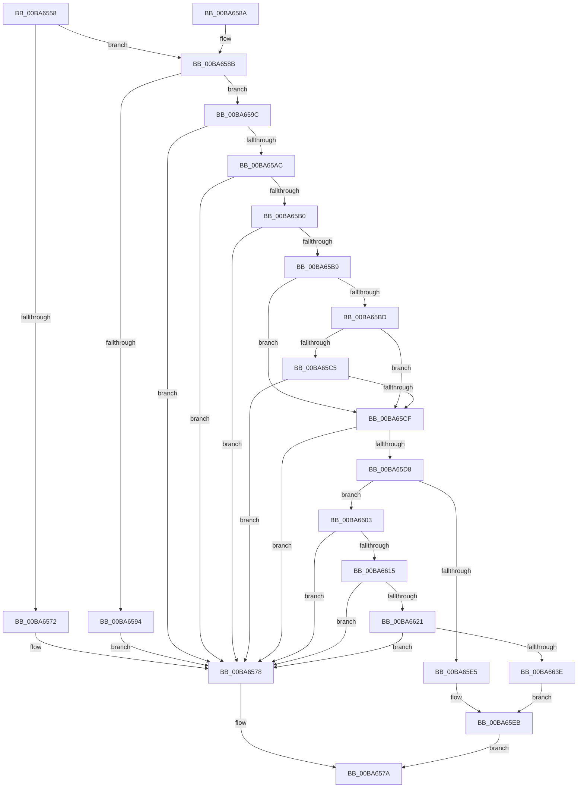

# VfFaultsInjectResourceFailure

- RVA: `0x00BA6558`–`0x00BA6646` (길이 `238` bytes)
- VA: `0x0000000140BA6558`
- 실행 섹션: `PAGEVRFY`
- PDB 이름 있음: `예`; PDB Function 태그: `아니요`
- unwind 정보 RVA: `0x000D25CC`
- 디코드: `63`개 명령, `238/238` bytes 표시
- 미해석 바이트: `0` (있으면 어셈블리에 `.byte`로 보존)

> 이 문서는 커널 이미지의 기계어와 PDB 기호를 분석해 생성했습니다. 4번과 5번은 함수 원형과 자료형을 바이너리 사용 방식에서 추정한 C 해석이며 원본 소스 복구 결과는 아닙니다.

## 1. Dependencies

- 직접 호출 지점: **4**; 고유 호출 대상: **4**
- 직접 호출자로 확인된 함수: **21**
- RIP 상대 이미지 참조: **11**

### Outgoing calls
- `0x00BA65B0` → [VfFaultsIsSystemSufficientlyBooted](VfFaultsIsSystemSufficientlyBooted_function_00BA664C.md) (function, `0x00BA664C`)
- `0x00BA65CF` → [ViFaultsIsCurrentAppTarget](ViFaultsIsCurrentAppTarget_function_00BA6D54.md) (function, `0x00BA6D54`)
- `0x00BA65DC` → [VfRandomGetNumber](../B9/VfRandomGetNumber_function_00B930CC.md) (function, `0x00B930CC`)
- `0x00BA65F4` → [ViFaultsInjectionNotification](ViFaultsInjectionNotification_function_00BA6BDC.md) (function, `0x00BA6BDC`)

### Direct callers
- [VerifierIoAllocateDriverObjectExtension](../B9/VerifierIoAllocateDriverObjectExtension_function_00B9ABA0.md) at `0x00B9ABCC`
- [VerifierIoAllocateErrorLogEntry](../B9/VerifierIoAllocateErrorLogEntry_function_00B9AC20.md) at `0x00B9AC3B`
- [VerifierIoAllocateIrp](../B9/VerifierIoAllocateIrp_function_00B9AC70.md) at `0x00B9AD14`
- [VerifierIoAllocateMdl](../B9/VerifierIoAllocateMdl_function_00B9AE70.md) at `0x00B9AE9B`
- [VerifierIoAllocateWorkItem](../B9/VerifierIoAllocateWorkItem_function_00B9AF30.md) at `0x00B9AF45`
- [VerifierIoSetCompletionRoutineEx](../B9/VerifierIoSetCompletionRoutineEx_function_00B9AFF0.md) at `0x00B9B01C`
- [VfFaultsInjectPoolAllocationFailure](VfFaultsInjectPoolAllocationFailure_function_00BA6480.md) at `0x00BA653A`
- [VfRlrsKeInjectStatusAlerted](VfRlrsKeInjectStatusAlerted_function_00BAF6F4.md) at `0x00BAF730`
- [ViRlrsMmProbeAndLockPages_Entry](ViRlrsMmProbeAndLockPages_Entry_function_00BAF7C0.md) at `0x00BAF7C6`
- [VerifierMmAllocateContiguousMemory](../BB/VerifierMmAllocateContiguousMemory_function_00BB0050.md) at `0x00BB006C`
- [VerifierMmAllocateContiguousMemorySpecifyCache](../BB/VerifierMmAllocateContiguousMemorySpecifyCache_function_00BB0160.md) at `0x00BB018C`
- [VerifierMmAllocateContiguousMemorySpecifyCacheNode](../BB/VerifierMmAllocateContiguousMemorySpecifyCacheNode_function_00BB0240.md) at `0x00BB026C`
- [VerifierMmAllocateContiguousNodeMemory](../BB/VerifierMmAllocateContiguousNodeMemory_function_00BB02F0.md) at `0x00BB031C`
- [VerifierMmAllocateMappingAddress](../BB/VerifierMmAllocateMappingAddress_function_00BB0370.md) at `0x00BB038B`
- [VerifierMmAllocateNodePagesForMdlEx](../BB/VerifierMmAllocateNodePagesForMdlEx_function_00BB03E0.md) at `0x00BB041A`
- [VerifierMmAllocateNonCachedMemory](../BB/VerifierMmAllocateNonCachedMemory_function_00BB04D0.md) at `0x00BB04E5`
- [VerifierMmAllocatePagesForMdl](../BB/VerifierMmAllocatePagesForMdl_function_00BB0510.md) at `0x00BB0546`
- [VerifierMmAllocatePagesForMdlEx](../BB/VerifierMmAllocatePagesForMdlEx_function_00BB05F0.md) at `0x00BB062A`
- [VerifierMmCreateMdl](../BB/VerifierMmCreateMdl_function_00BB06F0.md) at `0x00BB0717`
- [VerifierMmMapIoSpace](../BB/VerifierMmMapIoSpace_function_00BB0980.md) at `0x00BB09AF`
- [VerifierMmMapLockedPagesSpecifyCache](../BB/VerifierMmMapLockedPagesSpecifyCache_function_00BB0B30.md) at `0x00BB0BE6`

### Static image references
- `0x00BA6567` → RVA `0x00FFDAB0` (`PAGEVRFD`; read)
- `0x00BA6572` → RVA `0x00FFEF80` (`PAGEVRFD`; read/write)
- `0x00BA658B` → RVA `0x00FFDB04` (`PAGEVRFD`; read)
- `0x00BA6594` → RVA `0x00FFEFAC` (`PAGEVRFD`; read/write)
- `0x00BA659C` → RVA `0x00E0E93C` (`.data`; read)
- `0x00BA65A2` → RVA `0x00E0E938` (`.data`; read)
- `0x00BA65BD` → RVA `0x00F044F0` (`.data`; read)
- `0x00BA65C5` → RVA `0x00F044F4` (`.data`; read)
- `0x00BA65E5` → RVA `0x00FFEF98` (`PAGEVRFD`; read/write)
- `0x00BA6603` → RVA `0x00FFEF9C` (`PAGEVRFD`; read/write)
- `0x00BA663E` → RVA `0x00FFEFA0` (`PAGEVRFD`; read/write)

## 2. Other-region calls and transfers

- 다른 실행 섹션으로 향하는 call: **0**
- 별도 외부 분기/꼬리 이동을 확인하지 못했습니다.

## 3. Assembly (complete function range)

```asm
00BA6558  48 89 5C 24 08                  mov qword ptr [rsp + 8], rbx
00BA655D  48 89 74 24 10                  mov qword ptr [rsp + 0x10], rsi
00BA6562  57                              push rdi
00BA6563  48 83 EC 20                     sub rsp, 0x20
00BA6567  83 3D 42 75 45 00 00            cmp dword ptr [rip + 0x457542], 0
00BA656E  8B D9                           mov ebx, ecx
00BA6570  75 19                           jne 0x140ba658b
00BA6572  FF 05 08 8A 45 00               inc dword ptr [rip + 0x458a08]
00BA6578  33 C0                           xor eax, eax
00BA657A  48 8B 5C 24 30                  mov rbx, qword ptr [rsp + 0x30]
00BA657F  48 8B 74 24 38                  mov rsi, qword ptr [rsp + 0x38]
00BA6584  48 83 C4 20                     add rsp, 0x20
00BA6588  5F                              pop rdi
00BA6589  C3                              ret
00BA658A  CC                              int3
00BA658B  83 3D 72 75 45 00 00            cmp dword ptr [rip + 0x457572], 0
00BA6592  74 08                           je 0x140ba659c
00BA6594  FF 05 12 8A 45 00               inc dword ptr [rip + 0x458a12]
00BA659A  EB DC                           jmp 0x140ba6578
00BA659C  8B 3D 9A 83 26 00               mov edi, dword ptr [rip + 0x26839a]
00BA65A2  8B 35 90 83 26 00               mov esi, dword ptr [rip + 0x268390]
00BA65A8  85 FF                           test edi, edi
00BA65AA  74 CC                           je 0x140ba6578
00BA65AC  3B FE                           cmp edi, esi
00BA65AE  77 C8                           ja 0x140ba6578
00BA65B0  E8 97 00 00 00                  call 0x140ba664c
00BA65B5  85 C0                           test eax, eax
00BA65B7  74 BF                           je 0x140ba6578
00BA65B9  85 DB                           test ebx, ebx
00BA65BB  75 12                           jne 0x140ba65cf
00BA65BD  39 1D 2D DF 35 00               cmp dword ptr [rip + 0x35df2d], ebx
00BA65C3  74 0A                           je 0x140ba65cf
00BA65C5  8B 05 29 DF 35 00               mov eax, dword ptr [rip + 0x35df29]
00BA65CB  85 C0                           test eax, eax
00BA65CD  74 A9                           je 0x140ba6578
00BA65CF  E8 80 07 00 00                  call 0x140ba6d54
00BA65D4  85 C0                           test eax, eax
00BA65D6  74 A0                           je 0x140ba6578
00BA65D8  8B D6                           mov edx, esi
00BA65DA  33 C9                           xor ecx, ecx
00BA65DC  E8 EB CA FE FF                  call 0x140b930cc
00BA65E1  3B C7                           cmp eax, edi
00BA65E3  73 1E                           jae 0x140ba6603
00BA65E5  FF 05 AD 89 45 00               inc dword ptr [rip + 0x4589ad]
00BA65EB  F7 DB                           neg ebx
00BA65ED  1B C9                           sbb ecx, ecx
00BA65EF  83 E1 02                        and ecx, 2
00BA65F2  FF C1                           inc ecx
00BA65F4  E8 E3 05 00 00                  call 0x140ba6bdc
00BA65F9  B8 01 00 00 00                  mov eax, 1
00BA65FE  E9 77 FF FF FF                  jmp 0x140ba657a
00BA6603  FF 05 93 89 45 00               inc dword ptr [rip + 0x458993]
00BA6609  81 FF 58 02 00 00               cmp edi, 0x258
00BA660F  0F 85 63 FF FF FF               jne 0x140ba6578
00BA6615  81 FE 10 27 00 00               cmp esi, 0x2710
00BA661B  0F 85 57 FF FF FF               jne 0x140ba6578
00BA6621  48 B8 20 03 00 00 80 F7 FF FF   movabs rax, 0xfffff78000000320
00BA662B  48 8B 00                        mov rax, qword ptr [rax]
00BA662E  25 FF 7F 00 00                  and eax, 0x7fff
00BA6633  3D 00 04 00 00                  cmp eax, 0x400
00BA6638  0F 83 3A FF FF FF               jae 0x140ba6578
00BA663E  FF 05 5C 89 45 00               inc dword ptr [rip + 0x45895c]
00BA6644  EB A5                           jmp 0x140ba65eb
```

## 4. C-style interpretation (structured pseudocode)

```c
__int64 __fastcall VfFaultsInjectResourceFailure(int a1)
{
    __int64 result;
    __int64 v_rbx;
    __int64 v_rsp;
    unsigned __int64 v_stack_p10;
    unsigned __int64 v_stack_p8;

    v_stack_p8 = v_rbx;
    v_stack_p10 = v_rsi;
    v_rsp = (v_rsp) - (32);
    if ((*(unsigned int *)(v_rip + 4552002)) != 0) goto loc_00BA658B;
loc_00BA6578:
    result = 0;
loc_00BA657A:
    v_rsp = (v_rsp) + (32);
    return result;
loc_00BA658B:
    if ((*(unsigned int *)(v_rip + 4552050)) == 0) goto loc_00BA659C;
    goto loc_00BA6578;
loc_00BA659C:
    if ((unsigned int)((unsigned int)(*(unsigned int *)(v_rip + 2524058))) == 0) goto loc_00BA6578;
    if (((unsigned int)((unsigned int)(*(unsigned int *)(v_rip + 2524058)))) > ((unsigned int)((unsigned int)(*(unsigned int *)(v_rip + 2524048))))) goto loc_00BA6578;
    result = VfFaultsIsSystemSufficientlyBooted(a1, a2, a3, a4);
    if ((unsigned int)(result) == 0) goto loc_00BA6578;
    if ((unsigned int)(v_stack_p8) != 0) goto loc_00BA65CF;
    if ((*(unsigned int *)(v_rip + 3530541)) == ((unsigned int)(v_stack_p8))) goto loc_00BA65CF;
    if ((unsigned int)((unsigned int)(*(unsigned int *)(v_rip + 3530537))) == 0) goto loc_00BA6578;
loc_00BA65CF:
    result = ViFaultsIsCurrentAppTarget(a1, a2, a3, a4);
    if ((unsigned int)(result) == 0) goto loc_00BA6578;
    a1 = 0;
    result = VfRandomGetNumber(a1, (unsigned int)((unsigned int)((unsigned int)(*(unsigned int *)(v_rip + 2524048)))), a3, a4);
    if (((unsigned int)(result)) >= ((unsigned int)((unsigned int)(*(unsigned int *)(v_rip + 2524058))))) goto loc_00BA6603;
loc_00BA65EB:
    v_rbx = (unsigned int)(-(v_stack_p8));
    a1 = (unsigned int)((a1) & (2));
    a1 = (unsigned int)((a1) + 1);
    result = ViFaultsInjectionNotification(a1, (unsigned int)((unsigned int)((unsigned int)(*(unsigned int *)(v_rip + 2524048)))), a3, a4);
    goto loc_00BA657A;
loc_00BA6603:
    if (((unsigned int)((unsigned int)(*(unsigned int *)(v_rip + 2524058)))) != 600) goto loc_00BA6578;
    if (((unsigned int)((unsigned int)(*(unsigned int *)(v_rip + 2524048)))) != 0x2710ULL) goto loc_00BA6578;
    result = (unsigned int)((*(unsigned __int64 *)(1)) & (0x7FFFULL));
    if (((unsigned int)(result)) >= 0x400ULL) goto loc_00BA6578;
    goto loc_00BA65EB;
}
```

## 5. (Beta) C Style

```c
int64_t VfFaultsInjectResourceFailure(int32_t Arg1)
{
    int64_t result;
    int64_t local_rbx;
    int64_t local_rsp;
    uint64_t v_stack_p10;
    uint64_t v_stack_p8;

    v_stack_p8 = local_rbx;
    v_stack_p10 = local_rsi;
    local_rsp = (local_rsp) - (32);
    if ((*(uint32_t *)(v_rip + 0x457542)) != 0) goto loc_00BA658B;
loc_00BA6578:
    result = 0;
loc_00BA657A:
    local_rsp = (local_rsp) + (32);
    return result;
loc_00BA658B:
    if ((*(uint32_t *)(v_rip + 0x457572)) == 0) goto loc_00BA659C;
    goto loc_00BA6578;
loc_00BA659C:
    if ((uint32_t)((uint32_t)(*(uint32_t *)(v_rip + 0x26839A))) == 0) goto loc_00BA6578;
    if (((uint32_t)((uint32_t)(*(uint32_t *)(v_rip + 0x26839A)))) > ((uint32_t)((uint32_t)(*(uint32_t *)(v_rip + 0x268390))))) goto loc_00BA6578;
    result = VfFaultsIsSystemSufficientlyBooted(Arg1, a2, a3, a4);
    if ((uint32_t)(result) == 0) goto loc_00BA6578;
    if ((uint32_t)(v_stack_p8) != 0) goto loc_00BA65CF;
    if ((*(uint32_t *)(v_rip + 0x35DF2D)) == ((uint32_t)(v_stack_p8))) goto loc_00BA65CF;
    if ((uint32_t)((uint32_t)(*(uint32_t *)(v_rip + 0x35DF29))) == 0) goto loc_00BA6578;
loc_00BA65CF:
    result = ViFaultsIsCurrentAppTarget(Arg1, a2, a3, a4);
    if ((uint32_t)(result) == 0) goto loc_00BA6578;
    Arg1 = 0;
    result = VfRandomGetNumber(Arg1, (uint32_t)((uint32_t)((uint32_t)(*(uint32_t *)(v_rip + 0x268390)))), a3, a4);
    if (((uint32_t)(result)) >= ((uint32_t)((uint32_t)(*(uint32_t *)(v_rip + 0x26839A))))) goto loc_00BA6603;
loc_00BA65EB:
    local_rbx = (uint32_t)(-(v_stack_p8));
    Arg1 = (uint32_t)((Arg1) & (2));
    Arg1 = (uint32_t)((Arg1) + 1);
    result = ViFaultsInjectionNotification(Arg1, (uint32_t)((uint32_t)((uint32_t)(*(uint32_t *)(v_rip + 0x268390)))), a3, a4);
    goto loc_00BA657A;
loc_00BA6603:
    if (((uint32_t)((uint32_t)(*(uint32_t *)(v_rip + 0x26839A)))) != 600) goto loc_00BA6578;
    if (((uint32_t)((uint32_t)(*(uint32_t *)(v_rip + 0x268390)))) != 0x2710ULL) goto loc_00BA6578;
    result = (uint32_t)((*(uint64_t *)(1)) & (0x7FFFULL));
    if (((uint32_t)(result)) >= 0x400ULL) goto loc_00BA6578;
    goto loc_00BA65EB;
}
```

## 6. Execution-region graph

[열기: 2D/3D 그래프와 함수 탐색 컨트롤 패널](../../../control-panel.html?section=pagevrfy&rva=0x00BA6558&view=graph)

- 2D 그래프는 위에서 아래로 흐르고, 3D 그래프는 빈 공간을 드래그해 회전합니다. Shift+드래그는 이동, 휠은 확대·축소, 함수 노드 선택은 대상 보고서 이동입니다.

### Static fallback


